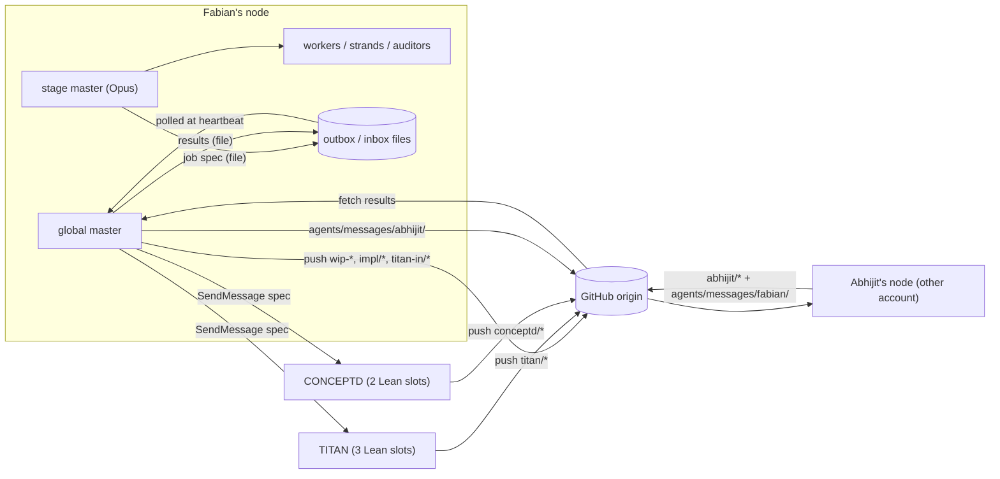

<!-- SPDX-License-Identifier: CC-BY-4.0 -->
<!-- Copyright (C) 2026 Fabian Januszewski, Abhijit (the Langlandscape team) -->

All times PST (UTC−8). Source logs: all machines on Berlin time (CET, UTC+1), report sources in UTC; converted.

# Architecture

## 1. Nodes
| Node | Hardware (source: `agents/rules/resources.md`) | Session | Role |
|---|---|---|---|
| **Fabian's node** (localhost, WSL2) | 32 threads, 82 GB RAM, `/mnt/c` 182 GB free at start; RTX PRO 6000 Blackwell Max-Q 96 GB (log 12:53 PST) | "JL MASTER RZN" (the global master) | orchestration, all agents, merges, pushes; LaTeX/Python. **Local Lean switched off** from ≈ 07:52 PST (log 07:50 PST: CPU/GPU reserved for HACS 0.2.1, `resources.md` TEMPORARY) |
| **TITAN** | 16 threads, 94 GB, 708 GB disk | helper session "TITAN" | Lean build node #1, 3 slots (ready 01:35 PST; import build 6:43 wall) |
| **CONCEPTD** | i7-10875H 8C/16T, WSL 25 GiB (+7 GiB swap) after a raise from 15 GiB, RTX 2080S | helper session "CONCEPTD" | Lean build node #2, 2 slots (ready 11:48 PST; import 6:45, warm build 2:04, peak 5.2 GiB) |
| **Abhijit's node** | notebook i5-1235U, 12 threads, 15 GB (≈ 4 GB free), 107 GB | own Claude session, **other account** (own quota; "28 % of a 5-h window" on 2026-11-14, STATE.md) | remote WPs (maths chapters, literature, Mathlib-only Lean drafts), **cross-account blind reviews**, `summary/`; 3–4 Opus agents; git channel only; may run direct `lean` draft checks of Mathlib-only files |

Lean build nodes are set up by `agents/roles/lean_build_node.md`: a frozen Mathlib copied from an existing node (no downloads),
wrapper scripts only, results pushed only to `titan/<job>` / `conceptd/<job>`.

### 1a. Cross-node process (stages 3–6)
- **Fabian's node** runs the global master (session "JL MASTER RZN"), every stage master, all writers and auditors, and both HACS lane masters (`hacsA`, `hacsB` worktrees); only it pushes `wip-*`, `impl/*` and merges into `main`. Local Lean is off (`resources.md` TEMPORARY); CPU/GPU is for HACS.
- **TITAN** (3 slots) and **CONCEPTD** (2 slots, WSL 25 GiB) are **Lean build nodes** driven by the global master over `SendMessage` (cross-session socket, prompt). Job flow (`resources.md`, `orchestration.md`, `master_resume.md` §3): stage master commits `outbox/<UTC>_<id>.md` → global master pushes the branch and relays the spec → node builds through wrappers → pushes **only** `titan/<job>` or `conceptd/<job>` (`.titan/out/*`) → global master writes `inbox/<UTC>_<job>.md` (verbatim errors) → stage master reads. Two nodes with single-WP lettered jobs ran in parallel from stage 3 (e.g. int6/int6a, int10/int10r); final gates run from scratch on TITAN with a fresh cross-check on CONCEPTD. Result branches by 2026-11-14 ~18:10 PST: 107 `titan/*`, 68 `conceptd/*`. CONCEPTD also builds **acceptance jobs** for Abhijit's Lean drafts (`acc-b34-1`, `acc-b5-1`).
- **Abhijit's node** has its own Claude account, so no `SendMessage` reaches it: all traffic is git files in `agents/messages/{abhijit,fabian}/` (rule file `messages.md`; filename `YYYYMMDD-HHMMSSZ_<from>_<slug>.md`, front matter id/from/to/type/re/priority; archive after processing; 134 messages by 2026-11-14 ~18:10 PST; polled every 10 min). The global master delegates **batches** (1–7 sent: S06 Lean WPs L1–L17, S03–S06 chapters, literature, then cross-account reviews; batch 8 = review of the final report and talk). Deliveries come on `abhijit/*` branches, **accepted only after a TITAN/CONCEPTD build**, then merged by the stage master. Cross-account **blind reviews** (s01, s02, s03, s05 chapters; S06-M5 second reader; PARI check F4) were the independent reading that changed the `q ≡ −1` statement twice. Abhijit's node also maintains `summary/` on `abhijit/summary`, merged by the global master after each stage.
- Stage-4 incident class: his import-minimisation merge arrived mid-stage (hold 14:07 PST, gate 14:21 PST) and a message order mismatch; the committed outbox note, not message order, is authoritative (`runs/s04.md` lesson 7).

## 2. Agent hierarchy
```
global master (Fabian's node; Opus; never does work itself, keeps only conclusions)
 ├─ planning masters (Opus): staged plan (P1), implementation plans (P3), re-plan, HACS plan
 ├─ stage masters (Opus): stage1-master, stage2-master, stage3-master …   (one per stage, on wip-implementation)
 │    ├─ track sub-coordinators (Opus): M (maths), C/T (code+talk) lane, S06 early lane
 │    │    └─ workers (Haiku / Sonnet / Opus; ≤ 8 concurrent per delegating agent)
 │    ├─ Lean WP workers (one worktree + branch impl/sNN-<wp> each)
 │    ├─ experiment strands (exp/sNN-<wp>-<model>, paired models, blind audits)
 │    └─ auditors (Opus WP audits; Fable Lean + chapter audits, in parallel)
 ├─ build jobs → TITAN (3 slots), CONCEPTD (2 slots)    [separate sessions, relayed by the global master]
 ├─ one-off agents: scouts (Lean repos, read-only via gh api), abhijit-dispatch, licensing, model-policy, process-docs
 └─ Abhijit's node (its own master + 3–4 Opus agents)   [git messages only]
```
Rules (`agents/roles/global_master.md`, `agents/rules/orchestration.md`): subagents commit, never push; only the global master
pushes and merges into `main`; each master/coordinator has its own worktree under `…/Langlandscape-wt/`; reports ≤ 30 lines,
detail in files. Subagent cap: 3, raised to 8 per delegating agent at 07:32 PST (Fabian); Fable may run in parallel (09:22 PST). Stages 3–6 additionally had HACS lane masters (Opus, `impl/hacs-laneA`, `impl/hacs-laneB`, ≤ 4 subagents at once) next to the stage master, and from ≈ 18:01 PST (2026-11-14) a **final-integration master** (Opus, branch `wip-final`/`final/*`, worktrees under `…-wt/`) for the report, `docs/agentic-process/`, the talk consistency pass and release notes.

## 3. Communication channels
| Channel | Between | Mechanism | Observed reliability |
|---|---|---|---|
| In-session teammate messages | global master ↔ its own subagents/teammates | `SendMessage` to "team-lead"/"main" | **delayed by hours**: a burst of messages from 02:52–08:51 PST arrived at 09:53 PST (log; lesson in `global_master.md`); one job batch lost at 08:49 PST |
| Cross-session messages | global master ↔ TITAN, CONCEPTD (same account, different machines) | `SendMessage` to a session name (uds socket) | prompt |
| **File outbox / inbox** | stage master ↔ global master | committed files `plan/implementation/outbox/<UTC>_<id>.md` (job specs, status, closures) and `inbox/<UTC>_<job>.md` (verbatim build results), polled at every heartbeat | prompt; primary since 08:49 PST (decision F11) |
| **Git message inboxes** | Fabian's node ↔ Abhijit's node (different accounts) | `agents/messages/{fabian,abhijit}/<UTC>_<from>_<slug>.md` on `main`, archived after processing (`agents/rules/messages.md`); polled by a cron every 10 min | reliable; 39 messages so far |

**Why the file channels became primary.** In-session messages were the only channel that failed (lost/delayed), while files
in git and the cross-session socket arrived promptly. Since F11 every job spec, status and closure is a committed file and
`SendMessage` is only a notification ("outbox: <file>"), never the payload. Files also leave an audit trail for this write-up.

Job relay (`agents/roles/master_resume.md` §3): stage master writes the outbox spec → global master pushes the branch (or a
neutral `titan-in/<id>` ref for experiment strands) → sends the node a self-contained spec → node pushes `titan/<id>` →
global master writes the inbox file (verbatim errors, no fix hints for strands) and notifies the stage master.

Two crons drive the global master (STATE.md): heartbeat at minutes 7 and 37 (disk/RAM, agent status, next phase, commit/push,
one log line) and inbox check every 10 min (`git pull --no-rebase`).

## 4. Branch families
| Family | Purpose | Written by | Merged? |
|---|---|---|---|
| `main` | integrated state; agents/, messages | global master only | — |
| `wip-plan`, `wip-mathematics`, `wip-lean`, `wip-code`, `wip-talk` | per-directory work (planning used `wip-plan`) | coordinators | → `main` by global master |
| `wip-implementation` | stage execution, spans all track dirs | stage master | → `main` at stage end |
| `impl/sNN-<wp>`, `impl/sNN-int<k>` | WP drafts; integration rounds (top commit = `.titan/` spec only, never merged) | WP workers; stage master | WPs → `wip-implementation` after a green round |
| `exp/sNN-<wp>-<model>` | experiment strands | strand agents | at most one strand merged; **local only, never pushed** |
| `titan-in/<job>` | neutral temporary refs for strand jobs (no model names) | global master | deleted after fetch |
| `titan/<job>`, `conceptd/<job>` | build results (`.titan/out/*`) | build nodes | never merged; read only |
| `abhijit/<wp>` | remote packages (may stack on each other) | Abhijit's node | fetched, accepted by a TITAN/CONCEPTD build, merged by stage master |

On `origin` (`git ls-remote origin`, 2026-11-14 ~18:10 PST): 107 `titan/*`, 68 `conceptd/*`, 129 `impl/*`, 37 `abhijit/*`, 3 `doc/*`, 6 `wip-*`, `main` (2026-11-14 13:00 PST it was 48 / 10 / 37 / 13). HACS and doc branches: `impl/hacs-laneA`, `impl/hacs-laneB`, `doc/hacs-*`.

## 5. Diagram

