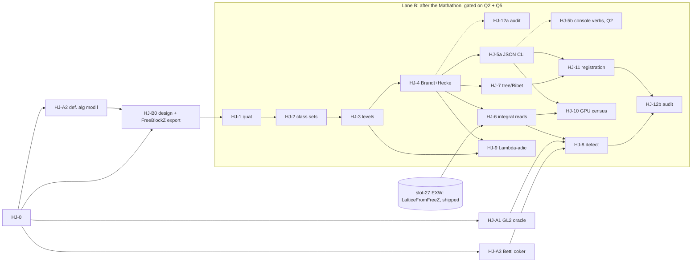

<!-- SPDX-License-Identifier: CC-BY-4.0 -->
<!-- Copyright (C) 2026 Fabian Januszewski, Abhijit (the Langlandscape team) -->
# HACS–JL plan: the definite side and the transfer comparison in HACS

Status: **plan only** (wip-plan, 2026-11-14). Nothing is implemented here. Inputs read: `code/hacs/` (seed of HACS 0.2.1),
`plan/staged/` (SPLIT.md, stage tex), `plan/implementation/stage-0{1..6}.md`, `experiments/SUMMARY.md`, and the impl worktree
(`/home/janosch/dev/Langlandscape-wt/impl`: `code/results/`, `code/python/langlandscape/`, `code/hacs/jl/s03_h1_rerun.py`).
Paths below are relative to the repository root unless they start with `src/` or `docs/` (those are relative to `code/hacs/`).
Tags: *shipped* = in the HACS seed; *ours* = in the impl worktree; *missing* = neither has it.
**Revision 2026-11-15 (slot 27):** after a read of HACS slot 27 and `docs/jl_exchange/` (§7), Lane B is re-timed to after the
Mathathon implementation and re-designed around slot-27 interfaces and discipline; changes are marked "(rev. 2026-11-15, slot 27)"
in §1.2, §3, §4 (Lane B, §4.1, §4.2), §6 and in the new §7. Lane A content is unchanged.

---

## 1. What HACS has, and what it does not have

### 1.1 Shipped capabilities (the indefinite / GL₂ side)

| Capability | Where (file / verb / contract label) | Rings |
|---|---|---|
| Orbifold cohomology of SL₂(ℤ) with Sym^n, on the 7-vertex model | `sl2z_model`, `symmetric_power`, `cohomology`; `src/hacs/EquivariantCohomologyOnK.*`; [C] def:model7, def:rhon | F_ℓ, ℤ/ℓ^k |
| Level Γ₀(N), Γ₁(N), (Γ₀(N), χ) by Shapiro on the induced fibre ℝ[P¹(ℤ/N)] ⊗ Sym^n | `level_n(N,n,ℓ,primes)`, `nebentypus(...)`; `src/hacs/Hecke/HeckeLevelN*.h`, `HeckeNebentypus.*`, `HeckeCosetTables.*`; [C] def:levelNmodel, def:cosetrepsN | F_ℓ |
| Hecke T_p (p ∤ N), U_p (p ∣ N) via Manin–Merel Heilbronn matrices | [C] prop:heilbronn; classical normalisation (no 1/p, no p^{k/2−1}) | F_ℓ, ℤ |
| General correspondences [A g B], incl. trace/projection (degeneracy-type) maps on the induced fibre | [C] prop:levelcorrespondence (4)(b)–(d) *specified*; built at N = ℓ (`Hecke/HeckeLevelEll`: degeneracy and fibre maps, prop:oldspace, stabilisation) and as Res/Cores to level 1 on modular symbols (`HeckeExt/LValue/Gamma0NShapiro.h`) | F_ℓ, ℤ/ℓ^m |
| Integral descent over ℤ: H^q(Γ₀(N); Sym^n ℤ²) with torsion, char_ℤ(T_p), torsion Hecke modules, exported integer T_p on H¹/tors | `descent(N,n,primes)` under `coefficient_ring = "Z"`, `.module(ℓ,K)`, `.module_Z()`; `src/hacs/Integral/Descent/*` (Smith form `DescentSmith.h`, GPU `DescentSmithGpu.*`); [C] thm:descentcert, prop:torsionhecke | ℤ, ℤ/ℓ^K |
| Integral Hecke structure: certified generation, maximal ideals, local type (Gorenstein, Loewy, embdim), congruence modules C_T, Eisenstein certificate | `hecke_structure(N,n,"full"/"anemic")`; `src/hacs/Integral/HeckeZ{Rational,Local,Record,Up,Tor}.*`; [C] sec:heckeZ, prop:heckeZcong, prop:heckeZeiscert | ℤ_(ℓ) |
| U_p, p ∣ N, over ℤ_(ℓ) inside the record (full algebra) | `Integral/HeckeZUp.h` (slot-26 Z1/Z2); its matrices only through an **owner-gated emitter** (`UpDumpOptions`) | ℤ_(ℓ) |
| Mod-ℓ algebra toolkit on arbitrary commuting matrices | `algebra`, `commutant`, `algebra_invariants`, `is_local`, `socle`, `tangent_space`, `loewy`, `radical`, `charpoly`, `minpoly`, `jordan_type`, `kernel`, `intersect` (console, group `arithmetic`/`extension`) | F_p only (`Matrix` = `FlatMatrixT<uint32_t>`) |
| Hida theory, tame level 1 | `hida_tower(n,ℓ,m)`, `hida_lambda(ℓ,k,W)`; `HeckeExt/HeckeLambdaTower.h`, `HeckeHidaTower`; [U] | ℤ/ℓ^K, Λ/(ℓ^K, Ω_r) |
| Matrix engine | `src/ModArithmetic/` (`ModCtx`, `DenseElim` rref/kernel/solve, Smith over ℤ/2^k, ℤ/3^k ladders, RNS/Garner), `src/Engine/` (tape, program cache), `src/Cuda/` (u32/u64 GEMM, batched GEMM, IMMA int8 GEMM and device rref for p ≤ 127); contract `src/ModArithmetic/ENGINE_API.md` | F_p, ℤ/ℓ^k |
| Number-field utilities | `src/hacs/NumberField/` (`BigInt`, `BigRational`, `Lll`, `IntPolyFactor`, `Polred`) | ℤ, ℚ |
| Console + scripts | `hacs --script f.oc`, `--serve`; JSON via `json(...)`; `docs/console/console.md` | — |

Already exercised for JL: `docs/jl_exchange/hacs-answers/` (Task 0: Δ/g congruence Z/17 at D = 3, k = 12; level-raising primes
for D ≤ 13; Task 1 v6: the amalgam SL₂(ℤ[1/p]) Mayer–Vietoris, coker α torsion Eisenstein only, coker(α*α) = (ℤ/l^v)²), and
*ours* `code/hacs/jl/s03_h1_rerun.py` (impl worktree): `descent` with `coefficient_ring = "Z"` reproduced C5's det(Ψ*Ψ) table on
14 cases and the q = 11 Mazur number 5 (`code/results/s03/C3_rerun.json`).

### 1.2 Missing in HACS (each item is cited from the seed's own statements)

1. **No quaternion code at all** (`task1_v6/README.md`, "Feasibility: Task 2"; `grep` over `src/` finds no quaternion order,
   class set or Brandt matrix). The HACS-side "definite module" (M8 / S1b / S2 of the v6 request) is *tracked, not carded* in
   `docs/implementation/slot27/00-slot27-plan.md` l. 127, 530.
2. **W_p** is not implemented (`task0_inscope/results.md` §0; values were derived from U_p).
3. **Degeneracy map α and α*α over ℤ** are not exposed (`task1_v6/README.md`: "α and α*α are not exposed by HACS, so they were
   computed independently in Python", `task1_v6/scripts/amalgam.py`).
4. **U_ℓ at level N with ℓ = coefficient prime** is refused by `level_n`; integral U_p at level 3p^r is not reachable
   (`task0_inscope/results.md` §3, §4). Hida tools are **tame level 1 only** (same, §4).
5. **Integral U_D matrices** sit behind an owner-gated emitter; `G3.C_T[U_D] = not_run` in the record (same, §4).
6. **Console `Matrix` is F_p only** and the console has **no file reader** for matrices: integer / ℤ/ℓ^K matrices from outside
   cannot be fed to `hecke_structure`-style integral reads. Those reads consume a `heckez::local::LatticeModule`
   (`Integral/HeckeZLocal.h`, "INPUT. A LATTICE MODULE: L/ℓ^K = (ℤ/ℓ^K)^D with the matrices of T_p") assembled only from
   HACS's own cohomology (`HeckeExt/HeckeZLocalSource.h`). The shape is exactly that of a Brandt lattice, but there is no
   external source. *(rev. 2026-11-15, slot 27)* Partly superseded: slot-27 EXW added `LatticeFromFreeZ`
   (`Integral/HeckeZLocal.h:200–207`, `.cpp:741`), which builds the `LatticeModule` from a `FreeBlockZ` of exact integer
   matrices (`Integral/Descent/DescentModuleExportZ.h:140`, `F` per operator r×r, `nf::BigInt`) and feeds `ReadLocal`. That is an
   in-process entry point for **any** free ℤ-lattice with commuting integer T_p, a Brandt lattice included. It is still not
   reachable from the console or from a file, so items 6 and 7 still rule out Leg A for integral reads.
7. Most Hecke/Integral code is compiled **into the executable** `cohomology_app`, not into a library (`CMakeLists.txt`
   l. 583 ff.; libraries are only `ModArithmetic`, `MatrixEngine`, `HeckeCore`, `EngineCuda`, `ConsoleCore`, `NumberField`).
   So the integral machinery can be reused **only in-tree**.

---

## 2. What the JL transfer needs (by stage, with existing coverage)

| Need | Stage / test | Covered now by | Gap |
|---|---|---|---|
| Definite B_D (ω(D) odd), maximal and Eichler orders, class sets X_B(U), Γ_x, w_x, Eichler mass Σ1/\|Γ_x\| = (1/24)∏(p−1) | S01 H1; `if:s01-classset`, `if:s01-mass` | *ours* `quat.py`, `classset.py`, `levels.py` (D ≤ 60 + 66, 70, 78; \|S_s\| = 2, 50, 1250) | scale (q ≳ 500), U_1(Mp^s) for s ≥ 4 |
| Brandt modules M(U; V_k) = ⊕ V_k^{Γ_x}, T_ℓ, S_ℓ, U_ℓ, ⟨d⟩, U_p (N_{U_p}), Π_ℓ (ℓ ∣ D), pairing ⟨[x],[y]⟩ = w_xδ_xy | S01 H2/H4/H5; `if:s01-brandt`, `if:s01-hecke` | *ours* `brandt.py`, `symn.py` (exact over ℚ(√a), D ≤ 13, k ≤ 12), `up.py`, `pi_ell.py` | integral Sym^n over ℤ/ℓ^K and ℤ; larger D, k |
| Comparison: Hecke-equivariant match of eigensystems with S_k(Γ₀(DM))^{D-new} (charpoly / trace), Π_q ↔ U_q sign | S01 H2, S05 T05-1/T05-2 | *ours* against PARI `mf` (`symn.json` 66/66, `pi_sign.json` all +) | HACS as the GL₂ oracle (integral, larger range) |
| Tree quotients: s₀, s₁, s_j^*, s_{j*}, two-term complex, H₁(Γ_U, V_k) | S02 H02.1–5 | *ours* `tree.py`, `twoterm.py`, `results/s02/*` | scale only |
| Ribet sequence, weighted graphs, Φ^comb, Mazur num((q−1)/12), Ihara (coker α Eisenstein) | S03 T1, T2, T6 | *ours* `ribet/*.py`, `results/s03/T{1,2,6}.json` | Mazur census over many q (Python T1 took 48 s for q ≤ 131) |
| GL₂ amalgam, Ψ*Ψ = [[q+1, −q^{2−k}λ], [−λ, q+1]], coker(Ψ*Ψ)_m | S03 C5/H1, S06 T4 (H1) | *ours* `betti.py` (PARI), HACS charpolys (H1); exchange `amalgam.py` | coker(Ψ*Ψ)_m **over ℤ_(ℓ) as a module** (needs α); k up to 124 at q = 3, p = 17 |
| Integral: η^B (Gram determinant on the q-new Brandt module at m), η_f(q), η_f(1,q), 𝔠_q, Gorenstein test, character / component groups | S06 T5, H3; v6 Task 2(a)–(c) | *ours* planned S06-C1/C5 (Python, PARI `matsnf`) | certified local reads (HACS-grade), W_p integral, quaternionic Ihara cokernel torsion |
| Λ-adic: U_p towers on S_s, ordinary projector e, Λ-ranks constant in s, Λ-adic Ribet ranks; compare with GL₂ ordinary ranks | S04 T3, H6, H7, C2 | *ours* `up.py` (s ≤ 3) | s ≥ 4 (\|S_4\| = 31 250), GL₂ side at tame level D (HACS: level 1 only) |
| Iwahori trace tr(T_n U_p^m), Ohta-twisted pairing (seed T7) | S05 T05-4 (not scheduled) | — | GL₂ U_p at level qp^s in HACS (item 1.2.4) |

---

## 3. Architecture

### 3.1 Two legs

**Leg A — Python bridge (now).** Our Python package stays the definite side for every stage test that already has a C-WP.
HACS is driven through `hacs --script` exactly as `s03_h1_rerun.py` does (generate `.oc`, parse `@@TAG json` lines). Uses:
(i) GL₂ oracle: `descent(DM, k−2, P)` char_ℤ(T_p) → D-new charpolys by removing old multiplicities; `level_n` mod ℓ incl. U_p
(p ∣ N); `hecke_structure` congruence modules; (ii) mod-ℓ structure of the **definite** Hecke algebra: Python emits Brandt
matrices mod ℓ as `matrix(p, rows)` literals and HACS returns `algebra_invariants`, `is_local`, `socle` (Gorenstein),
`loewy`, `jordan_type`, `minpoly`. Zero C++; limited to F_p and to sizes a script literal can carry (≈ 10⁴ entries comfortable).

**Leg B — native module `code/hacs/src/jl/` (C++17, optional CUDA, in-tree).** Needed for (a) integral, certified reads on
Brandt lattices (item 1.2.6–7: only reachable in-process), (b) scale (q up to ~10⁵, towers s ≥ 4, weights k ≤ 60),
(c) GPU. It mirrors HACS's own induced-fibre design: the Brandt module at U₀(M) is ⊕_x (ℤ/ℓ^K[P¹(ℤ/M)] ⊗ Sym^n)^{Γ_x}, the
definite analogue of [C] def:levelNmodel's Ind V = R[P¹(ℤ/N)] ⊗ Sym^n, with ρ_n of [C] def:rhon (column convention).

**Recommendation: the hybrid, Leg A first, Leg B in parallel, cross-validated on the overlap.** Reasons: Leg A unblocks S04–S06
tests immediately on validated code (all of `code/results/s0{1,2,3}`); Leg B is the only route to HACS's certified integral
machinery and to GPU scale, and the Python results are its acceptance oracle. No stage WP waits for Leg B (tracks are
decoupled, SPLIT.md "Conventions for drafters" 3); Leg B results upgrade *computed* values to larger ranges and certified
integral statements.

*(rev. 2026-11-15, slot 27)* **Timing and shape of Leg B changed (§7.4).** Leg A runs now, as before. Leg B is split:
- **now, no C++ build:** HJ-B0, a slot-27-aligned design note plus a Python export of Brandt lattices in the `FreeBlockZ` shape;
- **after the Mathathon implementation:** HJ-1 … HJ-11, written as the HACS quaternion stage.

The quaternion stage is tracked in HACS but has no card (slot-27 plan §2.0, l. 126–128). Leg B will follow HACS's slot discipline:
- its own registration fragment;
- contract first;
- the box's heavy-job rule;
- golden data untouched.

Its integral reads go through EXW's `LatticeFromFreeZ` → `ReadLocal`, not through a private wrapper of `HeckeZLocal` internals.
Reasons: the box is the slot-27 box, the record word `certified` needs a refereed contract, and the upstream tree moves at the
slot-27 close (G27 flip, K2 fold).

### 3.2 Leg B module layout (namespace `hacs_jl`; every file new; upstream untouched except the hooks of §3.4)

| File (under `code/hacs/src/jl/`) | Content |
|---|---|
| `Quat.{h,cpp}` | B = (a,b)_ℚ definite, ω(D) odd (same `find_ab` rule as `quat.py`, so bases agree); exact arithmetic on `__int128` with `NumberField/BigInt` fallback; reduced norm/trace |
| `Lattice.{h,cpp}` | ℤ-lattices of rank 4 in HNF; product, intersection, colon, left/right order; Gram of nrd; LLL (`NumberField/Lll.h`) + Fincke–Pohst short vectors |
| `Order.{h,cpp}` | maximal order of B_D, Eichler order of level M, local splittings ι_M: O ⊗ ℤ/M ≅ M₂(ℤ/M) and ι_ℓ mod ℓ^K (Hensel) for ℓ ∤ D |
| `ClassSet.{h,cpp}` | left-ideal classes by ℓ₀-neighbour BFS, isomorphism test I ≅ J (an element of I⁻¹J of reduced norm nrd(I⁻¹J), found by short vectors; candidates bucketed by theta-series prefixes), Γ_x = O_r(I)^×, exact mass termination (`BigRational`) |
| `Level.{h,cpp}` | X_B(U) for U₀(M), U₁(N), U₀(q)U, U₁(Mp^s) as Γ_x-orbits on fibres (P¹(ℤ/M), (ℤ/N)² primitive vectors), w_x, the S_s tower maps π_{s+1,s} |
| `Brandt.{h,cpp}` | M(U; Sym^n) over F_p, ℤ/ℓ^K, ℤ: invariants via `engine::elim::kernel_basis`; T_ℓ, S_ℓ, U_ℓ, ⟨d⟩, U_p = N_{U_p}, Π_ℓ, W_ℓ as sparse block matrices (CSR of (n+1)×(n+1) blocks, int64/ℤ/ℓ^K entries); pairing with w_x and with \|Γ_x\| |
| `Tree.{h,cpp}` | s₀, s₁ (q-neighbour sublattice x_qαℤ_q²), s_j^*, s_{j*}, ∂ = (−s_{0*}, s_{1*}), α, αα†, weighted Gram, Φ^comb (Smith) |
| `Lattice2HeckeZ.{h,cpp}` | builds a `heckez::local::LatticeModule` from a Brandt lattice (+ T_ℓ list) and calls the shipped local reads / congruence-module rule (prop:heckeZcong). *(rev. 2026-11-15, slot 27)* It fills an `integral_descent::modexport::FreeBlockZ` (`F` per op, r×r row-major `nf::BigInt`, `F_fnv`, `basis_rule`, `proof`). It then calls `heckez::local::LatticeFromFreeZ(N=DM, n=k−2, ℓ, K, P, G, ops)` (EXW) and `ReadLocal(M, ReadOptions{r_eis, eis_rational, k_weight, full_algebra})`. `ReadLocal` is built around the Eisenstein ideal (λ_p = 1 + p^{k−1}), so it covers the Mazur/Eisenstein reads (k = 2: the constant function, T_p = p + 1). The cusp–cusp η^B needs our own Smith route (`DescentSmith`). `source` = `"free_block_z"` is kept; the JL origin is recorded in our JSON, not in a new HACS source word |
| `Ordinary.{h,cpp}` | e by image stabilisation of U_p mod p^m (sparse Krylov; dense GPU path), Δ_s-module rank |
| `JlBindings.cpp` | console verbs (below) |
| `JlValidation.{h,cpp}` | registered validations with frozen expected values from `code/results/` |
| `code/hacs/jl/cmake/JL.cmake` | source list (one `include()` hook). *(rev. 2026-11-15, slot 27)* Moved to `code/hacs/cmake/jl/JL.cmake`, with the registration in `code/hacs/src/hacs/Registry/JL/JL.cpp`. Both are the paths the seed's `CLAUDE.md` (l. 100–103) recommends for "a new JL validation … never by editing an upstream slot fragment", by the open-slot pattern of `docs/agent-guides/new-validation.md` l. 21–22 |
| *(rev. 2026-11-15, slot 27)* note on `Quat` | `__int128` arithmetic stays in `src/jl/`. `NumberField` must remain STL-only, with no `__int128` unless guarded by `-DNF_NO_INT128` (slot-27 plan §2.1 BIGNTT; `check_numberfield_includes.sh` runs in `--all`). Optional reuse of BIGNTT's `nf::bigntt` product for char_ℤ CRT at large n; it is not needed at D ≤ 13 |
| `code/hacs/jl/*.py` | Leg-A drivers (like `s03_h1_rerun.py`) |

Reuse, not re-implementation: `engine::elim` (rref, kernel, solve), `DescentSmith` (`maps::SmithFormBlocked`, ℤ/ℓ^k, ℓ^k < 2^31)
and its GPU twin, `heckez::CharpolyHessenberg` (F_ℓ, ℓ < 2^31), `HeckeZRational` CRT/Garner (`ZFromResidues`) for char_ℤ,
`engine::cuda` GEMM / batched GEMM / IMMA, `NumberField` (`BigInt`, `BigRational`, `Lll`, `IntPolyFactor`). Modulus limits are
inherited: u32 primes ≲ 2^27 (HACS CLAUDE.md), ℓ^K < 2^63 in `HeckeZLocal`.

### 3.3 Console verbs (new group `jl`) and data formats

`quat_algebra(D)`, `class_set(D, level)` (level as `{kind: "max"|"U0"|"U1"|"U0qU"|"U1Mps", M, N, q, p, s}`),
`brandt(D, level, n, ring, primes)` (ring `"Fp:ℓ"`, `"Zl:ℓ:K"`, `"Z"`; returns a handle with `.matrix(p)` (F_p: a console
`Matrix`), `.charpoly(p)` (exact over ℤ by CRT), `.json`), `brandt_pairing(...)`, `tree_quotient(D, level, q)`,
`jl_lattice_read(B, ell, K)` (the HeckeZLocal read on a Brandt lattice), `ordinary(B, p, m)`.
Exchange format: JSON `{provenance, data}` exactly as `code/python/langlandscape/results.py` (script, commit, params, date,
runtime_s; fractions as `"p/q"`); schema strings `langlandscape_classset/v1`, `langlandscape_brandt/v1` (matrices as
row-major lists of decimal strings, convention fields copied from `symn.json`'s `conventions` record), so `code/results/`
files from Leg A and Leg B are diffable by one comparison script.

*(rev. 2026-11-15, slot 27)*
- **`langlandscape_brandt/v1` gains a `free_block_z` record.** It holds the integer T_p matrices in the `FreeBlockZ` layout and in
  the `LatticeModule` column convention (T_p b_j = Σ_i F_ij b_i, as `module_Z()` exports; `task0_inscope/results.md` §0), plus
  `ops` and a `basis_rule` string. HJ-B0 writes it from Python now, and Leg B's `Lattice2HeckeZ` later reads the same fields.
- **GL₂-side record reads must carry the settings fingerprint and the θ order.** The θ flip (`lex` → `lex_then_greedy`,
  fingerprint `0x8ffc29730c4f9672` → `0x325b510edad11c8d`) gives every HeckeZ record a new id at G27 / edition 4
  (slot-27 plan §6 Q1). So any JSON that quotes a `hecke_structure` record id or word records the `default_fp` of the binary and
  `hz_theta_order`. The same holds for `G10.contract` (EISUPb writes `gl2_contract 1.28.0-pre.1` on every `full` record at N > 1).
- **Console verbs.** A new verb group changes the [P] console spec (3.15.0-pre.9) and the CLI tables. Whether it touches the
  ConsoleDet C4 (a) digest is unverified. So HJ-5 ships a JSON CLI first; the verb group waits for Q2.

### 3.4 Integration with the HACS tree (upstream edits kept to one-line hooks, each logged in `code/hacs/CHANGES.md`)

1. `CMakeLists.txt`: `include(jl/cmake/JL.cmake)` (appends `src/jl/*.cpp` to `cohomology_app`, option `OC_ENABLE_JL`, default ON).
   *(rev. 2026-11-15, slot 27)* → `include(cmake/jl/JL.cmake)` placed **after** the `cmake/slot27/*.cmake` includes
   (`CMakeLists.txt` l. 1409–1412), so that the slot-27 close fold (K2: `cmake/slot27/*` → `cmake/sources/*`) leaves our line in place.
   Option `OC_ENABLE_JL` defaults to **OFF** in the seed fork until HJ-11 is green. HACS's rule "no switch changes a computed value"
   holds trivially, since the JL code adds names and changes none.
2. `src/hacs/ValidationRegistry.cpp`: one call `RegisterJL()` (pattern of `Registry/Slot27/`).
   *(rev. 2026-11-15, slot 27)* → declared and called **after** `RegisterSlot27HeckeZEisUpChar()` (l. 409 / 1973), from
   `Registry/JL/JL.cpp`. The `--list` order of the 294 upstream names stays unchanged. We never edit `Registry/Slot27/*` or
   `cmake/slot27/*`: these are package-owned (`Registry/Slot27/README.md`).
3. Console registration: one call in `Console/Bindings/Bindings.cpp`.
4. Regenerated artefacts (`docs/latex/tools/gen_cli_manual_tables.sh`, `docs/console/gen_console_md.sh`,
   `docs/validation-catalogue.md` entry) per `docs/agent-guides/new-validation.md`, else `CliManualCoverageValidation` fails.
*(rev. 2026-11-15, slot 27)* Every Leg-B C++ WP also meets HACS's "every C++ package" row (slot-27 plan §0):
- `git diff <base> -- '*GoldenReference.inc'` is empty;
- `GOLDEN_STRICT=1` gives tier A 12154 / 0 and tier B 6231 / 0;
- the four digests are unchanged;
- `LABEL_CENSUS … unresolved=0 stale=0`, `ADD_SPDX_CHECK … verdict=OK`, `LicenceGuardValidation … verdict=OK`;
- `--all` is green at 246 + the JL names, and `CliManualCoverageValidation` and `ConsoleScriptValidation` pass.

The HeckeZ brief rule also applies: state the parallel decomposition, and add a route bit-identity arm (threads 1 vs N, CPU vs GPU).
Neither the HeckeZ default fingerprint nor any HZ record changes: Leg B never calls HZ-RAT or the record builder on its lattices.
Never touched: `GoldenReference.inc`, emitters, `code/hacs/lean/`, licence files. Fallback if Fabian refuses hooks (Q2): a
separate executable `hacs-jl` linking `ModArithmetic`, `MatrixEngine`, `EngineCuda`, `NumberField` only — then no
HeckeZLocal reads (HJ-6 drops to our own Smith/Gorenstein code) and no console integration (JSON CLI instead).

---

## 4. Work packages

Columns: goal · inputs → outputs · acceptance · deps · model (ladder) · wall min (agent-active / wall incl. builds; the first
full HACS build is **excluded**, see R6) · stage supported · when. Models per `experiments/SUMMARY.md` §3: sonnet routine
(sonnet → opus), opus hard (+1 planned opus fix), haiku mechanical, Fable audits.

### Lane A — bridge (Python + `hacs --script`; files in `code/hacs/jl/`, results in `code/results/sNN/`)

**HJ-0 — HACS inspection, decisions, API note** (= S01-H0). Build check on the other worker's build (read-only), confirm verbs of
§1.1 on the binary, record answers to Q1–Q3; write the integration note into `code/hacs/CHANGES.md` (planned hooks) and a short
`code/hacs/jl/README.md`. Accept: every verb of §1.1 called once in a smoke `.oc` (exit 0); Q1/Q2 answered or defaults logged.
Deps: HACS build present. sonnet · 20/30 · all · **first**.

**HJ-A1 — GL₂ JL oracle driver.** `jl/gl2_dnew.py`: for (D, M, k), `descent(DM, k−2, P)` → char_ℤ(T_p | H¹/tors) → D-new
cuspidal charpoly (divide out Eisenstein (x−(1+p^{k−1}))^c and old parts by the multiplicity σ₀(DM/d) rule, check perfect
squares as in `s03_h1_rerun.py`); U_q eigenvalues at q ∣ D from `level_n` mod several ℓ (CRT for small integers).
Out: `results/s05/gl2_dnew.json`. Accept: reproduces the RHS of `symn.json` on all 66 cases (D ∈ {2,3,5,7,11,13}, k ≤ 12)
and `pi_sign.json` (a_D = +λ(Π_D)); extended grid D ≤ 50, k ≤ 24 runs (no PARI needed). Deps: HJ-0. sonnet · 30/45 ·
S01 H2, **S05 T05-1** · with S05 X1.

**HJ-A2 — definite Hecke algebra mod ℓ through HACS.** `jl/definite_alg.py`: Python Brandt matrices (`symn.py`, `brandt.py`)
mod ℓ → `.oc` with `matrix(p, rows)` → `algebra_invariants`, `is_local`, `socle`, `loewy`, `minpoly` per maximal ideal.
Out: `results/s06/definite_local.json`. Accept: at B₁₁, k = 2, ℓ = 5 the Eisenstein ideal is non-étale (Mazur 5);
Gorenstein flags agree with S06-C1's Python test on all its toys; at D = 3, 5, 7, k = 12 the definite algebra has **no**
non-étale m at 17, 29/131, 1051 (the level-raising primes are old/new congruences, invisible on the D-new definite side —
a negative control). Deps: HJ-0. sonnet · 25/40 · S06 T5, S05 T05-5 · with S06 X1.

**HJ-A3 — Betti side coker(Ψ*Ψ)_m as a ℤ_ℓ-module** (= S06-H1, S03-H1 extension). Reuse exchange `task1_v6/scripts/amalgam.py`
(α via coset functions, Smith mod ℓ^E; already validated on 30 + 25 cells) fed with HACS level-1 / level-q data; T4: q = 3,
p = 17, k ∈ {12, 28, 44, 60, 124}, localise at m (T₁₇ ∉ m for k ≥ 17), apply e. Out: `results/s06/T4_betti.json`.
Accept: k = 12 gives (ℤ/17)² (= exchange Task 1(c)); ≅ (T(1)_m/δ)² against S06-C3's Hecke side at every k; the seed's
prediction ord₁₇ 𝔠₃ = 1,1,1,1,2 recorded, *not gating* (\stexp). Deps: HJ-0, S06-C3 merged. opus · 30/60 · S03, **S06 T4** ·
after S06-C3.

**Lane A interface notes for slot-27 compatibility** *(rev. 2026-11-15, slot 27; Lane A content unchanged)*. These are interfaces
Lane A should keep, so that its outputs stay comparable with Leg B and with later HACS editions.

1. Every result JSON records:
   - the `hacs --version` line (commit, [C]/[E]/[U] versions) and the binary sha256;
   - for any `hecke_structure` read, the settings fingerprint (`default_fp`, today `0x8ffc29730c4f9672`) and `hz_theta_order`.
   Record ids move at G27 / edition 4 (§3.3).
2. HJ-A2 writes its Brandt matrices to `langlandscape_brandt/v1` with the `free_block_z` record (§3.3): integer matrices, column
   convention, plus the `ops` list. Leg B then reads Lane A's lattices without conversion.
3. HJ-A3 keeps `task1_v6/results.md` §0 conventions verbatim:
   - g = diag(1,p) and κ(c)(x) = ρ_n(g)c(g⁻¹xg);
   - α(x,y) = dg₁x − dg_p y;
   - α\*α = [[p+1, −T_p], [−p^{2−k}T_p, p+1]];
   - classical T_q.
   The quaternionic Ihara map of HJ-7 (S1b) mirrors them.
4. Lane A uses only the shipped binary and verbs. It sets no env hook, never takes `s27/*.lock`, and logs any run over 3 GiB in
   the shared run log (heavy-job rule, §7.1).

### Lane B — native module (`code/hacs/src/jl/`)

*(rev. 2026-11-15, slot 27)* **Timing.** Only HJ-B0 runs during the Mathathon implementation. HJ-1 … HJ-11 start after it, when
Q2 and Q5 are answered, as the HACS quaternion stage. They use their own `Registry/JL` fragment, the slot discipline of §3.4 and §7.1,
and one build directory under the box's heavy-job rule. Per-WP comparison with slot 27: §7.3.

**HJ-B0 — slot-27-aligned design note and Brandt `FreeBlockZ` export** *(new, rev. 2026-11-15, slot 27)*. It needs no C++ and no
build. It produces two things:
- `plan/hacs/laneB-design.md`, which fixes the §3.2 interfaces against the seed: the `FreeBlockZ` fields, the `ReadLocal` options
  per read type, the hook lines and positions, the validation names, and the "every C++ package" checklist;
- `code/hacs/jl/brandt_export.py`, which writes the `free_block_z` record from `brandt.py` / `symn.py` output.

Accept:
- on B₁₁ (k = 2) and on the 66 `symn.json` cases the exported matrices commute, row sums are ℓ + 1 at weight 2, and
  char_ℤ = `symn.json`;
- the layout matches `FreeBlockZ` field by field, by a reading of `DescentModuleExportZ.h:140–154`;
- the note names every upstream file Leg B touches (expected: `CMakeLists.txt`, `ValidationRegistry.cpp`, and the two generated
  tables).

Deps: HJ-0, HJ-A2 (its matrices). sonnet · 25/35 · S06 (prepares HJ-6) · during the Mathathon, after HJ-A2.

**HJ-1 — quaternion core** (`Quat`, `Lattice`, `Order`). Out: unit tests in `JlValidation` (fast tier). Accept: for all D of
`classsets.json`, the maximal-order basis, discriminant D², and nrd-Gram equal `quat.py`'s (same (a,b)); Eichler order of
level M has discriminant DM; ι_ℓ is a ring homomorphism mod ℓ^K on a basis (K ≤ 8). Deps: HJ-0 (Q1, Q2). opus · 35/60 ·
S01 · start after HJ-0, in parallel with lane A. *(rev. 2026-11-15, slot 27)* Now **after the Mathathon**. Deps add HJ-B0 and Q5. Bases and
conventions are checked against HACS's refereed `quaternion-conventions.md` N6/N9, if Fabian ships it (Q5); otherwise against
`quat.py` only. `__int128` stays outside `NumberField` (§3.2).

**HJ-2 — class sets and unit groups** (`ClassSet`). Accept: h(D) and \|Γ_x\| multisets = `classsets.json` (D ≤ 60, 66, 70, 78);
Eichler's class-number formula for prime D, h = (D−1)/12 + ¼(1−(−4/D)) + ⅓(1−(−3/D)) ([Vo, Thm 30.1.5], as in stage 03 T2;
D = 11 → 2), for all primes D < 10⁴; mass Σ1/w_x = ∏(p−1)/12 exactly (both conventions, factor 2 recorded); literature spot
checks: Pizer 1980 and Kohel 2001 tables (h, unit orders) for D ≤ 100 — values transcribed by the WP with page numbers.
Deps: HJ-1. opus · 35/60 · S01, S03 · after HJ-1. *(rev. 2026-11-15, slot 27)* No slot-27 overlap. Name the theta-series bucketing "`qf_theta`"
in code and output, to avoid confusion with HeckeZ's θ (the generator search of TS).

**HJ-3 — level structures** (`Level`). Accept: `levels.json` (U₀(M), U₁(N), U₀(q)U; mass level change; \|S_s\| = 2, 50, 1250
for B₃, p = 5) and, new, \|S_4\| = 31 250 = 2·25³ with the mass identity; fibre sums Σ\|Γ_x\|/\|Γ_e\| = q+1 on the 240 cases of
`s02/validation.json`. Deps: HJ-2. sonnet (+1 opus fix) · 25/45 · S01, S02, S04 · after HJ-2. *(rev. 2026-11-15, slot 27)* The P¹(ℤ/M) indexing reuses
[C] def:cosetrepsN (`Hecke/HeckeCosetTables`), so that the fibres line up with HACS's level-N model.

**HJ-4 — Brandt modules with Sym^n and all Hecke operators** (`Brandt`). Conventions copied verbatim from stage 01
(cohomological f(γxu) = u_p^{-1}f(x); `if:s01-hecke`; N_{U_p} commuting with π_*; Π_ℓ with U_ℓ ↦ +Π_ℓ; diamond inversion
flag). Accept: weight 2: row sums ℓ+1, T_ℓ = `brandt_w2.json` up to the class permutation found by `match_permutation`;
Sym^n: char_ℤ(T_ℓ) = `symn.json` on 66/66 and = HJ-A1 on the extended grid; π_*U_p = U_pπ_* and failure for U'_p
(`up.json`); Π² = D^{k−2} and `pi_sign.json`; self-adjointness for ⟨,⟩_w; commutativity of all operators.
Deps: HJ-3. opus · 40/75 · S01, S04, S05 · after HJ-3. **HJ-12a audit runs on its draft.** *(rev. 2026-11-15, slot 27)* Conventions are also
checked against the jl_exchange record: ρ_n column convention ([C] def:rhon) and classical U_p, with no p^{k/2−1}
(`task1_v6/README.md`, Task 3 feasibility). The pairing weight is |Γ_x| or |Γ_x/±1|, both recorded (v6 request §3). Output also as
`free_block_z` (HJ-B0 layout).

**HJ-5 — console verbs and JSON** (`JlBindings`, §3.3). Accept: one `.oc` per verb in `src/hacs/Console/scripts`-style with
`.expected` transcript (new files under `code/hacs/jl/scripts/`); JSON validates against the Python loader; regenerated
console/CLI tables pass `CliManualCoverageValidation`. Deps: HJ-4. sonnet · 25/40 · all · after HJ-4. *(rev. 2026-11-15, slot 27)* It is split.
**HJ-5a**: a JSON CLI (`hacs JlExport …`-style validation-runner or a `--jl` entry), with no [P] change. **HJ-5b**: the console verb
group `jl`, only on Q2 = yes. HJ-5b carries the [P] text, regenerated CLI tables, and a ConsoleDet C4 (a) digest check; if the
digest moves, that is an owner re-baseline.

**HJ-6 — integral reads on Brandt lattices** (`Lattice2HeckeZ`). Accept: B_q weight 2, Eisenstein vs cuspidal congruence
module = ℤ/num((q−1)/12) for q ∈ {11, 23, 37, 101, 131} (= 5, 11, 3, 25, 65; `s03/T1.json`); local types equal HJ-A2 mod ℓ on
the overlap; η^B from the Gram determinant on the q-new module at m ([Hs, Rem 7.3]) equal S06-C5 on the seven T5 triples
(q,k,p) ∈ {(13,18,19), (5,18,23), (5,16,31), (13,12,31), (3,18,53), (3,18,61), (13,16,101)}; v_p of the ratio of the
w_x- and \|Γ_x\|-Gram determinants = 0. Deps: HJ-4, Q3. opus · 35/60 · **S06 T5**, v6 Task 2(a) · after HJ-4.
*(rev. 2026-11-15, slot 27)* **Reuse EXW**: `LatticeFromFreeZ` → `ReadLocal` for the Eisenstein/Mazur reads, plus our own `DescentSmith` route for η^B
(§3.2). Word limit ℓ^K < 2^63 (`refused(word_modulus)`). Every output is tagged *computed (HACS ReadLocal on a JL lattice)*;
the record word `certified` appears only after a contract text is refereed (contract-first rule, §7.1; Q3). Wall time drops
by ≈ 10 min, since there is no private wrapper of `HeckeZLocal` internals: opus · 30/50.

**HJ-7 — tree quotients, Ribet, Ihara natively** (`Tree`). Accept: `s02/{T2,T3,H_Vk,validation}.json`, `s03/{T1,T2,T6}.json`
reproduced (B₁₁, q = 2: \|coker αα†\| = 5 on the cuspidal part; Φ^comb cyclic); quaternionic Ihara cokernel torsion
(v6 Task 2(b)) and W_p as an integral matrix (Task 2(c)) for D ∈ {2,3,5,7,11,13}, k ≤ 14 — new values, cross-checked against
the Python two-term complex at k ≤ 10. Deps: HJ-4. sonnet (+1 opus fix) · 30/50 · S02, S03 · after HJ-4, ∥ HJ-6.
*(rev. 2026-11-15, slot 27)* The split-side oracle is `task1_v6/scripts/amalgam.py` (30 + 25 cells, 2447 cross-checks). The quaternionic Ihara map
uses its sign and transport conventions (Lane A note 3). W_p is the v6 Task 2(c) object, "cheap once the classes are
enumerated".

**HJ-8 — integral JL defect comparison.** GL₂ side from `hecke_structure(q, k−2, "full")` (U_q inside, HeckeZUp) and HJ-A1/A3;
definite side from HJ-6. Check η_f(q) = 𝔠_q(f)·η^B at k and k+(p−1) on the T5 triples (Thm E: failure = bug), the H3
q ≡ −1 triples (13,7,4), (13,7,6), (19,5,4), (29,5,4) (predicted difference 0), and an extended census q ≤ 50, k ≤ 20,
p ∈ (k, 200), p ∤ q²−1. Out: `results/s06/T5_hacs.json`, `H3_hacs.json`. Accept: equal to S06-C6/C7 on the overlap; every
cell tagged with the record's status words (certified / bound / open). Deps: HJ-6, HJ-A1, (HJ-A3 for 𝔠_q). opus ·
35/60 · **S06** · after HJ-6. *(rev. 2026-11-15, slot 27)* The GL₂-side records come from the binary of record, with fingerprint and θ order
recorded (Lane A note 1). After G27 the comparison is re-read on edition 4: values do not change, ids do. The record words for the
ψ ≠ 1 Eisenstein systems (EISUPb: `psi_cond`, `U_
.charpoly`) are read where p² | qM. Q4 is unchanged: no U_p emitter.

**HJ-9 — Λ-adic definite side** (`Ordinary`). U_p on ℤ/p^m[S_s] for B₃, q = 2, p = 5, s ≤ 4 (s = 5: \|S_5\| = 781 250, sparse
only, attempted if s = 4 < 10 min); e, rank over ℤ/p^m[Δ_s], Λ-adic Ribet ranks; B_q, q ∈ {11, 23}: e = 0 on Φ^comb ⊗ ℤ₅ (H7).
GL₂ comparison: ordinary counts from char_ℤ(T_p) at level D (exchange method, Hida stabilisation *cited*). Accept: `s04/T3.json`,
`H6.json`, `H7.json` on s ≤ 3; rk_{Δ_s} e constant for s = 1..4 (new, *computed*). Deps: HJ-3, HJ-4. opus · 40/75 · **S04** ·
after HJ-4; may lag S04 (ext). *(rev. 2026-11-15, slot 27)* There is no slot-27 overlap: H4 Hida rung is a level-1 stretch item. The s = 4, 5 runs
follow rule 19 (predict RSS and wall time first; 3.9 GB dense at s = 4 exceeds the 3 GiB "other run" budget, so it is announced).

**HJ-10 — GPU scaling and census.** Device paths for: dense charpoly/rref mod ℓ of Brandt matrices (n ≥ 4000), batched small
matrices (many (D,k,ℓ) cells), IMMA for ℓ ≤ 127, `DescentSmithGpu` for ℤ/ℓ^K. Census: JL charpoly match for all D < 500
(ω(D) odd), k ≤ 12, against HJ-A1; Mazur/Eisenstein congruence for all primes q < 2·10⁴; level-raising primes of B_D vs GL₂.
Accept: CPU = GPU bit-identical on 50 random cells (`ENGINE_VERIFY_DEVICE`); timing table vs CPU. Deps: HJ-4, HJ-5 (+HJ-6 for
the integral census). sonnet (+1 opus fix) · 30/60 · S03, S05, S06 (talk numbers) · last. *(rev. 2026-11-15, slot 27)* Slot 27 says "no GPU arm
of ours on the box", and HACS's GPU is never on by default. So the device paths are opt-in, validated in short runs, with no GPU job
during a TRACE FORMULA timing window or a slot-27 quiet window. The CPU census runs detached with `$HACS_RUN_LOG` start/end lines in
UTC. The census therefore lands **after** the talk unless Fabian grants a window (Q6).

**HJ-11 — validation registration and CHANGES.** `JlValidation` arms (fast: HJ-1/2/3 checks; standard: HJ-4/6/7 frozen values),
`docs/validation-catalogue.md` entry, `CHANGES.md` rows for every hook and file. Accept: `hacs --list` contains the new names;
`--all` shard green on the JL names; `add_spdx.py --check` clean. Deps: HJ-5, HJ-7. sonnet · 20/30 · — · before HJ-12b.
*(rev. 2026-11-15, slot 27)* Registration in `Registry/JL/JL.cpp` + `cmake/jl/JL.cmake` (§3.4). The acceptance adds the full "every C++ package" row
(§3.4) and `--list` = the 294 upstream names in their order + the JL names. The `--all` count 246 + k is written into our `CHANGES.md`,
not into HACS's `CLAUDE.md`. Deps add HJ-5a (not HJ-5b).

**HJ-12a / HJ-12b — audits.** (a) conventions audit on HJ-4's draft: U_p normalisation, Π sign, w_x vs \|Γ_x\|, cohomological vs
homological transpose (stage 01 R1–R4, stage 03 R1). (b) final: code vs `if:` interfaces, provenance of every result file,
licensing/hook minimality. Fable · 20/30 each. *(rev. 2026-11-15, slot 27)* (b) also audits slot-discipline compliance. It checks that no
`Registry/Slot27` / `cmake/slot27` edit was made, that golden and digests are unchanged, that rule-19 predictions exist for every heavy
run, and that no `certified` word appears without a refereed contract.

**HJ-13 (gated on Fabian, Q5) — GL₂ features that belong in HACS proper:** W_p over ℤ, degeneracy α at level N over ℤ from
[C] prop:levelcorrespondence(4)(b), U_p at level qp^s mod p (T05-4 = seed T7; v6 Task 3 tr(T_nU_p^m)). Not scheduled by us.
opus · —/90 · S05 T05-4. *(rev. 2026-11-15, slot 27)* None of these is carded in slot 27 (§7.1). The exchange computed α only in Python
(`task1_v6/README.md`, Provenance). Proposed to Fabian as **slot-28 seed items** next to the quaternion stage; until then the
Python α (`amalgam.py`) stays our source.

### 4.1 Dependency graph

*(rev. 2026-11-15, slot 27)* HJ-B0 is new. The dashed box marks Lane B after the Mathathon, gated on Q2/Q5. EXW is the shipped
slot-27 entry point HJ-6 calls.

Critical path (unchanged in content, re-timed): during the Mathathon only HJ-0 → HJ-A2 → HJ-B0 (≈ 30 + 40 + 35 min) runs on
Lane B's behalf. After it: HJ-1 → HJ-2 → HJ-3 → HJ-4 → HJ-6 → HJ-8 → HJ-12b = 60+60+45+75+50+60+30 = **380 min ≈ 6.3 h** wall,
*(rev. 2026-11-15, slot 27)* 10 min less (HJ-6 reuses EXW). Add the box's build queue: ≤ 2 heavy C++ jobs on the host,
shared with HACS's own slot work (§7.1).
Lane A (HJ-A1/A2 ≈ 45 min after HJ-0; HJ-A3 after S06-C3) finishes inside the first 2 h and feeds S05/S06 directly.
Sum of all scheduled WPs ≈ 875 min (HJ-B0 included); with ≤ 3 concurrent lane-B agents (one shared build lane, R6)
≈ 8–9 h. HJ-13 not counted.

### 4.2 Placement against the stage plan

| Stage (state on impl, 2026-11-14) | HACS–JL WPs | Gate |
|---|---|---|
| S01, S02 done; S03 in progress (T1, T2, T6, C3_rerun merged) | HJ-0 now; ~~HJ-1, HJ-2 start now~~ *(rev. 2026-11-15, slot 27)* HJ-B0 after HJ-A2; HJ-1, HJ-2 after the Mathathon | none |
| S04 launch | HJ-3, HJ-4 (T3 cross-check at s ≤ 3); HJ-9 as S04 ext. *(rev. 2026-11-15, slot 27)* post-Mathathon; S04 uses Python `up.py` (s ≤ 3) | S04-H1 = HJ-9 (ext, post-Mathathon) |
| S05 launch | HJ-A1 before S05-C1 (T05-1 GL₂ side), HJ-A2 for T05-5 | S05-C1 may use PARI if HJ-A1 is late |
| S06 launch | HJ-A2, HJ-A3 (= S06-H1), HJ-6, HJ-8. *(rev. 2026-11-15, slot 27)* HJ-6, HJ-8 post-Mathathon; S06 T5 uses Python S06-C1/C5 | S06-H1 = HJ-A3; HJ-8 ext |
| talk | HJ-10 census numbers. *(rev. 2026-11-15, slot 27)* talk numbers from Lane A + Python; HJ-10 post-talk unless Q6 grants a window | after S06 |

---

## 5. GPU use

Device numbers below are **measured on an RTX 5070 Ti** (`ENGINE_API.md` §11.6; `performance-reference.md`): u32 GEMM 2048³ at
4.06 T modmul/s (82 % roofline), batched 2000 × 129³ at 79× the CPU single-thread rate, `cohom 1000` GPU 11.9 s vs CPU 14.1 s.
Our two RTX PRO 6000 (96 GB) are **not** benchmarked in the seed; sizes below are *estimates* by O(n³) extrapolation.

| Task | Size | GPU? |
|---|---|---|
| Class-set enumeration, neighbour BFS, isometry tests, unit groups | h ≈ D/12 | **no** (branchy, CPU-threaded over classes) |
| Brandt T_ℓ assembly (short vectors per class / neighbour identification) | h(ℓ+1) tests | no (CPU); hash-table identification |
| Dense rref / charpoly / minpoly mod ℓ of one Brandt matrix | n = (k−1)·h; n < 2000 | CPU (engine rref 1677×1419 = 0.07 s) |
|  | 2000 ≤ n < 5000 | either; GPU from ≈ 4000 |
|  | 5000 ≤ n ≤ 10⁵ (e.g. B_q, q ≈ 10⁵, k = 2; q ≈ 10⁴, k = 12) | **yes**: n = 10⁴ ≈ 10¹² modmul ≈ 0.3 s GPU vs ≈ 10–20 s CPU; n = 10⁵ dense = 40 GB, ≈ 5 min GPU (*estimate*) |
| Many small cells (census D < 500, k ≤ 12: n ≤ 500) | 10⁴–10⁵ matrices | **yes**, batched GEMM / graph replay |
| ℓ ≤ 127 (Hida primes 5, 7; congruence prime 17) | any n ≥ 2000 | IMMA int8 GEMM + device rref (`cuda::imma_rref`) |
| Smith form over ℤ/ℓ^K (η^B, Φ^comb, coker α) | n ≤ 2000 CPU; larger: `DescentSmithGpu` | yes above ~2000 |
| char_ℤ by CRT over many word primes | embarrassingly parallel | batched per prime |
| Ordinary projector e on ℤ/p^m[S_s] | \|S_4\| = 31 250 (dense 3.9 GB u32) | sparse Krylov on CPU first; dense powering on GPU if Krylov stalls |
| Weighted graph / Mazur Φ^comb | 2 vertices, h edges | no (trivial) |

Rule: every device path is value-neutral and checked against the CPU path (`ENGINE_VERIFY_DEVICE`, HACS CLAUDE.md); GPU work
is scheduled through `$HACS_RUN_LOG` and the flock conventions (Q6).

---

## 6. Risks, open questions, licensing and provenance

### 6.1 Risks

- **R1 conventions** (highest): N_{U_p} vs U'_p, Π_ℓ sign (+, `pi_sign.json`), diamond inversion, w_x vs \|Γ_x\| (factor 2),
  cohomological vs homological transpose, HACS's classical U_p (no p^{k/2−1}) vs ours. Mitigation: Leg B copies the stage-01
  convention record (`symn.json` `conventions`) into every JSON; HJ-12a; acceptance always against `code/results/`.
- **R2 internal-API drift**: `heckez::local::LatticeModule`, `maps::SmithFormBlocked`, `engine::elim` are internal; a later HACS
  seed may change them. Mitigation: wrap in `Lattice2HeckeZ` only; pin `PROVENANCE.md` commit `0ea75f73`. *(rev. 2026-11-15, slot 27)* The risk is
  lower: the entry point is now EXW's `LatticeFromFreeZ` / `ReadLocal`, refereed and validated (`HeckeZExportWordValidation`).
  Known coming drift: G27 flip (fingerprint), K2 fold of `Registry/Slot27`, [C] 1.28.0, release 0.3.0. Lane B starts on the
  post-slot-27 seed if one is cut by then.
- **R3 ℓ ∣ \|Γ_x\|** (ℓ = 2, 3) and ω(D) = 3 orders (D = 30, 42, 66, 70, 78): invariants are not exact functors; restrict
  integral reads to ℓ ≥ 5 as HACS does at ℓ ≥ 5, flag the rest *open*.
- **R4 integral Sym^n** needs ι_ℓ to precision K and ℓ > n for a perfect V_k-pairing (stage 01 R5); T4 at k = 124, p = 17 is
  outside that range on the definite side (GL₂ side only there).
- **R5 duplication** with HACS's own planned quaternion stage (slot 27, "tracked, not carded"). Mitigation: Q5 before HJ-1.
  *(rev. 2026-11-15, slot 27)* Confirmed: there is no HACS quaternion code or card (§7.1). The HACS answer sizes the stage as "one card-sized stage for
  D ≤ 13 and k ≤ 14" (`task1_v6/README.md`, Task 2). Mitigation: Lane B is written *as* that stage (§7.4), after Q5.
- *(rev. 2026-11-15, slot 27)* **R9 shared box.** This node hosts HACS's slot-27 data root (`~/data/orbifold-cohomology-of-gl2/s27/` with
  `build.lock`, `gate.lock`) and the TRACE FORMULA `lean.lock`. Slot 27's heavy-job rule therefore binds our builds: ≤ 2 heavy C++
  jobs and ≤ 12 GB summed; ≤ 10 GiB in a TRACE FORMULA window; no GPU arm. Slot 27's wave 4 (RUN5 ≈ 9.7 h, R2089 ≈ 23.8 h) will
  occupy most of it. Mitigation: Lane B C++ is post-Mathathon; builds are announced in `$HACS_RUN_LOG`; locks are used only as
  Fabian rules (Q6).
- **R6 build cost**: `cohomology_app` compiles ~1300 files; one build directory per agent (HACS CLAUDE.md) multiplies it.
  Mitigation: one lane-B build directory under `$HACS_DATA`, used sequentially by lane-B WPs (incremental builds only).
- **R7 script size** (Leg A): matrices as `.oc` literals scale to ~10⁴ entries; beyond that Leg B is required.
- **R8 owner gates**: integral U_D matrices and W_p are behind emitters / absent; HJ-8 reads only record words for U_D.

### 6.2 Open questions for Fabian (defaults in brackets)

- **Q1 licence of new files inside `code/hacs/`: DECIDED (Fabian, 2026-11-15; proposed by the global master 2026-11-14).** Follow
  `agents/rules/licensing.md:21`: new files inside `code/hacs/` use HACS's own scheme (`code/hacs/REUSE.toml`: code
  LGPL-3.0-only WITH LicenseRef-CUDA-exception, as `jl/s03_h1_rerun.py` does; Apache-2.0 for its `lean/`). Files outside
  `code/hacs/` use GPL-3.0-or-later WITH LicenseRef-CUDA-exception-GPL (our Lean: Apache-2.0, main 992d755).
- **Q2 hooks**: may we add the three one-line hooks of §3.4 to upstream files? [yes, logged in CHANGES.md; else `hacs-jl`
  standalone]. *(rev. 2026-11-15, slot 27)* The *where* is answered by the seed itself: `Registry/JL/` + `cmake/jl/`, never a
  slot fragment (`code/hacs/CLAUDE.md` l. 100–103). Still open: permission. New: should the hooks be **upstreamable** to
  `hecke-extensions` (slot 28), so that our fork and HACS do not diverge? [yes, written so; the upstream merge is Fabian's].
- **Q3** may Leg B call `HeckeZLocal` / `HeckeZRecord` internals for certified reads on non-cohomological lattices, and may the
  record word `certified` be used for them? [yes, with a distinct schema name `jl_lattice_read/v1`].
  *(rev. 2026-11-15, slot 27)* Narrowed:
  - the call is now the refereed EXW entry `LatticeFromFreeZ` → `ReadLocal` (no `HeckeZRecord`, no HZ-RAT);
  - HACS's contract-first rule says a new statement of `sec:heckeZ` merges only after a refereed [C] pre-release;
  - so the new default is **no `certified` word**: tag *computed (HACS ReadLocal)* under `jl_lattice_read/v1`, until a contract text
    (a [C] section or our own JL contract) is refereed. Fabian decides whether such a text exists and where.
- **Q4** permission to use the owner-gated U_p emitter and `module_Z()` for JL comparisons (Task 0 did not). [no; record words only].
  *(rev. 2026-11-15, slot 27)* Unchanged default. Slot 27 adds record words that reduce the need for the emitter:
  - EISUPb's `U_
.charpoly` and `psi_cond` on ψ ≠ 1 Eisenstein components;
  - EXW's finals on the 20 `refused(export_word)` records (from edition 4).
- **Q5** is the HACS "definite module" (M8/S1b/S2, slot 27) planned by you? Should Leg B *be* it (your conventions file
  `quaternion-conventions.md` N6/N9 is not in the seed — can it ship?), and are W_p, α over ℤ, U_p at level qp^s mod p, and
  tame-level-D Hida on the HACS roadmap (HJ-13)? [Leg B written to be upstreamable; HJ-13 left to HACS].
  *(rev. 2026-11-15, slot 27)* **Partly answered** by the slot-27 plan:
  - the quaternion stage is "tracked, not carded" in slot 27 (§2.0 l. 126–128; seed item 11 → §7 l. 530);
  - it is shared with TRACE FORMULA: Conv v1 recheck m2–m7, M8 Shimizu weights, `QCONV_tools/qconv_check.py`, different Lean pins;
  - no HACS code exists, and W_p, α over ℤ and U_p at qp^s are not carded;
  - the HACS answer sizes Task 2 as one card.

  Still open:
  - (i) will the stage be carded in slot 28, and may Lane B be that card [default: yes, Lane B = the stage, post-Mathathon];
  - (ii) can `quaternion-conventions.md` N6/N9 and `qconv_check.py` ship into our seed [default: no; `quat.py` / stage-01 conventions
    are the reference];
  - (iii) does the stage need a binding contract of its own (a [C] section, or a new document with its own pre-release line)
    [default: our stage-01 `if:` interfaces, *not binding* for HACS];
  - (iv) HJ-13 items as slot-28 seed items [default: proposed, not done by us].
- *(rev. 2026-11-15, slot 27)* **Q5b timing**: is the hybrid of §7.4 acceptable (HJ-B0 now; HJ-1 … HJ-11 after the Mathathon)?
  Or do you want an early **HJ-6-min** spike (HJ-B0's Python lattices → one validation calling `LatticeFromFreeZ` / `ReadLocal`
  on B₁₁, k = 2, ℓ = 5; one build, ≈ 1.5 h) for talk numbers? [no spike].
- **Q6** GPU scheduling on this node: `$HACS_DATA`, `$HACS_RUN_LOG`, GPU sharing with other jobs. [one JL GPU job at a time].
  *(rev. 2026-11-15, slot 27)* This node *is* the slot-27 box (R9). Should Lane B take `s27/build.lock` / `gate.lock` (and so count in slot 27's ≤ 2
  heavy-job budget), or get its own `jl/*.lock` under a separate budget? [take the s27 locks; no GPU during slot-27 or TRACE FORMULA
  windows].
- **Q7** full-build wall time and whether lane B may share the other worker's build configuration (CUDA ON, RelWithDebInfo).

### 6.3 Licensing and provenance constraints (binding)

- Cite: HACS v0.2.1, github.com/drjanosch42/hacs, DOI 10.5281/zenodo.24231446 (code-identical to our `code/hacs/`
  snapshot); census data hacs-data v0.2.0, github.com/drjanosch42/hacs-data, DOI 10.5281/zenodo.24147012.

- `code/hacs/` upstream files are read-only; licence files (`LICENSE`, `LICENSE.GPL`, `NOTICE`, `COPYRIGHT.md`, `LICENSES/`,
  `REUSE.toml`) and existing headers are never changed (`agents/rules/licensing.md`, `agents/rules/code.md`).
- Every new file carries an SPDX header and copyright line (scheme per Q1); every new file and hook gets a row in
  `code/hacs/CHANGES.md` with its covering validation.
- No literature text or third-party code is copied (Pizer/Kohel/Gross tables are cited with page, values re-derived); no PARI or
  Magma code enters `code/hacs/` (PARI stays in `code/python/` as an oracle).
- Results: `{provenance, data}` JSON ≤ 10 MB in `code/results/`; larger census data referenced, not committed; the HACS binary
  version string and build sha recorded in every result (as `C3_rerun.json` does).
- Status tags in every result: *computed* (HACS/ours), *certified* only where a HACS record word says so, *cited* for Hida
  stabilisation / JL theorems, *conjectural/expected* for the seed's T4 predictions beyond the amalgam range.
- HACS's own Lean project (`code/hacs/lean/`, v4.33.0) is not built or touched; our Lean statements (stage `if:` interfaces)
  are the reference for conventions, not for code.

---

## 7. Slot 27 and jl_exchange (read 2026-11-15)

Sources, all read-only:
- `code/hacs/docs/implementation/slot27/00-slot27-plan.md` (v0.2, 2026-11-12) and `HANDOVER_1113.md`;
- `src/hacs/Registry/Slot27/{README.md, *.cpp}` and `cmake/slot27/`;
- `docs/jl_exchange/` (requests v4, v6; `hacs-answers/` README, `task0_inscope/`, `task1_v6/`);
- greps of `CLAUDE.md`, `PROVENANCE.md`, `docs/KNOWN_ISSUES.md` and `docs/validation-catalogue.md`.

Paths are relative to `code/hacs/`. Commit hashes quoted from these files are in HACS's non-public development history
(`PROVENANCE.md`).

### 7.1 What slot 27 is, and what it delivers

**Slot 27** is HACS's open development slot on the dev branch `hecke-extensions`; slot 26 closed on 2026-11-12. It covers:
- the **integral GL₂ line** (HeckeZ over ℤ): the θ search, `export_word` refusals and ψ ≠ 1 Eisenstein systems;
- a **frontier lever** at level 1 (NTT big integers);
- a data re-issue (HZ-DS edition 4) and one golden event (G27);
- lever retirements and the notebook.

It has 19 packages (plan §2.0). It contains **no quaternion work**: the quaternion stage is "tracked, not carded" (plan l. 126–128,
seed item 11 at l. 530).

Our seed (`PROVENANCE.md`: dev commit `0ea75f73`, 2026-11-14, HACS 0.2.1) is post-handover. It has 294 validations (`--all` 246)
and contains TS, EXW, BIGNTT M1 and EISUPb.

| Package | What it delivers | Status in our seed | Files / citation |
|---|---|---|---|
| TS-FIX / TS | `GPIsBound` fix (latent false `certified` g_P); θ order `lex` \| `lex_then_greedy` (a `RationalSettings` field, default `lex`) | **in-tree** (shipped in seed). The default flip (fingerprint `0x8ffc29730c4f9672` → `0x325b510edad11c8d`) is **planned** on `s27-run5` and lands at G27 | `Registry/Slot27/HeckeZThetaSearch.cpp`, `Integral/HeckeZThetaSearchValidation.*`; catalogue l. 5277; KNOWN_ISSUES l. 596 ff.; HANDOVER "Done" |
| EXW | the free-block read over ℤ: `LatticeFromFreeZ` (a `LatticeModule` from exact integer matrices), `ReadCellLocal(…, FreeSource*)`, `RecordSources::local_read_free`; a route for the 20 `refused(export_word)` records | **in-tree**; its records are written only by RUN5 (**planned**) | `Integral/HeckeZLocal.h:200–207`, `HeckeZLocal.cpp:741`, `Integral/Descent/DescentModuleExportZ.h:140`, `HeckeExt/HeckeZRecordSource.h`, `Registry/Slot27/HeckeZExportWord.cpp`; catalogue l. 5559 |
| BIGNTT | M1: NTT big-integer product and Barrett step; finder only (untrusted, certified downstream) | M1 **in-tree**. M1b on a branch, not gated. M2 (Garner, sub-quadratic radix) **planned**, may move to slot 28 | `NumberField/BigNtt.*`, `Ntt*.cpp`, `Registry/Slot27/BigIntNtt.cpp`; catalogue l. 5314 |
| EISUPb | ψ ≠ 1 Eisenstein U_p systems over ℤ at level N > 1 (cube-free); schema A5 (`psi_cond`, `psi_order`, `theta_poly`, `U_
.charpoly`); `G10.contract = gl2_contract 1.28.0-pre.1` | **in-tree** (roster 294). The neutrality gate's 3 moves are attributed to EXW (HANDOVER addendum) | `Integral/HeckeZEisUpChar.*`, `Registry/Slot27/HeckeZEisUpChar.cpp`; catalogue l. 5343 |
| C128 | [C] 1.28.0-pre.1 (θ search, EISUPb, EXW words, Q6 note) | drafted and refereed (ACCEPT-WITH-CHANGES, applied); **not signed**. Binding [C] in the seed = **1.27.0** | HANDOVER table; `CLAUDE.md` l. 46 |
| L691, Z3b-F, LEV-K | the index-691 arm, Z3b oracle fixes, lever runs | merged (arms only) | HANDOVER |
| RUN5 → HZ-DS ed. 4, R2089, G27 (`changed=15`), LEV27, NB-B, TOOLS, XPL, close (K2 folds `Registry/Slot27/*`) | the re-issue, golden event, close | **planned** | plan §2.1–§5 |
| quaternion stage | M8 (Brandt module and pairing, Shimizu weights), conventions recheck m2–m7, `QCONV_tools/qconv_check.py`, with TRACE FORMULA | **planned, no card, no code**. `quaternion-conventions.md` and `QCONV_tools/` are not in the seed | plan l. 126–128, 530; `task1_v6/README.md` Task 2 feasibility |

**The slot discipline, as it binds Lane B:**

- **Contracts [C]/[E]/[U]** (binding: [C] `gl2_contract.tex` 1.27.0, [E] 1.25.3, [U] 0.8.1; `CLAUDE.md` l. 42–50).
  - **Contract first** (plan §0, owner-signed 2026-11-04): a package that implements a new statement of `sec:heckeZ` or record item 8
    merges only after the [C] pre-release carrying it is refereed ACCEPT. Code may start on the draft.
  - **Pre-release lines:** slot 27 has exactly **one** [C] line, 1.28.0-pre.k (C128). Signing is the owner's.
  - The JL reads are not in any line, so they cannot claim [C] words.
- **Registration.** Each package owns one fragment pair (`Registry/Slot27/<pkg>.cpp`, `cmake/slot27/<pkg>.cmake`), plus two
  one-line shared edits. The pair is folded at the close (K2). A JL validation uses `Registry/JL/` + `cmake/jl/` and never edits a
  slot fragment (`CLAUDE.md` l. 100–103). Roster changes merge one at a time with the regenerated CLI tables.
- **"Every C++ package" row** (plan §0): golden untouched (18 385 / 12 154 / 6 231), the four digests, `LABEL_CENSUS`,
  `ADD_SPDX_CHECK`, `LicenceGuard`, `--all`, `CliManualCoverage`, `ConsoleScript`. The **HeckeZ brief rule** adds a parallel
  decomposition and a route bit-identity arm.
- **Heavy-job rule** (plan §0 "Box", §4; HANDOVER "Box, disk, peers"):
  - C++ ≤ 12 GB host summed, and ≤ **2 heavy jobs** (a `-j8` build 3.2–3.8 GiB, or an `--all` ≤ 6.3 GiB) under
    `s27/build.lock` / `gate.lock`; other runs ≤ 3 GiB; detached runs count.
  - In a TRACE FORMULA window: ≤ 10 GiB total, and both locks for any heavy job.
  - Start and end lines in `$HACS_RUN_LOG` in UTC; rule 19 (predict RSS and wall time); disk guard (warn ≤ 20 GB, pause ≤ 10 GB);
    no GPU arm on the box.
  - **This node is that box:** `~/data/orbifold-cohomology-of-gl2/s27/{build,gate}.lock` and `~/.cache/gl2tf/lean.lock` exist here.
- **Owner gates:** `GOLDEN_EMIT`, `CONSOLE_EMIT_EXPECTED`, the integral U_p emitter, edition sign-off, the G27 go, the [C] signature,
  pushes, cluster jobs.

### 7.2 What jl_exchange is

`docs/jl_exchange/` is the asynchronous channel between the JL research project and the HACS session: requests forwarded by the PI,
answers written by a HACS agent with the shipped binary only. It is mirrored on this node at `~/data/jl_hacs_exchange/`.

- `requests/hacs_request_v4.txt` (2026-11-12) asks Task 0: integral old/new congruence modules and ordinarity. Tasks A–D
  (GL₂(B), Sp(1,1)) are withdrawn.
- `requests/hacs_request_v6.txt` (2026-11-13) asks three tasks:
  - Task 1: SL₂(ℤ[1/p]) amalgam, Mayer–Vietoris with Sym^{k−2};
  - Task 2: exports from the planned definite module "M8 / S1b / M7" — η^B, the quaternionic Ihara cokernel, W_p;
  - Task 3: tr(T_n U_p^m) once "S2" exists.
- `hacs-answers/task0_inscope/` (done / partial):
  - C_T = ℤ/17 *certified* at D = 3, k = 12;
  - the grid D ≤ 13, k = 4..14 is upper bounds plus k = 12 exact;
  - W_p is derived from U_p, not implemented;
  - U_p at level 3p^r is unreachable.
- `hacs-answers/task1_v6/` (Task 1 **done**, 30 + 25 cells):
  - the conventions are in `results.md` §0;
  - α and α\*α were computed **independently in Python** (`scripts/amalgam.py`), because HACS exposes no degeneracy map;
  - 2447 cross-checks against HACS, 0 mismatches.
- Tasks 2 and 3 are **not started**; the README gives a feasibility paragraph. Task 2 is "one card-sized stage for D ≤ 13,
  k ≤ 14; D = 30 is the same code; everything downstream (Smith forms, congruence modules, records) exists". The real cost is the
  class sets and their validation.

So jl_exchange has **data and conventions**, no code that Lane B could link. Lane B can reuse:
- the conventions (Lane A note 3);
- `amalgam.py` as the split-side oracle for HJ-7;
- the Task 0 / Task 1 numbers as acceptance values.

### 7.3 Lane B against slot 27, work package by work package

"Overlap" means slot-27 work that does the same thing. "Reuse" means what Lane B can call or extend. "Conflict" means friction with
[C]/[E]/[U], pre-release lines, the heavy-job rule or owner gates.

| WP | Overlap | Reuse | Conflict / constraint |
|---|---|---|---|
| HJ-B0 (new) | none | `FreeBlockZ` layout, `LatticeModule` column convention | none: no C++, no build |
| HJ-1 quat core | none in code. The tracked HACS quaternion stage (conventions N6/N9, not shipped) is a latent duplicate | `NumberField` `BigInt`, `BigRational`, `Lll` | `NumberField` stays STL-only, no unguarded `__int128` (BIGNTT rule) → `Quat` lives in `src/jl/`. Q5 (conventions file) |
| HJ-2 class sets | none | `Lll`, `BigRational` (exact mass) | naming only: HeckeZ "θ" ≠ theta series |
| HJ-3 levels | none | `HeckeCosetTables` (P¹(ℤ/M), [C] def:cosetrepsN) | none |
| HJ-4 Brandt + Hecke | none | `engine::elim`; jl_exchange conventions (ρ_n, classical U_p, weight \|Γ_x\| vs \|Γ_x/±1\|) | none (no [C] words) |
| HJ-5 console / JSON | none | — | a new verb group is a [P] change; the ConsoleDet C4 (a) digest risk is unverified (owner re-baseline if it moves) → HJ-5a JSON first, HJ-5b on Q2 |
| HJ-6 integral reads | **partial**: EXW built the same adapter shape for HACS's own free block | **`LatticeFromFreeZ` → `ReadLocal`** (Eisenstein/Mazur reads), `ReduceLattice`, `DescentSmith` for η^B | **contract first**: the word `certified` on a JL lattice is a new `sec:heckeZ`-type statement and needs a refereed pre-release, which slot 27's single line does not carry → tag *computed* (Q3). Word limit ℓ^K < 2^63 |
| HJ-7 tree / Ribet / Ihara | the split-side mirror is done (Task 1, Python) | `amalgam.py` oracle, `task1_v6` §0 conventions, Smith mod ℓ^E | none |
| HJ-8 JL defect | none | `hecke_structure` records (TS: more cells certified after the flip; EISUPb: ψ ≠ 1 Eisenstein words; EXW: finals) | **G27 flip moves every HZ record id** → pin the fingerprint and θ order, re-read on ed. 4. Q4 (U_p emitter) stays gated |
| HJ-9 Λ-adic | none (H4 Hida rung is level 1, stretch) | `engine::elim`, sparse Krylov | rule 19 for s = 4, 5 (3.9 GB dense > 3 GiB budget) |
| HJ-10 GPU census | BIGNTT has a CUDA route (opt-in, in `EngineCuda`) | `engine::cuda` GEMM / IMMA, `DescentSmithGpu`; optionally `nf::bigntt` for char_ℤ CRT | **heavy-job rule**: "no GPU arm of ours on the box"; ≤ 2 heavy jobs; TRACE FORMULA / quiet windows → post-talk unless Q6 |
| HJ-11 registration | slot-27 fragments are the template | `Registry/Slot27/README.md` pattern | must use `Registry/JL` + `cmake/jl`, placed after the slot-27 lines (survives K2); never edit a slot fragment; full "every C++ package" row |
| HJ-12a/b audits | slot 27's audit pattern (Opus / Fable) | — | 12b adds the slot-discipline checklist |
| HJ-13 GL₂ features | **none carded**: W_p, α over ℤ, U_p at qp^s are absent from slot 27 | `amalgam.py` (α, Python) | owner roadmap → slot-28 seed proposal (Q5 iv) |

**Summary.**
- Slot 27 duplicates none of Lane B's code, so there is no direct overlap.
- There is one large reuse: EXW's `LatticeFromFreeZ`, the missing external-lattice entry point of §1.2 item 6.
- There is one latent duplication: HACS's own tracked quaternion stage.
- The real friction is procedural: contract first (no `certified` without a refereed text), the registration pattern, the golden
  and digest row, and above all the **heavy-job rule on this shared box**, where slot 27's wave 4 (RUN5 ≈ 9.7 h, R2089 ≈ 23.8 h)
  and TRACE FORMULA windows compete for the same ≤ 2 heavy-job slots.

### 7.4 Recommendation: hybrid — slot-27-aligned design, timing of (c)

**Fabian's prior, tested.** "Slot 27 is relevant" holds, but not in the sense of option (a).
- **Relevant (evidence):**
  1. EXW's `LatticeFromFreeZ` / `ReadLocal` is exactly the integral entry Leg B needs (`HeckeZLocal.h:200–207`).
  2. This node is the slot-27 box, so its heavy-job rule and locks bind our builds.
  3. Contract first decides what words Leg B may print.
  4. The G27 flip changes the GL₂-side record ids HJ-8 reads.
  5. HACS tracks a quaternion stage of exactly Lane B's scope (plan l. 126–128; Task 2 sized as one card).
- **Not relevant in the (a) sense:** slot 27 has no quaternion card, code, contract text or pre-release line. Its one [C] line
  (1.28.0-pre.k) is full, and its critical path runs through TS → EISUPb → RUN5 → G27. "Inside slot 27" would need the owner to re-card
  an open slot.
- **(b)** ignores the evidence above.
- **Pure (c)** wastes the cheap preparatory step.

**Recommended: (a′) + (c).** Design Lane B *as* the HACS quaternion stage, aligned with slot-27 interfaces and discipline. Run only
HJ-B0 now (no C++, no build), and HJ-1 … HJ-11 after the Mathathon implementation, as a slot-28 card or JL fragment.

Reasons:
1. **No stage gate needs Lane B** (§3.1): Lane A and the Python package cover S01–S06, and talk numbers come from Lane A.
2. **Box capacity:** during the Mathathon the ≤ 2 heavy-job budget is contested by slot-27 wave 4 and by TRACE FORMULA. A ~1300-file
   build per Lane-B agent (R6) would compete with HACS's critical path.
3. **Words:** HJ-6/HJ-8's value is *certified* integral reads. Under contract first that needs a refereed text, which is not a
   Mathathon-scale task; *computed* reads are already available in Python (S06-C1/C5).
4. **Drift:** G27, the K2 fold, [C] 1.28.0 and release 0.3.0 all land at the slot-27 close. Starting C++ after it avoids a rebase
   onto a moved tree.
5. **Low cost of waiting:** the EXW entry point removes the riskiest design item (a private `HeckeZLocal` wrapper, R2). HJ-B0 puts
   Lane A's lattices in the right shape now, so the post-Mathathon start is fast (critical path ≈ 6.3 h).
6. **One owner, one stage:** Fabian owns both HACS and this project. Writing Lane B as the stage avoids two quaternion
   implementations (R5).

**Exception (Q5b):** if Fabian wants HACS-read integral numbers for the talk, there is one optional **HJ-6-min** spike: one build,
one validation, B₁₁ / k = 2 / ℓ = 5 through `LatticeFromFreeZ`, ≈ 1.5 h. It takes the s27 build lock, and its output is tagged
*computed*. It is not scheduled by default.

### 7.5 What changed in this plan (index)

| Section | Change |
|---|---|
| header | revision note |
| §1.2 item 6 | `LatticeFromFreeZ` noted |
| §3.1 | Leg B re-timed and re-shaped |
| §3.2 | `Lattice2HeckeZ` via EXW; cmake / registration paths; `Quat` / `__int128` note |
| §3.3 | `free_block_z` record; fingerprint / θ order in JSON; console-verb caution |
| §3.4 | hook placement after slot 27, `OC_ENABLE_JL` default OFF, "every C++ package" row |
| §4 | Lane A interface notes (no content change); HJ-B0 new; inline notes on HJ-1 … HJ-13; HJ-5 split 5a/5b; HJ-6 30/50 |
| §4.1 / §4.2 | graph with post-Mathathon box; critical path 380 min; placement re-timed |
| §6.1 | R2, R5 updated; R9 new |
| §6.2 | Q2–Q5 revised (Q5 partly answered); Q5b new; Q6 extended |
