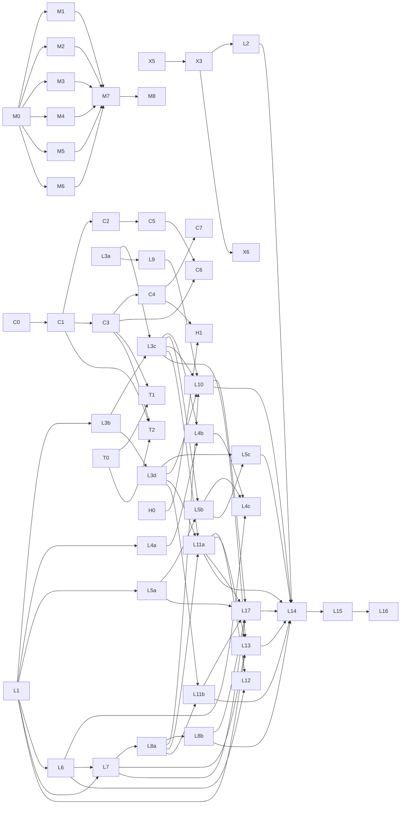

# Stage 01 implementation plan: quaternionic foundations

Status: P3 implementation plan, revised after the Fable audit `audits/stage-01-fable.md` (GO WITH REQUIRED FIXES; fix
ids C2, M1, M4–M14, m2–m12 are cited where applied). Author: stage-01 drafter (Opus), 2026-11-14.
`plan/implementation/OVERVIEW.md` is binding and wins where this file differs. This file follows its §1 (schema), §2
(branches), §3 (Lean structure P/V, wrappers, smoke test), §4 (resources) and §5 (models). The WP ids match
`EXPERIMENT_PROTOCOL.md` (E1–E6, E8; E7 dropped; S01-X5).
Sources: `plan/staged/stage-01-quaternion-foundations.tex` (*tex*, labels `…:s01-…`), `plan/staged/SPLIT.md` §01 and
`if:s01-{classset,brandt,hecke,mass,targets}`, `plan/staged/audits/stage-01-{muse,resolution}.md`, the global Fable seam
audit (findings F3, F6, F8, F15 concern 01), `plan/scouting/{SUMMARY,Stacks}.md`, and the import
`lean/trace-formula-project-import/` (*imp*; Lean namespace `GL2TF.Quat` unless stated otherwise).

## 0. Scope and fixed conventions

- **Stage 01 is the root.** It imports no interface. It exports `if:s01-*` to all later stages and it creates the four
  track scaffolds: the Lean project `lean/Langlandscape/`, `mathematics/main.tex`, the Python package
  `code/python/langlandscape/` and `talk/main.tex`. Later stages extend these scaffolds and never re-create them.
- **Seed notation is kept.** In Lean, the seed's `B_D` is `GL2TF.Quat.QuatAlg ℚ a b` together with
  `hD : RamifiedExactly a b D` and `O : MaxOrder a b`. These are bundled as `Langlandscape.Quat.DefiniteData` (S01-L1).
  The import uses Hilbert-symbol algebras `ℍ[ℚ,a,0,b]`, `a, b < 0`.
- **Decisions fixed by the tex, which no WP may change:**
  - `N_{U_p}` uses `ϖ_j = (p j; 0 1)` (`def:s01-NUp`). The seed's literal `diag(1,p)` is `U'_p`.
  - The lower row of `U_1(N)` is `≡ (0,1)` (`def:s01-levels`).
  - `w_x = |Γ_x/(Γ_x∩{±1})|`, whereas the import's `mass` and `weightedPairing` use `|Γ_x|`, so a factor 2 appears
    iff `-1 ∈ U`.
  - `ν` intertwines `T_g` with `T_{g⁻¹}` and sends `π_*` to the trace, the latter only if `-1 ∈ U'` or `-1 ∉ U` (F3).
  - The adelic `⟨d⟩` is the classical `⟨d⟩⁻¹`.
  - `U_ℓ ↦ +Π_ℓ` (F6/D3); Hsieh's `−` is not imported.
- **Tracks are decoupled** (OVERVIEW §6). A Lean WP depends only on a statement in the tex (later in `mathematics/`).
  The math track may run ahead. The only cross-track edges are T → C: every slide number must come from
  `code/results/`.
- **Lean P/V agnosticism** (OVERVIEW §3.2). Every L-WP writes `import AlgJL.…` and uses the names `GL2TF.Quat.*`, so it
  works unchanged under outcome P (path dependency through `.lake/GL2TF`) and under outcome V (byte-vendored closure).
- **Lean scope split.** The **core** WPs make up "Lean stage 01 done". The **extended** WPs (L4a, L4b, L4c, L12) may run
  on into the stage-02 period without blocking the stage-01 merge (OVERVIEW §6, "some tracks done and others
  continuing"). The reason: they are the plumbing-heaviest and nothing in stages 02–04 depends on them formally.
  Stages 02–04 use `|S_s|` only numerically, through C2.
- **Aggregator files** belong to the stage master: `Langlandscape.lean`, `LanglandscapeTests.lean`, `SORRIES.md`,
  `HYPOTHESES.md`, `Vendor/*/MANIFEST.tsv`, `mathematics/main.tex`, `mathematics/chapters/s01.tex`,
  `code/results/INDEX.md` and `talk/main.tex`. A WP creates its own files and reports its one-line aggregator additions.
  The scaffolding WPs (X1a, M0, C0, T0) create the first versions of these files. S01-X1a runs before the stage clock
  (§2), so its files exist at t = 0.

**Lean coverage of the tex (Fable M6).** The Lean track is narrower than the tex; this table is the binding statement of
what stage 01 formalizes. Every tex label appears once (the M track covers all of them, §3). Status: **core** (part of
"Lean stage 01 done"), **ext** (extended WPs, may continue), **deferred to stage NN**, **not planned** (maths/code only).
Items marked † are the gaps found by the audit; they were not stated in the first draft.

| tex label (part) | M WP | Lean WP: declarations | Lean status |
|---|---|---|---|
| `sec:stage-01` | M0 | — | not planned (section label) |
| `def:s01-B` | M1 | L1 `DefiniteData`; L2 `QuatAlg.isCentral`, `localSplitting_conj`; L3b `DefiniteData.iota` | core |
| `def:s01-levels` | M1 | L3a `GL2Zl K0 K1 Iw`; L3c `U0 U1 Utower U0q` | core |
| `lem:s01-nrd` † | M1 | (would be `nrd_U1_eq_top`, via `localEmbedGL (diag u 1)`) | **deferred to stage 02** — the stage-02 planner must confirm that `prop:s02-quot` does not need it formally, else it becomes a small stage-02 WP (routine, sonnet, 30, deps S01-L3c, S01-L3d) |
| `prop:s01-eichler` | M1 | L4b `U0_eq_U0Psi` (identification with the import's Eichler level) | ext |
| `def:s01-classset` | M1 | L1 `XB`, `Gam`, `XB_units_eq_classSet` | core |
| `prop:s01-finite` | M1 | L1 `XB_finite`; L6 `XB_finite_of_relIndex`; L5a `card_Gam_dvd_24` | core |
| `lem:s01-stab` (a), (c) | M1 | L5a `nrd_eq_one_of_mem_Gam`, `card_Gam_dvd_24`, `not_dvd_card_Gam` | core |
| `lem:s01-stab` (b) | M1 | L5b `Gam_eq_bot_of_le_U1` | core |
| `lem:s01-stab` (b′) † | M1 | L5c `diamondAct_free` for `Utower` only; the tex's any `U = U^{(p)} × U_1(p^s)_p` | core (`Utower`); general `U^{(p)}`: not planned |
| `thm:s01-mass` (a), (b) | M2 | L1 `massFull`, `massFull_units_eq_mass`; L6 `massW`, `massW_level_change` | core |
| `thm:s01-mass` (c), (d) | M2 | L4a `relIndex_U1Psi`; L4b `relIndex_U1`; L4c `card_XB_Utower` | ext |
| `ex:s01-masschecks` | M2 | — (numeric: C1, C2) | not planned |
| `eq:s01-Vk`, `def:s01-pairingV` † | M3, M5 | — | not planned (Hecke with coefficients, next row) |
| Hecke operators **with coefficients** † (tex Lean item L3 "double-coset operators with monoid action"; Hecke action on `brandtModule U R V ρ`, `V_k`) | M3, M4 | L7 defines `brandtModule U R V ρ` as a module only; all operators (L8a–L11b) are on `ZX`/`ZXdual` (trivial coefficients) | not planned in stage 01; no Lean consumer in the stage 02–06 plans at wip-plan 5442db5 — the stage 04–06 planners must re-check |
| `def:s01-brandt` | M3 | L7 `brandtModule`, `ZX`, `ZXdual`, `brandtModuleTrivEquiv` | core |
| `rem:s01-dictionary` † (tex Lean item L4: `ℚ_p`-linear equivalence, all `k`, level `Ô(M)^×`) | M5 | L12 at `k = 2`, level `Ô^×` only: `Tl_eq_heckeOperator`, `brandtPairing_eq_import`, `Tl_selfAdjoint_units` | ext (`k = 2`, `Ô^×`); all `k`, `Ô(M)^×`: not planned |
| `def:s01-pairing` | M3 | L7 `brandtPairing`, `evalPairing`, `normMap`, `normMap_bijective`; L17 `normMap_bijective_padic` | core |
| `prop:s01-adjoint` (a), (c) | M3 | L8b `brandtPairing_heckeTHom`; `normMap_pushforward`, `normMap_pushforward_two` | core |
| `prop:s01-adjoint` (b) | M3 | L8b `normMap_heckeT`; "in particular" † : L17 `Tl_adjoint` (`T_ℓ^* = S_ℓ^{-1}T_ℓ`), `diamond_adjoint`, `PiEll_adjoint`, `Tl_selfAdjoint_U0` (`ℓ ∤ DM`, level `U0 d M`) | core (L17); the `U_p^*` clause: see `lem:s01-Up`(d) |
| `def:s01-hecke` | M4 | L8a `heckeT`, `heckeTHom`; L11a `Tl Sl Ul diamond`; L11b `PiEll`; L10 `Up` | core (trivial coefficients) |
| `def:s01-NUp` | M4 | L9 `varpi`, `varpiDiag`; L10 `Up` | core |
| `lem:s01-Up` (a), (b) | M4 | L9 `K1_mul_varpi_mul_K1`, `varpi_inv_mul_not_mem`, `reps_indep`; L10 `Up_apply`, `Up_comm_push`, `Up_comm_pull` | core |
| `lem:s01-Up` (c) | M4 | coset half: L9 `diag1p_reps`, `relIndex_K1_succ`; trace half † (`U'_p ∘ tr = tr ∘ U'_p`) | coset half core; trace half not planned (C5 checks it numerically) |
| `lem:s01-Up` (d) † (`U_p^* = ⟨p⟩_M U'_p`) | M4 | — (the global `U'_p` is never defined in Lean) | not planned; **stage-04 planner must check** (consumers of `U'_p`/`U_p^*`) |
| `lem:s01-Up` (e) | M4 | L17 `Up_comm_Tl` | core |
| `rem:s01-Upconv` | M5 | — (numeric: C6) | not planned |
| `prop:s01-relations` (a), (b), (d) † | M4 | only `PiEll_indep` (second half of (b)) in L11b; `S_ℓ` formula, `Π_ℓ² = S_ℓ`, `T_ℓ` recursion: — | not planned (import has (d) at `(n, DM) = 1`, level `Ô(M)^×`; C3 checks numerically) |
| `prop:s01-relations` (c) | M4 | L11a `heckeT_comm_of_disjoint`; L11b `rightTranslate`, `heckeT_comm_rightTranslate` | core |
| `def:s01-T` † | M4 | — | not planned |
| `ex:s01-Pi11` | M5 | — (numeric: C7) | not planned |
| `thm:s01-JLclassical` | M6 | L13 `Hyp.JLClassical` (`k = 2`, schematic interface) | core (hypothesis, schematic) |
| `thm:s01-chenevier` | M6 | — | not planned (cited) |
| `thm:s01-lambdaJL` | M6 | L13 `Hyp.LambdaJL` (surjection **and** kernel = abstract `D`-new ideal; schematic) | core (hypothesis, schematic) |
| `if:s01-classset` | M3 | L1, L6, L5a | core, except the `lem:s01-nrd` clause (deferred to stage 02) |
| `if:s01-brandt` | M3 | L7, L8b | core |
| `if:s01-hecke` | M4 | L8a, L8b, L10, L11a, L11b, L17 | core (trivial coefficients; `U_p^*`: not planned) |
| `if:s01-mass` | M4 | L1, L6 (level change); L4c (`|S_s|`) | core / ext (`|S_s|`) |
| `if:s01-targets` | M6 | L13 | core (schematic) |

**Obligation for later planners.** The stage 02–06 plans must be checked against this table for consumers of a
"deferred" or "not planned" item: in particular `lem:s01-nrd` (stage 02), `U'_p`/`U_p^*` (stage 04) and
Hecke-with-coefficients (stages 04–06). A consumer either gets a WP in its own stage or cites the item as maths only.

## 1. Work packages (summary)

Columns: id | trk | goal | deps | difficulty | model (verifier) | agent wall min | build wall min.
- Full schema blocks are in §2–§7.
- "Build" means Lean process time spent in a node slot: lfile checks plus the WP's own `lbuild` of its modules. It is
  contained in the agent wall, but it occupies one of the ≤ 2 local slots.
- `core`/`ext` marks the Lean scope (see §0).
- **Schema defaults** (OVERVIEW §1; they apply wherever a block in §2–§7 does not repeat a field). *Inputs*: the tex
  labels the block names, plus the outputs of its deps. *Acceptance*: the track's common acceptance (M: §3 list; L: §4
  common rules; C: §5 `pytest` with the asserted tables; T: `latexmk` exit 0) plus the block's own checks. *Model,
  agent, build, deps*: this table. Non-mechanical correctness is reviewed by M7 (maths), L15 (Lean) and the stage
  master (C/T).
- ★ marks a strand candidate. Selected strands E1–E6, E8 (L9, L5a, C1, M2, L13, X3, M4) run on `exp/` branches
  (see § Strand candidates). E7 (M0) is dropped (Fable M14(b)); M0 runs reference-only at t = 0.
- **Pre-stage WPs** (Fable C2): S01-X1a and S01-X4 run **before the stage clock starts**, as the last step of P4/P5
  (OVERVIEW §3.5). They are listed here but do not appear in the §9 schedule; t = 0 of §8/§9 is "X1a merged, X4 done".

| id | trk | goal (short) | deps | diff. | model | agent | build |
|---|---|---|---|---|---|---|---|
| S01-X1a | X | **pre-stage.** Lake project `lean/Langlandscape/` + minimal wrapper copies + pin guard + **smoke test, decides P / P′ / V** (OVERVIEW §3.5) | — | mechanical | **opus** | 40 (V: +45) | 6–8 (V: +25, TITAN?) |
| S01-X1b | X | lock model + `SLOTS` allowlist (OVERVIEW §3.4/§3.5); **does not gate the stage** (until merged: exclusive lock + batched gates, R4) | X1a, Fabian's approval (OVERVIEW §8 F2) | routine | sonnet | 30 | 5 |
| S01-X2 | X | `tools/new_wp.sh` (worktree + branch + `link_deps` + `.lake/build` seeding) and `tools/check_wp.sh` (acceptance helper of every L-WP) | X1a | mechanical | sonnet (Fable m2) | 20 | 2 |
| S01-X3 ★ | X | vendor Stacks Skolem–Noether (8 files, rev `c496df0d`) from `.exp/inputs/`, LICENSE/ATTRIBUTION/MANIFEST/PROVENANCE | X1a, X5 | mechanical | haiku (sonnet) | 30 | 6–8 |
| S01-X4 | X | **pre-stage.** TITAN replica: `deps.local.conf` (TITAN Mathlib path; `SLOTS=3` only after X1b), X1a steps 2–6 on TITAN | X1a | mechanical | — (TITAN job; master side by the global master) | 15 | 8 |
| S01-X5 | X | experiment setup (EXPERIMENT_PROTOCOL §1.4) incl. `exp_event.sh`, `exp_prepare_audit.sh`, the E6 inputs in `.exp/inputs/` | X1a | routine | sonnet | 30 | 3 |
| S01-X6 | X | third-party NOTICE **draft** (Anthropic FLT, Imperial FLT, AxiomStacks); no LICENSE choice; "Fabian: choose license" | X3 | mechanical | haiku (stage master checks) | 15 | – |
| S01-M0 ★ | M | `mathematics/` skeleton: `main.tex`, `preamble.tex` (stage macros), `references.bib`, `chapters/s01.tex` + 6 section files with **statement skeletons of all tex labels** (Fable M8) | — | mechanical | haiku | 25 | – |
| S01-M1 | M | §1 algebra, orders, levels, class sets, finiteness, Lemma stab (full proofs) | M0 | routine | sonnet | 50 | – |
| S01-M2 ★ | M | §2 mass formula (a)–(d), `[Ô^×:U_1(N)]`, `|S_s|`, examples | M0 | routine | sonnet | 40 | – |
| S01-M3 | M | §3 Brandt modules, pairing, `ν`, Prop adjoint (a)–(c) with proofs, factor-2 case | M0 | routine | sonnet | 50 | – |
| S01-M4 ★ | M | §4 Hecke operators, **`N_{U_p}`**, Lemma Up (a)–(e) with full proofs, relations, `T_B` | M0 | hard | opus | 60 | – |
| S01-M5 | M | §5 conventions: `V_k` pairing, dictionary seed ↔ import ↔ Gross, the `U_p` translations, `Π_11` | M0 | conceptual | opus | 55 | – |
| S01-M6 | M | §6 targets: JL classical, Chenevier, Λ-adic JL; citations re-verified against the PDFs | M0 | routine | sonnet | 40 | – |
| S01-M7 | M | chapter audit: Muse pre-pass, then Fable (alone) | M1–M6 | conceptual | muse → fable | 5 + 50 | – |
| S01-M8 | M | apply the M7 fixes, final `latexmk`, milestone PDF | M7 | routine | sonnet | 35 | – |
| S01-L1 | L core | facade `Quat/Basic`: `DefiniteData`, `XB`, `Gam`, `wx`, `massFull`, re-exports | X1a | mechanical | sonnet | 40 | 8 |
| S01-L2 | L core | `QuatAlg` central + simple; Skolem–Noether corollaries; `ι_ℓ` unique up to `GL₂(ℚ_ℓ)`-conjugation | X1a, X3 | hard | opus | 60 | 15 |
| S01-L3a | L core | local subgroups `GL2Zl`, `K0`, `K1`, `Iw` of `GL₂(ℚ_ℓ)` (Mathlib only) | X1a | routine | sonnet | 45 | 10 |
| S01-L3b | L core | `LocalSplittings`, `localComponent ℓ : B̂^× →* GL₂(ℚ_ℓ)`; `Ô^×` maps into `GL2Zl` | L1 | hard | opus | 60 | 20 |
| S01-L3c | L core | global levels `U0`, `U1`, `Utower`, `U0q`; inclusions, antitone tower | L3a, L3b | routine | sonnet | 40 | 8 |
| S01-L3d | L core | `localEmbed ℓ : B_ℓ^× →* B̂^×` (every prime `ℓ`, incl. `ℓ ∣ D`); components of `localEmbed`; factorisation of levels at `p` | L3b | hard | opus | 50 | 15 |
| S01-L4a | L ext | levels `U0Psi`/`U1Psi` from the import's `Ψ`; `[Ô^× : U1Psi] = ψ(N)φ(N)` | L1 | routine | sonnet | 50 | 10 |
| S01-L4b | L ext | bridge `U1 = U1Psi` for the level structure induced by `ι_ℓ` | L3c, L4a | hard | opus | 60 | 20 |
| S01-L4c | L ext | `card_XB_Utower`: `|S_s| = φ(D)/24·ψ(Mp^s)φ(Mp^s)` under `Hyp.EichlerMass` | L4b, L5b, L6 | routine | sonnet | 45 | 8 |
| S01-L5a ★ | L core | Lemma stab (a) `Nrd Γ_x = 1`; (c) `|Γ_x| ∣ 24`, `p ∤ |Γ_x|` | L1 | routine | sonnet | 40 | 8 |
| S01-L5b | L core | Lemma stab (b): `Γ_x = 1` if `U ≤ U_1(p)`, `p ≥ 5` | L3c, L5a | hard | opus | 60 | 20 |
| S01-L5c | L core | Lemma stab (b′): `Δ_s` acts freely on `X_B(U_s)` | L5b, L3d | routine | sonnet | 45 | 10 |
| S01-L6 | L core | `XB_finite_of_relIndex`; `Gam` under translation; `wx` lemmas; `massW` level change (factor 2) | L1 | routine | sonnet | 45 | 10 |
| S01-L7 | L core | `brandtModule` (seed convention), `ZX`, `ZXdual`, `brandtPairing`, `normMap`, bijectivity (`normMap_bijective_padic` moved to L17) | L1, L6 | routine | sonnet | 60 | 12 |
| S01-L8a | L core | double-coset operators `heckeT U g` on `ZXdual` (through imp `heckeAct`), transpose `heckeTHom` on `ZX` | L7 | routine | sonnet | 50 | 12 |
| S01-L8b | L core | adjoint `⟨T_g a,b⟩ = ⟨a,T_{g⁻¹} b⟩`; `ν ∘ T_g = T_{g⁻¹} ∘ ν`; `ν ∘ π_* = tr ∘ ν'` with the factor-2 case | L8a | hard | opus | 60 | 15 |
| S01-L9 ★ | L core | `N_{U_p}` coset decomposition `K_sϖK_s = ⊔_j ϖ_jK_s`, independent of `s ≥ 1`; `U'_p` reps depend on `s` | L3a | hard | opus | 60 | 25 |
| S01-L10 | L core | global `Up`, Lemma Up (b): `π_* ∘ U_p = U_p ∘ π_*`, `U_p ∘ π^* = π^* ∘ U_p` | L8a, L9, L3c, L3d | hard | opus | 60 | 15 |
| S01-L11a | L core | `Tl Sl Ul diamond`; `heckeT_comm_of_disjoint` (disjointly supported operators commute) | L8a, L3c, L3d | routine | sonnet | 45 | 10 |
| S01-L11b | L core | `PiEll` (`ℓ ∣ D`, normality of `𝒪_ℓ^×`), `PiEll_indep`, right translation `rightTranslate` (`g ∈ B_q^×`), `heckeT_comm_rightTranslate` | L8a, L3d | hard | opus | 60 | 12 |
| S01-L12 | L ext | dictionary at `U = Ô^×`, `k = 2`: `Tl` = imp `heckeOperator`/`brandtMatrix`; `T_ℓ` self-adjoint | L11a, L6 | hard | opus | 60 | 15 |
| S01-L13 ★ | L core | targets as `Prop`s: `Hyp.JLClassical`, `Hyp.LambdaJL` (schematic interfaces, abstract GL₂ side; shapes fixed in §4), Eichler-mass alias | L1, L7, L3c, L11a | mechanical | sonnet | 30 | 5 |
| S01-L17 | L core | corollaries: `normMap_bijective_padic`, `Up_comm_Tl`, `Tl_adjoint`, `diamond_adjoint`, `PiEll_adjoint`, `Tl_selfAdjoint_U0` | L5a, L7, L8b, L10, L11a, L11b | routine | sonnet | 40 | 8 |
| S01-L14 | L core | integration: `Audit/PrintAxioms.lean`, tests (non-vacuity), `lbuild Langlandscape LanglandscapeTests` | core L (incl. L17) | routine | sonnet | 30 | 12 (TITAN?) |
| S01-L15 | L core | Lean audit (`lean_audit.md`), Fable alone; S01-L16 = fixes (sonnet, ≤ 45) | L14 | conceptual | fable | 50 | 10 |
| S01-C0 | C | `code/python/langlandscape/` package, pytest config, `results.py` provenance helper, `results/INDEX.md` | — | mechanical | haiku | 20 | – |
| S01-C1 ★ | C | `B_D`, maximal orders, class sets at `Ô^×`, `|Γ_x|` (PARI `alg*`, `qfauto`/`qfisom`); mass check | C0 | routine | sonnet | 60 | – |
| S01-C2 | C | class sets at `U_0(M)`, `U_1(N)`, `U_0(q)U` via fibres `Γ_x\(U/U')`; mass level change; `|S_s|`; stab | C1 | routine | sonnet | 50 | – |
| S01-C3 | C | weight-2 Brandt `T_ℓ` at `U_0(M)`; relations; **seed C4(ii)** against PARI `mf` and isogeny graphs | C1 | routine | sonnet | 60 | – |
| S01-C4 | C | `Sym^n` coefficients exactly over `ℚ(√a)`; `T_ℓ` on `⊕V_k^{Γ_x}`; JL char-poly check, `k ≤ 12` | C3 | hard | opus | 60 | – |
| S01-C5 | C | `N_{U_p}` at `S_1, S_2` (`B_3`, `p = 5`): `π_*U_p = U_pπ_*`, failure for `U'_p` | C2 | routine | sonnet | 45 | – |
| S01-C6 | C | `U_p` eigenvalues vs `a_5` of the 3-new forms: `s = 1` level 15 (`Γ_0(3)∩Γ_1(5)`), `s = 2` level 75 (`Γ_0(3)∩Γ_1(25)`); dimension checks `2 = 1 + 1`, `50 = 1 + 49` | C5, C3 | hard | opus | 60 | – |
| S01-C7 | C | `Π_ℓ` eigenvalues vs `a_ℓ`, `D ∈ {11,13,17,19}`, `k ∈ {2,4}` (fixes the sign for stage 05) | C4 | routine | sonnet | 45 | – |
| S01-H0 | H | *(gated on the HACS snapshot)* inspect it; `code/hacs/CHANGES.md`; API note for a definite module | — | routine | sonnet | 30 | – |
| S01-H1 | H | HACS definite module (class sets, Brandt with `Sym^n`), cross-validated against C1–C4 | H0, C4 | hard | opus | 60 | – |
| S01-T0 | T | `talk/` beamer skeleton (`main.tex`, `slides/`, latexmkrc) | — | mechanical | haiku | 15 | – |
| S01-T1 | T | slide "what JL says": `B_11` = 2 points (`|Γ|` = 4, 6) vs `X_0(11)`; equal eigenvalues, no map | T0, C3 | routine | sonnet | 30 | – |
| S01-T2 | T | backup slide: mass formula plus a table `h(D)`, `|Γ_x|`, `T_2` from `code/results/s01/` | T0, C1, C3 | mechanical | haiku | 20 | – |

Count: **55 WPs**: X 7, M 9, L 26 (22 core including the conditional L16 fix-up, plus 4 ext), C 8, H 2, T 3.
S01-H0 and S01-H1 are planned but optional and **not scheduled** until `code/hacs/` is filled (§12, F8).
S01-X1a and S01-X4 are pre-stage; X4 is a TITAN job. S01-L16 is the conditional fix-up after L15.
Sum of agent wall: X ≈ 180 (incl. X1a's 40 and X4's 15 master-side min), M ≈ 410, L ≈ 1290 (incl. L16), C ≈ 400,
H ≈ 90, T ≈ 65, **total ≈ 2435 min** (in-stage, without X1a, X4 and H: ≈ 2290 min).

## Strand candidates

**Selected (EXPERIMENT_PROTOCOL, revised after the Fable audit).** E1 = L9 (three strands: opus reference, **sonnet**
and **muse** challengers; Fable M14(a)), E2 = L5a, E3 = C1, E4 = M2, E5 = L13, E6 = X3 and E8 = M4: 7 WPs, 15 strands.
**E7 (M0) is dropped** (Fable M14(b)): M0 is reference-only and starts at t = 0.
- These seven WPs run as strands on `exp/s01-<wp>-<model>` branches (worktrees `…-wt/exp-s01-<wp>-<model>`), not on
  `impl/s01-<wp>`. The reference strand is the production run with the model of §1.
- At most one strand per WP is merged into `wip-implementation` (protocol §4.4). **A reference strand is mergeable at
  mechanical acceptance** (the OVERVIEW §2 gate), like any `impl/` WP, and downstream WPs start then; its Opus audit
  and fix rounds continue on the `exp/` branch for timing and are merged as a follow-up (protocol §4.4, Fable M12(b)).
  So no audit or fix round of a strand is on the production path; §9 places the audits in each team's experiment slot.
- E5 (L13) is on a near-zero-slack path (§8) and is kept **only** under this rule.
- Their briefs come from S01-X5 (verbatim WP blocks of §2–§7, as revised here; in particular the corrected
  `relIndex_K1_succ (hs : 1 ≤ s)` of L9, Fable M5, and the fixed L13 shapes, Fable M7).
- L5b and L2 are not selected; they run as ordinary `impl/` WPs.

These ten WPs are tagged `strand-candidate`. They cover mechanical, routine and hard work in Lean, LaTeX and code, and
each has a mechanical acceptance check. The protocol writer selected E1–E6, E8 from this list (EXPERIMENT_PROTOCOL §1.3).
"CP" says whether the WP is on the critical path (§9); on the CP only an opencode or Haiku challenger is allowed. (The
"CP?" column below is the draft's assessment; the revised slack figures are in §8.)

| WP | difficulty / track | ref. model | suggested challenger | CP? | reason |
|---|---|---|---|---|---|
| S01-X3 | mechanical / Lean infra | haiku | mistral or muse (opencode, `--auto` in a worktree) | no | Pure vendoring. The check is fully mechanical: `git hash-object` equals the upstream blob sha recorded by X5 and `lbuild LanglandscapeVendorStacks` passes. Answers whether opencode can do Lean housekeeping. |
| S01-L13 | mechanical / Lean | sonnet | haiku | near-zero slack (§8) | `def … : Prop` with docstrings; the exact signatures are given in §4. The build check is trivial, so quality shows only as faithfulness in the audit. Tests Haiku on Lean boilerplate that carries meaning. |
| S01-M0 | mechanical / LaTeX | haiku | mistral | no (dropped as E7) | Skeleton and macro port. The check is `latexmk` exit 0 plus a fixed list of macros present. Small (~20 min), so overhead dominates. |
| S01-L5a | routine / Lean | sonnet | muse (Lean loop) | no | Two short proofs from named import lemmas. Self-contained, mechanical check. The cleanest "routine Lean" cell. |
| S01-M2 | routine / LaTeX | sonnet | muse | no | Known statement, orbit counting, an index computation. The check is `latexmk`, the labels and the numbers of `ex:s01-masschecks`. |
| S01-C1 | routine / code | sonnet | mistral | no | Exact `pytest` checks against the Eichler mass, the class numbers h(D) and `|Γ_x|`. Tests Mistral on CAS code. |
| S01-L9 | hard / Lean (Mathlib only) | opus | sonnet + muse (Lean loop) | via L10, slack 170 in §9 | **Recommended hard Lean cell.** Pure 2×2 matrix algebra over `ℤ_[p]`. The statement is fixed exactly by `lem:s01-Up`(a),(c), so the result is either right or wrong. Highest mathematical risk of the stage (R1). |
| S01-L5b | hard / Lean (adelic plumbing) | opus | sonnet | yes | `unit_cases` + local components + reduction mod p. Tests whether Sonnet handles the `BHat`/`RestrictedProduct` API. (Not selected by the protocol.) |
| S01-L2 | hard / Lean + vendored code | opus | sonnet | no | Centrality of `ℍ[ℚ,a,0,b]` plus the instance plumbing to Stacks. Probes instance synthesis (R5). (Not selected.) |
| S01-M4 | hard / LaTeX | opus | sonnet | no (math track) | Convention-sensitive proofs. Checkable against the C5 numerics and the L9 statement. |

## 2. Track X — infrastructure

**S01-X1a** · X · **pre-stage** · *Create `lean/Langlandscape/` and decide P / P′ / V* (Fable C1, C2, M1, M2).
- Runs **before the stage clock starts**, as the last step of P4/P5 (OVERVIEW §3.5): it needs no other input, it gates
  every Lean WP, and Fabian's approvals (OVERVIEW §8) are needed anyway. §8/§9 start at t = 0 with L1, L3a.
- Inputs: OVERVIEW §3.1–3.5 (layout, minimal wrapper diff, pin guard, smoke steps 0–7); imp `tools/*`,
  `lean/{lakefile.toml, lake-manifest.json, lean-toolchain}` (byte sources).
- Outputs, under P:
  - `lean/Langlandscape/{lakefile.toml, lake-manifest.json, lean-toolchain, .gitignore}`; the manifest is
    **generated** by the committed `tools/make_manifest.py` (never hand-edited; path entry with `"scope": ""`,
    `"copy": false`, `"inherited": false`), and `tools/pins.sha256` (pin guard, OVERVIEW §3.4);
  - `tools/{deps.conf, deps_load.sh, link_deps.sh, check_frozen.sh, lbuild.sh, lfile.sh, load_profiles.conf}` with the
    **minimal** diff only (`lean="$repo"`, target allowlist, the `path` exception in `link_deps.sh`, `GL2TF_IMPORT`,
    `DEP_ROOTS` incl. `AlgJLTests`, the pin guard). The lock model stays the import's (`lean.lock` exclusive) until
    S01-X1b. `prune_stale_build.sh`/`stale_build.py` are **not** copied (not needed in stage 01; a prune tool next to
    `.lake/GL2TF` is an avoidable hazard);
  - `Langlandscape/Smoke.lean` (kept as a regression test of the frozen setup);
  - the first versions of the aggregator files: `Langlandscape.lean`, `LanglandscapeTests.lean`, `SORRIES.md`,
    `HYPOTHESES.md` (header rows; one row for the reused `GL2TF.Hyp.EichlerMass`), `Audit/PrintAxioms.lean`
    (`#print axioms` of `Smoke` only), `README.md`;
  - the decision record `lean/Langlandscape/DECISION-PV.md`: outcome P / P′ / V, the manifest diff against the
    import's file, wall times, Lake log excerpts, and **which worktree regime is in force**: (a) `.lake/build` seeding
    by `cp -a --reflink=auto` (step 7 passed) or (c) one long-lived worktree per worker lane (step 7 failed; OVERVIEW §2,
    Fable M1).
- Outputs, under V in addition: `Vendor/GL2TF/**`, `Vendor/AnthropicFLT/**` (with `LICENSE`, `NOTICE` copied
  verbatim), `Vendor/ImperialFLT/**` (with `LICENSE`), MANIFEST rows **copied verbatim from the import's
  `Vendor/MANIFEST.tsv`** for the third-party files (true upstream URL, rev, `sha256_upstream`; `modified = yes` for the
  two AnthropicFLT files) with "via lean/trace-formula-project-import @<commit>" in the note column, and
  `tools/vendor_check.sh`. The closure is 37 AlgJL + 2 `Definitions.*` + 2 `FLT.*` modules, ≈ 25.1k lines (Fable A.7, M2).
- The lakefile declares **all** stage-01 libraries up front (`Langlandscape`, `LanglandscapeTests`,
  `LanglandscapeVendorStacks` with `srcDir = "Vendor/AxiomStacks"`, `globs = ["StacksCore.+"]`,
  `leanOptions = { maxSynthPendingDepth = 3 }`, whose `srcDir` does not exist yet, so that this case is exercised; under
  V also `LanglandscapeVendorGL2TF`, `LanglandscapeVendorFLT` and `LanglandscapeVendorImperial`, exactly as in
  OVERVIEW §3.3). Then X3 adds files only and no later WP edits the lakefile.
- Steps: OVERVIEW §3.5 steps 0–7, in that order. Step 3 is the **sandboxed first contact** (`tools/lbuild.sh --smoke`:
  dry check and first build inside an `unshare -rmn` namespace with the farm, the Mathlib tree and the import mounted
  read-only and no network; the one place where a wrapper calls `lake` directly). Step 7 is the second worktree
  `…-wt/s01-x1a-2`: `link_deps`, dry check **and the seeding test** (copy `.lake/build` with `cp -a --reflink=auto`,
  then `tools/lbuild.sh +Langlandscape.Smoke` must report the module as replayed, zero modules compiled).
- Acceptance: OVERVIEW §3.5 steps 0–7 all pass, or the V branch passes steps 4–6. `git -C <main checkout> status
  --porcelain lean/trace-formula-project-import` stays empty. No wrapper exits 99. `DECISION-PV.md` names the outcome
  and regime (a) or (c).
- Difficulty: mechanical. Model: **opus** (Fable C2: a wrapper bug that looks like a P failure would send the stage to V
  for nothing; the cost is negligible against "a wrong conclusion costs the whole stage"). Agent 40 min (P ≈ 30 writing
  + 6–8 build + checks; V: +45). Build 6–8 min (V: first `lbuild LanglandscapeVendorGL2TF` ≈ 25 min locally or ≈ 7 min
  on TITAN; TITAN candidate). Deps: —.

**S01-X1b** · X · *Lock model and `SLOTS` allowlist* (Fable C2, C3). Implements the X1b lock model and the acquisition
order of OVERVIEW §3.4 in `lbuild.sh`/`lfile.sh` and the `SLOTS` (≤ 3) entry of the local-conf allowlist.
- Precondition: Fabian approves the lock change (OVERVIEW §8 F2). **The stage does not wait for X1b**: until it is
  merged, the stage runs with the exclusive `lean.lock` of X1a and batched merge gates (R4).
- Acceptance (OVERVIEW §3.5): (a) two worktrees run `tools/lbuild.sh +Langlandscape.Smoke` concurrently and both
  finish; (b) the deadlock test: one `lbuild` and two `lfile`s in one checkout while the second node slot is held by a
  dummy `flock`, all finish; (c) an import `lbuild` (simulated by holding `lean.lock` exclusively with `flock`) blocks
  both of (a); `shellcheck` clean; X1a steps 4–6 still pass.
- routine · sonnet · 30 · build 5 · deps X1a. Scheduling (§9): pre-stage right after X1a if F2 is approved by then
  (preferred); otherwise in the first free X/L lane (§9: after L16).

**S01-X2** · X · *Per-WP tooling.*
- Outputs:
  - `lean/Langlandscape/tools/new_wp.sh <wp>`: runs `git worktree add …-wt/s01-<wp> -b impl/s01-<wp>
    wip-implementation`, then `tools/link_deps.sh`, then `--verify`, then **seeds** `.lake/build` from the `impl`
    worktree with `cp -a --reflink=auto` while holding that checkout's lock shared (OVERVIEW §2; never `cp -al`). Under
    regime (c) of `DECISION-PV.md` it instead runs `git switch -c impl/s01-<wp> wip-implementation` in the lane's
    long-lived worktree. Under V it prints the expected first-build time.
  - `tools/check_wp.sh <files…>`: one `lbuild.sh +M…` for the given modules; **fail** on `declaration uses 'sorry'` in
    the build log, and on a source grep for `sorry|admit|^axiom|native_decide|implemented_by`; then check that every
    `theorem` in the file list has a docstring containing `s01-`; exit code 0/1.
- Acceptance: `shellcheck` clean; a dry run on `Smoke.lean` returns 0; a planted `sorry`, `admit`, `axiom` and
  `native_decide` each return 1 (Fable m2).
- mechanical · **sonnet** (Fable m2: `check_wp.sh` is the acceptance check of every L-WP) · 20 · build 2 · deps X1a.

**S01-X3** ★ · X · *Vendor Stacks Skolem–Noether.*
- Inputs: `plan/scouting/Stacks.md` §1, §4 (the 8 files `StacksCore/RingTheory/SkolemNoether.lean`, `Morita/SimpleRing`,
  `SimpleRing/{DivisionRing,TensorProduct}`, `TwoSidedIdeal/{Operations,SpanAsSum}`, `ModuleCat/Basic`,
  `Dimension/Finite`; 893 lines), upstream rev `c496df0d9beea9deaeabcea8492605f9a0a2313b`. **The files are not fetched
  by the WP**: S01-X5 (or the stage master) fetches the 8 blobs and `LICENSE` once at that rev into `.exp/inputs/`
  (raw accept header, not base64 pasted by a model) and records their git blob shas; both E6 strands start from these
  files (Fable M13; the opencode prompt forbids network commands).
- Outputs: `lean/Langlandscape/Vendor/AxiomStacks/{LICENSE, ATTRIBUTION.md, MANIFEST.tsv (import's column format),
  PROVENANCE.md, StacksCore/**}`, files unmodified (`modified = no`). Licensing (Fable m4): `LICENSE` = the upstream
  file at the pinned rev, verbatim; **no NOTICE file** (upstream has none; none is invented in their name);
  `ATTRIBUTION.md` with the row from `scouting/Stacks.md` §1 ("no per-file header upstream; Copyright AxiomMath …;
  authors per formalization.yaml …") and the sentence "statements follow the Stacks Project (GFDL); only Lean code and
  tag numbers are copied".
- Acceptance:
  - integrity (Fable m3): `git hash-object <file>` of each vendored file equals the blob sha of the GitHub tree at the
    pinned rev recorded by X5; both shas (and the sha256) are recorded in `MANIFEST.tsv`/`PROVENANCE.md`;
  - the 8 files' docstrings are checked for verbatim Stacks prose; the result is recorded in `PROVENANCE.md`;
  - `tools/lbuild.sh LanglandscapeVendorStacks` rc 0; `#check @skolemNoether` and `#check @skolemNoether'` succeed in
    a scratch file (`lfile`).
- mechanical · haiku (sonnet takes over on failure) · 30 · build 6–8 · deps X1a, X5 (inputs; E6).
- Reason for Haiku: shell work with a fully mechanical check. A failure is caught within one build.

**S01-X4** · X · **pre-stage** · *Replicate on TITAN.* A TITAN job sent by the global master, after X1a.
- Precondition (Fable m11): TITAN's import is built (`lbuild` OK, 6:43 wall, ≥ 5.4 GB peak RSS) and its
  `tools/deps.local.conf` exists with `GL2TF_DATA=/home/claude/data/gl2tf-data`.
- On TITAN: create `lean/Langlandscape/tools/deps.local.conf` (git-ignored; the TITAN farm path), then run X1a steps
  2–6. `SLOTS=3` needs the X1b allowlist change; until X1b is merged and replicated, TITAN runs with `SLOTS=2`.
- Acceptance: TITAN's report `titan/s01-x4-1` shows steps 2–6 pass. mechanical · model — (run by the TITAN node's own
  agent, not a stage-master subagent) · agent 15 (master side) · build 8 · deps X1a. Without X4, TITAN cannot take
  stage-01 build jobs.

**S01-X5** · X · *Experiment setup.* As specified in EXPERIMENT_PROTOCOL §1.4 (owner: protocol). Inputs, outputs and
acceptance are those of protocol §1.4, including (Fable m10, M13) `plan/implementation/tools/exp_event.sh` (one command
per event; appends under `flock` to the single `events.tsv` in the `impl` worktree, addressed by absolute path; strand
worktrees never write it) and `plan/implementation/tools/exp_prepare_audit.sh` (patch, excerpt, check output, `shuf`
label), next to the `exp_*_loop.sh` loops, and the E6 inputs in `.exp/inputs/` (above). routine · sonnet · 30 ·
build 3 · deps X1a.

**S01-X6** · X · *Third-party NOTICE draft* (Fable F5). PROVISIONAL (global master, 2026-11-14).
- Output: `lean/Langlandscape/THIRD-PARTY-NOTICES.draft.md`, a list of the third-party code in the repository with
  path, upstream URL, pinned rev, license and NOTICE/ATTRIBUTION file: Anthropic FLT and Imperial FLT via
  `lean/trace-formula-project-import/lean/Vendor/` (rows taken from the import's `Vendor/MANIFEST.tsv`), and AxiomStacks
  under `lean/Langlandscape/Vendor/AxiomStacks/` (from X3's `MANIFEST.tsv`/`ATTRIBUTION.md`).
- **No LICENSE choice** and no top-level file: the draft's first line is "DRAFT — Fabian: choose license"; the global
  master moves it to the repository root only after Fabian's decision (OVERVIEW §8 F5).
- Acceptance: every row's path exists and its license file is named; the stage master checks the rows against both
  MANIFEST files. mechanical · haiku · 15 · build – · deps X3. Off the critical path.

## 3. Track M — mathematics (`mathematics/`)

File layout, fixed by M0. `chapters/s01.tex` `\input`s six section files `chapters/s01/{1-classsets,2-mass,3-brandt,
4-hecke,5-conventions,6-targets}.tex`, so the section WPs run in parallel without conflicts.

Labels: the tex labels are kept verbatim (`def:s01-levels`, `lem:s01-stab`, …), so plan, maths and Lean docstrings
use the same keys. **M0 creates every tex label** (statement skeletons, below); section WPs fill the bodies and may
neither add nor remove a tex label (Fable M8). New labels also carry the `s01-` prefix and come only from the list
below. The labels `rem:s01-stab-lean` (M1), `rem:s01-nu-hecke`
(M3), `rem:s01-diamond` (M4), `lem:s01-dictionary` and `lem:s01-Upconv` (M5) are **new outputs**, not tex labels. No
L-WP takes them as its statement interface: L5b formalizes `lem:s01-stab`(b), and `rem:s01-stab-lean` only records
the route. C6 cites the tex label `rem:s01-Upconv`.

Every result carries a status macro (`\stproved`, `\stcited`+`\lit{}{}`, …). Every formalized result carries a
`\lean{Langlandscape.…}` cross-reference. The Lean names come from §4; the reference is written even before the Lean
WP is done and is marked `\leanplanned` (macro defined in M0).

Literature (read-only, cite with file stem and theorem/page, never copy text):
- `voight_2021_quaternion-algebras` (Ch. 11.5, 13.3, 17, 23, 25, 41);
- `gross_1999_algebraic-modular-forms`;
- `buzzard_2004_p-adic-families-of-automorphic-forms_preprint` (§4–5);
- `eichler_1955_*`;
- `jacquet-langlands_1970_*`, `hijikata-pizer-shemanske_1980_*`;
- `chenevier_2005_*`, `longo-vigni_2009_*`, `hsieh_2017_*`;
- `pizer_1980_*`, `kohel_2001_*`.

Common acceptance for M1–M6:
1. `cd mathematics && latexmk -pdf -interaction=nonstopmode main.tex` exits 0.
2. `grep -c 'undefined' main.log` is 0. This holds on a section WP's own branch, because M0's skeletons define every
   tex label that other sections cite (e.g. M3 cites `lem:s01-Up`(d) from M4, M2 cites `lem:s01-stab` from M1).
3. Every label in the WP's label list is defined exactly once (`grep -c '\\label{<l>}'`), and the set of tex labels in
   `chapters/s01/*.tex` is unchanged against M0 (no tex label added or removed).
4. Every `\stcited` has a `\lit`.
5. `latexmk -c`; no build products are committed.
Correctness is reviewed by M7. Sources are pdftotext of `literature/`.

**S01-M0** ★ · *Skeleton.*
- Outputs:
  - `mathematics/{main.tex, preamble.tex, references.bib, latexmkrc, .gitignore}`;
  - `chapters/s01.tex` and the 6 section files, each with a `\section` and the **statement skeletons of all tex labels
    of that section**: the environments and `\label`s copied from the stage tex in order (`definition`, `lemma`,
    `proposition`, `theorem`, `example`, `remark`, `equation`, `interface`), bodies `TODO` (Fable M8). Each label goes to
    the section file of the WP that writes it (M1–M6 blocks below): 1 `def:s01-B`, `def:s01-levels`, `lem:s01-nrd`,
    `prop:s01-eichler`, `def:s01-classset`, `prop:s01-finite`, `lem:s01-stab`; 2 `thm:s01-mass`, `ex:s01-masschecks`;
    3 `eq:s01-Vk`, `def:s01-brandt`, `def:s01-pairing`, `prop:s01-adjoint`, `if:s01-classset`, `if:s01-brandt`;
    4 `def:s01-hecke`, `def:s01-NUp`, `lem:s01-Up`, `prop:s01-relations`, `def:s01-T`, `if:s01-hecke`, `if:s01-mass`;
    5 `def:s01-pairingV`, `rem:s01-dictionary`, `rem:s01-Upconv`, `ex:s01-Pi11`; 6 `thm:s01-JLclassical`,
    `thm:s01-chenevier`, `thm:s01-lambdaJL`, `if:s01-targets`; `sec:stage-01` goes on the chapter (31 labels).
- `preamble.tex` = the macro list of SPLIT "Macros" (copied from `plan/staged/preamble.tex`) + `\Tpath`,
  `\leanplanned`, `\lean`.
- `references.bib` = the stage-01 entries of `plan/staged/references.bib`.
- Acceptance: `latexmk` exits 0; `grep -c` finds each SPLIT macro name in `preamble.tex`; **every label of the stage tex
  is defined exactly once** in `chapters/s01.tex` + `chapters/s01/*.tex`:
  `for l in $(grep -o '\\label{[^}]*}' plan/staged/stage-01-quaternion-foundations.tex); do test "$(grep -rhoF "$l" mathematics/chapters/s01.tex mathematics/chapters/s01 | wc -l)" = 1 || echo "$l"; done` prints nothing.
- mechanical · haiku · 25 · deps —. Starts at t = 0, reference only (E7 dropped).

**S01-M1** · *§1 class sets.*
- Writes `def:s01-B`, `def:s01-levels` (with the explicit `U_0(q)U`), `lem:s01-nrd` (proof), `prop:s01-eichler`,
  `def:s01-classset`, `prop:s01-finite` (with the correction `{2,4,6,12,24}`, F1), `lem:s01-stab` (full proof).
- Plus the new `rem:s01-stab-lean`, recording the Lean route via `unit_cases`: the `(2,2)` entry of `u²` is `≡ 1` when
  `u ∈ K_1(p)`, which rules out every case for `p ≥ 5`. This is the proof L5b formalizes and an alternative to the
  trace argument.
- Literature: Voight 13.3.11, 17.1.1, 11.5.14, 23.4.3; Buzzard §4 p. 11.
- routine · sonnet · 50 · deps M0.

**S01-M2** ★ · *§2 mass.* `thm:s01-mass` (a)–(d) with proofs of (b) (orbit counting, including the `w` variant and its
factor-2 case) and of the second half of (c) (`[B_0(N):B_1(N)] = φ(N)`), and `ex:s01-masschecks`. The numbers must
match C2: `D = 3, p = 5`: `|S_s| = 2·25^{s−1}`; `D = 2`: `|X(U_1(5))| = 1`; `D = 11`: `1/4 + 1/6`. Literature: Voight
25.1.1, 25.3.18; Eichler 1955 §4. routine · sonnet · 40 · deps M0.

**S01-M3** · *§3 Brandt.*
- Writes `eq:s01-Vk`, `def:s01-brandt`, `def:s01-pairing`, `prop:s01-adjoint` (a) (cited from Gross Prop. 6.9 and
  re-proved for trivial coefficients), (b), and (c) with the case distinction of F3.
- Writes the "Consequence for SPLIT" paragraph as `rem:s01-nu-hecke`.
- Interface boxes `if:s01-classset`, `if:s01-brandt`, restated from the tex.
- routine · sonnet · 50 · deps M0.

**S01-M4** ★ · *§4 Hecke.*
- Writes `def:s01-hecke`, `def:s01-NUp`, `lem:s01-Up` (a)–(e) with full proofs. For (d), derive `U_p^* = ⟨p⟩_M U'_p`
  in detail, which is still `\sttoprove` in the tex. The index computation of (c) must state `[K_s:K_{s+1}] = p²`
  (F4).
- Also `prop:s01-relations` (a)–(d), `def:s01-T`, and the "diamond flag" as `rem:s01-diamond`.
- Interface boxes `if:s01-hecke` and `if:s01-mass`, using F15's wording: "`T^* = T_{g⁻¹}`; `T_ℓ` is self-adjoint only
  at level `U_0(M)`".
- hard · opus · 60 · deps M0.
- Reason for Opus: R1 is the highest risk of the whole plan, and every later stage imports `N_{U_p}`.

**S01-M5** · *§5 conventions.*
- Writes `def:s01-pairingV` together with its well-definedness proof and the perfectness range `p > k − 2`.
- `rem:s01-dictionary` (label kept), followed by the new lemma `lem:s01-dictionary`: the map `F ↦ x_p·F` with Gross's
  factor `μ_A(g)` checked.
- `rem:s01-Upconv` (label kept), followed by the new lemma `lem:s01-Upconv`: translation tables for Buzzard, Hida, Hsieh and LV (which operator
  is `N_{U_p}`, which is `U'_p`, how diamonds invert).
- `ex:s01-Pi11`.
- The dictionary seed ↔ import as a table: `Γ_x` vs `classStabilizer`, `w_x` vs `Nat.card`, `T_n` vs `heckeOperator`
  (only for `(n, DM) = 1`), `M(U;V)` vs `quatForms`.
- conceptual · opus · 55 · deps M0.

**S01-M6** · *§6 targets.*
- Writes `thm:s01-JLclassical`, `thm:s01-chenevier`, `thm:s01-lambdaJL` (sign `+Π_ℓ`; F6 note) and the box
  `if:s01-targets`.
- Re-verify every theorem/page number by pdftotext:
  - JL 16.1 p. 494;
  - Buzzard Thm 2 p. 13;
  - HPS §0;
  - Chenevier Thm 3 §4.6 p. 188;
  - LV Prop 6.1 p. 27;
  - Hsieh §4.5 p. 34.
- Shimizu and Pizer are scans: mark them "not text-verified".
- routine · sonnet · 40 · deps M0.

**S01-M7** · *Chapter audit.*
1. `plan/implementation/tools/muse_audit.sh` on `chapters/s01/*.tex` (≈ 1 min). Its output is a checklist only; the
   P1 data shows 59 % of its findings were rejected.
2. Fable runs `agents/roles/mathematics_chapter_audit.md` with the Muse list and with C2/C5 results where they exist.
   Report: `mathematics/audits/2026-11-xx_s01.md`.
- Acceptance: a verdict line is present, plus a prioritized fix list.
- conceptual · muse → fable (alone: no other subagent of the stage master runs at the same time; schedule it in a gap,
  §9) · 5 + 50 · deps M1–M6.

**S01-M8** · *Fixes.* Apply all "required" items of M7, rebuild, and commit the milestone `main.pdf` in-tree (the
global master mirrors it). Acceptance: the common checks; every required item of M7 is closed or rebutted in
`mathematics/audits/…-resolution.md`. routine · sonnet · 35 · deps M7.

## 4. Track L — Lean (`lean/Langlandscape/Langlandscape/`)

Common rules for all L-WPs:
- Namespace `Langlandscape.<Area>`; Areas are `Quat`, `Local`, `Brandt`, `Hyp`.
- Every main declaration has a docstring naming its tex label.
- Acceptance is `tools/check_wp.sh <module(s)>` = 0: one `lbuild` of the WP's modules, no `declaration uses 'sorry'`
  in the log, no forbidden tokens, every `theorem` with a docstring containing `s01-` (S01-X2). Plus the WP-specific non-vacuity `example`s in `LanglandscapeTests/S01/<Topic>.lean`. For the
  Hurwitz order `D = 2` the import provides `hurwitzOrder`, `isMaximal_hurwitz` and `units_hurwitz`
  (`P2/Instances.lean`).
- The proof style is free, but no `native_decide`.
- Build estimates follow OVERVIEW §4: a small file takes 1–2 min per lfile, an instance-heavy one 3–8 min.
- **TITAN candidates:** only L14 (full library plus tests) and the V first build. Single-file loops stay local
  (latency).

**S01-L1** · core · *Facade* — file `Quat/Basic.lean`.
- Inputs: `def:s01-B`, `def:s01-classset`; imp `QuatAlg`, `BHat`, `finEmbed`, `orderCompletionUnits`, `classSet`,
  `classStabilizer`, `mass`, `classSet_finite_of_open`, `RamifiedExactly`, `MaxOrder`.
- Outputs:
  - `structure DefiniteData` (fields `a b : ℤ`, `D : ℕ`, `O : MaxOrder a b`, `hD : RamifiedExactly a b D`), with
    `DefiniteData.ha : a < 0` and `.hb`;
  - `globalUnits a b : Subgroup (BHat a b)ˣ` (the range of `Units.map finEmbed`);
  - `abbrev XB (U) := DoubleCoset.Quotient (globalUnits a b) U`; `abbrev Gam U x := classStabilizer U x`;
  - `pmOne : Subgroup (QuatAlg ℚ a b)ˣ`;
  - `noncomputable def wx U x : ℕ := Nat.card (Gam U x) / Nat.card ↥(Gam U x ⊓ pmOne)`;
  - `massFull U := ∑ᶠ c : XB U, 1/|Gam U c.out|`;
  - `XB_units_eq_classSet` (rfl), `massFull_units_eq_mass` (rfl), `XB_finite (hU : U ≤ Ô^×) (hUo : IsOpen U)`.
- mechanical · sonnet · 40 · build 8 · deps X1a.
- Reason for Sonnet rather than Muse/Haiku: L1 sits at the head of the critical path, and its names are used by 15
  WPs.

**S01-L2** · core · *Central simple* — file `Quat/CentralSimple.lean`.
- Inputs: `def:s01-B`; Stacks `skolemNoether` (074Q), `skolemNoether'` (074R); Mathlib `Algebra.IsCentral`,
  `Mathlib/Algebra/Central/Matrix.lean`, `IsSimpleRing.matrix`, `DivisionRing.isSimpleRing`; imp `definite_division`.
- Outputs:
  - `QuatAlg.isCentral {K} [Field K] [NeZero (2:K)] (ha : (a:K) ≠ 0) (hb : (b:K) ≠ 0) : Algebra.IsCentral K
    (QuatAlg K a b)`, proved by computing the commutant of `i` and `j`;
  - `QuatAlg.divisionRingOfDefinite (ha hb) : DivisionRing (QuatAlg ℚ a b)`, and `QuatAlg.isSimpleRing_of_definite`;
  - instances under `[Fact (a < 0)] [Fact (b < 0)]`;
  - `QuatAlg.algHom_conj` (Skolem–Noether for `L →ₐ[ℚ] B`, `L` a field) and `QuatAlg.algEquiv_inner` (every
    automorphism of `B` is inner);
  - `localSplitting_conj (ι ι' : QuatAlg ℚ_[ℓ] a b ≃ₐ[ℚ_[ℓ]] Matrix (Fin 2) (Fin 2) ℚ_[ℓ]) : ∃ g : GL (Fin 2) ℚ_[ℓ],
    ∀ y, ι' y = g * ι y * g⁻¹`.
- Non-vacuity: instances for `(-1,-1)`.
- hard · opus · 60 · build 15 · deps X1a, X3.
- Brief note (Fable m6): `maxSynthPendingDepth = 3` is a library option of `LanglandscapeVendorStacks` only, and
  `lfile.sh` passes only top-level options; `set_option maxSynthPendingDepth 3 in` is allowed at use sites in
  `Quat/CentralSimple.lean`.
- Fallback (R5): if instance synthesis fails, use local `haveI` in the corollaries.

**S01-L3a** · core · *Local levels* — file `Local/GL2Levels.lean` (Mathlib only).
- Inputs: `def:s01-levels`.
- Outputs:
  - `GL2Zl ℓ : Subgroup (GL (Fin 2) ℚ_[ℓ])` (all entries of `g` and `g⁻¹` in `ℤ_ℓ`);
  - `K0 ℓ e` (`v(g₂₁) ≥ e`), `K1 ℓ e` (in addition `v(g₂₂ − 1) ≥ e`), `abbrev Iw ℓ := K0 ℓ 1`;
  - `K1_le_K0`, `K0_le_GL2Zl`, `K0_zero`, `K1_succ_le`, `K0_succ_le`, `diag_one_mem_K0 (d : ℤ_[ℓ]ˣ)`,
    `diag_one_mem_K1_iff`, `det_isUnit_of_mem_GL2Zl`.
- routine · sonnet · 45 · build 10 · deps X1a.

**S01-L3b** · core · *Local components* — file `Quat/LocalComponent.lean`.
- Inputs: `def:s01-B` (`ι_ℓ`); imp `maximalOrder_local_split`, `localLattice`, `baseChange`,
  `RestrictedProduct.evalRingHom`, `latticeCompletion`, `ellAdicSplitting`.
- Outputs:
  - `DefiniteData.iota ℓ hℓ := Classical.choose (maximalOrder_local_split …)`. This is **the same choice term** as in
    imp `ellAdicSplitting` and `localHeckeEmbedding`, so the L12 dictionary is definitional;
  - `localComponent d ℓ hℓ : (BHat a b)ˣ →* GL (Fin 2) ℚ_[ℓ]` and `localComponent_finEmbed`;
  - `localComponent_mem_GL2Zl (hu : u ∈ orderCompletionUnits d.O.1)`.
- hard · opus · 60 · build 20 · deps L1.
- Risk: the import's local description of `Ô` (ClassSet "item 43(d)") is `private`, so the lemma may need re-proving
  from `latticeCompletion` (R6).

**S01-L3c** · core · *Global levels* — file `Quat/Levels.lean`.
- Inputs: `def:s01-levels`; L3a, L3b.
- Outputs:
  - `U0 d N (hN : N.Coprime d.D)`, `U1 d N hN`, `Utower d M p s := U1 d (M*p^s)`, `U0q d q U`; each is
    `orderCompletionUnits d.O.1 ⊓ ⨅ ℓ ∈ N.primeFactors, (K• ℓ (N.factorization ℓ)).comap (localComponent d ℓ _)`;
  - `U1_le_U0`, `U0_le_units`, `U0_one`, `U1_anti (h : N ∣ N')`, `Utower_antitone`, `Utower_le_U1p (hs : 1 ≤ s)`.
- routine · sonnet · 40 · build 8 · deps L3a, L3b.

**S01-L3d** · core · *Local embeddings* — file `Quat/LocalEmbed.lean`.
- Outputs:
  - `localEmbed ℓ : (QuatAlg ℚ_[ℓ] a b)ˣ →* (BHat a b)ˣ` (component at `ℓ`, 1 elsewhere: a `RestrictedProduct` element
    with a single non-trivial component). **It is defined for every prime `ℓ`, including `ℓ ∣ D`** (no splitting
    hypothesis: the domain is `(QuatAlg ℚ_[ℓ] a b)ˣ`); L11b uses it at `ℓ ∣ D` (Fable M11). Only `localEmbedGL` needs
    `ℓ ∤ D`;
  - `localEmbedGL d ℓ hℓ := localEmbed ℓ ∘ ι_ℓ⁻¹`;
  - `localComponent_localEmbedGL` (same prime: identity; other prime: 1);
  - `localEmbed_comm` (different primes commute);
  - `mem_U_iff_factor_at` (for the levels of L3c: `u ∈ U ↔ u·localEmbedGL p (localComponent p u)⁻¹ ∈ U` and
    `localComponent p u ∈ K•`).
- hard · opus · 50 · build 15 · deps L3b.

**S01-L4a** · ext · *Ψ-levels and index* — file `Quat/LevelIndex.lean`.
- Inputs: `thm:s01-mass`(c); imp `exists_level_hom`, `level_hom_surjective`, `gl2_borel_index`, `borel`,
  `dedekindPsi`; Mathlib `Subgroup.index_comap_of_surjective`.
- Outputs:
  - `levelHom φ := Classical.choose (exists_level_hom O φ)`;
  - `borel1 (ZMod N)` (`c = 0`, `d = 1`); `U0Psi φ`, `U1Psi φ` (comaps);
  - `relIndex_U0Psi = ψ(N)` (the import's statement repackaged);
  - `index_borel1_borel = φ(N)` (the `d`-entry map onto `(ZMod N)ˣ`);
  - `relIndex_U1Psi : (U1Psi φ).relIndex Ô^× = ψ(N)·φ(N)`.
- routine · sonnet · 50 · build 10 · deps L1.

**S01-L4b** · ext · *Bridge* — same file.
- Outputs:
  - `levelStructureOfIota d N hN : LevelStructure d.O.1 N` (reduce `ι_ℓ` modulo `ℓ^e` and glue by CRT; surjectivity
    from imp `exists_approx_latticeCompletion`);
  - `U0_eq_U0Psi`, `U1_eq_U1Psi`; corollary `relIndex_U1 = ψ(N)φ(N)`.
- hard · opus · 60 · build 20 · deps L3c, L4a.
- Fallback: if the bridge is not closed in 60 min, keep the `Ψ`-levels for all index statements, and record
  `U1_eq_U1Psi` as an `impl/*` stub (listed in SORRIES.md, never merged to `main`) for the stage-02 window.

**S01-L4c** · ext · *`|S_s|`* — file `Quat/MassTower.lean`.
- Output: `card_XB_Utower (hM : GL2TF.Hyp.EichlerMass a b D O) (hp : 5 ≤ p) (hs : 1 ≤ s) : Nat.card (XB (Utower d M p
  s)) = φ(D)/24 · ψ(Mp^s) · φ(Mp^s)` (in ℚ). It uses imp `mass_orbit_count`, L5b (all `Γ = 1`), L4b and L6.
- Non-vacuity: `D = 2`, `M = 1`, `p = 5`, `s = 1` gives 1 (under the import's proved Hurwitz mass instance, if present;
  otherwise as a hypothesis).
- routine · sonnet · 45 · build 8 · deps L4b, L5b, L6.

**S01-L5a** ★ · core · *Stab (a), (c)* — file `Quat/Stab.lean`.
- Inputs: `lem:s01-stab`(a),(c); imp `nrd_definite`, `nrd_mem_zhat_of_mem_completion`, `rat_isInt_of_mem_zhat`,
  `stabilizer_units`, `card_unitGroup_dvd_24`.
- Outputs:
  - `nrd_eq_one_of_mem_Gam (hU : U ≤ Ô^×) (hγ : γ ∈ Gam U x) : nrd (γ : QuatAlg ℚ a b) = 1`;
  - `Gam_mono` (`U ≤ U'` implies `Gam U x ≤ Gam U' x`);
  - `card_Gam_dvd_24 (hU : U ≤ Ô^×)`;
  - `not_dvd_card_Gam (hp : p.Prime) (h5 : 5 ≤ p)`.
- routine · sonnet · 40 · build 8 · deps L1.

**S01-L5b** · core · *Stab (b)* — same file, section `Free`.
- Output: `Gam_eq_bot_of_le_U1 (hp : p.Prime) (h5 : 5 ≤ p) (hU : U ≤ U1 d p _) (x) : Gam U x = ⊥`.
- Route (M1's `rem:s01-stab-lean`):
  1. `γ ∈ unitGroup O_x` (`stabilizer_units`(a)) and `nrd γ = 1` (L5a);
  2. `unit_cases` gives five cases;
  3. `u := localComponent p (x⁻¹ γ x) ∈ K1 p 1`;
  4. compare `(u²)₂₂ ≡ 1` with each case: `−1`, `−1`, `0`, `−2` modulo `p`.
- hard · opus · 60 · build 20 · deps L3c, L5a.

**S01-L5c** · core · *Freeness of `Δ_s`* — same file.
- Outputs:
  - `deltaElt d p (t : ℤ_[p]ˣ) := localEmbedGL p (diag 1 t)`;
  - `deltaElt_normalizes (Utower …)`;
  - the action `diamondAct : Δ_s → Equiv.Perm (XB (Utower d M p s))`;
  - `diamondAct_free (hs : 1 ≤ s) (ht : t ≡ 1 mod p) (hfix : diamondAct t c = c) : t ≡ 1 mod p^s`.
- Scope (Fable m12, M6): tex: any `U = U^{(p)} × U_1(p^s)_p`; here `Utower` only (§0 coverage table).
- routine · sonnet · 45 · build 10 · deps L5b, L3d.

**S01-L6** · core · *Finiteness and weights* — file `Quat/Weights.lean`.
- Inputs: `def:s01-classset`, `thm:s01-mass`(b); imp `mass_orbit_count`, `stabilizer_units`(b).
- Outputs:
  - `XB_finite_of_relIndex (hle : U' ≤ U) (h : U'.relIndex U ≠ 0) [Finite (XB U)] : Finite (XB U')`;
  - `Gam_translate` (`Gam U (γxu) = γ (Gam U x) γ⁻¹`, for general `U`), `wx_translate`;
  - `two_mul_wx (h : negOne ∈ U)`, `wx_eq_card (h : negOne ∉ U)`;
  - `massW U`, `massW_level_change`, with the factor 2 exactly when `negOne ∈ U \ U'`.
- routine · sonnet · 45 · build 10 · deps L1.

**S01-L7** · core · *Brandt modules* — file `Brandt/Module.lean`.
- Inputs: `def:s01-brandt`, `def:s01-pairing`.
- Outputs:
  - `brandtModule U R V (ρ : U →* (V ≃ₗ[R] V)) : Submodule R ((BHat a b)ˣ → V)`, defined by `f(γxu) = (ρ u)⁻¹ (f x)`;
  - `abbrev ZX U R := XB U →₀ R`, `abbrev ZXdual U R := XB U → R`;
  - `evalPairing`, `evalPairing_perfect` (`[Finite (XB U)]`);
  - `brandtModuleTrivEquiv : brandtModule U R R 1 ≃ₗ[R] ZXdual U R`;
  - `brandtPairing` (`⟨[c],[c']⟩ = wx·δ`);
  - `normMap`, `normMap_single`, `normMap_bijective (h : ∀ c, IsUnit (wx U c.out : R))`.
  - (`normMap_bijective_padic` uses L5a (c) and moved to S01-L17, Fable M4.)
- routine · sonnet · 60 · build 12 · deps L1, L6.

**S01-L8a** · core · *Double-coset operators* — file `Brandt/DoubleCoset.lean`.
- Inputs: `def:s01-hecke` (trivial coefficients); imp `GL2TF.HeckeModule.heckeAct`, `heckeAct_support_finite`,
  `equivariantFunctions`.
- Outputs:
  - `heckeT U g (hfin : (U ⊓ g U g⁻¹).relIndex U ≠ 0) : ZXdual U R →ₗ[R] ZXdual U R`, defined by `f[x] ↦ Σ_i f[x g_i]`
    through `heckeAct` on lifts;
  - `heckeT_apply_reps` (any coset representatives give the same result);
  - `heckeTHom` on `ZX`, `heckeTHom_transpose`.
- routine · sonnet · 50 · build 12 · deps L7.

**S01-L8b** · core · *Adjoints* — same file, section `Adjoint`.
- Outputs:
  - `brandtPairing_heckeTHom (⟨T_g a, b⟩ = ⟨a, T_{g⁻¹} b⟩)`, as in `prop:s01-adjoint`(a) with trivial coefficients
    (orbit counting, Gross Prop 6.9);
  - `normMap_heckeT (ν ∘ T_g = T_{g⁻¹} ∘ ν)`;
  - `pushforward`/`trace` for `U' ≤ U`, and `normMap_pushforward (h : negOne ∈ U' ∨ negOne ∉ U)` together with
    `normMap_pushforward_two` (the factor-2 case).
- hard · opus · 60 · build 15 · deps L8a.

**S01-L9** ★ · core · *`N_{U_p}` cosets* — file `Local/UpCosets.lean` (Mathlib only).
- Inputs: `def:s01-NUp`, `lem:s01-Up`(a),(c), and the proof of (a)–(c).
- Outputs:
  - `varpi p j : GL (Fin 2) ℚ_[p]` (`!![p, j; 0, 1]`) and `varpiDiag`;
  - `K1_mul_varpi_mul_K1 (hs : 1 ≤ s) : (K1 p s : Set _) * {varpiDiag} * K1 p s = ⋃ j : Fin p, varpi p j • (K1 p s :
    Set _)`, plus the same for `K0`;
  - `varpi_inv_mul_not_mem (hjj' : j ≠ j') : (varpi p j)⁻¹ * varpi p j' ∉ K1 p s`;
  - `reps_indep (hs : 1 ≤ s)` (the `ϖ_j` represent both levels `s` and `s + 1`);
  - `diag1p_reps (hs) : K1 p s * {diag 1 p} * K1 p s = ⋃ j, !![1,0;p^s*j,p] • K1 p s` (these depend on `s`);
  - `relIndex_K1_succ (hs : 1 ≤ s) : (K1 p (s+1)).relIndex (K1 p s) = p^2`. The hypothesis is needed (Fable M5): at
    `s = 0`, `K1 p 0 = GL2Zl p` and the index is `p² − 1`.
- hard · opus · 60 · build 25 · deps L3a.
- Protocol cell E1: three strands, opus reference, **sonnet** and **muse** challengers (Fable M14(a)); the E1 brief is
  this block verbatim, including `(hs : 1 ≤ s)`.

**S01-L10** · core · *Global `U_p`* — file `Brandt/Up.lean`.
- Outputs:
  - `Up d M p s := heckeT (Utower …) (localEmbedGL p varpiDiag) _`;
  - `Up_apply : Up f [x] = Σ_j f[x·localEmbedGL p (varpi p j)]` (from L9 + L3d `mem_U_iff_factor_at`);
  - `towerPush s : ZX (Utower (s+1)) →ₗ ZX (Utower s)` and `towerPull`;
  - `Up_comm_push (hs : 1 ≤ s)`, `Up_comm_pull`.
- `lem:s01-Up`(b) is formalized here. Part (c) remains a remark: only its coset half is formalized, in L9.
- hard · opus · 60 · build 15 · deps L8a, L9, L3c, L3d.

**S01-L11a** · core · *Named operators* — file `Brandt/Hecke.lean` (Fable M11: L11 is split into L11a and L11b, which
run in parallel).
- Outputs:
  - `Tl d U ℓ`, `Sl d U ℓ` (central `z_ℓ`), `Ul d U ℓ` (`ℓ ∣ M`), `diamond d U t`, each a `heckeT U g _` (L8a) on
    `ZXdual U R`, for the levels of L3c;
  - `heckeT_comm_of_disjoint` (operators supported at disjoint prime sets commute; `prop:s01-relations`(c), first half).
- routine · sonnet · 45 · build 10 · deps L8a, L3c, L3d.

**S01-L11b** · core · *Atkin–Lehner and right translation* — file `Brandt/RightTranslate.lean`.
- Outputs:
  - `PiEll d U ℓ (hℓ : ℓ ∣ D)`: right translation by `localEmbed ℓ Π_ℓ` (L3d, defined at `ℓ ∣ D`), with `Π_ℓ` any
    element of `(QuatAlg ℚ_[ℓ] a b)ˣ` with `v(nrd Π_ℓ) = 1`; `PiEll_normalizes` (`Π_ℓ 𝒪_ℓ^× Π_ℓ⁻¹ = 𝒪_ℓ^×`, from the
    valuation of `nrd` on the local division algebra), and `PiEll_indep` (independent of the choice of `Π_ℓ`;
    `prop:s01-relations`(b), second half);
  - `rightTranslate g : XB U ≃ XB (g⁻¹Ug)` for `g` supported at `q`;
  - `heckeT_comm_rightTranslate` (`prop:s01-relations`(c), second half).
- hard · opus · 60 · build 12 · deps L8a, L3d.
- Reason for Opus: the local structure at ramified primes (`𝒪_ℓ^×` normal in `B_ℓ^×`, `localEmbed` at `ℓ ∣ D`) is not
  provided by the import's split-prime API (*judgement*, Fable M11).
- (`Up_comm_Tl`, `lem:s01-Up`(e), uses `Up` from L10 and moved to S01-L17, Fable M4.)

**S01-L12** · ext · *Import dictionary* — file `Brandt/ImportDictionary.lean`.
- Level `Ô^×` only. That avoids the L4b bridge.
- Outputs:
  - `Tl_eq_heckeOperator (hℓ : ¬ ℓ ∣ D)`: our `Tl` on lifts equals imp `heckeOperator O ℓ`. The cosets of
    `normNSet O ℓ` are those of `Ô^×ϖ_ℓÔ^×` (Cartan decomposition at `ℓ`; imp VolI `Decompositions`);
  - `Tl_matrix_eq_brandtMatrix`;
  - `brandtPairing_eq_import (k = 2)`: our pairing is `2×` the import's `weightedPairing`, since `-1 ∈ Ô^×`
    (factor F-w);
  - `Tl_selfAdjoint_units`, from imp `brandt_weighted_symmetry`.
- hard · opus · 60 · build 15 · deps L11a, L6.

**S01-L13** ★ · core · *Targets as statements* — files `Hyp/JLClassical.lean`, `Hyp/LambdaJL.lean`.
- Inputs: `thm:s01-JLclassical`, `thm:s01-lambdaJL`, `if:s01-targets`. OVERVIEW §3.6 applies: no axiom; a
  theorem that uses one of these takes it as an explicit argument.
- **Exact shapes** (fixed here by the Opus fixer, Fable M7(d), so that the WP is mechanical; the worker copies them and
  only proves that they elaborate):
  ```lean
  /-- Abstract stand-in for `S_k(Γ_0(N))^{D-new}` with its Hecke operators (Mathlib v4.35.0 has neither). -/
  structure GL2CuspData (N k : ℕ) where
    S : Type
    [acg : AddCommGroup S] [mod : Module ℂ S] [fd : FiniteDimensional ℂ S]
    T : ℕ → Module.End ℂ S
    comm : ∀ m n, Commute (T m) (T n)

  /-- The Eisenstein part for `k = 2`: the line of functions factoring through `Nrd` (tex `thm:s01-JLclassical`). -/
  abbrev Eis : Type := ℂ
  /-- `T_ℓ` acts on the Eisenstein line by `ℓ + 1` (tex `prop:s01-relations`(d), `T_ℓ 𝟏 = (ℓ+1) 𝟏`). -/
  noncomputable def eisT (ℓ : ℕ) : Module.End ℂ Eis := ((ℓ : ℂ) + 1) • LinearMap.id

  def Hyp.JLClassical (d : DefiniteData) (M : ℕ) (hM : M.Coprime d.D) (S : GL2CuspData (d.D * M) 2) : Prop :=
    letI := S.acg; letI := S.mod
    ∃ e : ZXdual (U0 d M hM) ℂ ≃ₗ[ℂ] (S.S × Eis),
      ∀ ℓ : ℕ, ℓ.Prime → ¬ ℓ ∣ d.D * M →
        e.toLinearMap ∘ₗ Tl d (U0 d M hM) ℓ = (LinearMap.prodMap (S.T ℓ) (eisT ℓ)) ∘ₗ e.toLinearMap

  /-- Generator labels of the ordinary Λ-adic Hecke algebras (tex `thm:s01-lambdaJL`). -/
  inductive LambdaJLGen | T (ℓ : ℕ) | U (ℓ : ℕ) | dia (d : ℕ) | Pi (ℓ : ℕ)

  def Hyp.LambdaJL (D M p : ℕ) (Λ TGL TB : Type*) [CommRing Λ] [CommRing TGL] [CommRing TB]
      [Algebra Λ TGL] [Algebra Λ TB] (genGL : LambdaJLGen → TGL) (genB : LambdaJLGen → TB)
      (newIdeal : Ideal TGL) : Prop :=
    ∃ φ : TGL →ₐ[Λ] TB,
      (Function.Surjective φ ∧
        (∀ ℓ, ℓ.Prime → ¬ ℓ ∣ D * M * p → φ (genGL (.T ℓ)) = genB (.T ℓ)) ∧
        (∀ ℓ, ℓ.Prime → ℓ ∣ M * p → φ (genGL (.U ℓ)) = genB (.U ℓ)) ∧
        (∀ d, φ (genGL (.dia d)) = genB (.dia d)) ∧
        (∀ ℓ, ℓ.Prime → ℓ ∣ D → φ (genGL (.U ℓ)) = genB (.Pi ℓ))) ∧   -- `U_ℓ ↦ +Π_ℓ` (F6/D3)
      RingHom.ker φ.toRingHom = newIdeal                                 -- `T^{ord, D-new} ≅ T_B^{ord}`
  ```
  - `GL2CuspData` stands for `S_k(Γ_0(N))^{D-new}`. `Hyp.JLClassical` is the `k = 2` trivial-coefficient form
    (`Eis := ℂ`, `eisT ℓ := (ℓ+1) • id`, Fable M7(a)); the `V_k` form is not planned (§0 coverage table).
  - `Hyp.LambdaJL` has two conjuncts (Fable M7(c)): the surjection with the generator matching, and the **kernel
    statement** `ker φ = newIdeal`, where `newIdeal` is the abstract ideal cutting out the `D`-new quotient
    (`TGL ⧸ newIdeal = T^{ord, D-new}`); like `GL2CuspData` it is abstract data.
  - Alias `Hyp.EichlerMass := GL2TF.Hyp.EichlerMass`. It is not redefined.
  - If a shape does not elaborate (e.g. instance plumbing for `S.S`), the worker may change only the plumbing
    (`letI`/field binders), not the mathematical content, and reports the change.
- **Schematic-interface wording** (Fable M7(b), accepted as F6, PROVISIONAL (global master, 2026-11-14)). The docstring
  of `Hyp.JLClassical` and `Hyp.LambdaJL` and their HYPOTHESES.md rows read: "*schematic interface; the GL₂ side is
  abstract data because Mathlib v4.35.0 has no Hecke operators on `S_k(Γ_0(N))`; the hypothesis is JL only when `S`
  (resp. `TGL`, `genGL`, `newIdeal`) is instantiated by the true space (algebra, ideal), which cannot be checked in
  Lean here.*" With an arbitrary `S`, `Hyp.JLClassical` only says that `S` is a Hecke-module complement of the
  constants; it carries no GL₂ content. No later theorem may be advertised as "under classical JL" (or "under Λ-adic
  JL") without this caveat.
- Each definition gets a HYPOTHESES.md row (reported, not edited) and a docstring with source and discharge plan
  ("cited; not to be discharged in this project").
- mechanical (after the shapes above are fixed) · sonnet · 30 · build 5 · deps L1, L7, L3c, L11a (Fable M4: `U0` and
  `Tl` appear in the statement).

**S01-L17** · core · *Corollaries* — file `Brandt/Corollaries.lean` (Fable M4, M6).
- Inputs: `def:s01-pairing`, `prop:s01-adjoint`(b), `lem:s01-Up`(e), `if:s01-hecke`; L5a, L7, L8b, L10, L11a, L11b.
- Outputs:
  - `normMap_bijective_padic (hp : 5 ≤ p)`, from L7 `normMap_bijective` and L5a (c) (moved from L7);
  - `Up_comm_Tl` (`lem:s01-Up`(e): `U_p` commutes with `T_ℓ, S_ℓ, ⟨d⟩, Π_ℓ` and with right translation, `ℓ ∤ Mp`;
    from L11a `heckeT_comm_of_disjoint` and L11b) (moved from L11);
  - `Tl_adjoint` (`T_ℓ^* = S_ℓ^{-1} T_ℓ` for `⟨,⟩`), `diamond_adjoint` (`⟨d⟩^* = ⟨d⟩^{-1}`), `PiEll_adjoint`
    (`Π_ℓ^* = Π_ℓ^{-1}`): one-line consequences of L8b `brandtPairing_heckeTHom` with `g⁻¹`;
  - `Tl_selfAdjoint_U0 (hℓ : ¬ ℓ ∣ d.D * M)`: `T_ℓ` is self-adjoint at level `U0 d M` (trivial coefficients;
    `S_ℓ = 1` there).
- routine · sonnet · 40 · build 8 · deps L5a, L7, L8b, L10, L11a, L11b.

**S01-L14** · core · *Integration*.
- Outputs:
  - the stage master's aggregator updates (applied by the master; the WP prepares the patch);
  - `Audit/PrintAxioms.lean` covering all core headline theorems;
  - `LanglandscapeTests/S01/*.lean` collected.
- Acceptance: `tools/lbuild.sh Langlandscape LanglandscapeTests` rc 0 in the impl worktree; `lfile Audit/PrintAxioms.
  lean` shows only `propext`, `Classical.choice`, `Quot.sound`; `SORRIES.md` lists 0 core entries.
- routine · sonnet · 30 · build 12 (TITAN candidate) · deps all core L: L2, L5c, L8b, L10, L11a, L11b, L13, **L17**.

**S01-L15** · core · *Lean audit.* `agents/roles/lean_audit.md` run by Fable alone, against the tex and
`mathematics/chapters/s01/*`. Report: `lean/Langlandscape/audits/2026-11-xx_s01.md`. Then **S01-L16** applies the
fixes (sonnet, ≤ 45 min, build 10). Acceptance: the report has a verdict line (PASS / PASS WITH REMARKS / FAIL) and a
prioritized fix list; L16's acceptance is L14's, re-run after the fixes. conceptual · fable · 50 · build 10 · deps L14.

## 5. Track C — code (`code/python/`, `code/results/s01/`)

Tools: `cypari2` 2.2.0 (PARI: `alginit`, `algmaxorder`, `qfauto`, `qfisom`, `mfinit`, `mfcharpoly`, `polmodular`,
`ellsupersingularj`), `python-flint` 0.9.0, `sympy` 1.14, `numpy`, `pytest` 9 (all *verified* installed). There is no
Sage or Magma.

Every result file `code/results/s01/<name>.json` records the script, the git commit, the parameters, the date and the
runtime, written by `results.py` (`code.md`). The common acceptance is `cd code/python && pytest -q
tests/test_s01_<x>.py` passing, with the asserted tables given below.

**S01-C0** · `langlandscape/{__init__,results}.py`, `pyproject.toml`, `tests/conftest.py`, `code/results/INDEX.md`.
Acceptance: `pytest` collects 0 tests without error; `results.write()` round-trips a dict. mechanical · haiku · 20 ·
deps —.

**S01-C1** ★ · `langlandscape/quat.py` (`DefiniteAlgebra(D)`, maximal order, ideal classes by ℓ-neighbours, isometry
by `qfisom` on norm forms), `classset.py`.
- Assert:
  - `Σ 1/|Γ_x| = φ(D)/24` for all squarefree `D ≤ 60` with `ω(D)` odd, plus `D ∈ {66, 70, 78}`;
  - `h(D)` for primes `D ≤ 53`: 1,1,1,1,2,1,2,2,3,3,3,3,4,4,5,5 (`D` = 2,…,53);
  - `|Γ_x|` multiset `{4, 6}` for `D = 11`, `{24}` for `D = 2`.
- Output: `results/s01/classsets.json`.
- routine · sonnet · 60 · deps C0. Protocol cell E3 (mistral challenger).

**S01-C2** · `levels.py`.
- `X_B(U') = ⊔_x Γ_x\(U/U')` for `U' ∈ {U_0(M), U_1(N), U_0(q)U}`, computed through the action of `O_x^×` on
  `P¹(ℤ/N)` or primitive `(ℤ/N)²` (by an explicit `O → M₂(ℤ/N)`).
- Assert:
  - `thm:s01-mass`(b)–(d) in both conventions (`|Γ|` and `w`), including the factor-2 case;
  - `|S_s| = 2, 50, 1250` (`D = 3`, `p = 5`, `s = 1, 2, 3`);
  - `|X(U_1(5))| = 1` for `D = 2`;
  - all `Γ_x = 1` at `U_1(p)`, `p ∈ {5, 7, 11}`;
  - `Δ_s` acts freely for `s ≤ 3`.
- routine · sonnet · 50 · deps C1.

**S01-C3** · `brandt.py`.
- `T_ℓ` at `U_0(M)`, weight 2.
- Assert:
  - row sums `ℓ+1`, `|Γ_c'|B_cc' = |Γ_c|B_c'c`, commutativity, `T_ℓT_{ℓ'} = T_{ℓℓ'}`;
  - **seed C4(ii)**: for `q ∈ {11,17,19,23,37,53}`, `charpoly(T_ℓ | Brandt) = (x − ℓ − 1)·mfcharpoly(S_2(Γ_0(q)))`
    for `ℓ ∈ {2,3,5,7}`, `ℓ ≠ q`;
  - the same matrices from the supersingular `ℓ`-isogeny graph over `𝔽_{q²}` (`polmodular`), up to permutation;
  - D-new check for `(D, M) ∈ {(2,11), (3,5), (5,7)}`.
- Output: `results/s01/brandt_w2.json`, which also holds the T1 numbers (`D = 11`: `T_2` eigenvalues `3, −2`).
- routine · sonnet · 60 · deps C1.

**S01-C4** · `symn.py`.
- Exact splitting `B ⊗ ℚ(√a) ≅ M₂` (`i ↦ diag(√a, −√a)`, `j ↦ (0 b; 1 0)`); `V_k^{Γ_x}`; `T_ℓ` on `M(Ô^×; V_k)` for
  `k ≤ 12` and `D ∈ {2,3,5,7,11,13}`.
- Assert `charpoly = mfcharpoly(S_k(Γ_0(D))^{new})` (with the `k = 2` constant line), `ℓ ∈ {2,3}`.
- hard · opus · 60 · deps C3.
- Reason for Opus: the invariants under the `Γ_x` action and the orientation of the left action (`eq:s01-Vk`) are
  error-prone.

**S01-C5** · `up.py`. `B_3`, `p = 5`, `S_1` (2 points) and `S_2` (50 points): the matrices of `N_{U_p}` (the
`ϖ_j`) and of `U'_p`. Assert `π_*U_p = U_pπ_*` (`lem:s01-Up`(b)), `π_*U'_p ≠ U'_pπ_*`, and `tr∘U'_p = U'_p∘tr`
(c). routine · sonnet · 45 · deps C2.

**S01-C6** · `up_mf.py`.
- Levels (Fable M9): `S_s = X_B(U_1(5^s))` for `D = 3`, `M = 1` corresponds to level `3·5^s`, i.e. **15 for `s = 1`**
  and **75 for `s = 2`**.
  - `s = 1`: compare the `U_p` eigenvalues on `ℂ[S_1]` (`|S_1| = 2`) with the `a_5` of the 3-new part of
    `⊕_χ S_2(Γ_0(15), χ)`, `χ` mod 5 even (trivial and the quadratic character), through PARI `mfinit([15,2,χ])`.
  - `s = 2`: the same on `ℂ[S_2]` (`|S_2| = 50`) against `⊕_χ S_2(Γ_0(75), χ)`, `χ` even of conductor dividing 25,
    through PARI `mfinit([75,2,χ])`.
  - The `Nrd`-factoring line is the "1" (one-dimensional, since `Nrd U_1(N) = Ẑ^×`, `lem:s01-nrd`).
- **Dimension checks first** (asserted before any eigenvalue comparison): `2 = 1 + Σ_χ dim S_2(15,χ)^{3-new}` and
  `50 = 1 + Σ_χ dim S_2(75,χ)^{3-new}`. Expected values (*computed* by the plan fixer by a genus count, not by PARI):
  `X(Γ_0(3)∩Γ_1(5))` has genus 1 and `S_2(Γ_1(5)) = 0`, so the 3-new sum is 1; `X(Γ_0(3)∩Γ_1(25))` has genus 73 and
  `X_1(25)` genus 12, so the 3-new sum is `73 − 2·12 = 49`. Both agree with `|S_s| = 2·25^{s−1}` (C2).
- Assert that the `N_{U_p}` eigenvalue multiset equals the `a_5` multiset (expected: `N_{U_p}` ↔ classical `U_p`,
  `rem:s01-Upconv`, an `\stexp` item), and record in the JSON which normalisation matches. A failing assertion is the
  R1 trigger below, not a test to be adjusted.
- hard · opus · 60 · deps C5, C3.
- Reason for Opus rather than the code default (OVERVIEW §5: mistral/sonnet): the character bookkeeping in `mfinit`
  and the matching of the two normalisations are the numerical half of R1.
- If the comparison fails, open risk R1. Escalate to the stage master and to the M4 author; do not patch the
  definition.

**S01-C7** · `pi_ell.py`. `Π_ℓ` eigenvalues vs `a_ℓ`, `D ∈ {11,13,17,19}`, `k ∈ {2,4}`. Assert `U_ℓ ↦ +Π_ℓ`; for
`D = 11` this gives `Π_11 = id` and `a_11 = +1` (`ex:s01-Pi11`). Output `results/s01/pi_sign.json` for stage 05.
routine · sonnet · 45 · deps C4.

## 6. Track H — HACS (optional, planned)

**S01-H0** · Gated on the HACS snapshot arriving in `code/hacs/`; it is empty today. H0/H1 stay optional and are **not
scheduled** until `code/hacs/` is filled (§12, F8; PROVISIONAL (global master, 2026-11-14)). Inspect it, write
`code/hacs/CHANGES.md` and `code/hacs/NOTES-definite.md` (how to add a module without changing upstream files).
Acceptance: the snapshot's own test or example command runs, and the commands are recorded. routine · sonnet · 30 ·
deps —.

**S01-H1** · `code/hacs/jl/definite.*` in HACS's language: class sets and Brandt matrices with `Sym^n`. The tests
reproduce `results/s01/{classsets,brandt_w2,symn}.json` exactly. hard · opus · 60 · deps H0, C4.
If the snapshot has not arrived by the stage merge, H0/H1 move to stage 02 unchanged. Every number they would check is
already produced by the C track.

## 7. Track T — talk (`talk/`)

**S01-T0** · `talk/main.tex` (beamer), `slides/`, `latexmkrc`, `.gitignore`. Acceptance: `latexmk -pdf main.tex`
exits 0. mechanical · haiku · 15 · deps —.

**S01-T1** · `slides/s01-what-jl-says.tex`: `X_B(Ô^×)` for `B_11` as two points with automorphism groups of order 4 and
6 (mass `1/4 + 1/6 = 10/24`), against `X_0(11)` of genus 1. `T_2` acts by `3` (constants) and `−2` (the form 11a) on
both sides, and there is no map of spaces. Every number cites `code/results/s01/brandt_w2.json` in a comment, plus
`mathematics/` `ex:s01-masschecks`. Acceptance: the talk builds, `grep -c 'results/s01'` ≥ 1, and every number on the slide equals the
corresponding entry of `brandt_w2.json` (checked by the stage master). routine · sonnet · 30 · deps T0, C3.

**S01-T2** · `slides/s01-mass-table.tex`, generated from `classsets.json` by `code/python/langlandscape/tables.py`
(the C-track helper is part of this WP). Acceptance: the talk builds, and re-running `tables.py` reproduces the committed
slide byte for byte (`git diff --exit-code`). mechanical · haiku · 20 · deps T0, C1, C3.

## 8. Dependency DAG

Pre-stage (not in the DAG below; done before t = 0): S01-X1a, then S01-X4 on TITAN. Every in-stage WP may assume X1a
is merged. Edge list (`A -> B`: B needs A). Revised after the Fable audit: M4 edges (L5a/L8b/L10/L11a/L11b → L17,
L3c/L11a → L13, L17 → L14), M11 split of L11, M13 edge X5 → X3; strands additionally start only after X5 (protocol §1.4),
which §9 respects but which is not a production edge.
```
X5->X3 X3->L2 X3->X6            (X2, X5, X1b: no in-stage deps; X1b is approval-gated and has no out-edges)
L1->L3b L3a->L3c L3b->L3c L3b->L3d L1->L4a L3c->L4b L4a->L4b L4b->L4c L5b->L4c L6->L4c
L1->L5a L3c->L5b L5a->L5b L5b->L5c L3d->L5c L1->L6 L1->L7 L6->L7 L7->L8a L8a->L8b
L3a->L9 L8a->L10 L9->L10 L3c->L10 L3d->L10
L8a->L11a L3c->L11a L3d->L11a L8a->L11b L3d->L11b L11a->L12 L6->L12
L1->L13 L7->L13 L3c->L13 L11a->L13
L5a->L17 L7->L17 L8b->L17 L10->L17 L11a->L17 L11b->L17
{L2,L5c,L8b,L10,L11a,L11b,L13,L17}->L14 L14->L15 L15->L16
M0->M1 M0->M2 M0->M3 M0->M4 M0->M5 M0->M6 {M1..M6}->M7 M7->M8
C0->C1 C1->C2 C1->C3 C3->C4 C2->C5 C5->C6 C3->C6 C4->C7 H0->H1 C4->H1
T0->T1 C3->T1 T0->T2 C1->T2 C3->T2
```

**Waves** (earliest start, dependency depth; t = 0 = X1a merged):
- W0: X1b (if approved), X2, X5, L1, L3a, M0, C0, T0, (H0).
- W1: X3, L3b, L4a, L5a, L6, L9, M1–M6, C1.
- W2: X6, L2, L3c, L3d, L7, C2, C3, M7.
- W3: L4b, L5b, L8a, C4, C5, T1, T2, M8.
- W4: L4c, L5c, L8b, L10, L11a, L11b, C6, C7, (H1).
- W5: L12, L13, L17.
- W6: L14.
- W7: L15.
- W8: L16.
(M7 is in W2 by dependency depth only; it runs when M1–M6 are done, §9.)

**Critical path** (dependency-only, agent-wall estimates of §1, t = 0 = X1a merged; finish times in brackets):
`L1 (40) [40] → L6 (45) [85] → L7 (60) [145] → L8a (50) [195] → {L8b, L10, L11b} (60) [255] → L17 (40) [295] → L14 (30)
[325] → L15 (50) [375] → L16 (45) [420]` = **420 min ≈ 7.0 h** without merge gates. The length is unchanged against the
draft (X1's 40 min moved before the clock, L17's 40 min added), but the path now runs through L17 (Fable M4).
- **Merge gates on the path** (Fable m9): six gates between path WPs (after L1, L6, L7, L8a, the last of
  L8b/L10/L11b, L17; L14's own acceptance is the full build, L16's re-runs it), 3–6 min each. **Serial gates: 438–456
  min.** Rule adopted instead: the stage master merges a WP into `wip-implementation` as soon as `check_wp.sh` passed
  on the WP branch, and the downstream WP starts from that merge commit at once (worktree seeded from the upstream WP's
  worktree, which holds the new modules and is trace-valid; OVERVIEW §2); the gate `lbuild` runs in parallel in the
  `impl` worktree, and a gate failure is fixed forward before the downstream WP's own acceptance. Gates are batched
  (≤ every 30 min) while the exclusive X1a lock is in force (R4). Cost on the path ≈ 2 min per merge: **≈ 432 min**.
- Co-critical: `L1 → L3b [100] → L3d [150] → L10/L11a/L11b` (wait for L8a at 195): 45 min slack. `L3a → L3c [140]`:
  55 min slack.
- L10's earliest start is max(L8a 195, L3c 140, L3d 150, L9 105) = 195; L11a and L11b also start at 195.
- **L13 (E5)**: earliest finish max(L11a 240, L7 145, L3c 140) + 30 = 270; L14's earliest start is 295, so the
  dependency-only slack is **25 min** (the audit's "zero slack" assumed the unsplit 60-min L11; with L11a = 45 it is
  25). In the §9 schedule L13 ends at 375 and L14 starts at 380: **schedule slack 5 min, effectively zero**. E5 is
  therefore kept only under the "reference mergeable at mechanical acceptance" rule (§ Strand candidates; protocol
  §4.4); the protocol's earlier statement that E5 is off the critical path and "needs L1 and L7" is superseded
  (deps now L1, L7, L3c, L11a).
- **L11a**: latest finish 255 (L17), so 15 min dependency slack.
- **Slack figures used by EXPERIMENT_PROTOCOL**:
  - **E1 (S01-L9).** Dependency-only: L9 finishes at 105 (L3a 45 → L9 105), L10 needs it at 195: **slack = 90 min
    (≥ 60 ✓)**. In §9 the three L9 strands run 50–110 and L10 starts at 280: **effective slack 170 min**, more than the
    120-min cap, so the sonnet challenger (a Claude strand) is admissible (protocol §1.5).
  - E7 is dropped (Fable M14(b)); M0 starts at t = 0, reference only.
  - E2 (L5a), E3 (C1), E4 (M2), E6 (X3) and E8 (M4) are off the critical path (slack ≥ 60 min in §9).
- Ext chain: `L1 → L3b → L3c → L4b → L4c` = 245 min (dependency-only). It is not on the core path.
- M track: M0 25 → M4 60 → M7 55 → M8 35 = 175 min. C track: `C0 20 → C1 60 → C2 50 → C5 45 → C6 60` = 235 min
  (the R1 numeric chain) and `C0 → C1 → C3 60 → C4 60 → C7 45` = 245 min.
- Possible later shortening (Fable recommendation C.1, **not applied**): if L7 needs only `wx` (L1), the edge L6 → L7
  is false serialization and the dependency path drops to ≈ 375 min. Under the lane bound of §9 (L14 ≥ 373) it would
  not shorten the schedule unless the X/L team gets more lanes.

**Slot-constrained makespan.** With the track sub-coordinators (§12 Q1, decided) the stage is no longer bound by three
workers for all tracks; the binding constraint is the **X/L team's three lanes**: 1120 min of X/L work before L14
(incl. the X/L experiment slot's E1 sonnet and E5 haiku challengers) on 3 lanes ⇒ L14 ≥ 373 min, vs 295 by
dependency. §9 reaches L14 at 380.

## 9. Schedule and build plan

**Teams** (Fable M10, F3; OVERVIEW §4, §8 F3 — PROVISIONAL (global master, 2026-11-14)). Three teams of ≤ 3 Claude
workers each: the **stage master's X/L team** (lanes A–C), the **M team** (M sub-coordinator, lanes MA–MC) and the
**C/T team** (C/T sub-coordinator, lanes CA–CC). The sub-coordinators are spawned by the global master (so no
coordinator exceeds 3 subagents) and briefed by the stage master; they deliver WP branches, and only the stage master
merges and edits aggregator files. Each team has **one experiment Claude slot** (one of its three lanes, used by at
most one challenger or audit at a time; protocol §1.5): X/L hosts E1, E2, E5, E6; M hosts E4, E8; C/T hosts E3. The
stage master owns all experiment events, audit preparation and decisions. "Fable alone" holds within a team (F4),
and never two Fable agents at once anywhere. Times in minutes from t = 0 (X1a merged); each WP runs as its own agent
with the model of §1. opencode: ≤ 6 jobs node-wide (Lean-building ones count double); experiments take ≤ 3 of them.

**X/L team (stage master).** Lane-bound (§8); the order below was found by a list-scheduling search and reaches the
lower bound within 7 min.

| lane | schedule |
|---|---|
| A | X5 0–30 → X2 30–50 → **L9** (E1 opus ref) 50–110 → L7 110–170 → L8a 170–220 → L8b 220–280 → L10 280–340 → L17 340–380 → **L14 380–410** → **Fable L15 alone 410–460** → L16 460–505 → ext L12 505–565 → X1b 565–595 (if not run pre-stage) |
| B | L1 0–40 → L6 40–85 → L3b 85–145 → L5a (E2 ref) 145–185 → L3d 185–235 → L11b 235–295 → L11a 295–340 → *E5 haiku challenger 345–375* → *exp. audits 380–410* → (Fable window) → *exp. audits 460–565* |
| C | L3a 0–45 → *E1 sonnet challenger 50–110* → X3 (E6 ref) 110–140 → L2 140–200 → L3c 200–240 → L5b 240–300 → L5c 300–345 → L13 (E5 ref) 345–375 → X6 380–395 → (Fable window) → ext L4a 460–510 → L4b 510–570 → L4c 570–615 |

- *Italic* = the X/L experiment Claude slot (never two at once). Opencode challengers, no Claude slot: E1 muse (Lean
  loop, 50–≤170), E2 muse (145–≤245), E6 mistral (110–≤200).
- **Reference and challenger audits of the X/L strands** (Fable M12(c)): 4 reference audits (E1, E2, E5, E6) and 5
  challenger audits (E1 ×2, E2, E5, E6), ≈ 9 × 10–20 min ≈ 135 min, in the X/L experiment slot at 380–410 (lane B
  while L14 runs on A) and 460–565. They are off the production path: each reference strand was merged at mechanical
  acceptance (L9 at 110, L5a at 185, X3 at 140, L13 at 375); their audit/fix rounds run on the `exp/` branch and are
  merged as follow-ups. Queue time is logged as `queue_min` (protocol §3).
- L10 starts at 280, after C6 (ends 245): the R1 numeric check is done before the first `U_p`-dependent Lean WP is
  written (Fable M10). L13 ends 5 min before L14 starts (§8).
- X1b: pre-stage right after X1a if Fabian approves F2 by then (preferred; then the stage runs with the X1b lock model
  from t = 0); otherwise at the end of lane A. Until it is merged: exclusive lock and batched gates (R4).

**M team (M sub-coordinator).**

| lane | schedule |
|---|---|
| MA | M0 0–25 → M1 25–75 → M3 75–125 → *exp. audits (E8 ref + sonnet, E4 ref + muse) 125–170* → Muse pre-pass of M7 170–175 (opencode) → **Fable M7 alone 175–225** → M8 225–260 |
| MB | M4 (E8 opus ref) 30–90 → M5 90–145 |
| MC | *E8 sonnet challenger 30–90* → M2 (E4 sonnet ref; muse challenger via opencode) 90–130 → M6 130–170 |

- M4 and its challenger start at 30, after X5 (strands start after X5; M0 itself needs no X5). 4 audits × 10–12 min fit
  in 125–170. The M7 Fable window (175–225) does not overlap the L15 window (410–460).

**C/T team (C/T sub-coordinator).** The R1 chain `C0 → C1 → C2 → C5 → C6` runs from t = 0 (Fable M10).

| lane | schedule |
|---|---|
| CA | C0 0–20 → C1 (E3 sonnet ref; mistral challenger via opencode) 30–90 → C2 90–140 → C5 140–185 → **C6 185–245** |
| CB | T0 0–15 → C3 90–150 → C4 150–210 → C7 210–255 |
| CC | *exp. audits E3 (ref + mistral) 90–115* → T1 150–180 → T2 180–200 |

- C1 waits for X5 (30) because it is strand E3. C6 ends at 245, 35 min before L10 starts (280). If C6 fails, R1 stops
  L10, M4's follow-up and C6 before L10 has started. H0/H1 are not scheduled (§12, F8).

**Result.**
- Core Lean (L16) done at **505 min ≈ 8.4 h**; with ≈ 2 min merge latency per merge in the X/L lanes (≈ 13 merges not
  hidden behind other work) ≈ 530 min **≈ 8.8 h** (the audit estimated ≈ 9 h with sub-coordinators). Maths (M8) done
  at 260, code (C7) at 255, talk (T1/T2) at 200. "Stage 01 done" (§10) is therefore set by the Lean core.
- The ext Lean WPs (L4a–c, L12) continue to ≈ 615 min ≈ 10.3 h and do not block the stage merge (§0, §12 Q2).
- **Critical path** (with the new edges): dependency-only 420 min (`L1 → L6 → L7 → L8a → {L8b, L10, L11b} → L17 → L14 →
  L15 → L16`), 432 min with the m9 merge rule, 438–456 min with serial gates; the schedule is lane-bound at 505 min.
- Experiment overhead never delays a production WP (reference strands merge at mechanical acceptance); the X/L
  experiment slot's challengers (E1 sonnet, E5 haiku, 90 min) are included in the lane bound.

**Lean build plan (localhost: ≤ 2 Lean jobs (scopes) node-wide; OVERVIEW §3.4 lock model).**
- Until X1b is merged, `lbuild` takes `lean.lock` exclusively (X1a model): every gate blocks all lfiles for 3–6 min,
  so gates are batched (≤ every 30 min) and downstream WPs start from the merge commit (§8, m9). After X1b, `lbuild`
  takes `lean.lock` shared plus the per-checkout lock in the acquisition order of OVERVIEW §3.4.
- The three X/L lanes share the 2 local slots with the merge gates and the experiment lfiles (≤ 1 slot, under
  `exp.lock`, protocol §1.5); the wrappers queue, and `queue min` is logged (protocol §5). The protocol's stop rule
  pauses challengers if production waits > 10 min for a slot.
- **Merge gates**: after each merged L-WP, the stage master runs `tools/lbuild.sh +<new modules>` in `…-wt/impl`. This
  is incremental (3–6 min).
- **Worktrees and seeding** (Fable M1): new WP worktrees are created with `tools/new_wp.sh` (X2, merged at ≈ 50); before
  that the stage master creates the worktrees of X5, L1, L3a by hand with the same commands. `new_wp.sh` seeds
  `.lake/build` from the `impl` worktree (or from the upstream WP's worktree, §8) with **`cp -a --reflink=auto`**,
  holding that checkout's lock shared; **never `cp -al`** (a rebuild in one worktree would rewrite the shared inode and
  corrupt the other worktree's build while its `.hash` files still claim the old content). This is needed under P too,
  since `lfile.sh` needs every project import of the file built. If X1a step 7 failed, regime (c) applies instead: one
  long-lived worktree per X/L lane (`git switch -c` after each merge; `.lake/build` survives). `DECISION-PV.md` states
  which regime is in force.
- **TITAN (3 slots after X1b, else 2; via the global master):**
  1. X4 replication (pre-stage);
  2. under V, the first vendored build;
  3. L14's full `lbuild Langlandscape LanglandscapeTests` + `Audit/PrintAxioms`;
  4. the build preceding L15, so that Fable audits a TITAN-verified commit;
  5. merge-gate builds when both local slots are busy (Fable rec. C.4; optional);
  6. Muse tactic fan-out for L9/L5b only as *Q&A* without builds (TITAN not needed).
  TITAN round trip ≈ 5–10 min: never for checks < 5 min (OVERVIEW §4).
- Estimated Lean process time for the stage: core ≈ 280 min, ext ≈ 55 min. On 2 slots over ≈ 8.5 h that is ≈ 35 %
  utilisation; the X/L lanes, not the slots, are the bottleneck, but slot queueing is likeliest in 200–345 (three
  Lean lanes plus gates plus experiment loops).

## 10. Merge point and acceptance of the stage

**Per WP**: the worker commits on `impl/s01-<wp>` and reports its aggregator lines (M and C/T workers through their
sub-coordinator, §9). The stage master merges into `wip-implementation` (`--no-ff`, message `impl: merge S01-<wp>`),
re-runs the acceptance on the merged tree (OVERVIEW §2 gate; batched and in parallel with the downstream WP, §8) and
appends the aggregator lines. Experiment strands: at most one strand per WP is merged; a reference strand is mergeable
at mechanical acceptance, its audit and fix rounds follow on the `exp/` branch (protocol §4.4).

**"Stage 01 done" per track** (OVERVIEW §6):
- **M**: `mathematics/main.pdf` builds with chapter s01 (all tex labels of §3 present, no undefined references);
  M7 verdict PASS or PASS WITH REMARKS; M8 resolution file closes every required item; PDF committed.
- **L**: core WPs merged; `lbuild Langlandscape LanglandscapeTests` passes on `wip-implementation` (localhost or
  TITAN); `Audit/PrintAxioms` shows only the three standard axioms; `SORRIES.md` has no core entry; `HYPOTHESES.md`
  has the rows `GL2TF.Hyp.EichlerMass`, `Hyp.JLClassical`, `Hyp.LambdaJL`; L15 verdict PASS or PASS WITH REMARKS and
  L16 done. Ext WPs (L4a–c, L12) are reported as "continuing", if not merged.
- **C**: `pytest -q tests/test_s01_*.py` all pass; `results/s01/*.json` present with provenance; `results/INDEX.md`
  lists them; C6 records which `U_p` normalisation matches (R1 closed or escalated).
- **H**: done if H0/H1 ran and reproduce C; otherwise "deferred (snapshot missing)".
- **T**: `talk/main.pdf` builds; T1 and T2 cite `code/results/s01/`.
- **Exports**: the interfaces `if:s01-*` exist in `mathematics/` (M3, M4, M6 boxes) with the same wording as the tex
  (including F3 and F15). Their Lean counterparts are **only the core rows of the §0 coverage table** (declarations of
  L1, L3a–d, L5a–c, L6, L7, L8a/b, L9, L10, L11a/b, L13, L17); the items marked deferred / not planned there (in
  particular `lem:s01-nrd`, Hecke operators with coefficients, `lem:s01-Up`(c) trace half and (d), `prop:s01-relations`
  (a), (b), (d), `def:s01-T`) have **no** Lean counterpart in stage 01, and later stages may import only the core rows
  (ext rows once merged).
- Then the stage master writes `plan/implementation/runs/s01.md`. The global master merges `wip-implementation` →
  `main`, mirrors the PDFs and updates `agents/rules/lean.md`.

## 11. Risks and fallbacks

1. **R1, the `N_{U_p}` normalisation** (highest). The seed's formula and its requirement disagree (tex deviation iii).
   Mitigation: a triple check.
   - M4 proves the claim.
   - L9/L10 formalize the cosets and the commutation.
   - C5/C6 check it numerically.
   - §9 finishes C6 (245) before L10 starts (280), so a failure is seen before any `U_p`-dependent Lean WP runs.
   - If C6 contradicts M4, stop the U_p-dependent WPs (L10, L17, C6, M4's follow-ups), escalate to the stage and
     global masters, and record it in `missing/`. The definition is fixed by the requirement, so only its literature translation (M5)
     changes.
2. **R2, smoke test outcome** (P / P′ / V; decided by S01-X1a **before** the stage clock, so it moves the stage start,
   not the schedule).
   - P′ (stale import oleans): the global master runs the import's `lbuild AlgJL` once (≈ 30 min). X1a is then re-run;
     the stage start slips ≈ 35 min.
   - V: +45 min for X1a, ≈ 25 min of first build per fresh worktree. Mitigation: TITAN for the first build, seeding by
     `cp -a --reflink=auto` (X1a step 7; never hard links), or regime (c), one long-lived worktree per lane
     (`DECISION-PV.md`).
   - All L-WPs are P/V agnostic (§0).
3. **R3, lane-bound makespan.** With the track sub-coordinators (Q1, decided) the stage is ≈ 8.8 h, bound by the X/L
   team's three lanes (§8, §9); without them it was ≈ 14 h. Mitigation: opencode drafts for routine work; the ext Lean
   WPs continue into the stage-02 window; rec. C.1 (§8) only helps together with more X/L lanes.
4. **R4, the lock model change** (S01-X1b; OVERVIEW §8 F2). Until X1b is merged (or if it is not approved), our
   `lbuild` takes `lean.lock` exclusively. Then every merge gate blocks all lfiles for 3–6 min, gates are batched (at
   most every 30 min), and downstream WPs start from the merge commit before the gate (§8, Fable m9).
5. **R5, Skolem–Noether instance plumbing.** Possible problems: `Algebra.IsCentral ℚ (ℍ[ℚ,a,0,b])` under the module
   system, `Fact`-based instances, or a universe mismatch with Stacks' statement. Fallbacks: (a) `haveI`-local
   instances; (b) state the corollaries for `Matrix (Fin 2) (Fin 2) ℚ_[ℓ]` only (Mathlib instances exist), which is
   enough for `localSplitting_conj`; (c) defer `QuatAlg.algHom_conj` to stage 02, which needs it for L02.SA(e).
6. **R6, private import helpers.** The import's local description of `Ô` and several Brandt helpers are `private`, and
   `lfile` cannot see across files. L3b and L12 may need re-proofs. Do not edit the import; copy and adapt the proof
   into our file with a comment naming the source.
7. **R7, the adelic `RestrictedProduct` API** (L3b, L3d). An element with one non-trivial component needs the
   restricted-product membership proof, which is fiddly. Fallback: build it from imp `VolI.P0.Adeles` /
   `Common.RestrictedProduct` helpers. If that fails within 60 min, keep L3d's `mem_U_iff_factor_at` as an `impl/*`
   stub, so L10 can proceed; the stub must be closed before L14.
8. **R8, the bridge L4b.** If it is not closed, the index statements stay on the `Ψ`-levels (§4 L4b fallback). `|S_s|`
   remains formal for `U1Psi` and numeric (C2) for `U1`.
9. **R9, HACS snapshot missing.** H moves to stage 02. Nothing else depends on it.
10. **R10, PARI coverage.** `mfinit` with characters for C6 (levels 15 and 75). If it is slow or awkward, restrict to
    `s = 1` (level 15) and give the `s = 2` comparison through traces only; the dimension checks of C6 stay.
11. **R11, Muse/Fable reliability.** Muse output is never merged unverified (P1: 59 % of its findings rejected). The
    two Fable audits run alone, so they are scheduled into deliberate gaps (§9). An Opus failure on a hard L-WP
    escalates to Fable only after one Opus retry (≈ +60 min, which is acceptable off the CP).

## 12. Open questions (for the stage/global master) — status after the Fable audit

- **Q1.** *(Decided: yes; Fable M10/F3. PROVISIONAL (global master, 2026-11-14).)* The M track and the C/T track each
  get a sub-coordinator with ≤ 3 workers, spawned by the global master (so no coordinator exceeds 3 subagents) and
  briefed by the stage master, who alone merges; the stage master keeps ≤ 3 X/L workers. RAM ≈ 9 agents × 2 GB +
  2 × 8 GB Lean + opencode ≈ 40 GB of 79 GB. §9 is planned with it: ≈ 8.8 h instead of ≈ 14 h. (Had Q1 been denied:
  the C chain on one lane from t = 0, the M track after it.)
- **Q2.** *(Accepted, F7. PROVISIONAL (global master, 2026-11-14).)* The ext Lean WPs (L4a–c, L12) count as
  "continuing"; the §0 coverage table states what is core / ext / deferred / not planned.
- **Q3.** *(Resolved in the P3 revision.)* Stacks vendoring is S01-X3 and X2 is the WP tooling in OVERVIEW §3.5/§7,
  this plan and EXPERIMENT_PROTOCOL (E6); the protocol's X5 deps read X1a; OVERVIEW §2 lists the
  `plan/implementation/experiments/**` exception.
- **Q4.** *(Accepted, F7. PROVISIONAL (global master, 2026-11-14).)* L3b defines `ι_ℓ` as the import's
  `Classical.choose (maximalOrder_local_split …)` term (definitional match with `ellAdicSplitting`). Seed `def:s01-B`
  fixes `ι_ℓ` only up to this choice, and L2 shows any two choices are `GL₂(ℚ_ℓ)`-conjugate.
- **Q5.** *(Accepted as schematic, F6. PROVISIONAL (global master, 2026-11-14).)* `Hyp.JLClassical` and `Hyp.LambdaJL`
  are schematic interfaces with an abstract GL₂ side (`GL2CuspData`; `TGL`, `genGL`, `newIdeal`), because Mathlib v4.35
  has no Hecke operators on `S_k(Γ_0(N))`; docstrings and HYPOTHESES.md carry the caveat of L13 (Fable M7(b)). The
  trace-form alternative through imp `jl_formula_identity` is not pursued in stage 01.
- **F8.** *(PROVISIONAL (global master, 2026-11-14).)* `code/hacs/` is still empty: the H-WPs (H0, H1) stay optional and
  are not scheduled until `code/hacs/` is filled.
- **F5.** *(PROVISIONAL (global master, 2026-11-14).)* The repository LICENSE is Fabian's choice; S01-X6 only drafts the
  third-party NOTICE list ("Fabian: choose license").
