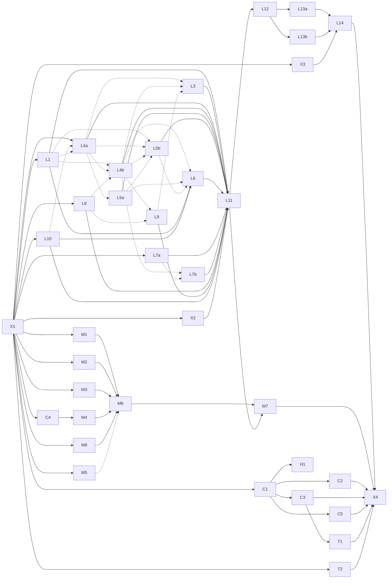

# Stage 02 implementation plan: tree quotients (revision 3, ready to launch)

Status: P3 implementation plan, **revision 3** = revision 2 (8420e70, re-planning drafter, Opus) with the replan audit
`audits/stage-02-replan-audit.md` (A1–A26) and the reviser's own findings N1–N11 resolved in
`audits/stage-02-replan-resolution.md` (reviser: Opus, 2026-11-14). Binding conventions: `OVERVIEW.md` (4deb009; §1
aggregators, §2 branches, §3.6, §4.3 TITAN incl. the S02-X1 tool fixes and the job-id grammar O16, §4.4, §5.1, §5.2,
§6.1 O12c/O13, §8 F18, §9) and `briefs/replan-s02-06.md`. Binding decision of the re-planning master: stage 02 delivers
`partialHom` and the two-term complex with **trivial coefficients only**; stage 03 (S03-L14) generalises them to
coefficients on top of the interface of §4.1. Sources: `plan/staged/stage-02-tree-quotients.tex` (*tex*, labels
`…:s02-…`), `SPLIT.md` §02, `audits/stage-02-{muse,resolution}.md`, `experiments/SUMMARY.md`, `runs/s01.md`, the s01
closure, `stage-03.md` (consumer), and the Lean tree `lean/Langlandscape/` = `main` (read only; no Lean change since
7ce2a3e). Change notes of rev. 2: `audits/stage-02-replan-notes.md`.

## 0. Scope, fixed decisions, inputs from stage 1

### 0.1 Deliverables
- **Lean = the SA-free core** (tex L02.3): from connectivity of the finite graph `BG(U,q)` (`prop:s02-BG`(iii)) derive
  the quotient bijections and stabilisers (`prop:s02-quot`(a),(b)); the tree-free route from (i); `prop:s02-quot`(c)
  (Hecke commutation away from q); the finite bipartite graph layer with `H_1` (`def:s02-indef` over ℤ, deviation D1);
  the two-term complex `partialHom`/`deltaCoh` on Brandt modules with **trivial coefficients** (binding; coefficients:
  S03-L14 on the §4.1 interface); `lem:s02-tree`(b)–(d), `lem:s02-normone`, and the carried-over `lem:s01-nrd` (S02-L10).
- **Maths** = chapter `mathematics/chapters/s02` (all statements of the tex, full proofs where the tex says \stproved),
  Fable chapter audit PASS, PDF.
- **Code** = tree-quotient builder, validation, T2/T3 tables, torsion example, `H_*(Γ_U,V_k)` ranks. **Talk** = 2 slides.

### 0.2 Registered hypotheses (never axioms; OVERVIEW §3.6). X1 writes these rows (all 8 columns, status `open`); the
owner WP confirms "used by" in its report.
| Lean name | file | statement label | source | used by (decls) | instances | discharge plan | status |
|---|---|---|---|---|---|---|---|
| `Langlandscape.Hyp.SA d q hq` | `Hyp/SA.lean` | `thm:s02-SA`, `if:s02-SA`: `∀ U, Tree.IsQAdmissible d q hq U → Tree.SAat d q hq U` (shape (SA_U)) | Voight 28.5.3 + 28.5.12; Vignéras III.4.3 | `Tree.BGConnected_of_SA_HS`, L6 `…_of_SA_HS` | none (it is the theorem; per level it is replaced by `BGConnected`, `prop:s02-BG`) | L02.SA, post-hackathon | open |
| `Langlandscape.Hyp.HS d` | `Hyp/HS.lean` | `lem:s02-normone`(b) input: `∀ r : ℚ, 0 < r → ∃ γ : Bˣ, nrd γ = r` | Voight 14.7.4; Vignéras III.4.1 | `Tree.XBone_toXB_bijective`, `Tree.BGConnected_of_SA_HS`, L6 `…_of_SA_HS` | none in stage 02 (Hasse–Minkowski input) | Hasse–Schilling, post-hackathon | open |
| `Langlandscape.Hyp.BTtree q` | `Hyp/BTtree.lean` | `lem:s02-tree`(a): `(Tree.graph q).IsTree ∧ ∀ v, Nat.card ((Tree.graph q).neighborSet v) = q + 1` | Serre II.1.1 Thm 1; Ludwig–Merten `BTtree` | `Tree.BGConnected_of_surj`, `Tree.BGConnected_of_SA_HS` (only the (i)⇒(iii) step) | none | port of L–M (v4.19 → v4.35), post-hackathon | open |
| `Langlandscape.Hyp.SerreCoh d q hq U hU hconn R` | `Hyp/SerreCoh.lean` | `prop:s02-coh`(b), trivial coefficients, **under (iii)** (`hconn : Tree.BGConnected …`) | Serre II.2.8 Prop 13 + Rem 1; Brown VII.7 | — (statement only) | none | L02.6, post-hackathon | open |
| `Langlandscape.Hyp.SerreFree d q hq U hU hconn hfree` | `Hyp/SerreFree.lean` | `prop:s02-free`(a), **under (iii) and `hfree : ∀ x, Gam U x = ⊥`** | Serre I.3.3 Thm 4′, II.1.5 Thm 4; Bass 3.6 | — | none | needs `Hyp.BTtree` + Serre I.3, post-hackathon | open |
Reused, not redefined: `GL2TF.Hyp.EichlerMass` (counts only). Cited only, no Lean: `prop:s02-coh`(c),(d) (full SA at p,
D3), `rem:s02-normone`, `rem:s02-CD`, `rem:s02-torsion` (computed by C4). Not scheduled: L02.1(a) port, L02.5
identification with `H_1(Γ_U,ℤ)`, L02.6, L02.SA.

### 0.3 Lean conventions
- Files `lean/Langlandscape/Langlandscape/Tree/*.lean` (`Langlandscape.Tree`), `…/Graph/*.lean` (`Langlandscape.Graph`),
  `…/Hyp/*.lean` (`Langlandscape.Hyp`), `…/Quat/LevelNrd.lean` (`Langlandscape.Quat`), tests `LanglandscapeTests/S02/*.lean`.
  **Every file name is fixed by X1's stub (§3.1 step 2)**; a worker fills its stub and creates no other module.
- **Name clash (N9):** Mathlib has `_root_.Graph` (`Mathlib/Combinatorics/Graph/Basic.lean:90`). Never `open Graph`; write
  `Langlandscape.Graph.…` in axiom files, tests and other namespaces.
- Graphs are incidence structures `E ⇉ V₀ ⊔ V₁` (loops/multi-edges), never `SimpleGraph` for quotients. Tree in **coset
  form**: vertices `GL₂(ℚ_q) ⧸ (Z·GL₂(ℤ_q))`, all **oriented** edges `GL₂(ℚ_q) ⧸ (Z·Iw_q)` (both orientations of every
  geometric edge, N1), and the tex's edge set `EdgeO q` = the edges with type-0 origin. Orientation type 0 → type 1.
  `SL₂` appears as the acting group and in transitivity/stabiliser statements (muse F4 rejected, kept).
- `q : ℕ`, `[Fact q.Prime]`, `hq : ¬ q ∣ d.D`; S01 API that needs `q.Coprime d.D` gets `Tree.coprime_of_not_dvd hq` (L4a).
  `U0q U` abbreviates `d.U0q q (Tree.coprime_of_not_dvd hq) U`.
- **Docstrings (OVERVIEW §3.6, §9 lesson 3, exact):** every `theorem`/`lemma`, **including `private` ones and those in
  `LanglandscapeTests/`**, has an immediately preceding `/-- … -/` containing a label `s02-…` (stage-tex label, e.g.
  "`lem:s02-tree`(d) (`s02-tree`)"); `check_wp.sh` (after X1 step 1) enforces it in the integration round and the stage
  master never patches docstrings. Public `def`/`structure`/`instance` also have a docstring; this is **not
  machine-checked** and is reviewed in every WP audit and in L12 (A19). Hypotheses are explicit arguments.

### 0.4 What stage 1 delivered that stage 02 uses (verified in `lean/Langlandscape/` = `main`)
| need | declaration (file) |
|---|---|
| local level groups at q | `Langlandscape.Local.GL2Zl ℓ`, `K0 ℓ e`, `K1 ℓ e`, `Iw ℓ := K0 ℓ 1`, `mem_GL2Zl_iff`, `mem_K0_iff_exists`, `matGL`, `diagGL`, `intUnit` (`Local/GL2Levels.lean`) |
| α = diag(1, q) | `Langlandscape.Local.diagOneP q` (`Local/UpCosets.lean`); `varpiDiag`, `cartanRep`, `exists_cartanRep_inv_mul` (`Brandt/HeckeFinite.lean`, q+1 coset reps) |
| ι_q, components | `Quat.localComponent d ℓ hℓ`, `localComponent_finEmbed`, `localComponent_finEmbed_eq_ellAdicSplitting`, `localComponent_mem_GL2Zl`, `DefiniteData.iota` (a `ℚ_[ℓ]`-algebra equiv, `Quat/LocalComponent.lean`); `localEmbedGL d p hp` (= `localEmbed ∘ iotaGL.symm`), `awayAt`, `IsInvariantAt`, `IsInvariantAt.inf`, `isInvariantAt_Ohat`, `isInvariantAt_comap_of_ne`, `mem_U_iff_factor_at`, `localEmbedGL_mem_inf_comap`, `localComponent_localEmbedGL_of_ne`, `commute_awayAt_localEmbedGL` (`Quat/LocalEmbed.lean`) |
| levels | `DefiniteData` (`a b D O hD`), `d.Ohat`, `d.U0 N hN`, `d.U1 N hN`, `d.Utower M p s hN`, `d.U0q q (hq : q.Coprime d.D) U := U ⊓ d.U0 q hq` (`Quat/Basic.lean`, `Quat/Levels.lean`) |
| class sets, Γ_x, finiteness | `XB U`, `globalUnits`, `Gam U x`, `wx`, `massFull`, `XB_finite`, `instFiniteXBOhat`, `finite_XB_U0/U1/Utower` (`Quat/Basic.lean`, `Quat/LevelFinite.lean`); `nrd_eq_one_of_mem_Gam`, `card_Gam_dvd_24`, `Gam_eq_bot_of_le_U1` (`Quat/Stab.lean`); `iotaU`, `XB_finite_of_relIndex`, `mem_Gam_iff`, `Gam_translate`, `wx_translate`, `massW_level_change` (`Quat/Weights.lean`) |
| maps between class sets | `Brandt.levelMap U' U`, `levelMap_mk`, `pushforward`, `trace (hrel : U'.relIndex U ≠ 0)`, `traceRaw`, `normMap_pushforward` (`Brandt/Adjoint.lean`); `translateMap U V g`, `translateMap_mk`, `rightConj U g` (= `g⁻¹Ug`), `rightTranslate`, `translateLin`, `rightTranslateLin` (`Brandt/RightTranslate.lean`) |
| Brandt modules | `ZX U R := XB U →₀ R`, `ZXdual U R := XB U → R`, `brandtModule`, `brandtModuleTrivEquiv`, `normMap`, `normMap_apply`, `normMap_bijective`, `brandtPairing`, `evalPairing` (`Brandt/Module.lean`) |
| Hecke | `heckeT U g R hfin` (`hfin : (U ⊓ conjSub U g).relIndex U ≠ 0`), `heckeTHom` (`[Finite (XB U)]`), `heckeTHom_transpose` (`Brandt/DoubleCoset.lean`); `heckeT_comm_translate` (needs `g⁻¹Ug ⊆ V` **and** `gVg⁻¹ ⊆ U`), `heckeT_comm_rightTranslate`, `heckeT_comm_rightTranslate_localEmbed` (the translation half of `prop:s02-quot`(c)); `Tl`, `Sl`, `diamond`, `PiEll`, `elemT`, `relIndex_elemT_ne_zero*` (`Brandt/{Hecke,HeckeFinite,RightTranslate}.lean`). `Up` is defined only at `Utower` levels (`Brandt/Up.lean:146`) |
| import | `GL2TF.Quat.nrd`, `nrdHom`, `BHat`, `classStabilizer`, `nrd_definite`, `rat_isInt_of_mem_zhat`; **`GL2TF.Quat.splitting_norm_trace`** (public, `AlgJL/VolIII/Brandt/Coefficients.lean:57`: `det s(x) = nrd x` for a splitting of `B` over `K`); private `hl_det_eq_nrd` (`…/HeckeLocal.lean:230`, the `ℚ_[ℓ]`-algebra-hom version, template for L10); `GL2TF.Local.iwasawa_local`, `cartan_exists`, `cartanElement` (`AlgJL/VolI/P0/Decompositions.lean`) with S01's bridge `Brandt.mem_K_iff_GL2Zl` (`Brandt/ImportDictionary.lean:143`) |
Correction kept from rev. 1: the import has no Iwahori; `Iw` comes from S01.

### 0.5 Carried-over items
| item | disposition in stage 02 |
|---|---|
| `lem:s01-nrd` | **S02-L10** (sonnet, off path), incl. `det_iota` (A8) |
| 80 Lean linter warnings, L15 R8b/R8c names (F17) | **S02-X3**, single-WP TITAN job, merged after gate1 (A14) |
| `U_ℓ` at ℓ ∣ N; `Up` finiteness hyps; product ⟨d⟩ | not needed (L7 uses `heckeT` with explicit `hfin`; the `Up` corollary is the `varpiDiag` instance, A7); carried to stage 04 |
| Hecke with coefficients; coefficient two-term complex | stage 03 S03-L14 (complex), stage 04 S04-L15a (Hecke); stage 02 exports §4.1 |
| tex corrections from S01 | M7 checks chapter s02 cites `rightTranslateLin` from level `g⁻¹Ug` to `U` |
| HACS (F16) | `code/hacs/` still empty: S02-H1 conditional, not counted |
| OVERVIEW §4.3 kickoff tool fixes (`check_wp.sh` pattern, `titan_batch.sh` axiom counter, Vendor mapping) | **S02-X1 step 1**, committed on `wip-implementation` **before** any branch is created (A1, N4) |
| LICENSE (F5) | Fabian; not a stage-02 item |

### 0.6 Kept from revision 1 and its Muse resolution
F1, F2, F3, F5, F7, F8 (connectivity example, now `decide +kernel` or explicit walk, A21), R1 (partial export to stage
03), R3. WP ids of rev. 1/2 are kept (stage 03 cites `S02-L4b/L6/L7/L8/L9`); rev. 3 splits L7 into **L7a/L7b** (both
keep the `L7` prefix; stage 03's `heckeT_comm_s*` inputs come from L7b). Superseded: muse/mistral, local Lean, "Fable
alone", the 12 h path, TBD models.

## 1. Work packages

Model column per OVERVIEW §5.1. Times: agent-active / wall (min, §4.4; Lean wall includes TITAN rounds). `rem.` =
remote-eligible (§6). **CHK(WP)** = in the WP's TITAN round, on the integration tree: `CHECK_WP <WP> rc=0 0 FAIL lines`
**and** `AXIOMS .titan/s02_<wp>_axioms.lean rc=0 printed=<e> expected=<e> nonstandard=0` (patched counter, X1). CHK(X3)
has no AXIOMS part (A3). **TEX(files)** = `latexmk -pdf standalone-s02.tex` in `mathematics/` exit 0, no undefined
refs/cites, the WP's labels exactly as in the tex. **PY(table)** = `pytest code/python` pass and the stated numbers in
`code/results/s02/*.json` with provenance.

### Track X
| id | goal | inputs | outputs | acceptance | diff. | model (+fix) | act/wall | TITAN | rem. | deps |
|---|---|---|---|---|---|---|---|---|---|---|
| S02-X1 | stage kickoff, **four ordered steps** (§3.1): (1) tool fixes, (2) stubs + aggregators, (3) briefs, `BASE_S02`, branches/worktrees, (4) int1 spec | OVERVIEW §2, §3.6, §4.3; this plan §0.2, §1, §3 | step 1: `tools/check_wp.sh`, `tools/titan_batch.sh`, new `tools/axcount.sh`; step 2: 20 library + 12 test stub files (§3.1), root import lines, `Audit/PrintAxioms.lean` S02 block (§3.4), `HYPOTHESES.md` 5 rows, `mathematics/chapters/s02.tex`, `mathematics/standalone-s02.tex`, `main.tex` line, `code/results/s02/.gitkeep`; step 3: `plan/implementation/experiments/briefs/{s02-l1,s02-m1}.md`, worktrees; step 4: `impl/s02-int1`, spec text | the acceptance list of §3.1 (dry runs without Lean; `latexmk` of both drivers; `git merge-base --is-ancestor $BASE_S02` for every new branch); int1 then verifies the tools live | mechanical | sonnet (+1 opus fix ≤ 5) for step 1; stage master for steps 2–4 | 12 / 15 | int1 | no | S01 on `main`; launch checklist (resolution) |
| S02-X2 | axiom-list generator (§9 lesson 2) | WP output names (§1), `Audit/PrintAxioms.lean` | `lean/Langlandscape/tools/gen_axioms.py [--names N1,N2,…] FILE…` (parses `namespace`/`end`/`section`, emits one `import` per declaring module and `#print axioms <Full.Name>` per listed name, or per public `theorem`/`lemma`/`def` found when `--names` is absent), usage line in `tools/README` (or the script header) | local, no Lean: `gen_axioms.py --names normMap_bijective_padic,Up_comm_Tl,Tl_adjoint,diamond_adjoint,PiEll_adjoint,Tl_selfAdjoint_U0,card_XB_Utower Langlandscape/Brandt/Corollaries.lean Langlandscape/Quat/MassTower.lean` equals `origin/impl/s01-int2f:lean/Langlandscape/.titan/l17_l4c_axioms.lean` modulo line order (A22); on `Local/GL2Levels.lean` every name starts `Langlandscape.Local.` | mechanical | haiku (ladder → sonnet); runs in the `impl` worktree (no own worktree) | 5 / 8 | — | no | X1 step 1 |
| S02-X3 | S01 hygiene (F17): linter warnings, private helper/test names of L15 R8b/R8c; no statement or public-name change | warning list from `origin/titan/s01-final-1:lean/Langlandscape/.titan/out/a-build.log` (80 lines `^warning: Langlandscape/`); `audits/2026-11-14_s01.md` R8b/R8c | edits in `Langlandscape/**/*.lean` (S01 files only), `LanglandscapeTests/S01/*` | single-WP job `s02-x3-<n>` (priority 3, §3.2): `CHECK_WP X3 rc=0 0 FAIL lines`, step (2) `FULL lbuild rc=0`, reported `grep -c '^warning: Langlandscape/' .titan/out/build.log` < 20; `git diff -U0` shows no changed line starting with `theorem`/`lemma`/`def`/`abbrev`/`structure` of a public name (reviewer: stage master); merged **after gate1**, covered by the final gate | mechanical | sonnet (+1 opus fix ≤ 5) | 15 / 40 | `s02-x3-1` | no | X1 (worktree when a slot frees, §3.1) |
| S02-X4 | milestone closure + `runs/s02.md` + experiment LOG rows (haiku logger) | all | `outbox/<UTC>_milestone-closure-s02.md`, `runs/s02.md`, `experiments/LOG.md` rows E1/E4 | format of the s01 closure; every WP has a row | mechanical | stage master + haiku | 5 / 5 | — | no | L14, M7, C/T done |

### Track L (`lean/Langlandscape/`; no local Lean, F10; all checks on TITAN)
Statement shapes below are binding (names and argument order); a worker who must change one reports it in the first fix
round and the stage master re-binds downstream briefs. `lc` = `localComponent d q hq`.
| id | goal | inputs | outputs (files; declarations) | acceptance | diff. | model (+fix) | act/wall | TITAN | rem. | deps |
|---|---|---|---|---|---|---|---|---|---|---|
| S02-L1 **[E1]** | local layer at q, coset-model tree, `lem:s02-tree`(b)–(d) | `def:s02-tree`, `lem:s02-tree`(b)–(d) + proofs, `rem:s02-treeconv`; S01 `GL2Zl`, `Iw`, `K0`, `mem_K0_iff_exists`, `diagOneP`, `cartanRep`, `exists_cartanRep_inv_mul`; *optional* import `GL2TF.Local.iwasawa_local`, `cartan_exists`, `cartanElement` + bridge `Brandt.mem_K_iff_GL2Zl` (A9); Mathlib `QuotientGroup`, `MulAction.stabilizer`, `Padic.valuation`, `SimpleGraph`. Note for the brief: in coset form, transitivity is elementary (`h = s · diag(1, det h)` with `diag(1, u) ∈ Iw`) | `Tree/Local.lean`: `alphaq q := Local.diagOneP q`, `SLq q := (Matrix.GeneralLinearGroup.det).ker`, `SL2Zq q := SLq q ⊓ GL2Zl q`, `Kalpha q := (GL2Zl q).map (MulAut.conj (alphaq q)).toMonoidHom`, `K1q q := SLq q ⊓ Kalpha q`, `IwSL q := SLq q ⊓ Iw q`, `vdet q : GL (Fin 2) ℚ_[q] → ZMod 2` (`v_q(det g) mod 2`), `vdet_mul`, `GL2Zl_inf_Kalpha : GL2Zl q ⊓ Kalpha q = Iw q`, `alphaq_inv_conj_mem_GL2Zl (hk : k ∈ Iw q) : (alphaq q)⁻¹ * k * alphaq q ∈ GL2Zl q`, `exists_SL2Zq_inv_mul_mem_Iw (hk : k ∈ GL2Zl q) : ∃ s ∈ SL2Zq q, s⁻¹ * k ∈ Iw q`, `exists_K1q_inv_mul_mem_Iw (hk : k ∈ Kalpha q) : ∃ s ∈ K1q q, s⁻¹ * k ∈ Iw q`, `relIndex_Iw : (Iw q).relIndex (GL2Zl q) = q + 1`; `Tree/Coset.lean`: `ZK q := Subgroup.center _ ⊔ GL2Zl q`, `ZIw q := Subgroup.center _ ⊔ Iw q`, `Vert q := GL (Fin 2) ℚ_[q] ⧸ ZK q`, `Edge q := GL (Fin 2) ℚ_[q] ⧸ ZIw q` (**all oriented edges**), `o t : Edge q → Vert q` (`o [g] = [g]`, `t [g] = [g * alphaq q]`), `vtype : Vert q → ZMod 2`, `vtype_smul : vtype (g • v) = vdet q g + vtype v`, `vtype_t : vtype (t e) = vtype (o e) + 1`, **`EdgeO q := {e : Edge q // vtype (o e) = 0}`** (the tex's edge set, N1), `oO tO : EdgeO q → Vert q`, `instance : MulAction (SLq q) (EdgeO q)`, `v0 := [1]`, `v1 := [alphaq q]`, `e0 : EdgeO q`, `o_smul`, `t_smul`, `oO_e0 : oO e0 = v0`, `tO_e0 : tO e0 = v1`, `vtype_oO : vtype (oO e) = 0`, `vtype_tO : vtype (tO e) = 1`, `preserves_vtype_iff : (∀ v, vtype (g • v) = vtype v) ↔ vdet q g = 0` (b), `SLq_transitive_type0 (h : vtype v = 0) : ∃ s : SLq q, s • v0 = v`, `SLq_transitive_type1 (h : vtype v = 1) : ∃ s : SLq q, s • v1 = v`, `SLq_transitive_edge (e : EdgeO q) : ∃ s : SLq q, s • e0 = e`, `stabilizer_v0 : MulAction.stabilizer (SLq q) v0 = (SL2Zq q).subgroupOf (SLq q)`, `stabilizer_v1 : … v1 = (K1q q).subgroupOf (SLq q)`, `stabilizer_e0 : … e0 = (IwSL q).subgroupOf (SLq q)` (c), `graph q : SimpleGraph (Vert q)` (`v ~ w` iff some `e : EdgeO q` has `{oO e, tO e} = {v, w}`); tests `LanglandscapeTests/S02/Coset.lean` (q = 2: `oO e0 = v0`, `tO e0 = v1`, `vtype v1 = 1`, `(graph 2).Adj v0 v1`) | CHK(L1) in the strand jobs `s02-l1-a/b-<n>` (spec `.titan/spec-l1.txt`, §3.3); Fable WP audit (blind, §5); deadline rule §5 | hard | **E1**: opus (reference, +1 planned opus fix) vs sonnet (challenger, ladder → opus) | 20 / 45 | strand jobs | no | X1 |
| S02-L4a | statement layer: q-levels, `Γ_U`, action on the tree, norm-one class set, `SAat`, `Hyp.SA`, `Hyp.HS` | `def:s02-{GU,Xone}`, `thm:s02-SA` (SA_U), `lem:s02-normone`(b); S01 `IsInvariantAt`, `localEmbedGL`, `awayAt`, `iotaU`, `localComponent_finEmbed_eq_ellAdicSplitting`, `U0q`, `U0`, `U1`, `Utower`; import `splitting_norm_trace`; L10 `nrdHat`, `NrdSurj` (declared) | `Tree/Admissible.lean` (S01 + import + L10 only): `coprime_of_not_dvd (hq : ¬ q ∣ d.D) : q.Coprime d.D`, `HasFactorAt d q hq (K) (U) : Prop := ∃ V, IsInvariantAt d q hq V ∧ U = V ⊓ K.comap lc`, `IsQLevel d q hq U : Prop := U ≤ d.Ohat ∧ U.relIndex d.Ohat ≠ 0 ∧ HasFactorAt d q hq (GL2Zl q) U` (A18), `IsQAdmissible d q hq U := IsQLevel d q hq U ∧ Quat.NrdSurj d U`, `isQLevel_Ohat`, `isQLevel_U0 (hqN : ¬ q ∣ N)`, `isQLevel_U1 (hqN : ¬ q ∣ N)`, `isQLevel_Utower (hqN : ¬ q ∣ M * p ^ s)` (N3), `hasFactorAt_U0q (hU : IsQLevel d q hq U) : HasFactorAt d q hq (Iw q) (U0q U)`, `det_localComponent_finEmbed (γ) : ((Matrix.GeneralLinearGroup.det (lc (iotaU d.a d.b γ)) : ℚ_[q]ˣ) : ℚ_[q]) = ((nrd (γ : QuatAlg ℚ d.a d.b) : ℚ) : ℚ_[q])` (from `splitting_norm_trace`, A8), `BHatOne d := (Quat.nrdHat d.a d.b).ker`, `GammaU d q hq U : Subgroup (QuatAlg ℚ d.a d.b)ˣ` (`nrd γ = 1 ∧ awayAt d q hq (iotaU d.a d.b γ) ∈ U`), `mem_GammaU_iff`, `XBone d U` (`B¹\B̂¹/U¹`), `XBone.toXB`, **`SAat d q hq U : Prop`** (SA_U: `∀ y ∈ BHatOne d, ∃ β : Bˣ, nrd β = 1 ∧ ∃ g, Matrix.GeneralLinearGroup.det g = 1 ∧ ∃ u ∈ U ⊓ BHatOne d, lc u = 1 ∧ y = iotaU β * localEmbedGL d q hq g * u`, N2); `Hyp/SA.lean`: `Hyp.SA d q hq : Prop := ∀ U, Tree.IsQAdmissible d q hq U → Tree.SAat d q hq U`; `Hyp/HS.lean`: `Hyp.HS d : Prop := ∀ r : ℚ, 0 < r → ∃ γ : (QuatAlg ℚ d.a d.b)ˣ, nrd (γ : QuatAlg ℚ d.a d.b) = r`; tests `LanglandscapeTests/S02/Admissible.lean` (`isQLevel_Ohat`, `1 ∈ GammaU`, `isQLevel_U0` for a `DefiniteData` variable) | CHK(L4a); opus WP audit (faithfulness of `GammaU`, `SAat` vs (SA_U), `IsQLevel` vs "compact open, `U = U_q × U^{(q)}`") | hard | opus (+1 planned opus fix) | 20 / 50 | int1 → int1a | no | X1, L10 (decl.) |
| S02-L4a (act) | spec line `L4a-act` of the same WP: action of `Γ_U` on the tree | L1 (decl.), `Admissible.lean` | `Tree/Action.lean`: `gammaQGL : GammaU d q hq U →* GL (Fin 2) ℚ_[q]` (`γ ↦ lc (iotaU γ)`), `gammaQ_mem_SLq` (from `det_localComponent_finEmbed`), `gammaQ : GammaU d q hq U →* Tree.SLq q`, `MulAction` instances of `GammaU d q hq U` on `Vert q`, `Edge q`, `EdgeO q` (via `MulAction.compHom` along `gammaQ`), `gammaU_smul_vtype : vtype (γ • v) = vtype v`; tests `LanglandscapeTests/S02/Action.lean` (`(1 : GammaU …) • v0 = v0`) | CHK(L4a-act) | (in L4a) | (in L4a) | (in L4a) | int1 → int1a | no | L1 (decl.) |
| S02-L4b | `s_0, s_1`, `BG(U,q)`, `BGConnected`, pull/push, index and finiteness plumbing | `def:s02-BG`; L1 `alphaq_inv_conj_mem_GL2Zl`, `relIndex_Iw`; L4a `IsQLevel`, `hasFactorAt_U0q`; L8 `BipMultigraph`; S01 `levelMap`, `translateMap`, `rightConj`, `XB_finite_of_relIndex`, `mem_U_iff_factor_at` | `Tree/BrandtGraph.lean`: `alphaElt d q hq := localEmbedGL d q hq (Tree.alphaq q)`, `alphaElt_inv_conj_mem (hU : IsQLevel d q hq U) (hu : u ∈ U0q U) : (alphaElt d q hq)⁻¹ * u * alphaElt d q hq ∈ U`, `relIndex_U0q (hU) : (U0q U).relIndex U = q + 1`, `relIndex_U0q_ne_zero (hU)`, `s1Level d q hq U := rightConj (U0q U) (alphaElt d q hq)`, `s1Level_le (hU) : s1Level d q hq U ≤ U`, `relIndex_s1Level_ne_zero (hU) : (s1Level d q hq U).relIndex U ≠ 0`, `finite_XB_of_isQLevel (hU) : Finite (XB U)`, `finite_XB_U0q (hU) : Finite (XB (U0q U))` (A18), `s0 d q hq U : XB (U0q U) → XB U := levelMap (U0q U) U`, `s1 d q hq U : XB (U0q U) → XB U := translateMap (U0q U) U (alphaElt d q hq)`, `s0_mk`, `s1_mk (hU) : s1 … [y] = [y * alphaElt d q hq]`, `BG d q hq U hU : Graph.BipMultigraph` (`V0 = V1 = XB U`, `E = XB (U0q U)`, maps `s0`, `s1`), `BGConnected d q hq U hU : Prop := (BG d q hq U hU).Connected`, `s0Pull s1Pull : ZXdual U R →ₗ[R] ZXdual (U0q U) R` (`LinearMap.funLeft R R (s0 …)`, resp. `s1`), `s0Push s1Push : ZX (U0q U) R →ₗ[R] ZX U R` (`Finsupp.lmapDomain R R (s0 …)`, resp. `s1`), `s0Push_single`, `s1Push_single`; tests `LanglandscapeTests/S02/BrandtGraph.lean` | CHK(L4b) | routine (mech.-with-meaning), on the critical path, stacked on 3 drafts | **opus (+1 planned opus fix)** (A26) | 15 / 40 | int2 → int2a | no | L1, L4a, L8 (drafts) |
| S02-L5a | `lem:s02-normone` | `lem:s02-normone` + proof; import `nrd_definite`, `rat_isInt_of_mem_zhat`; S01 `nrd_eq_one_of_mem_Gam`, `mem_Gam_iff` | `Tree/NormOne.lean`: `XBone_toXB_injective (hU : U ≤ d.Ohat)` (a), `GammaOne_eq_Gam` (`B¹ ∩ xU¹x⁻¹ = Γ_x` for `x ∈ BHatOne d`), `XBone_toXB_bijective (hHS : Hyp.HS d) (hN : Quat.NrdSurj d U) (hU : U ≤ d.Ohat)` (b); tests `LanglandscapeTests/S02/NormOne.lean` | CHK(L5a) | routine | sonnet (+1 opus fix ≤ 5) | 12 / 40 | int2 → int2a | no | L4a (draft) |
| S02-L5b | **core** `prop:s02-BG` | `prop:s02-BG` + proof; L1, L4a, L4b, L5a | `Hyp/BTtree.lean`: `Hyp.BTtree q : Prop` (row §0.2); `Tree/QuotientCore.lean`: `phiV : MulAction.orbitRel.Quotient (GammaU d q hq U) (Vert q) → XB U ⊕ XB U` (type 0 `[s • v0] ↦ inl [localEmbedGL s]`, type 1 `[s • v1] ↦ inr [localEmbedGL (s * alphaq q)]`), `phiE : MulAction.orbitRel.Quotient (GammaU d q hq U) (EdgeO q) → XB (U0q U)`, `phiV_oO`, `phiV_tO` (endpoints ↦ `inl ∘ s0`, `inr ∘ s1`), `phiV_injective (hU)`, `phiE_injective (hU)`, `phi_locSurj_type0 (hU)`, `phi_locSurj_type1 (hU)`, `surjType0 d q hq U : Prop` ((i)), `bijective_of_BGConnected (hU) (hc : BGConnected …) : Function.Bijective phiV ∧ Function.Bijective phiE` ((iii) ⇒, SA- and tree-free), **`bijective_of_surjType0 (hU) (h : surjType0 …)`** ((i) ⇒ bijections, tree-free, A6), `surj_of_SA (hU) (hSA : SAat d q hq U) (hX : Function.Surjective (XBone.toXB …)) : surjType0 …` ((ii) ⇒ (i)), `SA_of_surj (hU) (h : surjType0 …) : SAat d q hq U ∧ Function.Surjective (XBone.toXB …)` ((i) ⇒ (ii), per level, N2), `BGConnected_of_surj (hBT : Hyp.BTtree q) (hU) (h : surjType0 …) : BGConnected …` ((i) ⇒ (iii)), **`BGConnected_of_SA_HS (hSA : Hyp.SA d q hq) (hHS : Hyp.HS d) (hBT : Hyp.BTtree q) (hU : IsQAdmissible d q hq U) : BGConnected d q hq U hU.1`** (export for S03-L9, A6); tests `LanglandscapeTests/S02/QuotientCore.lean` | CHK(L5b); `#print axioms bijective_of_BGConnected` and `bijective_of_surjType0` standard and their argument lists contain no `Hyp.*`; opus WP audit (risk 2) | hard | opus (+1 planned opus fix) | 20 / 55 | int3 → int3b | no | L1, L4a, L4b, L5a (drafts) |
| S02-L6 | `prop:s02-quot`(a),(b) packaged; `prop:s02-free`(b) count | `prop:s02-quot`, `prop:s02-free`(b); L1 `stabilizer_*`; L4b `relIndex_U0q`; L5a; L5b; S01 `Gam_translate`, `massW_level_change` | `Tree/Quotient.lean`: `quotVEquiv (hU) (hc : BGConnected …) : MulAction.orbitRel.Quotient (GammaU …) (Vert q) ≃ XB U ⊕ XB U`, `quotEEquiv (hU) (hc) : MulAction.orbitRel.Quotient (GammaU …) (EdgeO q) ≃ XB (U0q U)`, `quotEquiv_oO`, `quotEquiv_tO`, versions `quotVEquiv_of_SA_HS`, `quotEEquiv_of_SA_HS (hSA : Hyp.SA d q hq) (hHS : Hyp.HS d) (hU : IsQAdmissible …)` (via `bijective_of_surjType0`; **no `Hyp.BTtree`**, A6), `stab_gv0_eq_Gam (hU) (g : SLq q) : (MulAction.stabilizer (GammaU …) (g • v0)).map (GammaU …).subtype = Gam U (localEmbedGL d q hq g)`, `stab_gav0_eq_Gam` (`g • v1`, `Gam U (localEmbedGL d q hq (g * alphaq q))`), `stab_ge0_eq_Gam` (`g • e0`, `Gam (U0q U) (localEmbedGL d q hq g)`), **`card_XB_U0q_of_free (hU) (hfree : ∀ x, Gam U x = ⊥) : Nat.card (XB (U0q U)) = (q + 1) * Nat.card (XB U)`** (A5); tests `LanglandscapeTests/S02/Quotient.lean` | CHK(L6); opus WP audit | hard | opus (+1 planned opus fix) | 15 / 40 | int4 → int4b | no | L1, L4b, L5a, L5b (drafts), L10 |
| S02-L7a | level-change half of `prop:s02-quot`(c) (new S01-style lemmas, A7) | `prop:s02-quot`(c); S01 `heckeT`, `heckeTHom`, `heckeTHom_transpose`, `levelMap`, `pushforward`, `IsInvariantAt`, `mem_U_iff_factor_at`, `commute_localEmbed_of_commute` | `Tree/HeckeLevel.lean` (S01 only): `levelPull U' U R : ZXdual U R →ₗ[R] ZXdual U' R := LinearMap.funLeft R R (levelMap U' U)`; with `U := V ⊓ K.comap lc`, `U' := V ⊓ K'.comap lc`: `heckeT_comm_levelPull (hV : IsInvariantAt d q hq V) (hK' : K' ≤ K) (hK : K ≤ GL2Zl q) (t) (ht : localProjUnits d.a d.b q t = 1) (hfin : (U ⊓ conjSub U t).relIndex U ≠ 0) (hfin' : (U' ⊓ conjSub U' t).relIndex U' ≠ 0) : (heckeT U' t R hfin').comp (levelPull U' U R) = (levelPull U' U R).comp (heckeT U t R hfin)` (proof: `U'tU'/U' → UtU/U` is a bijection because the q-factor commutes with `t`), `heckeTHom_comm_levelPush` (same hypotheses + `[Finite (XB U)] [Finite (XB U')]`: `(pushforward U' U R).comp (heckeTHom U' t R hfin') = (heckeTHom U t R hfin).comp (pushforward U' U R)`, by transpose) | CHK(L7a); opus WP audit | hard | opus (+1 planned opus fix) | 15 / 40 | int3 → int3a | no | X1 (worktree when a slot frees) |
| S02-L7b | `prop:s02-quot`(c) for `s_j^*`, `s_{j*}` and the named operators | `prop:s02-quot`(c), `if:s01-hecke`; L4b; L7a; S01 `heckeT_comm_rightTranslate_localEmbed`, `Tl`, `Sl`, `diamond`, `varpiDiag`, `PiEll` | `Tree/Hecke.lean`: `heckeT_comm_s0Pull (hU) (t) (ht : localProjUnits d.a d.b q t = 1) (hfin) (hfin')`, `heckeT_comm_s1Pull` (same; `s1Pull` = `rightTranslateLin` ∘ `levelPull (s1Level …) U`, L7a at level `s1Level`), `heckeTHom_comm_s0Push`, `heckeTHom_comm_s1Push` (`[Finite]` from L4b), corollaries `Tl_comm_s1Pull (hℓq : ℓ ≠ q)`, `Sl_comm_s1Pull`, `diamond_comm_s1Pull`, `varpi_comm_s1Pull (hpq : p ≠ q)` (`t = localEmbedGL d p hp (varpiDiag p)`; replaces the ill-typed `Up_comm_s1Pull`, A7), *optional* `PiEll_comm_s1Pull` (ℓ ∣ D); tests `LanglandscapeTests/S02/Hecke.lean` | CHK(L7b) | routine | sonnet (+1 opus fix ≤ 5) | 10 / 35 | int4 → int4a | no | L4b, L7a (drafts) |
| S02-L8 | finite bipartite multigraphs, boundary, `H_1`, connectivity | `def:s02-indef` (D1), `prop:s02-free`(b); Mathlib only (`IsDomain.hasRankNullity`, `Mathlib/LinearAlgebra/Dimension/Localization.lean:177`) | `Graph/Bipartite.lean`: `structure BipMultigraph` (`V0 V1 E : Type`, `s0 : E → V0`, `s1 : E → V1`), `BipMultigraph.toSimpleGraph : SimpleGraph (G.V0 ⊕ G.V1)`, `BipMultigraph.Connected`, `instance [Fintype G.V0] [Fintype G.V1] [Fintype G.E] [DecidableEq G.V0] [DecidableEq G.V1] : Decidable G.Connected`; `Graph/H1.lean`: `boundary G R : (G.E →₀ R) →ₗ[R] (G.V0 →₀ R) × (G.V1 →₀ R)` (`e ↦ (−single (s0 e) 1, single (s1 e) 1)`), `H1 G R := LinearMap.ker (boundary G R)`, `aug G R : (G.V0 →₀ R) × (G.V1 →₀ R) →ₗ[R] R` (sum of all coefficients), **`range_boundary_of_connected [CommRing R] [Finite G.V0] [Finite G.V1] (hc : G.Connected) : LinearMap.range (boundary G R) = LinearMap.ker (aug G R)`**, **`finrank_H1_of_connected [CommRing R] [IsDomain R] [Finite …] (hc) : Module.finrank R (H1 G R) + Nat.card G.V0 + Nat.card G.V1 = Nat.card G.E + 1`** (N5; covers ℤ and fields); tests `LanglandscapeTests/S02/Graph.lean`: B₂, q = 7 shape (1+1 vertices, 2 edges): `finrank ℚ (H1 G ℚ) = 1`, same over `ZMod 5` and over `ℤ`; connectivity of a 2+2-vertex example by `decide +kernel` or an explicit walk (never `native_decide`, A21) | CHK(L8) | routine | sonnet (+1 opus fix ≤ 5); fallback if the domain version costs > 1 fix round: field `K` here and the ℤ statement in L9 | 15 / 35 | int1 → int1a | no | X1 |
| S02-L9 | two-term complex (trivial coefficients) and the tree model of the indefinite stage; **interface of §4.1** | `def:s02-Mhom`, `prop:s02-{coh,harm}` (combinatorial part), `def:s02-indef`, `if:s02-indef`; L4b, L8; S01 `trace`, `translateLin`, `normMap`, `normMap_pushforward`, `wx_translate` | `Tree/TwoTerm.lean`: `partialHom d q hq U R : ZX (U0q U) R →ₗ[R] ZX U R × ZX U R := (-(s0Push d q hq U R)).prod (s1Push d q hq U R)`, `partialHom_single`, `partialHom_eq_boundary (hU) : partialHom d q hq U R = Graph.boundary (BG d q hq U hU) R`, `deltaCoh d q hq U R : ZXdual U R × ZXdual U R →ₗ[R] ZXdual (U0q U) R` (`(f0, f1) ↦ s1Pull f1 − s0Pull f0`), `deltaCoh_apply`, `s0Tr (hU) : ZXdual (U0q U) R →ₗ[R] ZXdual U R := Brandt.trace (U0q U) U R (relIndex_U0q_ne_zero hU)`, `s1Tr (hU) := (Brandt.trace (s1Level d q hq U) U R (relIndex_s1Level_ne_zero hU)).comp (translateLin R (s1Level d q hq U) (U0q U) (alphaElt d q hq)⁻¹)`, `s0Tr_apply_mk`, `s1Tr_apply_mk` (`s1Tr f [x] = ∑ᶠ u : U ⧸ (s1Level …).subgroupOf U, f [x * u * (alphaElt …)⁻¹]`), `qNew (hU) := LinearMap.ker ((s0Tr hU).prod (s1Tr hU))`, `normMap_comp_s0Push (hU)`, `normMap_comp_s1Push (hU)` (`normMap U R ∘ₗ s_jPush = s_jTr ∘ₗ normMap (U0q U) R`; the `−1` condition of `normMap_pushforward` holds automatically), `qNewEquivKerPartial (hU) (hw : ∀ c : XB U, IsUnit ((wx U (Quotient.out c) : ℕ) : R)) : LinearMap.ker (partialHom d q hq U R) ≃ₗ[R] qNew …` (N11); `Tree/Indef.lean`: `Xindef d q hq U hU := Graph.H1 (BG d q hq U hU) ℤ`, `XindefR d q hq U R := LinearMap.ker (partialHom d q hq U R)`, `finrank_Xindef_of_connected (hU) (hc) : Module.finrank ℤ (Xindef …) + 2 * Nat.card (XB U) = Nat.card (XB (U0q U)) + 1`; tests `LanglandscapeTests/S02/TwoTerm.lean` | CHK(L9); opus WP audit (signs `∂ = (−s_{0*}, s_{1*})`, `δ = s_1^*f_1 − s_0^*f_0`, index factors; cross-check with M3 and C5) | hard | opus (+1 planned opus fix) | 20 / 45 | int2 → int2a | no | L4b, L8 (drafts) |
| S02-L10 | `lem:s01-nrd` (carry-over) + local `det ∘ ι_ℓ = nrd` | stage-01 tex `lem:s01-nrd`; S01 `localEmbedGL`, `diagGL`, `intUnit`, levels; import private `hl_det_eq_nrd` (template) and public `splitting_norm_trace` | `Quat/LevelNrd.lean`: **`det_iota (x : QuatAlg ℚ_[ℓ] d.a d.b) : (d.iota ℓ hℓ x).det = nrd x`** (re-proof of the private import argument, A8), `nrdHat a b : (BHat a b)ˣ →* FinAdeleˣ` (`Units.map (nrdHom FinAdele a b)`), `NrdSurj d U : Prop` (`nrdHat` maps `U` onto the units of `Ẑ`; the WP names the import's `Ẑ^×` subgroup it uses), `nrdSurj_Ohat`, `nrdSurj_U0`, `nrdSurj_U1`, `nrdSurj_Utower` (via `localEmbedGL (diag u 1)` per prime, glued); tests `LanglandscapeTests/S02/LevelNrd.lean` | CHK(L10) | routine | sonnet (+1 opus fix ≤ 5) | 18 / 40 | int1 → int1a | no | X1 |
| S02-L3 | register `Hyp.SerreCoh`, `Hyp.SerreFree` | `prop:s02-coh`(b), `prop:s02-free`(a); Mathlib `groupHomology`, `Rep.trivial`, `FreeGroupBasis`; L4a `GammaU`; L4b `BGConnected`; L9 `partialHom` | `Hyp/SerreCoh.lean`: `Hyp.SerreCoh d q hq U (hU : Tree.IsQLevel d q hq U) (hconn : Tree.BGConnected d q hq U hU) (R) [CommRing R] : Prop := (∀ x, IsUnit ((Nat.card (Gam U x) : ℕ) : R)) → Nonempty (groupHomology (Rep.trivial R (Tree.GammaU d q hq U) R) 1 ≃ₗ[R] LinearMap.ker (Tree.partialHom d q hq U R)) ∧ Nonempty (groupHomology (Rep.trivial R (Tree.GammaU d q hq U) R) 0 ≃ₗ[R] (ZX U R × ZX U R) ⧸ LinearMap.range (Tree.partialHom d q hq U R))` (A4); `Hyp/SerreFree.lean`: `Hyp.SerreFree d q hq U hU (hconn) (hfree : ∀ x, Gam U x = ⊥) : Prop := ∃ (ι : Type) (_ : Finite ι), Nat.card ι = (q - 1) * Nat.card (XB U) + 1 ∧ Nonempty (FreeGroupBasis ι (Tree.GammaU d q hq U))` (A4); tests `LanglandscapeTests/S02/SerreShape.lean` (both shapes typecheck for a variable level); HYPOTHESES "used by" lines in the report | CHK(L3); Fable checks faithfulness in L12 (item: `hconn`, `hfree`) | routine (mech.-with-meaning) | sonnet (+1 opus fix ≤ 5) | 12 / 35 | int3 → int3a | no | L4a, L4b, L9 (drafts) |
| S02-L11 | **early full gate** `s02-gate1-1` on `wip-implementation` | all core L merged (L1, L3, L4a, L4b, L5a, L5b, L6, L7a, L7b, L8, L9, L10) + X2 | outbox job (OVERVIEW §4.3 gate variant, `expected = <#print axioms lines of Audit/PrintAxioms.lean>`), `titan/s02-gate1-1`; the commit the Fable audit reads | (a)–(f) clean; printed = expected (= 161 + the S02 block of §3.4, re-checked against `gen_axioms.py` over all S02 files before sending), 0 non-standard; `grep -cE '(Built\|Replayed) Langlandscape\.(Tree\|Graph\|Hyp\.(SA\|HS\|BTtree\|SerreCoh\|SerreFree)\|Quat\.LevelNrd)' a-build.log` ≥ 20 and the 12 `LanglandscapeTests.S02.*` modules present (A2) | mechanical | stage master | 3 / 8 | gate1 | no | core L green |
| S02-L12 | Fable Lean audit (`lean_audit.md`) | gate1 commit; §0.2, §1 shapes | `lean/Langlandscape/audits/<date>_s02.md` | PASS / PASS WITH REMARKS; required remarks → L13a | conceptual | fable | 8 / 8 | — | no | L11 |
| S02-L13a | audit-fix WP for required Lean remarks | L12 report | edits of the named files | CHK of the touched WPs in `int5` | routine | opus (budget 13) | 10 / 20 | int5 | no | L12 |
| S02-L13b | audit-fix WP for hygiene remarks (docstrings, names) | L12 report | edits | CHK in `int5` | mechanical | sonnet (+1 opus fix ≤ 5) | 5 / 15 | int5 | no | L12 |
| S02-L14 | **final gate from scratch** `s02-final-1` | `wip-implementation` after L13a/b and X3 | outbox job, `titan/s02-final-1` | (a)–(f), fresh unseeded checkout; 0 sorry, printed = expected, 0 non-standard, `check_frozen` clean | mechanical | stage master | 2 / 7 | final | no | L13a, L13b, X3 |

### Track M (`mathematics/`; sub-coordinator M, Opus)
Section files are **new files** written by their WP; `chapters/s02.tex` (X1) inputs them with `\InputIfFileExists`.
New bib entries go to a per-WP file `mathematics/bib/s02-m<k>.bib` (new file, one writer; loaded by `standalone-s02.tex`
with `\IfFileExists`; merged into `references.bib` by the stage master in M7, A23); existing keys (`Se`, `Vo`, `Br`,
`Bass1993`, `Vig80`, `LM`, `Kneser1969`, `PlatonovRapinchuk1994`, `Casselman2014`, `DT`, `BC`) are preferred. NOTES lines
are returned in the WP report.
| id | goal | inputs | outputs | acceptance | diff. | model (+fix) | act/wall | TITAN | rem. | deps |
|---|---|---|---|---|---|---|---|---|---|---|
| S02-M1 **[E4]** | §1 the tree and the S-arithmetic group: `def:s02-tree`, `rem:s02-treeconv`, `lem:s02-tree` (b)–(d) full proofs, (a) cited, `def:s02-GU`, `def:s02-Xone`, `lem:s02-normone` | tex §§ tree, S-arithmetic group, proof strategy; `if:s01-classset` | `chapters/s02/1-tree.tex` | TEX(1-tree); Fable WP audit (blind) | routine | **E4**: sonnet (reference, +1 budgeted opus fix ≤ 2) vs opus (challenger, single shot) | 8 / 15 | — | no (strand) | X1 |
| S02-M2 | §2 SA and the Brandt graph: `thm:s02-SA` (cited, Voight 28.5.3/28.5.12 page-checked), `def:s02-BG`, **`prop:s02-BG`** (SA-free; mark where tree connectivity enters (i)⇒(iii); (i) ⇒ bijections tree-free), `prop:s02-quot` (a)–(c), `rem:s02-normone` | tex; `if:s01-hecke`; M8 notes if ready | `chapters/s02/2-quotient.tex`, `bib/s02-m2.bib` (if needed) | TEX(2-quotient); opus WP audit, planned opus fix; M6 | hard | opus (+1 planned opus fix) | 15 / 25 | — | **yes** | X1 |
| S02-M3 | §3 (co)homology: Serre Prop 13 with `∂=(−s_{0*},s_{1*})`, `def:s02-Mhom` incl. index factors (Γ_x/±1, F8), `prop:s02-{coh,harm,free}`, `def:s02-indef` (D1, F9, F17) | tex; `if:s01-brandt` | `chapters/s02/3-cohomology.tex`, `bib/s02-m3.bib` (if needed) | TEX(3-cohomology); sign table equals `if:s02-coh`; opus WP audit + planned fix; M6 | hard | opus (+1 planned opus fix) | 15 / 25 | — | **yes** | X1 |
| S02-M4 | §4 remarks: `rem:s02-torsion` → *computed* with the C4 numbers, D1 wording, `rem:s02-CD` (cited) | C4 `results/s02/torsion.json`; tex | `chapters/s02/4-remarks.tex` | TEX(4-remarks); numbers equal `torsion.json` | routine | sonnet (+1 budgeted opus fix ≤ 2) | 6 / 12 | — | no (input from code/) | X1, C4 |
| S02-M5 | *optional*: blueprint of `thm:s02-SA` for ℚ, S = {∞, q}, steps L02.SA (a)–(f), Mathlib gaps | tex L02.SA; literature | `chapters/s02/5-appendix-SA.tex`, `bib/s02-m5.bib` (if needed) | TEX(5-appendix-SA); reviewer M6 | conceptual | opus | 20 / 30 | — | **yes** | X1 |
| S02-M8 | literature notes: Voight 14.7.4, 28.4.8, 28.5.3, 28.5.12; Serre I.3.3, I.4.3, II.1.1, II.1.3, II.2.8; Brown VII.7; Boutot–Carayol III.5.2 — page, statement shape, ≤ 15-line paraphrase | `literature/`; tex `\lit` | `mathematics/litnotes/s02-voight.md`, `s02-serre.md`, `s02-other.md` | every `\lit` pointer has a note with page; mismatches listed (reviewer: M6) | routine | sonnet (+1 budgeted opus fix ≤ 2) | 10 / 15 | — | **yes** | X1 |
| S02-M6 | Fable chapter audit, **in parallel with L12** | M1–M4, M8 (+M5) merged; litnotes | `mathematics/audits/<date>_s02.md` | PASS / PASS WITH REMARKS; required items → M7 | conceptual | fable | 10 / 10 | — | no | M1–M4, M8 |
| S02-M7 | apply M6 items, `\stformal`/`\lean{}` markers (names from §1), bib merge, final build, milestone PDF | M6; merged L names | chapter edits, `references.bib` (stage master applies), `mathematics/main.pdf` | `latexmk -pdf main.tex` exit 0, 0 undefined refs; every M6 required item closed | routine | opus (budget 13) | 10 / 15 | — | no | M6, L11 |

### Track C (`code/python/langlandscape/`, `code/results/s02/`) and H, T (sub-coordinator C/T)
| id | goal | inputs | outputs | acceptance | diff. | model (+fix) | act/wall | TITAN | rem. | deps |
|---|---|---|---|---|---|---|---|---|---|---|
| S02-C1 | tree-quotient builder (H02.1): `(B, O, U, q)` → `X_B(U)`, `X_B(U_0(q)U)` with stabiliser orders, `w`; `s0`, `s1`; incidence matrices; levels `Ô^×`, `U_0(M)`, `U_1(N)` | `def:s02-BG`; S01 `classset.py`, `brandt.py`, `levels.py` | `langlandscape/tree.py`, `tests/test_s02_tree.py` | PY: edge count = Σ fibres; at `U = Ô^×` incidence = Brandt `T_q` matrix | hard | opus (+1 planned opus fix) | 12 / 20 | — | no | X1 |
| S02-C2 | validation (H02.2 a–c): connectivity, fibre sums `Σ Γ_x/Γ_e = q+1`, mass identity, `rk H_1 = E − 2X + 1` | `prop:s02-BG`; C1 | `results/s02/validation.json`, `tests/test_s02_validation.py` | PY: all identities on D ≤ 53, q ≤ 13 | routine | sonnet (+1 budgeted opus fix ≤ 2) | 8 / 12 | — | no | C1 |
| S02-C3 | T2 (H02.3) and T3 (H02.4) | tex H02.3/H02.4; C1 | `results/s02/T2.json`, `T3.json`, test | PY: B₂,q=7: rk 1, 2 edges; B₂,q=13: rk 2, 3 edges; B₁₁,q=2: 2+2 vertices, rk 0, 3 edges; B₃,q=2,U₁(5^s): S_s = 2, 50, 1250, E_s = 3·S_s, rk = S_s + 1 (s ≤ 3) | routine | sonnet (+1 budgeted opus fix ≤ 2) | 8 / 12 | — | no | C1 |
| S02-C4 | torsion example (H02.2 d): D=2 Hurwitz, q=3 | `rem:s02-torsion`; S01 `quat.py`, `classset.py` | `results/s02/torsion.json`, test | PY: one orbit per type, `Γ_v ≅ SL₂(F₃)`, edge mass 1/6; record `Γ_e` and coker (expected `C_6`, `ℤ/3`) | routine | sonnet (+1 budgeted opus fix ≤ 2) | 10 / 15 | — | no | X1 |
| S02-C5 | `H_*(Γ_U,V_k)` via the two-term complex over `ℤ/p^m` (H02.5) | `prop:s02-coh`(b),(d), `def:s02-indef`; S01 `symn.py`; C1 | `langlandscape/twoterm.py`, `results/s02/H_Vk.json`, test | PY: free-level rank `(q−1)(k−1)·X` (B₃,q=2,U₁(5),k ≤ 8); `H^0 = 0` for k > 2; signs as `if:s02-coh` | hard | opus (+1 planned opus fix) | 12 / 20 | — | no | C1 |
| S02-H1 | *conditional (F16)*: port C1 into HACS once `code/hacs/` is filled | C1 | HACS module, `CHANGES.md` | output equals C1 on the C3 table | routine | sonnet (+1 opus fix) | 15 / 20 | — | no | C1, HACS present |
| S02-T1 | TikZ picture of `BG(U₁(5),2)` for B₃ (2+2 vertices, 6 edges, rank 3) above a piece of `T_2` | C3 `T3.json`; `def:s02-BG` | `talk/slides/s02-graph.tex` | `latexmk talk/main.tex` exit 0 (stage master's `\input`); numbers traceable to `T3.json` | routine | sonnet (+1 budgeted opus fix ≤ 2) | 8 / 12 | — | no | C3 |
| S02-T2 | slogan slide "0-dim orbifolds glue to a 1-dim one" + honest SA line | `prop:s02-BG`, `prop:s02-quot`; L5b/L6 names | `talk/slides/s02-slogan.tex` | as T1; each claim cites a label/result/declaration | routine | sonnet (+1 budgeted opus fix ≤ 2) | 6 / 10 | — | no | X1 |

**Count: 36 WPs** = X 4 + L 17 (12 implementation WPs L1, L3, L4a, L4b, L5a, L5b, L6, L7a, L7b, L8, L9, L10; gates L11,
L14; audit L12; fixes L13a, L13b) + M 8 (M5 optional) + C 5 + T 2; S02-H1 conditional, not counted.
**Module list** (fixed by the X1 stubs; 20 library + 12 test modules):
library `Langlandscape.Tree.{Local, Coset, Admissible, Action, BrandtGraph, NormOne, QuotientCore, Quotient, HeckeLevel,
Hecke, TwoTerm, Indef}`, `Langlandscape.Graph.{Bipartite, H1}`, `Langlandscape.Hyp.{SA, HS, BTtree, SerreCoh, SerreFree}`,
`Langlandscape.Quat.LevelNrd`; tests `LanglandscapeTests.S02.{Coset, Admissible, Action, Graph, LevelNrd, BrandtGraph,
NormOne, TwoTerm, QuotientCore, SerreShape, Hecke, Quotient}`.

## 2. DAG

Edge list (`S01-*` = merged on `main`; "(d)" = stacked on the upstream's draft/declared signatures):
```
X1->L1 X1->L8 X1->L10 X1->L4a X1->L7a X1->X2 X1->X3 X1->M1 X1->M2 X1->M3 X1->M5 X1->M8 X1->C1 X1->C4 X1->T2
L10->L4a(d) L1->L4a(d, Action.lean only)
L1->L4b(d) L4a->L4b(d) L8->L4b(d)   L4a->L5a(d)
L1->L5b(d) L4a->L5b(d) L4b->L5b(d) L5a->L5b(d)
L1->L6 L4b->L6(d) L5a->L6(d) L5b->L6(d) L10->L6
L4b->L7b(d) L7a->L7b(d) S01-L8a/L10/L11->L7a   L4b->L9(d) L8->L9(d)   L4a->L3(d) L4b->L3(d) L9->L3(d)
{L1,L3,L4a,L4b,L5a,L5b,L6,L7a,L7b,L8,L9,L10,X2}->L11 L11->L12 L12->L13a L12->L13b {L13a,L13b,X3}->L14
C4->M4 {M1,M2,M3,M4,M8}->M6 M5-.->M6 M6->M7 L11->M7
C1->C2 C1->C3 C1->C5 C1->H1 C3->T1
{L14,M7,C2,C3,C5,T1,T2}->X4
```

**Waves** (eligibility; ≤ 8 subagents per coordinator, F12; stage master = X/L, M sub-coordinator, C/T sub-coordinator;
**≤ 12 live worktrees per node** (OVERVIEW §2), allocated by the priority of §3.1 step 3):
- **W0** (t = 0): X1 steps 1–2 (≈ 8 min), step 3 (BASE_S02 and branches at ≈ t+12).
- **W-A** (t ≈ 12): L1@a/L1@b (E1, same minute), L4a, L8, L10, X2 (in `impl`) | M lane: M1@a/M1@b (E4, same minute),
  M2, M3, M8, (M5).
- **W-B** (≈ t+30…40, as worktrees free: M1 strands decided, L8/L10 merged): L4b (first; ≈ t+30 on L4a's first commit),
  L7a, L5a, L9, C/T lane (C1, C4, T2), X3.
- **W-C** (L4b draft ≈ t+47): L5b, L3 (on L9 draft) | M4 (after C4), C2, C3, C5.
- **W-D** (L5b draft ≈ t+67): L6, L7b (on L7a + L4b drafts) | T1.
- **Tail**: L11 gate1 → L12 ∥ M6 → L13a/b (+M7) → int5 → L14 → X4.

**Critical path (summed wall, §4.4, upper half for hard WPs):**
X1 to `BASE_S02` 12 → L4a first draft 18 (t+30) → L4b draft 17 (t+47) → L5b draft 20 (t+67) → L6 draft 15 (t+82) →
int4 round 6 → planned fix 8 + int4a round 6 (t+102) → L11 gate1 6 (t+108) → L12 Fable 8 → L13a 10 → int5 round 6 →
L14 final 7 → X4 5 = **144 min ≈ 2.4 h** (gate1 ≈ t+108, final ≈ t+139).
**E1 branch (A12):** X1 12 → L1 draft 20 (t+32) → strand round 1 (int1, report t+38) → fix → round 2 (int1a, ≈ t+52) →
fix → round 3 (int2, report ≈ t+58) = **deadline D** (§5). Case (a) reference green by D: merged-first at t+58.
Case (b): reference merged into production at D, opus production fix + int2a (t+64) + int2b (t+72): L1 green ≤ t+72.
L1 must be green before L5b's last letter (int3b ≈ t+92): slack ≥ 20 min in case (b), so E1 is **not** on the critical
path unless case (b) also fails int2b (then +8 per extra letter, risk 5).
Other branches: L5b green in int3a/int3b (t+84/+92); L7a (start ≈ t+35) green in int3a. M ≈ X1 12 → M2/M3 33 → merge 5 →
(M4 after C4 ≈ t+67) → M6 10 → M7 15 after gate1 ⇒ ends ≈ t+125; C/T from ≈ t+40: C1 20 → C5 20 / C3 12 → T1 12 ⇒ ≈ t+92.
**Stage wall estimate: 2.5 h ± 0.7 h (1.8–3.2 h)** = Lean track plus 1–2 extra letters for the hard core. Cross-check:
OVERVIEW §7 3.0 h ± 0.8; rev. 1 (12 h) × 0.25 = 3.0 h; −17 % (within 50 %) because L1+L2 merged, more S01 reuse, and
declared signatures for all stacked WPs.

**Throughput.** Agent-active ≈ L 260 (both E1 strands) + M 110 + C/T 65 + X 37 ≈ 470 min over three coordinators:
DAG-bound. Peak RAM ≈ 18 agents × 2 GB ≈ 36 GB (no local Lean): OK (check `free -g` before each wave).

## 3. TITAN plan

### 3.1 Kickoff S02-X1 (stage master in `/home/janosch/dev/Langlandscape-wt/impl`; sonnet worker for step 1)
Precondition: the launch checklist of `audits/stage-02-replan-resolution.md` holds. `git -C …-wt/impl merge --ff-only
main`. All commits of steps 1–3 are on `wip-implementation` (stage master's branch; aggregators per OVERVIEW §1); no
worktree or branch exists before step 3 (A1).

**Step 1 — tool fixes (OVERVIEW §4.3 "Tooling items for every stage kickoff X1"; N4), ≈ 5 min.** One commit
`lean: S02-X1 tool fixes (check_wp sNN label, axiom counter, vendor path)`:
- `tools/check_wp.sh`: `ok = 's01-' in doc` → `ok = re.search(r's[0-9][0-9]-', doc) is not None`; message text and header
  comment line (3) say `sNN-`; `LanglandscapeTests/**` **not exempt**; `Smoke.lean` exemption kept.
- new `tools/axcount.sh <axioms-log> <axioms.lean>` prints `printed=<p> expected=<e> nonstandard=<k>`: join the log with
  `tr -s '[:space:]' ' '`; `printed` = number of matches of `depends on axioms: \[[^]]*\]` **plus** matches of
  `does not depend on any axioms` (Prop-valued `Hyp` defs print this); a match is non-standard iff its bracket set is not
  ⊆ `{propext, Classical.choice, Quot.sound}` (so `sorryAx` and new axioms count, primed names included because the name
  is not matched); `expected = grep -c '^#print axioms' <axioms.lean>`.
- `tools/titan_batch.sh`: the `AXIOMS` line becomes `AXIOMS <file> rc=<r> $(tools/axcount.sh <log> <file>)`; module
  mapping strips `Vendor/AxiomStacks/` as `check_wp.sh` l. 25–27 does.
- Acceptance (local, no Lean): (i) `git show origin/titan/s01-final-1:lean/Langlandscape/.titan/out/c-axioms.log >
  /tmp/c.log; git show 7ce2a3e:lean/Langlandscape/Audit/PrintAxioms.lean > /tmp/p.lean; tools/axcount.sh /tmp/c.log
  /tmp/p.lean` prints `printed=161 expected=161 nonstandard=0` (the 4 primed lines counted, the 3 wrapped lines not
  flagged); (ii) a synthetic log with `'X.y'' depends on axioms: [propext, sorryAx]` gives `nonstandard=1`; (iii) the
  python part of `check_wp.sh` passes on `Langlandscape/Quat/Stab.lean`, passes on a scratch file with an `s02-`
  docstring, fails on one without a label (`bash -n` on all three scripts).

**Step 2 — stubs and aggregators (stage master; scripted), ≈ 4 min, in parallel with step 1.** One commit
`lean: S02-X1 stubs and aggregators for stage-02 modules` (+ `math:`/`code:` commits for the drivers):
- 20 library stubs and 12 test stubs at the paths of the module list (§1), each containing only a module docstring
  `/-! # <title> — S02-<WP> (stub; owner fills it) … -/` with its tex labels; **no declaration, no `sorry`** (so
  `SORRIES.md` stays "(none)", and `check_wp.sh` has nothing to check).
- `Langlandscape.lean`: 20 lines `import Langlandscape.<Area>.<File>`; `LanglandscapeTests.lean`: 12 lines
  `import LanglandscapeTests.S02.<File>` (A2).
- `Audit/PrintAxioms.lean`: the S02 block of §3.4 (30 lines, fully qualified). It elaborates only once all core WPs are
  merged; nothing runs it before gate1 (int rounds build only `lean_lib` targets).
- `HYPOTHESES.md`: the 5 rows of §0.2 (8 columns, status `open`).
- `mathematics/chapters/s02.tex` (`\section*{Stage 02: tree quotients}\label{sec:stage-02}`, intro sentence,
  `\InputIfFileExists{chapters/s02/<n>-<name>}{}{}` for `1-tree 2-quotient 3-cohomology 4-remarks 5-appendix-SA`);
  `mathematics/standalone-s02.tex` = `\documentclass[11pt]{amsart}`, `\input{preamble}`, `\IfFileExists` +
  `\addbibresource` for `bib/s02-m{2,3,5}.bib`, `\begin{document}`, `\input{chapters/s01}`, `\input{chapters/s02}`,
  `\printbibliography`, `\end{document}` (N7); `main.tex` line `\input{chapters/s02}` after `s01`;
  `code/results/s02/.gitkeep`. Talk slides are **not** stubbed. No maths stub for a WP assigned remote (OVERVIEW §6.1).
- Acceptance: `latexmk -pdf main.tex` and `latexmk -pdf standalone-s02.tex` exit 0; `grep -c '^import Langlandscape\.'
  Langlandscape.lean` = 25 + 20; every stub path exists (`test -f`).

**Step 3 — briefs, `BASE_S02`, branches, worktrees, ≈ 3 min.**
- Stage master commits `plan/implementation/experiments/briefs/s02-l1.md` and `s02-m1.md` (names `sNN-<wp>.md`, read by the generalised `exp_prepare_audit.sh`; WP row, files, exact docstring rule,
  acceptance; for L1 the acceptance section says "TITAN strand job; no local check") and records `brief_sha` in each
  `setup` event. Worker briefs of the other WPs are written from §1 rows (files, declarations, the docstring rule, "fill
  your stub; create no module").
- `BASE_S02=$(git -C …-wt/impl rev-parse wip-implementation)`; recorded in the kickoff status file.
- Every branch from `$BASE_S02` with plain `git -C …-wt/impl worktree add -b <branch> …-wt/<dir> $BASE_S02`; **no
  `tools/new_wp.sh`** (it hard-codes `s01-` and seeds `.lake`, A17). Strands `exp/s02-l1-{opus,sonnet}` →
  `…-wt/exp-s02-l1-{opus,sonnet}` and `exp/s02-m1-{sonnet,opus}` in the same minute (letters a/b drawn into
  `events.tsv` only); integration `impl/s02-int1` → `…-wt/s02-int`; WP branches `impl/s02-<wp>` → `…-wt/s02-<wp>`.
- **Lanes (N10):** the M and C/T sub-coordinators each get one lane worktree `…-wt/s02-m` (branch `impl/s02-m`) resp.
  `…-wt/s02-ct` (`impl/s02-ct`); their WPs write disjoint new files and commit with `git commit -- <files>` (index.lock:
  wait 10 s, retry); no branch switching inside a shared worktree. The stage master merges a lane after each WP's check.
- **Worktree budget (≤ 12 live incl. `main` and `impl`; the `plan` worktree is removed before launch):** W-A = main,
  impl, s02-int, s02-m, exp-l1 ×2, exp-m1 ×2, s02-l4a, s02-l8, s02-l10 = 11; the 12th goes to L4b at ≈ t+30. Each freed
  slot (E4 decision ≈ t+35: both M1 worktrees removed per protocol §6(4); L8/L10 merged after int1a) is reassigned in
  this order: **L7a, L5a, L9, C/T lane, L5b, L3, L6, L7b, X3**; a merged WP's worktree is removed at merge. If Fabian
  raises the cap for `.lake`-free worktrees (Q6), all of W-B opens at t+12.
- Acceptance: `git merge-base --is-ancestor $BASE_S02 <branch>` for every `impl/s02-*` and `exp/s02-*` branch; `git
  worktree list | wc -l` ≤ 12.

**Step 4 — int1 spec (stage master).** When the int1 drafts are in (≈ t+32): merge the L4a, L8, L10 drafts and the L1
reference import (§3.2) into `impl/s02-int1`; top commit `lean: TITAN spec s02-int1 (scratch)` = `.titan/spec-int1.txt`
(§3.3, verbatim) + the four axiom files (§3.4); preflight (§3.3); outbox job file; SendMessage "outbox: <file>".
Step 5: outbox `…_status-s02-kickoff.md` (BASE_S02, live worktrees, strand letters held in `events.tsv` only) and
`…_s02-exports-for-s03.md` (points stage 03 to §4.1 and to the re-bound `stage-03.md` §0.4).

### 3.2 Integration rounds (job ids per OVERVIEW §4.3 O16: first run `int<k>`, re-runs `int<k>a, b, …`)
| round | ≈ t | WPs (spec lines) | strand jobs (prio 2) | expected |
|---|---|---|---|---|
| int1 | +32 | L4a, L4a-act, L8, L10 (verifies the X1 tools live) | `s02-l1-a-1`, `s02-l1-b-1` | first errors; L8/L10 may go green |
| int1a | +46 | int1 WPs not green (fixes) | `-a-2`, `-b-2` | L4a, L8, L10 green |
| int2 | +52 | L4b, L5a, L9 + int1 WPs not green | `-a-3`, `-b-3` → **deadline D** at this report (§5) | first errors of wave B |
| int2a, int2b | +64, +72 | fixes; L9 if it was late; L1 as a WP line in case (b) of D | challenger only (prio 3, off-regime) | L4b, L5a, L9 (and L1) green |
| int3 (a, b) | +70, +84, +92 | L5b, L7a, L3 + fixes | — | L5b, L7a, L3 green |
| int4 (a, b) | +88, +102 | L6, L7b + fixes | — | all core green |
| gate1 | +102 → +108 | `s02-gate1-1` on `wip-implementation` (L11) | — | PASS → L12 reads this sha |
| int5 (a) | +126 | L13a, L13b (+ X3 merged after gate1) | — | green |
| final | +132 → +139 | `s02-final-1` from scratch (L14) | — | PASS |
Rules: one integration build per round; a slow WP joins the next letter; a newer letter supersedes an unstarted older
one. **The L1 reference import (A10):** before each round the stage master takes the reference strand's head into
`impl/s02-int<k>` as **one squashed commit** (`git merge --squash exp/s02-l1-<ref>` then `git commit -m "lean: import
S02-L1 draft (stacking)"`); never a merge commit (its default message names the `exp/` branch). It is not a spec line
until D; its errors are not relayed to the strand (strands see only their own `s02-l1-<a|b>` job, verbatim, errors
only). When an upstream fix lands — including a tool fix after `BASE_S02` — rebase open WP branches and **both** strands
together onto the fixed tree (`impl/s02-int<k>~1` or the fixed head) before their next round (§9 lesson 4).
**TITAN priorities (OVERVIEW §4.3 O7; A25):** 1 = the int round and the gates; 2 = the E1 strand pair (one outbox file,
both start or wait together; while the pair waits no gate is dispatched); 3 = single-WP jobs (`s02-x3-<n>`), the
challenger after D, and stage-03 early jobs (after all stage-02 priority-3 jobs). Round + pair = 3 slots: X3 runs only
in a round without a strand pair (from int2a on).

### 3.3 Spec lines (verbatim file contents; paths relative to `lean/Langlandscape/`; no comment lines, no inline comments)
`.titan/spec-int1.txt` (top commit of `impl/s02-int1` only):
```
L4a Langlandscape/Tree/Admissible.lean Langlandscape/Hyp/SA.lean Langlandscape/Hyp/HS.lean LanglandscapeTests/S02/Admissible.lean
L4a-act Langlandscape/Tree/Action.lean LanglandscapeTests/S02/Action.lean
L8 Langlandscape/Graph/Bipartite.lean Langlandscape/Graph/H1.lean LanglandscapeTests/S02/Graph.lean
L10 Langlandscape/Quat/LevelNrd.lean LanglandscapeTests/S02/LevelNrd.lean
AXIOMS .titan/s02_l4a_axioms.lean
AXIOMS .titan/s02_l4a-act_axioms.lean
AXIOMS .titan/s02_l8_axioms.lean
AXIOMS .titan/s02_l10_axioms.lean
```
`.titan/spec-int2.txt` (top commit of `impl/s02-int2`; the four int1 lines and their AXIOMS lines appear **only for
WPs not green at the int1a report** — delete the green ones, keep the rest verbatim):
```
L4a Langlandscape/Tree/Admissible.lean Langlandscape/Hyp/SA.lean Langlandscape/Hyp/HS.lean LanglandscapeTests/S02/Admissible.lean
L4a-act Langlandscape/Tree/Action.lean LanglandscapeTests/S02/Action.lean
L8 Langlandscape/Graph/Bipartite.lean Langlandscape/Graph/H1.lean LanglandscapeTests/S02/Graph.lean
L10 Langlandscape/Quat/LevelNrd.lean LanglandscapeTests/S02/LevelNrd.lean
L4b Langlandscape/Tree/BrandtGraph.lean LanglandscapeTests/S02/BrandtGraph.lean
L5a Langlandscape/Tree/NormOne.lean LanglandscapeTests/S02/NormOne.lean
L9 Langlandscape/Tree/TwoTerm.lean Langlandscape/Tree/Indef.lean LanglandscapeTests/S02/TwoTerm.lean
AXIOMS .titan/s02_l4a_axioms.lean
AXIOMS .titan/s02_l4a-act_axioms.lean
AXIOMS .titan/s02_l8_axioms.lean
AXIOMS .titan/s02_l10_axioms.lean
AXIOMS .titan/s02_l4b_axioms.lean
AXIOMS .titan/s02_l5a_axioms.lean
AXIOMS .titan/s02_l9_axioms.lean
```
Strand spec `.titan/spec-l1.txt` (only in the throwaway commit on top of the strand head, sent as
`titan-in/s02-l1-<a|b>-<n>`; `exp/*` never contains `.titan/`):
```
L1 Langlandscape/Tree/Local.lean Langlandscape/Tree/Coset.lean LanglandscapeTests/S02/Coset.lean
AXIOMS .titan/s02_l1_axioms.lean
```
Later rounds (same rules): from D in case (b) the two L1 lines join the int spec; int3 adds
`L5b Langlandscape/Hyp/BTtree.lean Langlandscape/Tree/QuotientCore.lean LanglandscapeTests/S02/QuotientCore.lean`,
`L7a Langlandscape/Tree/HeckeLevel.lean`, `L3 Langlandscape/Hyp/SerreCoh.lean Langlandscape/Hyp/SerreFree.lean
LanglandscapeTests/S02/SerreShape.lean`; int4 adds `L6 Langlandscape/Tree/Quotient.lean LanglandscapeTests/S02/Quotient.lean`,
`L7b Langlandscape/Tree/Hecke.lean LanglandscapeTests/S02/Hecke.lean`; each with `AXIOMS .titan/s02_<wp>_axioms.lean`.
X3 job `.titan/spec-x3.txt`: one line `X3 <every touched S01 file, library and tests>`, no AXIOMS line.
**Preflight** (stage master, in the int worktree, before the `.titan/` commit; all must print nothing / exit 0; A3):
```
awk 'NF && $1 !~ /^#/ && /#/' .titan/spec-int1.txt
awk 'NF && $1 !~ /^#/ && $1 != "AXIOMS" {for (i = 2; i <= NF; i++) print $i}' .titan/spec-int1.txt | xargs -n1 test -f
awk '$1 == "AXIOMS" {print $2}' .titan/spec-int1.txt | xargs -n1 test -f
for a in $(awk '$1 == "AXIOMS" {print $2}' .titan/spec-int1.txt); do grep '^import ' "$a" | sed 's/^import //; s|\.|/|g; s|$|.lean|' | xargs -n1 test -f; done
```
(the same four lines with the round's spec file name for every later round and for strand/single-WP specs).

### 3.4 Axiom scratch files (S02-X2, §9 lesson 2) and the `PrintAxioms` S02 block
Per WP and round: `python3 -I tools/gen_axioms.py --names <the public theorem/def names of the WP row> <WP library
files> > .titan/s02_<wp>_axioms.lean` in the int worktree (until X2 is merged the stage master writes them by the same
rule: one `import` per declaring module, fully qualified `#print axioms` lines). int1 files: `s02_l4a_axioms.lean`
imports `Langlandscape.Tree.Admissible`, `Langlandscape.Hyp.SA`, `Langlandscape.Hyp.HS`; `s02_l4a-act_axioms.lean` imports
`Langlandscape.Tree.Action`; `s02_l8_axioms.lean` imports `Langlandscape.Graph.Bipartite`, `Langlandscape.Graph.H1`;
`s02_l10_axioms.lean` imports `Langlandscape.Quat.LevelNrd`; strand `s02_l1_axioms.lean` imports `Langlandscape.Tree.Local`,
`Langlandscape.Tree.Coset`. Each prints every public `theorem`/`lemma`/`def` of its row; `expected` is that count.
**S02 block of `Audit/PrintAxioms.lean`** (X1 step 2; 30 lines; gate1 expected = 161 + 30, plus any line the
pre-gate `gen_axioms.py` cross-check adds; a name missing at gate1 means a renamed or dropped output: fix the WP or
remove the line and record it):
```
#print axioms Langlandscape.Tree.GL2Zl_inf_Kalpha
#print axioms Langlandscape.Tree.relIndex_Iw
#print axioms Langlandscape.Tree.SLq_transitive_edge
#print axioms Langlandscape.Tree.stabilizer_v0
#print axioms Langlandscape.Tree.stabilizer_v1
#print axioms Langlandscape.Tree.stabilizer_e0
#print axioms Langlandscape.Tree.det_localComponent_finEmbed
#print axioms Langlandscape.Tree.gammaU_smul_vtype
#print axioms Langlandscape.Quat.det_iota
#print axioms Langlandscape.Quat.nrdSurj_U1
#print axioms Langlandscape.Graph.range_boundary_of_connected
#print axioms Langlandscape.Graph.finrank_H1_of_connected
#print axioms Langlandscape.Tree.relIndex_U0q
#print axioms Langlandscape.Tree.s1_mk
#print axioms Langlandscape.Tree.XBone_toXB_injective
#print axioms Langlandscape.Tree.XBone_toXB_bijective
#print axioms Langlandscape.Tree.bijective_of_BGConnected
#print axioms Langlandscape.Tree.bijective_of_surjType0
#print axioms Langlandscape.Tree.surj_of_SA
#print axioms Langlandscape.Tree.BGConnected_of_surj
#print axioms Langlandscape.Tree.BGConnected_of_SA_HS
#print axioms Langlandscape.Tree.quotVEquiv
#print axioms Langlandscape.Tree.stab_gv0_eq_Gam
#print axioms Langlandscape.Tree.card_XB_U0q_of_free
#print axioms Langlandscape.Tree.heckeT_comm_levelPull
#print axioms Langlandscape.Tree.heckeT_comm_s1Pull
#print axioms Langlandscape.Tree.heckeTHom_comm_s1Push
#print axioms Langlandscape.Tree.partialHom_eq_boundary
#print axioms Langlandscape.Tree.qNewEquivKerPartial
#print axioms Langlandscape.Tree.finrank_Xindef_of_connected
```

## 4. Gates and audits
- **Per WP**: Lean = CHK(WP) green in an integration round on the integration tree (docstring check included; the stage
  master never patches docstrings), then merge `impl/s02-<wp>` → `wip-implementation` (`--no-ff`; `.titan/`-absent grep;
  stacking rule O6: only with or after all upstream WPs). Hard Lean (L4a, L4b, L5b, L6, L7a, L9) additionally an opus WP
  audit (fresh, ~3 min) before merge, findings into the planned fix round; every WP audit also reviews the docstrings of
  public `def`/`structure`/`instance` (A19). M/C/T = the stated check on the merged tree; hard M/C (M2, M3, C1, C5) opus
  WP audit + planned fix; routine: acceptance + the sub-coordinator's read.
- **Early full gate S02-L11** (`s02-gate1-1`, ≈ t+102) as soon as the core is green: OVERVIEW §4.3 gate variant (a)–(f)
  on `wip-implementation`, seeded; spec states `expected`; acceptance as in the L11 row. A FAIL only at (c) is fixed by
  regenerating with `gen_axioms.py` and re-run as `s02-gate1-2`.
- **Fable Lean audit S02-L12 ∥ Fable chapter audit S02-M6.** L12 focus: faithfulness of `Hyp.SA`/`SAat`/`HS`/`BTtree`/
  `SerreCoh` (`hconn`)/`SerreFree` (`hconn`, `hfree`) and `GammaU`/`IsQLevel`/`IsQAdmissible` vs the tex; `EdgeO` = the
  tex's edge set; the (iii)⇒ and (i)⇒ bijections are SA- and tree-free (argument lists, `#print axioms`); sign conventions
  of `partialHom`/`deltaCoh` vs `if:s02-coh`; all public `def` docstrings; HYPOTHESES non-vacuity sentences. M6 focus:
  `prop:s02-BG` proof, sign/index table, D1/D3, litnotes mismatches.
- **Fix WPs**: L13a (opus), L13b (sonnet), both in `int5`; M7 (opus). Hygiene remarks not done are listed in the closure.
- **X3** merges after gate1 (its own job `s02-x3-<n>` green); its changes are covered by int5 and the final gate.
- **Final gate S02-L14** (`s02-final-1`): fresh unseeded checkout, (a)–(f); the closure commit's Lean tree = this sha.
- **Milestone closure S02-X4**: outbox closure, `runs/s02.md`, LOG rows; per-track "done" (OVERVIEW §6).

### 4.1 Exports to stage 03 (binding names; consumer `stage-03.md` §0.4, S03-L1/L2/L9/L11/L14; A13; also S04-L12/L13b)
Partial export (R1): L8 after int1a, L4b and L9 after int2a, L5b/L7b/L6 after int3b/int4a; stage 03 stacks on them before
the stage-02 closure (stage-03 entry condition).
| export | declaration (file) | consumer |
|---|---|---|
| graph layer | `Langlandscape.Graph.BipMultigraph` (`V0 V1 E`, `s0 s1`), `BipMultigraph.Connected` (decidable), `Graph.boundary G R` (`e ↦ (−[s0 e], [s1 e])`), `Graph.H1 G R`, `Graph.aug G R`, `Graph.range_boundary_of_connected` (**any `CommRing R`**), `Graph.finrank_H1_of_connected` (**any `[IsDomain R]`**, incl. ℤ) (`Graph/{Bipartite,H1}.lean`) | S03-L1, L2 |
| levels, maps | `Tree.coprime_of_not_dvd`, `Tree.IsQLevel d q hq U` (incl. `U.relIndex d.Ohat ≠ 0`), `Tree.IsQAdmissible`, `Tree.HasFactorAt`, `Tree.alphaElt d q hq`, `Tree.alphaElt_inv_conj_mem`, `Tree.relIndex_U0q`, `Tree.relIndex_U0q_ne_zero`, `Tree.s1Level`, `Tree.s1Level_le`, `Tree.relIndex_s1Level_ne_zero`, `Tree.finite_XB_of_isQLevel`, `Tree.finite_XB_U0q`, `Tree.s0 d q hq U`, `Tree.s1 d q hq U`, `Tree.s0_mk`, `Tree.s1_mk` (`Tree/{Admissible,BrandtGraph}.lean`) | S03-L9, L14 |
| tower levels | `Tree.isQLevel_Utower (hqN : ¬ q ∣ M * p ^ s)`, `Quat.NrdSurj`, `Quat.nrdSurj_Utower` (`Tree/Admissible.lean`, `Quat/LevelNrd.lean`) | S04-L12, L13b (`∀ s ≥ 1, BGConnected … (isQLevel_Utower …)`) |
| graph BG | `Tree.BG d q hq U hU`, `Tree.BGConnected d q hq U hU`, `Tree.BGConnected_of_SA_HS (hSA) (hHS) (hBT) (hU : IsQAdmissible …)` (`Tree/{BrandtGraph,QuotientCore}.lean`) | S03-L9 |
| two-term complex (trivial coefficients) | `Tree.s0Pull`, `s1Pull`, `s0Push`, `s1Push` (+ `_single`), `Tree.partialHom d q hq U R := (−s0Push).prod s1Push`, `partialHom_single`, `partialHom_eq_boundary`, `Tree.deltaCoh`, `deltaCoh_apply`, `Tree.s0Tr hU`, `Tree.s1Tr hU` (definitions fixed in the L9 row: `Brandt.trace` at level `U0q U` resp. `s1Level` after `translateLin … (alphaElt)⁻¹`), `s0Tr_apply_mk`, `s1Tr_apply_mk`, `Tree.qNew`, `normMap_comp_s0Push`, `normMap_comp_s1Push`, `qNewEquivKerPartial`, `Tree.Xindef`, `Tree.XindefR`, `finrank_Xindef_of_connected` (`Tree/{TwoTerm,Indef}.lean`). S03-L14 builds `s0PullV/s1PullV/s0TrV/s1TrV` with the same level data (`U0q U`, `s1Level`, `alphaElt`) and proves `alphaV_triv`/`alphaVee_triv` against `s0Tr`, `s1Tr`, `deltaCoh` via the `_apply_mk` lemmas | S03-L14, L11 |
| Hecke | `Tree.levelPull`, `Tree.heckeT_comm_levelPull`, `Tree.heckeTHom_comm_levelPush` (`Tree/HeckeLevel.lean`); `Tree.heckeT_comm_s0Pull`, `heckeT_comm_s1Pull`, **`heckeTHom_comm_s0Push`, `heckeTHom_comm_s1Push`**, `Tl_comm_s1Pull`, `Sl_comm_s1Pull`, `diamond_comm_s1Pull`, `varpi_comm_s1Pull` (`Tree/Hecke.lean`) | S03-L9, S04-L12 |
| hypotheses | `Hyp.SA`, `Hyp.HS`, `Hyp.BTtree`, `Hyp.SerreCoh` (rows §0.2) | S03 §0.2 |
| code | `code/python/langlandscape/tree.py`, `twoterm.py`; `results/s02/{T2,T3,H_Vk}.json` | S03-C3, C4 |
| tooling | X1: `check_wp.sh` `s[0-9][0-9]-`, `axcount.sh` (printed/expected); X2: `tools/gen_axioms.py` | all S03 L |
Renames against rev. 2 that stage 03 must re-bind are listed in the resolution, "Cross-stage items" (applied to `stage-03.md`
§0.4 by `audits/cross-stage-consistency.md`). These names are now bound by S03-L2/L9/L14 and S04-L12: keep them stable; a change
goes through the stage master and an outbox note to the consumer stage.

## 5. Experiment strands (OVERVIEW §5.2, EXPERIMENT_PROTOCOL)
| strand | WP | cell | strands (plan / neutral) | why this WP | cap |
|---|---|---|---|---|---|
| **E1** | S02-L1 | Lean hard (S01 E1 confounded by remote latency) | `S02-L1@opus` (reference) / `S02-L1@sonnet`; jobs `s02-l1-a/b-<n>` | hard (quotients of `GL (Fin 2) ℚ_[q]`, subtype actions, instance search, `P¹(F_q)` counting); only verified upstream (S01 + Mathlib), so no stacking confound; fixed interface with many downstream users | reference: deadline D; challenger: 105 min (= min(3·45, 45+60)) |
| **E4** | S02-M1 | LaTeX routine (S01 E4 undecided) | `S02-M1@sonnet` (reference: + budgeted opus fix) / `S02-M1@opus` (single shot) | routine full proofs; inputs only tex + chapter s01; off-path | 45 min |
**E1 deadline/fallback rule (binding; A12).** D = the report of the third strand round (the strand jobs of round int2,
≈ t+58), or t+60, whichever comes first.
- (a) Reference CHK-green in its strand job by D: merged-first to `wip-implementation` at that point (protocol §4.4; its
  audit/fix rounds continue on `exp/` as follow-up).
- (b) Not green at D: **the reference strand is merged into production at D regardless** — its head becomes `impl/s02-l1`
  (squashed, neutral message), L1 becomes a normal WP line from the next round (int2a), the stage master runs the
  planned opus fix with normal relays (hints allowed: it is no longer a strand); the reference's experiment record ends
  with outcome `deadline` (metrics frozen at D). If L1 is still red after int2b, the stage master splits it
  (`L1a` = `Tree/Local.lean`, `L1b` = `Tree/Coset.lean`) or escalates to fable (OVERVIEW §5.1).
- The challenger continues to its cap as data only: after D its jobs are priority 3, it never blocks a gate, and its LOG
  row says `off-regime after D`. A challenger can still "win" only as `winner=<it>, merged=<ref>` (§4.4 of the protocol).
**Protocol points (binding):** same brief (sha recorded), same base `BASE_S02`, start within 5 min; strands run locally;
equal TITAN regime until D (one job per strand per round, both in one outbox file, seeded from that round's build).
**Events** use the existing vocabulary (A11): `impl_start`, `impl_end`, `audit_*`, `fix_*`, `pass`, `stop
reason=timeout|fail|deadline`, and the TITAN wait as `build s=<relay→report seconds>;queue=<seconds before TITAN
start>;job=<job-id>` (agent-active excludes it, protocol §3). Relays verbatim, errors only, **no fix hints, no model
names**. **Blind Fable strand audits (A10):** the auditor gets only the `exp_prepare_audit.sh` scratch directory
(`strand-<X>.patch`, `brief.md`, `stage-excerpt.tex`, `check.txt`, `audit-prompt.md`); its brief excludes this plan,
`events.tsv`, `LOG.md` and any git access. For Lean strands `check.txt` is made with `EXP_NO_CHECK=1` and the stage
master appends the strand job's `summary.txt` (no local Lean). Merge commits of strands on `wip-implementation` use a
neutral message (`lean: merge S02-L1 (strand <letter>)`); model names only in `LOG.md`. At most one strand merged.
Results revise SUMMARY §2 cells "Lean / hard" and "LaTeX / routine" (priors). Tooling prerequisite: the
`exp_prepare_audit.sh` generalisation of the resolution's cross-stage items (launch checklist).

## 6. Remote-eligible WPs (OVERVIEW §6.1)
**The stage is launchable without Abhijit.** Default executor is local. **Precondition (O12c):** no WP is assigned
remotely until Q5 (transport of `abhijit/*`) is approved and Q2 (literature access) is settled for the WP's sources;
this is the default state at launch. Then the global master decides per WP (request: WP id, base sha =
`origin/wip-implementation` after X1, files, acceptance `latexmk -pdf standalone-s02.tex` exit 0, no undefined
refs/cites except the sibling-WP rule, labels as in the tex). **Package (O13):** remote M WPs of stage 02 share one
branch `abhijit/s02-math`; X1 has already created the per-stage files (`chapters/s02.tex`, `standalone-s02.tex`), so the
package writes only the section files below and per-WP bib files (one writer per file); a single literature WP alone
uses `abhijit/s02-m8`. Section files keep the chapter's names `chapters/s02/<n>-<name>.tex` (the driver inputs them;
deviation from O13's `<wp-id>.tex` naming, recorded). A remote WP not delivered when M6 would start (≈ t+60) is re-run
locally.
| WP | branch | files (new only) | local fallback model |
|---|---|---|---|
| S02-M2 | `abhijit/s02-math` | `mathematics/chapters/s02/2-quotient.tex`, `mathematics/bib/s02-m2.bib` | opus (+1 planned opus fix) |
| S02-M3 | `abhijit/s02-math` | `mathematics/chapters/s02/3-cohomology.tex`, `mathematics/bib/s02-m3.bib` | opus (+1 planned opus fix) |
| S02-M5 (optional) | `abhijit/s02-math` | `mathematics/chapters/s02/5-appendix-SA.tex`, `mathematics/bib/s02-m5.bib` | opus (or skip) |
| S02-M8 (literature) | `abhijit/s02-m8` (or in the package) | `mathematics/litnotes/s02-{voight,serre,other}.md` | sonnet (+1 budgeted opus fix) |
Not eligible: M1 (E4 strand), M4 (input `code/results/s02/torsion.json`), M6 (Fable), M7 (edits existing files).
WP-level opus audits of M2/M3 travel with the WP.

## 7. Risks and open questions

### Risks
1. **Adelic plumbing at q** (L4a, L4b, L5b): `Γ_U` via `localComponent`/`awayAt`; `s1` via `alphaElt`. Mitigation: opus
   on L4a/L4b/L5b; S01 `mem_U_iff_factor_at`, `commute_awayAt_localEmbedGL`; `Admissible.lean` is independent of L1;
   `det_localComponent_finEmbed` is a corollary of the public `splitting_norm_trace`.
2. **Tree connectivity hidden in (i)⇒(iii)**: only `BGConnected_of_surj`/`BGConnected_of_SA_HS` take `Hyp.BTtree`; both
   bijection routes are tree-free (L12 item).
3. **Hypothesis faithfulness**: shapes fixed in §0.2/§1; `SerreCoh` uses `groupHomology … : ModuleCat R`; if the coercion
   to a type is awkward, L3 states `Nonempty (… ≃ₗ[R] …)` on `ModuleCat.carrier` and records it (sonnet → opus fix).
4. **Stacking on same-wave drafts**: a changed declared signature breaks dependants; names are fixed in §1, renames go
   through the stage master; interface fidelity is an audit criterion.
5. **E1 on the critical path**: deadline rule §5; worst case (b) + failed int2b costs +8 min per extra letter and the
   L1a/L1b split.
6. **Sign/norm bookkeeping** (L9, M3, C5): `Γ_x/±1` (F8), `∂ = (−s_{0*}, s_{1*})`; cross-checks in the WP audits.
7. **Torsion example** (C4/M4): if `Γ_e` has order ≠ 6 the remark changes.
8. **X3 touches S01 files**: separate job, merged after gate1; if red after its fix round it is dropped and carried over.
9. **Worktree cap**: W-B opens as slots free (§3.1); a late E4 decision delays L5a/L9 by ≤ 10 min (off path).
10. **Tool fix defect found in int1**: fix on `wip-implementation`, rebase WP branches and both strands together.
11. **HACS** absent: the Python C track carries all numbers.

### Open questions for Fabian (non-blocking; defaults in brackets)
- Q1: E1 on L1 with the deadline rule, or move it to the off-path L9? [L1 with deadline D]
- Q2: Two-term complex with trivial coefficients only in stage 02, coefficients in S03-L14? [yes; binding decision]
- Q3: `Hyp.BTtree` as full "(q+1)-regular tree" shape although only connectivity is used? [full shape]
- Q4: Remote M WPs for Abhijit? [none until Q5 and Q2 of the scout are settled; all local]
- Q5: Drop rev.-1 L10 (`BGConnected` certificate)? [dropped; C2 checks connectivity numerically]
- Q6: Raise the 12-worktree cap (OVERVIEW §2) to 16 for `.lake`-free worktrees (no local Lean)? [keep 12; §3.1 order]
