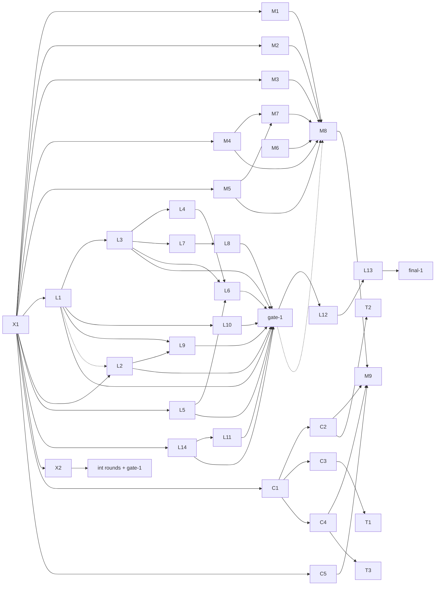

# Stage 03 implementation plan: weighted graphs, Ribet sequence, Ihara lemma (revision 2, after the re-plan audit)

Status: P3 implementation plan, **revision 2** (replan brief `briefs/replan-s02-06.md`; audit findings A1–A20 resolved in
`audits/stage-03-replan-resolution.md`), WPs concrete, TITAN rounds sketched; gets a final pass before launch. Author:
stage-03 re-planning drafter (Opus), 2026-11-14, revised by the re-planning reviser (Sonnet). Supersedes the coarse draft
(29 WPs, 9.3 h critical path). Binding conventions: new OVERVIEW §4.3 (TITAN), §4.4 (wall calibration), §5 (models),
§5.2 (strands), §6.1 (remote), §9 (stage-1 lessons) as fixed in the brief §§A–F. Sources: `plan/staged/stage-03-ribet-ihara.tex`
(*tex*, labels `…:s03-…`), `SPLIT.md` §03, `audits/stage-03-{muse,resolution}.md`, `experiments/SUMMARY.md`, `runs/s01.md`,
stage-1 closure, the Lean tree `lean/Langlandscape/` at `main` 7ce2a3e, and `stage-02.md` **revision 3** (interfaces only, see §0.4; re-bound to its §4.1 "Exports to stage 03" by the cross-stage
integrator, `audits/cross-stage-consistency.md`). Decision of the re-planning master (binding, A1): stage 02 stays lean (trivial coefficients only);
**stage 03 owns the coefficient generalisation of the two-term complex (new WP S03-L14)**.

## 0. Scope, fixed decisions, inputs

### 0.1 Scope
- **Lean deliverable**: the quaternion-free combinatorial core (weighted graphs, `Φ^comb`, Lemma bip (a)–(c) **over any
  commutative ring `R`** (rank over ℤ), Prop phi, Lemma cyclic, Mazur arithmetic, abstract Eisenstein argument, abstract
  `αα†`) plus the instantiations: Mazur check at level 1, `Φ^comb` Eisenstein at `U = Ô^×`, Thm ribet (a) and Cor ihara
  (i),(ii) on stage 02's `BG d q hq U hU` over any `R`, and **the coefficient layer** `Ribet.alphaV` on
  `Brandt.brandtModule U R V ρ` (S03-L14). Ihara (iii) (`thm:s03-iharaH0`) is **stated only** as a registered hypothesis
  (clause (a), over `alphaV`) plus the definition of `ε`; clause (b) (Hecke action) is maths/code only here, because its
  Lean statement needs Hecke operators with coefficients (stage 04, S04-L15a).
- **Maths**: chapter `s03` (5 sections) with full proofs of every `\sttoprove` of the tex except `conj:s03-iharaGL2`.
- **Code**: T1 (Mazur table), T2 (Ribet collapse ranks, `αα†`), T6 (`H_0` with `V_k`, exponent ±1), Betti `det(Ψ*Ψ)`.
- **Talk**: 3 slides (collapse, Mazur, Ihara/Eisenstein).
- **Cited only, no Lean**: the GL₂ Betti side (`prop:s03-{amalgam,MV,PsiPsi}`, `def:s03-LR`, `conj:s03-iharaGL2`),
  `rem:s03-{grothendieck,mazur,kirchhoff,T6}`.

### 0.2 Fixed decisions (changes against the coarse plan in brackets)
1. **No Stacks Frontier vendoring** [was S03-X2 + go/no-go]. Reason (corrected, A16): our Lean needs only short statements
   over Mathlib, and the code in `StacksFrontier.+` is AI-written and unreviewed. The existing lakefile glob
   `globs = ["StacksCore.+"]` of `LanglandscapeVendorStacks` covers the `StacksCore` files; only the `StacksFrontier.+`
   modules would need a new glob, i.e. a `lakefile.toml` edit and a `pins.sha256` regeneration (pin guard, OVERVIEW §3.4).
   We write the needed parts ourselves: `Φ^comb` as `Module.Dual ℤ X ⧸ range`, the rank from exactness plus
   `Module.finrank` of `deg⁰`, the index via `AddSubgroup.index_eq_natAbs_det`
   (`Mathlib/LinearAlgebra/FreeModule/Finite/CardQuotient.lean:98`, *verified*). This costs own-code time in L2 and L10,
   already reflected in their walls (§1). **Fallback if Fabian answers Q1 = keep:** an off-critical-path vendoring WP in
   stage 04 (nothing in stage 03 depends on it). Open question Q1 (§7); the drop is the working assumption, not a decision.
2. **Registered hypotheses** (OVERVIEW §3.6; never axioms). **One owner per row** (A20): the L WP that registers the
   hypothesis writes the row in its report; S03-X1 writes none; the stage master applies them at merge.

| Lean name | file | statement | source | discharge plan | owner |
|---|---|---|---|---|---|
| `Langlandscape.Hyp.EllipticCount` | `Hyp/EllipticCount.lean` | `lem:s03-elliptic` for `q ≥ 5` (`w_x ∈ {1,2,3}`, `n₂ = (1−(−4/q))/2`, `n₃ = (1−(−3/q))/2`), plus `|X_B(Ô^×)| = 1` for `q ∈ {2,3}` | Voight Thm 11.5.14, 25.1.1, 30.1.5 | Eichler class number formula (absent from import and Mathlib); post-hackathon | L6 |
| `Langlandscape.Hyp.BrandtStabFree` | `Hyp/BrandtStabFree.lean` | step (1) of the proof of `prop:s03-phieis`: `w_e ∣ B(e,e')` for `e ≠ e'` | tex (Morita + PID), Ri90 Thm 3.12 | ideal-level Morita at ℓ; post-stage-04 | L8 |
| `Langlandscape.Hyp.IharaH0` | `Hyp/IharaH0.lean` | `thm:s03-iharaH0`(a) for `V` a `ℤ_p`-module with `U`-action `ρ` (`Ribet.CoeffData`): `ε` well defined and onto, `ker ε = im Ribet.alphaV`; clause (b) (`T_g ↦ deg(UgU)[ℓ^{v_ℓ(Nrd g)}]`, cohomological, exponent +1) is **not** in the Lean statement (needs `heckeTV`, S04-L15a) | tex sketch; DT p. 445–446 | needs full SA (`Hyp.SA`, stage 02 D3) and `if:s02-coh`; post-hackathon | L11 |

   Reused, not redefined: `GL2TF.Hyp.EichlerMass` (alias `Langlandscape.Hyp.EichlerMass`), and stage 02's `Hyp.SA`,
   `Hyp.HS`, `Hyp.BTtree`, `Hyp.SerreCoh`. Non-vacuity: none of the three can be instantiated in stage 03; registry rows
   say so (as in stage 02). Evidence note: no stage-04/05/06 plan references `Hyp.IharaH0` by name; its consumers are the
   talk, the tex interface `if:s03-ihara` and stage 06 maths. Stage 04's "Ribet sequence with coefficients" is the
   `R`-linear trivial-coefficient version (`R = ℤ_p`), delivered by L9 (item 7).
3. **Lean layout**: `Langlandscape/Graph/*.lean` (namespace `Langlandscape.Graph`, Mathlib + stage-02 `Graph` only) and
   `Langlandscape/Ribet/*.lean` (namespace `Langlandscape.Ribet`, quaternionic instantiations). Tests in
   `LanglandscapeTests/S03/*.lean`. Graphs are incidence data `E ⇉ V`, `[Fintype]`, `[DecidableEq]`, weights
   `w : E → ℕ` with field `hw : ∀ e, 0 < w e`; never `SimpleGraph`. Chains are `E →₀ R`, cochains `E → A`.
   **Name clash (A17):** Mathlib has `structure _root_.Graph` (`Mathlib/Combinatorics/Graph/Basic.lean:90`, imported by
   `Mathlib`). Writers **never `open Graph`** and write `Langlandscape.Graph.…` fully qualified in axiom files, tests and
   cross-WP references (inside `namespace Langlandscape.Graph` use `WGraph…` unqualified only).
4. **Sign convention (C1)** in one lemma (`Graph.boundary_ofBip`, S03-L1): our `∂ = (−s₀*, s₁*)` equals stage 02's
   `Graph.boundary` (`e ↦ (−[s0 e], [s1 e])`, stage-02 rev. 2 L8, *verified*); every later WP uses that lemma (hence the
   edges L1→L2(c), L9, L10 in §2); C3 cross-checks the off-diagonal sign of `αα†`.
5. **Levels**: all quaternionic instantiations at `U = Ô^×` (`d.Ohat`) except S03-L9, L14 (`BG d q hq U hU`, any `U` stage
   02 allows). `U₀(M)` versions of the Eisenstein property are **ext** (inside S03-L8, optional): stage 1 has symmetry at
   `U₀(M)` (`Tl_selfAdjoint_U0'`) but no row-sum lemma `deg(U g U) = ℓ+1` at our levels (the import's `brandt_row_sums` is on
   `eichlerOrder φ`).
6. **Docstrings** (lesson D3): every public `theorem`/`lemma` has a docstring containing its `s03-` label;
   `check_wp.sh` must pass in the integration round. The `s[0-9][0-9]-` widening is delivered by S02-X1 (stage-02 §0.5, stage-02
   `X1` row; the tree at 7ce2a3e still has the hard-coded `'s01-'`, *verified*), so **entry condition (§0.4)**: S02-X1 merged.
   Public `def`/`structure` docstrings are not machine-checked; they are reviewed in the WP audits (hard WPs) and by S03-L12
   (all remaining, A18).
7. **Coefficients and exports** (A1, A2): `lem:s03-bip`(a) and `thm:s03-ribet`(a)/`cor:s03-ihara`(i),(ii) are stated and proved
   for **any `CommRing R`** (`R = ℤ`, `ℤ_p`, `ZMod (p^m)` follow; stage 02's `boundary G R` is `R`-linear, the connectivity
   induction is the same). `bip_rank` is over ℤ (and ℚ). **Exports** (names fixed here, listed in §4): `Graph.WGraph`,
   `Graph.WGraph.X` (+ abbreviation alias `Graph.X`), `Graph.PhiComb`, `Graph.phiComb`, `Ribet.DRgraph`,
   `Ribet.ribet_exact` (any `R`), `Ribet.ihara_ker_const`, `Ribet.alphaV` (with `Ribet.CoeffData`), `Hyp.IharaH0`,
   `Ribet.epsilon`.
8. **Normalisation of `prop:s03-PsiPsi` (A8), fixed now.** The tex normalisation is used: `Ψ*(z) = (cor^Γ_{Γ₀(Mq)} z,
   −c⁻¹ cor^{Γ'}_{Γ₀(Mq)} z)` and `Ψ*Ψ = [[q+1, −T'_q],[−T''_q, q+1]]` with `T'_q = cor∘res∘c` (double coset `Γα'Γ`,
   acting on `V` through `α'⁻¹`) and `T''_q = c⁻¹∘cor'∘res` (acting through `α'`). Coefficient system `V = Sym^{k−2}` of the
   standard column representation (not its dual). Since `α'⁻¹ = q⁻¹·α'^ι` and the scalar `q⁻¹` acts on `Sym^{k−2}` as
   `q^{2−k}`, **`T'_q = q^{2−k} T_q` and `T''_q = T_q`** (`T_q` the classical integral operator through the integral matrix),
   hence
   `Ψ*Ψ = [[q+1, −q^{2−k} T_q],[−T_q, q+1]]`, `det = (q+1)² − q^{2−k} T_q²`.
   The seed's matrix `[[q+1, −T_q],[−q^{2−k}T_q, q+1]]` is the other choice (coefficient system `V^∨`, or the two factors
   swapped); it is recorded as such, not used. **Status: M5 proves this table** (one fixed normalisation, double-coset
   proof); if its proof forces the other assignment, M5 reports the correction, the stage master amends this item, and C5/H1
   follow M5's table (never the other way round). Stage 06 uses only `det(Ψ*Ψ)` and `coker(Ψ*Ψ)_𝔪` (tex D4), which are
   normalisation independent.

### 0.3 What stage 1 delivered that stage 03 uses (*verified* in `lean/Langlandscape/` at 7ce2a3e)
| use | declaration (file) |
|---|---|
| class sets, weights | `Langlandscape.Quat.XB`, `wx`, `Gam` (`Quat/Basic.lean`); `two_mul_wx`, `wx_eq_card`, `massW`, `massFull_eq_massW_of_mem` (`Quat/Weights.lean`); `card_Gam_dvd_24` (`Quat/Stab.lean`); `XB_finite`, `Brandt.finite_XB_Ohat`, `Brandt.negOne_mem_Ohat` |
| mass | `massFull`, `massFull_units_eq_mass` (`Quat/Basic.lean`); `GL2TF.Hyp.EichlerMass`; `card_XB_Utower` (`Quat/MassTower.lean`) |
| levels | `DefiniteData` (`d.Ohat`, `d.U0`, `d.U0q`), `Quat/Levels.lean`; `Local.GL2Zl`, `Local.Iw` (`Local/GL2Levels.lean`) |
| Brandt modules | `Brandt.brandtModule U R V ρ : Submodule R (BHatˣ → V)` (`ρ : U →* (V ≃ₗ[R] V)`, condition `f (ι γ * x * u) = (ρ u)⁻¹ (f x)`, `Brandt/Module.lean:31`), `brandtModuleTrivEquiv` (`brandtModule U R R 1 ≃ₗ ZXdual U R`), `ZX`, `ZXdual`, `brandtPairing`, `normMap`, `normMap_bijective` (`Brandt/Module.lean`); `pushforward`, `levelMap`, `trace` (**trivial coefficients only**: `ZXdual U' R →ₗ ZXdual U R`) (`Brandt/Adjoint.lean`) |
| Hecke | `Brandt.heckeT`, `heckeTHom`, `heckeTHom_transpose` (`Brandt/DoubleCoset.lean`); `Tl`, `elemT` (`Brandt/Hecke.lean`); `Tl_matrix_eq_brandtMatrix`, `brandtMatrix_mul_wx`, `Tl_selfAdjoint_units`, `trivialLevel`, `eichlerOrder_trivialLevel` (`Brandt/ImportDictionary.lean`); `Tl_selfAdjoint_U0'`, `relIndex_elemT_ne_zero_Ohat` (`Brandt/HeckeFinite.lean`) |
| import | `GL2TF.Quat.brandtMatrix`, `brandt_weighted_symmetry`, `brandt_row_sums` (`AlgJL/VolIII/Brandt/Brandt.lean`), `GL2TF.Quat.normWeight` (`…/Pairing.lean:30`) |
| maths labels | `def:s01-{classset,brandt,hecke,pairing}`, `lem:s01-stab`, `thm:s01-mass`, `prop:s01-adjoint`, `rem:s01-nu-hecke`, `if:s01-{classset,brandt,hecke,mass}` (`mathematics/chapters/s01/`) |
| code | `code/python/langlandscape/{classset,brandt,quat,symn,pari,results}.py`, `results/s01/{classsets,brandt_w2,symn}.json` |

### 0.4 Stage-02 interfaces (bound to `stage-02.md` revision 3, §4.1 "Exports to stage 03"; names as declared there, A3)
| stage-tex / maths label | declared Lean output | used by |
|---|---|---|
| `if:s02-indef`, `def:s02-indef` | `Graph.BipMultigraph` (`V0 V1 E`, `s0 s1`), `Graph.BipMultigraph.Connected` (decidable on `Fintype`), `Graph.boundary G R : (G.E →₀ R) →ₗ[R] (G.V0 →₀ R) × (G.V1 →₀ R)` (`e ↦ (−[s0 e], [s1 e])`), `Graph.H1 G R := ker (boundary G R)`, `Graph.aug G R`, `finrank_H1_of_connected` (**any `[IsDomain R]`, incl. ℤ**), `range_boundary_of_connected` (**any `CommRing R`**: `range (boundary G R) = ker (aug G R)`) (`Graph/Bipartite.lean`, `Graph/H1.lean`) | L1, L2 |
| `def:s02-BG`, `if:s02-quot` | `Tree.BG d q hq U hU : Graph.BipMultigraph` (`V₀ = V₁ = XB U`, `E = XB (U0q U)`), `Tree.s0 d q hq U`, `Tree.s1 d q hq U : XB (U0q U) → XB U` (`s0_mk`, `s1_mk`), `Tree.alphaElt d q hq` (α as an element of `BHatˣ`), `Tree.BGConnected d q hq U hU := (BG …).Connected`, `s0Pull s1Pull`, `s0Push s1Push`, `Tree.IsQLevel` (incl. `U.relIndex d.Ohat ≠ 0`); connectivity: **`Tree.BGConnected_of_SA_HS (hSA : Hyp.SA d q hq) (hHS : Hyp.HS d) (hBT : Hyp.BTtree q) (hU : Tree.IsQAdmissible d q hq U)`** (`Tree/QuotientCore.lean`); tree edges are `Tree.EdgeO q` (type-0 origin) | L9, L14 |
| `prop:s02-quot`(c) | `heckeT_comm_s0Pull`, `heckeT_comm_s1Pull`, `heckeTHom_comm_s0Push`, `heckeTHom_comm_s1Push`, `Tl_comm_s1Pull`, `Sl_comm_s1Pull`, `diamond_comm_s1Pull`, `varpi_comm_s1Pull` (`Tree/Hecke.lean`, S02-L7b) | L9 |
| `if:s02-coh`, `def:s02-Mhom` | `partialHom : ZX (U0q U) R →ₗ[R] ZX U R × ZX U R` (`= (−s0Push, s1Push)`), `deltaCoh`, `s0Tr s1Tr : ZXdual (U0q U) R →ₗ[R] ZXdual U R` (definitions in the S02-L9 row; `s0Tr_apply_mk`, `s1Tr_apply_mk`), `qNew`, `partialHom_eq_boundary` (`Tree/TwoTerm.lean`), **trivial coefficients only**; `XindefR d q hq U R := ker partialHom` (no `hU`) | L14 (comparison lemmas) |
| `if:s02-coh` (code) | `code/python/langlandscape/tree.py`, `twoterm.py`, `results/s02/{T2,H_Vk}.json` | C3, C4 |
| tooling | `S02-X1`: `check_wp.sh` `s[0-9][0-9]-`, axiom counter (printed/expected); `S02-X2`: `tools/gen_axioms.py` | all L, X2 |
**Entry condition**: stage 02's Lean final gate green on `wip-implementation` (or, for early start, the listed declarations
green in a stage-02 integration round and S02-X1/X2 merged; global master decides). Stage-02 partial exports: L8 after
int1a, L4b/L9 after int2a, L5b/L7b/L6 after int3b/int4a (`stage-02.md` §4.1). M, C1, C5 need nothing from stage 02 beyond
the tex. If a name drifts, the WP rebinds in its first fix round (§3.3).

### 0.5 Carried over
- From the stage-1 closure: `def:s01-NUp` weight-2 correction and mass level-change factor-2 wording are fixed in s01;
  M1 and M4 cite the **final** s01 wording (`thm:s01-mass`, `prop:s01-adjoint`, `rem:s01-nu-hecke`), not the staged tex.
- From `runs/s01.md` coverage updates: `relIndex_elemT_ne_zero*` discharge `hfin` (used by L8); `Tl_selfAdjoint_U0'`
  needs no extra `hS`; `U_ℓ` at `ℓ ∣ N` and the product `⟨d⟩` are not covered and not needed here.
- From the coarse plan's resolution: R5 (stage-02 export list must include the `BG`/Hecke/two-term outputs) is now
  §0.4; F12 (`|Γ|` vs `w` mass) becomes the explicit lemma `Ribet.sum_inv_wx_Ohat` in L6.
- Closure "open issue" *Hecke with coefficients* (stage 02 §0.5: "stages 04–06"): the **coefficient two-term map** is now
  S03-L14; Hecke operators with coefficients (`heckeTV`) stay S04-L15a.

## 1. Work packages

Columns: id | goal | inputs | outputs | acceptance | diff. | model (+fix) | est. agent / wall min | TITAN round | remote | deps.
`remote` = remote-eligible (§6). Times calibrated per brief F and OVERVIEW §4.4, **upper half for hard/conceptual WPs** (A5):
local short WP 3–17 min; Lean WP under TITAN 33–80 min wall, agent-active 10–20 for routine, ≈ 0.25 × coarse estimate for hard
(coarse L2/L3 were 150 agent each ⇒ ≈ 38; stage-1 L3d, opus, took 78 min wall and 3 rounds). **LCHK** = the WP's spec line in its
TITAN round shows `CHECK_WP <WP> rc=0 0 FAIL lines` (build, no `sorry`/forbidden token, docstrings with `s03-` label) **and**
`AXIOMS .titan/s03_<wp>_axioms.lean rc=0 nonstandard=0` with `printed = expected` (one axiom file per WP, generated by X2) and the
WP's headline names in it. **TEXCHK** = `latexmk -pdf standalone-s03.tex` exit 0, no undefined refs/cites, listed labels present.
**PYCHK** = `pytest code/python -q` pass and the stated numbers in `code/results/s03/*.json` with provenance (`code.md`).

### Track X
| id | goal | inputs | outputs | acceptance | diff. | model (+fix) | agent / wall | TITAN | remote | deps |
|---|---|---|---|---|---|---|---|---|---|---|
| S03-X1 | kickoff: re-sync `wip-implementation`; create WP worktrees/branches with plain `git -C …-wt/impl worktree add -b impl/s03-<wp> …-wt/s03-<wp> $BASE_S03` (no `tools/new_wp.sh`: it hard-codes `s01-` and aborts without a seedable `.lake/build`) and `impl/s03-int1`; M drivers `mathematics/chapters/s03.tex` (five `\InputIfFileExists{chapters/s03/<n>-<sec>}`) and `mathematics/standalone-s03.tex`: `\input{preamble}`, `references.bib`, the merged `chapters/s01` and `chapters/s02` each guarded by `\IfFileExists` (so `thm:s01-*`, `if:s02-*` resolve; if s02 is not merged, M WPs restate those labels as `\texttt{if:s02-…}` as the tex does), and the per-WP bibs **by explicit name** `bib/s03-m{1,…,5}.bib`, each `\IfFileExists`-guarded (no glob is possible; `mathematics/` has no `bib/` directory and no `standalone-s0*.tex` at 7ce2a3e, *verified*); `code/results/s03/`; `impl/s03-int1` with the int1 spec (§3.2, WP lines; the AXIOMS lines are added by the stage master from X2) | OVERVIEW §2, §3.6, §6.1; §0.2 | dirs, drivers, spec file, report; **no** HYPOTHESES rows (owners L6/L8/L11) | `latexmk standalone-s03.tex` exit 0 (empty chapter); `git worktree list` shows the WP trees; `grep -c '^S03-' .titan/spec-int1.txt` = 6; `grep -c "s\[0-9\]\[0-9\]-" tools/check_wp.sh` ≥ 1 (S02-X1 landed, else report) | mechanical | sonnet (+1 opus fix ≤ 2) | 8 / 10 | — | — | — |
| S03-X2 | axiom scratch files (lesson D2), **a standing step from int1 on**: per WP `python3 -I tools/gen_axioms.py <WP files> > .titan/s03_<wp>_axioms.lean` (S02-X2 tool: fully qualified `#print axioms` names, one `import` per module); the report lists, per WP, the generated names and the expected count; cross-check against the §3.4 minimum list; at gate-1 the same output feeds the new rows of `Audit/PrintAxioms.lean`. Files exist only on the `impl/s03-int<k>` throwaway `.titan/` commit (stage master writes them), never on WP branches | WP draft files; §3.4 | per-round reports | every name of §3.4 whose WP has a draft appears once; each AXIOMS file imports only modules on spec lines of that round | mechanical | haiku (→ sonnet) | 3 per run / 4 | each round | — | X1 |

### Track M (`mathematics/chapters/s03/<n>-<sec>.tex`; one new section file + `bib/s03-m<k>.bib` per WP)
| id | goal | inputs | outputs | acceptance | diff. | model (+fix) | agent / wall | TITAN | remote | deps |
|---|---|---|---|---|---|---|---|---|---|---|
| S03-M1 | §1 weighted graphs and Mazur: `def:s03-graph`, `rem:s03-grothendieck`, `prop:s03-phi` (full proof), `lem:s03-cyclic`, `rem:s03-kirchhoff`, `def:s03-DR`, `lem:s03-elliptic` (cited inputs re-verified with page), `prop:s03-mazur`, `rem:s03-mazur`, `ex:s03-mazur` (table marked *sketch* until C2); **owns interface `if:s03-graph`** | tex §§ weighted graphs, Mazur; `thm:s01-mass`, `lem:s01-stab` | `s03/1-graphs.tex`, `bib/s03-m1.bib` | TEXCHK(those labels incl. `if:s03-graph`); every result has a status tag | routine | sonnet (+ opus fix ~2) | 10 / 15 | — | yes | X1 |
| S03-M2 | §2 **E8 strand WP** (§5): `prop:s03-phieis` with a full, independently re-read proof of steps (1)–(4) and `prop:s03-LRdef` with proof (trivial coefficients); a step that cannot be proved may be downgraded to *cited* only with the failing step named and a counterexample or gap written down (§5.3) | tex `prop:s03-{phieis,LRdef}`, (C1); `prop:s01-adjoint`; Ri90 pp. 449–454 | `s03/2-eisenstein.tex`, `bib/s03-m2.bib` | TEXCHK (the reference strand is mergeable at TEXCHK, protocol §4.4); protocol pass (crit 0, maj 0, min ≤ 3) by blind audit is recorded for the experiment, not required for the merge of the reference | hard | strands `@opus` (+ one planned opus fix) ∥ `@fable` (single-shot) | 15 / 25 | — | no (strand) | X1 |
| S03-M3 | §3 `lem:s03-bip` (full proof, any ring `R`), `thm:s03-ribet`(a)–(c) with the torsion remark, `cor:s03-ihara`(i),(ii),(ii′) (new proof of (ii′) from (C5)); (R4) SA dependence explicit; **owns `if:s03-ribet`** | tex; `if:s02-{quot,coh,indef}` (merged s02 chapter) | `s03/3-ribet.tex`, `bib/s03-m3.bib` | TEXCHK; sign table (C1) stated once and equals `if:s02-coh`; opus WP audit (§4) then planned fix | hard | opus (+ planned opus fix) | 15 / 22 | — | yes | X1 |
| S03-M4 | §4 conventions (C1)–(C6) (`ss:s03-conv`) checked against the merged s01 chapter (R1–R3), `thm:s03-iharaH0`(a)–(c) incl. unfolding identity and well-definedness of `ε`, `rem:s03-pm`, `cor:s03-eis`, `rem:s03-T6`; **owns `if:s03-ihara` and the interface deviations (D1)–(D4)** | tex; `def:s01-hecke`, `prop:s01-adjoint`, `rem:s01-nu-hecke`; `if:s02-indef` | `s03/4-ihara.tex`, `bib/s03-m4.bib` | TEXCHK; exponent table (+1 cohom., −1 homol.) stated once; (D1)–(D4) present; WP audit = M7 (below) then planned fix | hard | opus (+ planned opus fix) | 20 / 28 | — | yes | X1 |
| S03-M5 | §5 Betti side: `prop:s03-amalgam` (Serre II.1.4, (D) via SA for SL₂), `prop:s03-MV` (Brown), `prop:s03-PsiPsi` **in the normalisation of §0.2.8** with full double-coset proof, `def:s03-LR`, `conj:s03-iharaGL2`; Ri83 attribution fixed; **owns `if:s03-amalgam`** | tex `ss:s03-amalgam`; Serre, Brown, Vo 28.2.3 | `s03/5-amalgam.tex`, `bib/s03-m5.bib` | TEXCHK; normalisation table (which entry carries `q^{2−k}`) stated once and equal to §0.2.8 (or the correction reported); Fable adversarial WP audit (§4) then planned fix | hard | opus (+ planned opus fix) | 18 / 25 | — | yes | X1 |
| S03-M6 | literature WP: verify every `\stcited`/`\lit` of the tex (Vo 11.5.14, 25.1.1, 30.1.5, 28.2.3; Se II.1.4 Thm 2/3, p. 78–81; Br II.7.7, III.6; Ri90 Prop 3.1/3.3, Thm 3.12/3.15, Rem 3.18; Mz App. A.1(b), 1.1(d); DT p. 439–446; Ri83 (1.4); MS19 1.1) with exact page; list the missing ones (Ri84, SGA7, Ih75) | tex; `literature/` | `mathematics/litnotes/s03.md` (≤ 15-line paraphrase per item, no copied text) | every `\lit` key of the tex has a row with page or `MISSING`; `latexmk` not needed | routine | sonnet (+ opus fix ~2) | 15 / 18 | — | yes | — |
| S03-M7 | second reader / WP audit of the exponent chain and of the `Ψ*Ψ` table: `thm:s03-iharaH0`(b), `rem:s03-pm`, (R1)–(R3) of M4 against `def:s01-hecke`, `rem:s01-nu-hecke` and `if:s02-indef`; **and** M5's normalisation table against §0.2.8 (which entry carries `q^{2−k}`, with the `α'^{-1}` argument); verdict per step | M4, M5 sections; s01 chapter; stage-02 chapter or tex | `mathematics/chapters/s03/NOTES.md` (new file, M7 sole writer; CONFIRMED / GAP + step) | report gives a verdict for each of (R1), (R2), (R3), (b), `rem:s03-pm`, and the `Ψ*Ψ` table; its findings feed the planned fix rounds of M4/M5 | conceptual | opus | 10 / 14 | — | yes | M4, M5 |
| S03-M8 | chapter audit (`agents/roles/mathematics_chapter_audit.md`) of §§1–5, in parallel with S03-L12; notes the author-model confound for §2 if the Fable strand was merged (§5.4) | M1–M5, M6, M7 reports | `mathematics/audits/<date>_s03.md` | verdict PASS / PASS WITH REMARKS / FAIL with item list | conceptual | fable | 10 / 12 | — | no (Fable) | M1, M2, M3, M4, M5, M6, M7 |
| S03-M9 | apply M8 items + M6/M7 findings; replace *sketch* tables of M1/M4/M5 by the C2/C4/C5 numbers (`\stcomp`); `\leanplanned` → `\stformal` for the S03 Lean names merged; aggregator lines (`main.tex` `\input{chapters/s03}`, per-WP bib entries appended to `references.bib` and the `bib/s03-*.bib` files deleted, to avoid duplicate keys) applied by the stage master | M8; C2, C4, C5 results; Lean names (§3.4) | edits in `s03/*.tex`; `mathematics/main.pdf` | TEXCHK on `main.tex` too; every M8 required item closed; T1/T2/T6/betti_det numbers equal the JSON | routine | sonnet (+ opus fix ~2) | 10 / 14 | — | no (edits) | M8, C2, C4, C5 |

### Track L (`lean/Langlandscape/`)
| id | goal | inputs | outputs (files; headline declarations) | acceptance | diff. | model (+fix) | agent / wall | TITAN | remote | deps |
|---|---|---|---|---|---|---|---|---|---|---|
| S03-L1 | weighted-graph layer | `def:s03-graph`, `def:s03-DR` (abstract), (C1); stage-02 `Graph.BipMultigraph`, `Graph.boundary` | `Graph/Weighted.lean`: `Graph.WGraph` (`src tgt : E → V`, `w`, `hw`), `WGraph.boundary`, `WGraph.X`, alias `Graph.X := Graph.WGraph.X` (stage-05 name), `Graph.deg0`, `Graph.wPairing`, `Graph.phiComb (w) (X : Submodule ℤ (E →₀ ℤ))`, `WGraph.PhiComb`, `Graph.ofBip`, `Graph.collapse2`, **`Graph.boundary_ofBip`** (sign lemma); tests `LanglandscapeTests/S03/Weighted.lean` | LCHK | routine | sonnet (+ opus fix 2–5) | 10 / 35 | int1 | — | X1 |
| S03-L2 | **core** `lem:s03-bip` on `Graph.BipMultigraph`, **over any `CommRing R`** (A2): (a) `bip_ker_le_deg0`, `bip_surj_deg0` (input: stage 02's `range_boundary_of_connected`, any `CommRing R`), `bip_exact`, and `bip_rank` over ℤ (`rk H₁ = |E|−|V₀|−|V₁|+1`), from stage 02's `finrank_H1_of_connected` (any `[IsDomain R]`, incl. ℤ; fallback: exactness plus `Module.finrank` of `deg⁰`); (b) `bip_ker_dual` for every `AddCommGroup A`; (c) `bip_collapse_connecting` (needs L1 `collapse2`) | `lem:s03-bip` + sketch; stage-02 `Connected`, `boundary`, `range_boundary_of_connected` | `Graph/BipCollapse.lean` | LCHK; opus WP audit (§4) | hard | opus (+ planned opus fix) | 35 / 70 | int1 | — | X1 (part (c): L1 draft) |
| S03-L3 | **core** `prop:s03-phi`: `twoVertex_X_eq_deg0`, `phiComb_twoVertex_equiv` (`≃ (E → ℤ) ⧸ (W·deg⁰ + ℤ𝟏)`), `card_phiComb_twoVertex` (`= Σ_e ∏_{e'≠e} w_{e'}`, explicit basis + `AddSubgroup.index_eq_natAbs_det`), `phiComb_twoVertex_unit` (`≃ ZMod |E|`) | `prop:s03-phi`; Mathlib CardQuotient | `Graph/TwoVertex.lean`; tests `LanglandscapeTests/S03/TwoVertex.lean` (`w = (2,2,2)`: card 12, not cyclic; `w = (2,3)`: card 5; no `native_decide`) | LCHK; tests build; opus WP audit (§4) | hard | opus (+ planned opus fix) | 38 / 78 | int1 | — | L1 (draft) |
| S03-L4 | `lem:s03-cyclic`: `lambdaMap`, `lambdaBar : PhiComb → ZMod n`, `lambdaBar_surjective_iff` (`gcd_e (W/w_e) = 1`), `lambdaBar_bijective_of_pairwise_coprime` | `lem:s03-cyclic` + sketch | `Graph/Cyclic.lean` | LCHK | routine | sonnet (+ opus fix 2–5), stacked on L3 draft | 8 / 30 | int2 | — | L3 (draft) |
| S03-L5 | Mazur arithmetic (pure): for a finite family of weights in `{1,2,3}` with `n₂, n₃` given by `legendreSym`/`ZMod.χ₄`, `χ₃` and `Σ w⁻¹ = (q−1)/12` (`q ≥ 5`): `mazur_prod_mul_sum` (`∏w · Σw⁻¹ = num((q−1)/12)`), `mazur_weights_pairwise_coprime`; case split `q mod 12`. (The cases `q ∈ {2,3}` are in L6.) | `prop:s03-mazur` proof | `Graph/MazurArith.lean`; tests `LanglandscapeTests/S03/MazurArith.lean` (q = 11, 23, 37, 101, 131 → 5, 11, 3, 25, 65) | LCHK; part closed with no hypothesis | routine | sonnet (+ opus fix 2–5) | 12 / 35 | int1 | — | X1 |
| S03-L6 | Mazur check: register `Hyp.EllipticCount` (owner of its row); `Ribet.DRgraph d` (two vertices, `E = XB d.Ohat`, `w = wx d.Ohat`); `Ribet.sum_inv_wx_Ohat` (`Σ w_x⁻¹ = (q−1)/12` from `EichlerMass` via `massFull_eq_massW_of_mem`, `negOne_mem_Ohat`; (C2)); `Ribet.mazur_check` (`PhiComb (DRgraph d) ≃+ ZMod (num((q−1)/12))`) **for every prime `q` with hypothesis `d.D = q`**, under `EichlerMass ∧ Hyp.EllipticCount`: `q ≥ 5` via L5 + L4; **`q ∈ {2,3}` as its own case** (`|X_B(Ô^×)| = 1`, one edge of weight 12 resp. 6, `card_phiComb_twoVertex` gives 1 = num `1/12` resp. `1/6`; tests q = 2, 3) (A19) | `prop:s03-mazur`, `lem:s03-elliptic`; §0.3 | `Hyp/EllipticCount.lean`, `Ribet/Mazur.lean` | LCHK; HYPOTHESES row in report | routine (mechanical-with-meaning, stacked) | sonnet (+ opus fix 2–5) | 12 / 40 | int3 | — | L3, L4, L5 (drafts; green tree needed for the final run) |
| S03-L7 | `prop:s03-phieis` abstract: matrix `B` with row sums `ℓ+1`, `w_e ∣ B e e'` off-diagonal, `w_{e'} B e e' = w_e B e' e` ⇒ `T − (ℓ+1)` acts and is 0 on the two-vertex `phiComb`: `Graph.phiComb_eisenstein` | `prop:s03-phieis` steps (2)–(4) | `Graph/Eisenstein.lean` | LCHK; hypothesis-free | routine | sonnet (+ opus fix 2–5), stacked on L3 draft | 10 / 35 | int2 | — | L3 (draft) |
| S03-L8 | instantiation at `Ô^×`: register `Hyp.BrandtStabFree` (owner of its row); `Ribet.phiComb_eisenstein_Ohat` from `Tl_matrix_eq_brandtMatrix`, `brandtMatrix_mul_wx`, `GL2TF.Quat.brandt_row_sums` (via `trivialLevel`); *ext*: `U₀(M)` version with explicit row-sum hypothesis | `prop:s03-phieis`; §0.3 | `Hyp/BrandtStabFree.lean`, `Ribet/PhiEis.lean` | LCHK; HYPOTHESES row in report | routine (mechanical-with-meaning, stacked) | sonnet (+ opus fix 2–5) | 10 / 30 | int3 | — | L7 |
| S03-L9 | Thm ribet (a) on `BG d q hq U hU`, **over any `CommRing R`** (A2): `Ribet.ribet_exact (R)` (deg-0 parts, `0 → H1 → R[X(U0q U)]⁰ → (R[X U]⁰)² → 0`), `Ribet.ihara_surj` (i), `Ribet.ihara_ker_const` (ii, any `A`), `Ribet.ribet_rank` (c, over ℤ), `Ribet.ribet_hecke_equivariant` (via the stage-02 `heckeT_comm_s*` lemmas); each under `Tree.BGConnected …`, plus the stage-02-hypothesis version (`…_of_SA_HS`, via stage 02's `Tree.BGConnected_of_SA_HS`); uses L1 `boundary_ofBip` | `thm:s03-ribet`(a),(c), `cor:s03-ihara`(i),(ii); §0.4 | `Ribet/Sequence.lean` | LCHK | routine (stacked) | sonnet (+ opus fix 2–5) | 12 / 35 | int2 | — | L2 (draft), L1 |
| S03-L10 | `prop:s03-LRdef` abstract: weighted adjoints `alphaDagger` (index weights as data), `alphaDagger_deg0`, `alpha_alphaDagger_eq` (`[[q+1, −T],[−T, q+1]]`, `T := s₁*∘s₀^†`, fibre-sum hypothesis); own-code, no Stacks (A16) | `prop:s03-LRdef`; (C1) | `Graph/LevelRaising.lean`; tests (B₁₁, q = 2 shape: 2×2 matrix with det 5) | LCHK | routine | sonnet (+ opus fix 2–5) | 10 / 40 | int1 | — | L1 |
| S03-L11 | Ihara (iii) statement layer **on top of L14**: `Ribet.tau` (norm character (C5) from `GL2TF.Quat.normWeight`), `Ribet.epsilon : (brandtModule U R V ρ)² →ₗ[R] coinvariants` (definition), register `Hyp.IharaH0` (clause (a) over `Ribet.alphaV`; shape load-bearing for the interface `if:s03-ihara`); *optional*: `Ribet.eis_support_of_IharaH0` (`cor:s03-eis`) | `thm:s03-iharaH0`, `cor:s03-eis`, (C4)–(C6); L14 `CoeffData`, `alphaV` | `Hyp/IharaH0.lean`, `Ribet/IharaH0.lean` | LCHK; `#check` shape test `LanglandscapeTests/S03/IharaH0.lean`: `Hyp.IharaH0` applied to `d.Ohat`, `V = ℤ_[p]`, trivial `ρ` and the L14 `Ribet.alphaV` typechecks (A1: the V-coefficient option, not the trivial-coefficient fallback of §3.3); adversarial Fable WP audit (§4) | conceptual | opus (+ one planned opus fix) | 25 / 70 | int2 | — | X1, L14 (draft) |
| S03-L12 | Lean audit (`agents/roles/lean_audit.md`) on the gate-1 sha, in parallel with S03-M8: hypothesis shapes vs tex, sign lemma vs (C1), `EichlerMass` w-form, **docstrings of all public `def`/`structure` not covered by WP audits (A18)** | gate-1 | `lean/Langlandscape/audits/<date>_s03.md` | verdict PASS / PASS WITH REMARKS / FAIL | conceptual | fable | 8 / 10 | — | no (Fable) | L1–L11, L14 green in gate-1 |
| S03-L13 | audit fix WP(s) (one per cluster of required items, split `L13a`, `L13b`, … at launch) | L12 report | fixes on `impl/s03-l13*` | items closed in int4 | per Lean item | **sonnet (+ one opus fix ≤ 5)** for routine/mechanical items; **opus (+ one planned fix)** for hard items | 2–13 / 20 | int4 | — | L12 |
| S03-L14 **(new, A1)** | **coefficient two-term complex** (generalises stage 02's trivial-coefficient `partialHom`/`deltaCoh`; stage 02 stays lean): `Ribet.CoeffData d q hq U R V` (bundles `ρ : U →* (V ≃ₗ[R] V)` and `hα : ∀ u ∈ U0q U, ρ (α⁻¹ u α) = ρ u`, true when `ρ` factors through the `p`-component, `p ≠ q`); on `brandtModule U R V ρ` and `brandtModule (U0q U) R V ρ'` (`ρ' := ρ ∘ incl`): `s0PullV` (restriction), `s1PullV` (`f ↦ (x ↦ f (x·α))`), `s0TrV`, `s1TrV` (traces `f ↦ (x ↦ Σ_{u∈U/U'} ρ(u) f(x u))`, `s1TrV` after translation by α; the stage-1 `trace` is trivial-coefficient only, so these are new), `alphaV := (−s0TrV, s1TrV)`, `alphaVee := (f₀,f₁) ↦ s1PullV f₁ − s0PullV f₀`; lemmas: well-definedness (values lie in `brandtModule`, `R`-linear), `s0TrV_comp_s0PullV` (`= [U:U'] • id`), **`alphaV_triv`/`alphaVee_triv`**: for `V = R`, `ρ = 1`, under `brandtModuleTrivEquiv`, `alphaV = (−s0Tr, s1Tr)` and `alphaVee = deltaCoh` of stage 02 L9 (this ties the new object to the trivial-coefficient complex) | `if:s02-coh`, `def:s02-Mhom`; stage-02 `Tree.s0/s1/alphaElt/IsQLevel`, `s0Tr/s1Tr/deltaCoh`, `Tree.s1Level`, `Tree.relIndex_U0q_ne_zero`, `Tree.relIndex_s1Level_ne_zero`, `Tree.finite_XB_U0q`, `Tree.alphaElt_inv_conj_mem`, `Tree.s0Tr_apply_mk`, `Tree.s1Tr_apply_mk` (`s1Tr hU = (Brandt.trace (s1Level …) U R _).comp (translateLin R (s1Level …) (U0q U) (alphaElt …)⁻¹)`); stage 1 `brandtModule`, `brandtModuleTrivEquiv`, `levelMap`, `relIndex` finiteness | `Ribet/Coeff.lean`; tests `LanglandscapeTests/S03/Coeff.lean` (trivial `ρ` instance and `alphaV_triv` on the B₂, q = 7 level; a `V = ℤ_[p]` shape test for `CoeffData`) | LCHK; opus WP audit (§4) | hard | opus (+ one planned opus fix) | 30 / 75 | int1 | — | X1; stage-02 L4b, L9 (drafts) |

### Track C (`code/python/langlandscape/ribet/`) and H
| id | goal | inputs | outputs | acceptance | diff. | model (+fix) | agent / wall | TITAN | remote | deps |
|---|---|---|---|---|---|---|---|---|---|---|
| S03-C1 | weighted-graph module: `X(G)`, Gram matrix, `Φ^comb` via Smith form (`pari.py` `matsnf`), collapse, Lemma bip checks | `def:s03-graph`, `lem:s03-bip` | `ribet/graphs.py`, `tests/test_s03_graphs.py` | PYCHK: `(2,2,2) → [2,6]`, `(2,3) → [5]`, weighted matrix-tree count = Smith order on 20 random graphs | routine | sonnet (+ opus fix ~2) | 11 / 13 | — | — | X1 |
| S03-C2 | **T1**: `q ∈ {11,23,37,101,131}`: class sets of `B_q` at level 1 with `w`, Smith form, cyclicity; `T_ℓ − (1+ℓ)` kills `Φ^comb` for `ℓ ≤ 13` | `ex:s03-mazur`, `prop:s03-phieis`; `classset.py`, `brandt.py` | `ribet/mazur.py`, `tests/test_s03_mazur.py`, `results/s03/T1.json` | PYCHK: `h = 2,3,3,9,12`; `|Φ| = 5,11,3,25,65`; all cyclic; Eisenstein check true | routine | sonnet (+ opus fix ~2) | 10 / 12 | — | — | C1 |
| S03-C3 | **T2**: collapse on stage-02 incidence data: `B₂, q=7`; `B₂, q=13`; `B₁₁, q=2`; exactness, ranks; `αα†` weighted vs unweighted | `thm:s03-ribet`, `prop:s03-LRdef`; stage-02 `langlandscape/tree.py` | `ribet/collapse.py`, `tests/test_s03_collapse.py`, `results/s03/T2.json` | PYCHK: `|X(U′)| = 2,3,3`; `rk H₁ = 1,2,0`; weighted `T₂ = −2`, `|coker αα†| = 5` | routine | sonnet (+ opus fix ~2) | 10 / 12 | — | — | C1 |
| S03-C4 | **T6**: `B₃`, tree at 2, `p ∈ {5,7}`, `k ≤ 2p`: `coker α` with `V_k` over `ℤ/p^m`, `ε`, `T_ℓ` action under both Hecke conventions; `U₁(p)` non-vanishing | `thm:s03-iharaH0`, `rem:s03-{pm,T6}`; stage-02 `tree.py`, `twoterm.py`; `symn.py` | `ribet/ihara.py`, `tests/test_s03_ihara.py`, `results/s03/T6.json` | PYCHK: `H₀ = 0` for `k ≤ p+1` (maximal at p); `T_ℓ = (1+ℓ)[ℓ]` cohom. / `[ℓ]⁻¹` homol. for `p+3 ≤ k ≤ 2p`; `H₀ ≠ 0` at `U₁(p)`; opus WP audit (§4) | hard | opus (+ planned opus fix) | 18 / 25 | — | — | C1 |
| S03-C5 | Betti check without HACS: `det(Ψ*Ψ) = (q+1)² − q^{2−k}T_q²` on `T_q`-eigenvalues of `S_k(Γ₀(M))` (PARI `mf`), level-raising primes listed; **records the full matrix of §0.2.8** (entries `q+1`, `−q^{2−k}λ`, `−λ`, `q+1`) in the JSON next to `det`, and flags the entry assignment *untested by PARI* unless a Petersson-Gram cross-check of `{f, f∣B_q}` (PARI `mfpetersson`) confirms the ratio of the two off-diagonal entries | `prop:s03-PsiPsi`, `def:s03-LR`; §0.2.8 | `ribet/betti.py`, `tests/test_s03_betti.py`, `results/s03/betti_det.json` | PYCHK: det ≠ 0 except at the listed primes; normalisation table recorded and equal to M5's | routine | sonnet (+ opus fix ~2) | 10 / 12 | — | — | X1 |
| S03-H1 | *optional, gated (OVERVIEW §8 F8)*: re-run seed C3 in HACS **recording the same normalisation table as M5/C5 (§0.2.8)**; port T1 | M5 table; C5 | HACS script, `results/s03/C3_rerun.json` | det equals C5; table equals C5's | routine | sonnet (+ one opus fix ≤ 2) | 30 / 40 | — | — | C5, HACS present |

### Track T (`talk/slides/`)
| id | goal | inputs | outputs | acceptance | diff. | model (+fix) | agent / wall | TITAN | remote | deps |
|---|---|---|---|---|---|---|---|---|---|---|
| S03-T1 | central slide: `Γ_U\T_q` collapses onto the 2-vertex DR graph; kernel = Ribet sequence (TikZ, `B₁₁, q=2`) | `lem:s03-bip`, `thm:s03-ribet`; T2.json | `s03-collapse.tex` | `latexmk` talk exit 0; numbers traceable to `results/s03/T2.json` | routine | sonnet (+ opus fix ~2) | 8 / 10 | — | — | C3 |
| S03-T2 | Mazur slide: `q = 11`, weights 2, 3, `|Φ| = 6(½+⅓) = 5`; general formula; T1 table | `prop:s03-mazur`; T1.json; `Ribet.mazur_check` if merged | `s03-mazur.tex` | as T1 | routine | sonnet (+ opus fix ~2) | 6 / 8 | — | — | C2 |
| S03-T3 | "Ihara = connectivity", "the cokernel is Eisenstein" (`T_ℓ ↦ (1+ℓ)[ℓ]`), honest status line (Lean: (i),(ii) formalized given `BGConnected`; (iii) hypothesis) | `cor:s03-ihara`, `thm:s03-iharaH0`; T6.json; L9 names | `s03-ihara.tex` | as T1 | routine | sonnet (+ opus fix ~2) | 6 / 8 | — | — | C4 |

**Count: 34 WPs** (X 2, M 9, L 14, C 5, H 1, T 3); optional: H1, the `U₀(M)` part of L8, the corollary in L11; L13 may
split into 2–3 sub-WPs. Aggregators (`Langlandscape.lean`, `LanglandscapeTests.lean`, `Audit/PrintAxioms.lean`,
`HYPOTHESES.md`, `SORRIES.md`, `main.tex`, `references.bib`, `INDEX.md`, `talk/main.tex`) only by the stage master from report lines.

## 2. DAG

```
X1->M1 X1->M2 X1->M3 X1->M4 X1->M5  M4->M7 M5->M7  {M1,M2,M3,M4,M5,M6,M7}->M8  {M8,C2,C4,C5}->M9
X1->L1 X1->L2 X1->L5 X1->L14 X1->X2  X2->{each round's spec: int1..int4, gate-1}
L1->L3 L1->L10 L1->L9 L1->L2(part (c) only)  L2->L9  L14->L11  L3->L4 L3->L7  {L3,L4,L5}->L6  L7->L8
{L1..L11,L14 green}->gate-1 ; gate-1->L12 ; L12->L13 ; L13->final-1 ; {M-track, C/T}->closure
X1->C1 X1->C5  C1->C2 C1->C3 C1->C4  C5->H1  C3->T1 C2->T2 C4->T3
```
Stage-02 entry inputs (§0.4) feed L1, L2, L9, L14, L11, C3, C4. `M6` has no deps (pure literature; may start before X1).
**Stacking rule (A4, deviation from "drafted upstream, brief C" stated explicitly).** A stacked WP starts at the **first draft** of
its upstream, not at X1: L3, L10, L9(part), L11, L4, L7 therefore start after L1 (≈ 10 min), L14 (≈ 20 min), L3 resp. L2 drafts. The
signatures in the §1 rows are binding for the stacked writers (rebind in the first fix round if a draft differs, §3.3). The 10 min
of L1's draft are on the critical path.

**Waves** (Lean writers stack on drafts, §3): W0 = X1, M6. W1 (t ≈ 10) = L1, L2, L5, L14, X2, M1–M5, C1, C5. W1b (L1 draft,
t ≈ 20) = L3, L10; (L14 draft, t ≈ 30) = L11; (L2 draft, t ≈ 35) = L9. W2 (t ≈ 45–55, L3 draft) = L4, L7, C2–C4, M7. W3 (t ≈ 90,
L3 green) = L6, L8, T1–T3. W4 (gate-1, t ≈ 122) = L12 ∥ M8. W5 = L13, M9 → final-1 → closure.
Concurrency: stage master ≤ 3 X/L workers + M sub-coordinator ≤ 3 + C/T sub-coordinator ≤ 3 (OVERVIEW §8 F3); E8
strands count as M workers; Fable L12 ∥ Fable M8 (parallel Fable allowed since 18:22).

**Critical path** (Lean, summed wall; A5): X1 (**10**, wall, not 8) → L1 draft (10) → L3 (**78**: int1, planned opus fix, int2/int2a/int2b;
green at t ≈ 98) → L4/L6 stacked tail (L6 green in int3a, +22 ⇒ t ≈ 120) → gate-1 (10) → L12 Fable (10) → L13 + int4 (20) →
final-1 from scratch (6) → closure (5) = **171 min ≈ 2.85 h**. Next chains: X1 → L14 (75, green ≈ 85) → L11 stacked (starts t ≈ 30,
70, green ≈ 100–105); X1 → L2 (70) → L9 tail (+20) ≈ 100; both ≈ 15–20 min shorter than the L3 chain before gate-1 (the L2 chain
overtakes L3 only if L3 is faster than 60 min). M track: X1 (10) → M5 (25 + Fable audit 8 + planned fix 6) → M7 (14) → fix of M4/M5
(6) → M8 (12) → M9 (14, waits for C2/C4/C5) ≈ 95 min. C/T: X1 → C1 (13) → C4 (25 + opus audit 8) → T3 (8) ≈ 64 min.
**Stage wall estimate 2.85 h, range 2.2–3.6 h** (low: int1 mostly green as in s01-int2a; high: 2 extra integration rounds on L3/L6
and a FAIL audit verdict). Cross-check: coarse 9.3 h × 0.31 = 171 min, inside the 0.25–0.35 band (the 0.25 factor applied to the
earlier draft undercounted the hard WPs; see resolution A5); OVERVIEW §7's 3.0 ± 0.8 h contains it.

## 3. TITAN plan (OVERVIEW §4.3)

### 3.1 Mechanics
Writers commit on `impl/s03-<wp>`; the stage master merges drafts into `impl/s03-int<k>`, adds `.titan/spec-int<k>.txt` and the
per-WP `.titan/s03_<wp>_axioms.lean` (generated by X2) as a **separate top commit that contains only `lean/Langlandscape/.titan/`**
(never on WP branches, lesson A0.1), and writes the outbox file `plan/implementation/outbox/<UTC>_titan-s03-int<k><x>-<n>.md`
with **the OVERVIEW §4.3 job-spec template verbatim** (job id, result branch `titan/s03-int<k><x>-<n>`, `supersedes:`, full 40-hex
sha with the top commit = `.titan/` only, step (1) `bash tools/titan_batch.sh .titan/spec-int<k><x>.txt` and step (2)
`tools/lbuild.sh Langlandscape LanglandscapeTests`, the four report items, seeding by reflink from the previous job's build),
commits it; the global master pushes and relays. One integration build per round; a **new number** when a new set of WPs enters,
a **letter** = re-run after fixes (A14; stage 1's `int2a` for new WPs is not repeated). Before each round, WP branches whose
upstream got a fix are rebased onto the fixed `impl/s03-int<k>~1` tree (lesson D4). Status and closure also go to the outbox
(lesson D5). Goal states: the round's goal = the listed WPs green (LCHK).

### 3.2 Rounds (sketch; final pass fixes the shas). `t` = time the round is sent; its report is ≈ 8 min later.
| round | t ≈ | contents (new WPs in bold) | spec lines (sketch; each WP line is followed by `AXIOMS .titan/s03_<wp>_axioms.lean`) |
|---|---|---|---|
| int1 | 45 | first drafts **L1, L2, L3, L5, L10, L14** (+ tests) | `S03-L1 Langlandscape/Graph/Weighted.lean LanglandscapeTests/S03/Weighted.lean` · `S03-L2 Langlandscape/Graph/BipCollapse.lean` · `S03-L3 Langlandscape/Graph/TwoVertex.lean LanglandscapeTests/S03/TwoVertex.lean` · `S03-L5 Langlandscape/Graph/MazurArith.lean LanglandscapeTests/S03/MazurArith.lean` · `S03-L10 Langlandscape/Graph/LevelRaising.lean` · `S03-L14 Langlandscape/Ribet/Coeff.lean LanglandscapeTests/S03/Coeff.lean` |
| int2 | 58 | int1 fixes (L3 planned opus fix, L2, L14) + stacked **L4, L7, L9, L11** | int1 lines not yet green + `S03-L4 Langlandscape/Graph/Cyclic.lean` · `S03-L7 Langlandscape/Graph/Eisenstein.lean` · `S03-L9 Langlandscape/Ribet/Sequence.lean` · `S03-L11 Langlandscape/Hyp/IharaH0.lean Langlandscape/Ribet/IharaH0.lean LanglandscapeTests/S03/IharaH0.lean` |
| int2a, int2b | 72, 88 | re-runs after fixes (expected 1–2; L3 green ≈ 98) | failing WPs only + their AXIOMS lines |
| int3 | 96 | **L6, L8** on the fixed tree + remaining fixes | + `S03-L6 Langlandscape/Hyp/EllipticCount.lean Langlandscape/Ribet/Mazur.lean LanglandscapeTests/S03/Mazur.lean` · `S03-L8 Langlandscape/Hyp/BrandtStabFree.lean Langlandscape/Ribet/PhiEis.lean` |
| int3a, int3b | 108, 116 | contingency re-runs (stage 1 needed int2a–int2f) | failing WPs only + AXIOMS |
| **gate-1** (early full gate, job `s03-gate1-1`) | ≈ 122 | as soon as L1–L11, L14 are green: on `wip-implementation` after merging them | full: `tools/lbuild.sh Langlandscape LanglandscapeTests`, `tools/lbuild.sh LanglandscapeVendorStacks`, `tools/lfile.sh Audit/PrintAxioms.lean` (s03 rows from X2/`gen_axioms.py`; spec states `expected = <#print lines>`, report printed vs expected, non-standard count), forbidden-token grep, `declaration uses 'sorry'` count, `tools/check_frozen.sh` |
| int4 | ≈ 152 | **L13** fixes | L13 files + AXIOMS |
| **final-1** (job `s03-final-1`) | ≈ 160 | from scratch, unseeded checkout, as `s01-final-1` | gate-1 commands (a)–(f) on the final `wip-implementation` sha |
At most 3 concurrent TITAN jobs; stage 03 uses ≤ 2 (one integration round + one gate/strand-free slot; E8 is LaTeX only), leaving one
for a parallel stage (e.g. stage-04 early start).

### 3.3 Fallbacks
- A round returns only errors in one WP: merge the green WPs into `wip-implementation` now (they become the base of
  the next round; each WP is green on its own per-WP AXIOMS line, so this works from int1 on, A6), keep the red one on its branch.
- L3 red after its planned opus fix and int2b: split `S03-L3a` (basis + equiv) / `S03-L3b` (det identity), and let L6
  state `mazur_check` from `card_phiComb_twoVertex` as an explicit hypothesis for one round (listed in SORRIES only on the
  impl branch; never merged as a stub).
- L14 red after its planned fix and int2b: **option (b) of the audit** for one round: `Hyp.IharaH0` and `Ribet.epsilon` are stated
  for **trivial action over `R`** (`ZMod (p^m)`/`ℤ_[p]`) on stage 02's `partialHom`/`s0Tr`/`s1Tr`; the V-coefficient shape is recorded
  as a stage-04 item with a note to S04 (outbox); the shape test then uses `V = R`.
- Stage-02 name drift (§0.4): L1/L2/L9/L11/L14 rebind in their first fix round; S03-X1 records the actual names.

### 3.4 Headline list (minimum set cross-checked by S03-X2; the real list is **generated** by `gen_axioms.py` from the WP files, lesson D2/A18)
`Langlandscape.Graph.{boundary_ofBip, phiComb, bip_ker_le_deg0, bip_surj_deg0, bip_exact, bip_rank, bip_ker_dual,
bip_collapse_connecting, twoVertex_X_eq_deg0, phiComb_twoVertex_equiv, card_phiComb_twoVertex, phiComb_twoVertex_unit,
lambdaBar_surjective_iff, lambdaBar_bijective_of_pairwise_coprime, mazur_prod_mul_sum, mazur_weights_pairwise_coprime,
phiComb_eisenstein, alphaDagger_deg0, alpha_alphaDagger_eq}`,
`Langlandscape.Ribet.{DRgraph, sum_inv_wx_Ohat, mazur_check, phiComb_eisenstein_Ohat, ribet_exact, ihara_surj,
ihara_ker_const, ribet_rank, ribet_hecke_equivariant, tau, epsilon, alphaV, alphaVee, alphaV_triv, alphaVee_triv,
s0TrV_comp_s0PullV}`, and the three `Langlandscape.Hyp.{EllipticCount, BrandtStabFree, IharaH0}` defs. Expected: only `propext`,
`Classical.choice`, `Quot.sound` (hypotheses are explicit arguments and do not appear as axioms).

## 4. Gates and audits

- **Per WP**: acceptance as in §1. Lean: LCHK (green `check_wp` in a named round + the WP's own AXIOMS line clean; from **int1**
  on, since X2 is a standing step); the stage master merges into `wip-implementation` only then (merge gate OVERVIEW §2: the next
  round builds the merged tree). LaTeX/code: re-run on the merged tree by the sub-coordinator. Budgeted opus fix rounds (sonnet WPs) and
  planned opus fix rounds (opus WPs) are part of the WP, not new WPs.
- **WP-level audits** (OVERVIEW §5.3: every hard/conceptual WP before merge; the audit result is the input of the planned fix round):
  one blind **Opus** audit for the hard Lean WPs **L2, L3, L14**, for the hard C WP **C4**, and for the hard M WP **M3**; **Fable**
  adversarial audits for **L11** (its shape is exported) and **M5** (its normalisation table is exported, §0.2.8); **M4**'s WP audit is
  **M7** (opus second reader, scope extended to M5's table); the E8 strands get their protocol audits (§5). Public `def`/`structure`
  docstrings of the audited WPs are reviewed in these audits (A18). M7 is itself an audit WP and is not audited again (its output is read
  by M8). Findings feed the WP's fix round.
- **Early gate (gate-1)**, lesson D1: §3.2, as soon as L1–L11 and L14 are green (≈ mid-stage), not at the end.
- **Fable Lean audit S03-L12 ∥ Fable chapter audit S03-M8**, started at gate-1 (M8 may start as soon as M1–M7 are
  merged; it does not wait for Lean). Required items → L13 / M9.
- **Final from-scratch gate** final-1 (§3.2), then **milestone closure** in the outbox
  (`<UTC>_milestone-closure-s03.md`, format of the s01 closure): delivered, verification, open issues, request to merge
  `wip-implementation` → `main` and mirror PDFs. `runs/s03.md` written by the stage master (EXPERIMENT_PROTOCOL §5).
- **Stage 03 done** per track: M = chapter compiles, M8 PASS (with remarks), M9 applied, the interface labels
  **`if:s03-graph` (M1), `if:s03-ribet` (M3), `if:s03-ihara` (M4, with (D1)–(D4) and `ss:s03-conv`), `if:s03-amalgam` (M5)** present;
  L = final-1 PASS, SORRIES empty, HYPOTHESES with 3 new rows, L12 PASS; C = pytest pass, T1/T2/T6 match the
  tex, T6 confirms exponent +1 (cohomological), `betti_det.json` records the §0.2.8 table; T = slides compile, claims traceable. H1 and
  the optional Lean parts may continue into stage 04 (stated in `runs/s03.md`). **Exports to 04/05/06** (names fixed, A2):
  `Graph.WGraph`, `Graph.WGraph.X` (alias `Graph.X`), `Graph.PhiComb`, `Graph.phiComb`, `Ribet.DRgraph`, `Ribet.ribet_exact` (any
  `R`), `Ribet.ihara_ker_const`, `Ribet.alphaV` + `Ribet.CoeffData`, `Hyp.IharaH0`, `Ribet.epsilon`; maths `if:s03-*`.

## 5. Experiment strand E8 (OVERVIEW §5.2; brief B)

### 5.1 Cell and WP
- **Cell**: LaTeX hard (full proofs); stage-1 result *undecided, proposed all-fail* (E8 M4: opus failed at the top rung
  with W0 = 6, sonnet W0 = 10). Question: does a planned opus fix round reach a protocol pass faster/cheaper than Fable
  single-shot?
- **WP: S03-M2** (`prop:s03-phieis` + `prop:s03-LRdef`). Why this one:
  (a) it is pure "full proofs" with a known route written in the tex, so it measures proof writing, not design (M4 is
  conceptual: convention choices R1–R3 against s01 and stage 02 would confound quality); (b) it has a real
  correctness test: step (1) (Morita at ℓ, PID argument) has never had a second reader, so a strand that waves it
  through is caught by the blind audit; (c) size ≈ stage-1 E8 M4 (≈ 15 min opus), so cap and margins are comparable;
  (d) nothing downstream waits on it except M8 (L7/L8 take step (1) as `Hyp.BrandtStabFree` anyway), so the strand
  cannot lengthen the critical path; (e) M5 was rejected because its cited parts (Serre, Brown) make literature-reading
  time a confound, M3 because (ii′) depends on the stage-02 coefficient conventions.
- **Strands**: `S03-M2@opus` (reference) and `S03-M2@fable` (challenger, single-shot: no fix round; r0 fail = `failed`).
  Brief `experiments/briefs/s03-m2.md` (not `m2.md`, which is S01-M2's; `exp_prepare_audit.sh` reads `sNN-<wp>.md` first). Branches
  `exp/s03-m2-opus`, `exp/s03-m2-fable` off the same `wip-implementation` sha, set up the same minute (protocol §2.1); worktrees
  `…-wt/exp-s03-m2-<model>`. **Local only**, never remote (brief B/E). No Lean, hence no TITAN slot.

### 5.2 Mechanics that differ from EXPERIMENT_PROTOCOL (A9)
- **Fix rounds.** Brief B overrides protocol §2.4 for E8: the protocol's ladder `opus → (fail)` and its "same-model fix only if
  crit = 0 and W ≤ 5" (which is how the stage-1 E8 opus strand ended `failed` at W0 = 6) **do not apply**. `@opus` gets
  **exactly one planned opus fix round regardless of W0**, then a delta audit (fresh opus with `prior-findings.md`); if r1 fails, `@opus`
  is `failed` (max 1 fix round for E8, instead of the protocol's 3). `@fable` has no fix round. Cross-stage item: one line in
  EXPERIMENT_PROTOCOL §2.4 / OVERVIEW §5.2 (applied: protocol §2.4 "E8 override").
- **Audits and relays.** The audit artefact (`audit-<X>-r<r>.md`, with its "required fix" fields) is passed to the strand **unedited**;
  that is the protocol. What is forbidden is any commentary or hint added by the stage or global master (lesson D6); TITAN relays do not
  occur for M2.
- **Neutral commit messages** on strand branches: `<area>: <summary>` without model names (protocol §2.2); no `titan-in/` refs are used.
- **Cap.** Protocol §4.3: `cap = min(3·est_wall, est_wall + 60)`, `est_wall` = the WP's *agent* wall (15 min), at least 30 min ⇒
  **cap = 45 min**. (The earlier 75 min used the stage wall 25; the protocol is the measuring instrument, and only the Fable challenger
  is capped, so 45 leaves ample room: r0 ≈ 15 + audit ≈ 8.)
- **Metrics/decision**: EXPERIMENT_PROTOCOL §3–§4 unchanged (`active` decides, τ = max(0.15·active, 5)); cost weights opus 10, fable 20.
  Logged in `experiments/LOG.md` as `s03-m2-{opus,fable}`.

### 5.3 Downgrade rule (A9c)
A strand may not pass by weakening the statement. If step (1) (or any step) of `prop:s03-phieis` cannot be proved, the strand may
mark it *cited* only if it **names the failing step and gives a counterexample or the exact gap**; the auditor judges that downgrade as
a finding (**≥ major unless justified**, i.e. unless the gap is real and the citation exists in `literature/`). An unjustified downgrade
is a major finding for either strand.

### 5.4 Audit and merge rule (A10; answers Q2 with a production rule)
- **Audit**: one fresh blind Opus audit per strand per round (`exp_prepare_audit.sh`, order by `shuf`); confound noted: Opus audits an
  Opus strand (self-preference, as E1/E8 in stage 1). Optional cross-check if budget allows: one blind Fable audit of both r0 patches,
  recorded but not used for the verdict.
- **The merged artefact is the protocol-passing strand.** (1) The reference `@opus` is merged at TEXCHK (protocol §4.4; downstream M8
  starts on it). (2) If `@fable` passes and wins by §4.1, it **replaces** §2 **even if M8 has started**; M8 delta-reads §2 and LOG
  records `winner=fable, merged=fable (replace)`. (3) If the reference fails its audit ladder (r1 fail) and `@fable` passes, `@fable`
  replaces §2 the same way (the chapter must never keep a failed-audit §2). (4) If **both fail**, the normal pipeline runs (opus from the
  best-scored branch) before M8 closes. (5) M8 notes the author-model confound: the Fable chapter audit may be reading a Fable-authored
  §2. Timing: M8 starts after M7 (≈ t 70), whereas the opus strand needs r0 + audit + fix + delta audit ≈ 45 min from t = 10, so the
  decision normally lands before M8 starts.
- Cost: one extra Fable session ≈ 15 min; no critical-path cost.

## 6. Remote-eligible WPs (OVERVIEW §6.1; possible node "Abhijit")

**The stage is launchable without Abhijit**; default executor is local; the global master decides per WP at launch. A remote WP not
delivered when its first consumer is ready is **re-run locally with the fallback model below**. Conditions (all rows): inputs only the stage
tex + merged `mathematics/` + `literature/`; new files only; **remote base sha = after X1 and after the stage-02 chapter is merged** (M3,
M4, M5, M7 need the merged s02 chapter, A13); aggregator lines (`main.tex` `\input`, bib entries for `references.bib`) returned in the
report; acceptance `latexmk -pdf standalone-s03.tex` exit 0, no undefined refs/cites (the standalone driver loads `references.bib`, the
merged `chapters/s01`, `chapters/s02` and the per-WP `bib/s03-m<k>.bib`, §1 X1). M1, M3, M4, M5 form **one package branch
`abhijit/s03-math`** (OVERVIEW §6.1 O13; the per-stage files exist from X1, so no second writer); M6 and M7 are single-WP branches.
Deviation recorded against §6.1: per-WP bib files by explicit name (five names), because a single `bib/s03.bib` would have several writers;
the stage master moves their entries into `references.bib` and deletes the files at M9.

| WP | new files | branch | local fallback model | extra acceptance | note |
|---|---|---|---|---|---|
| S03-M1 | `chapters/s03/1-graphs.tex`, `bib/s03-m1.bib` | `abhijit/s03-math` | sonnet (+ opus fix ~2) | labels of M1 incl. `if:s03-graph` | T1 table stays *sketch* (C2 local) |
| S03-M3 | `chapters/s03/3-ribet.tex`, `bib/s03-m3.bib` | `abhijit/s03-math` | opus (+ planned fix) | labels of M3; sign table | needs the merged s02 chapter |
| S03-M4 | `chapters/s03/4-ihara.tex`, `bib/s03-m4.bib` | `abhijit/s03-math` | opus (+ planned fix) | labels of M4; exponent table | M7 then runs as the WP audit |
| S03-M5 | `chapters/s03/5-amalgam.tex`, `bib/s03-m5.bib` | `abhijit/s03-math` | opus (+ planned fix) | labels of M5; normalisation table = §0.2.8 | library access helps (Ri84 missing); Fable audit local |
| S03-M6 | `mathematics/litnotes/s03.md` | `abhijit/s03-m6` | sonnet (+ opus fix ~2) | every `\lit` key has a row (no latexmk needed) | best candidate: library access, no build |
| S03-M7 | `mathematics/chapters/s03/NOTES.md` (new file; permitted in §6.1's list, replaces the earlier `audits/s03-exponent-review.md`) | `abhijit/s03-m7` | opus | verdict per step | independent account is the point; needs M4, M5 merged |
**Assignment (global master 2026-11-14, Abhijit batch 1):** M1, M3, M4, M5 go to `abhijit/s03-math` at BASE; the base condition "after X1 / merged s02 chapter" is replaced: the package writes the two drivers itself (`chapters/s03.tex`, `standalone-s03.tex`), and the merged-s02 condition holds at BASE. **X1 skips `chapters/s03.tex` and `standalone-s03.tex`** and merges the package instead (the X1 acceptance `latexmk standalone-s03.tex` then runs on the merged driver). **M7 is local (opus)**; package deviations are delivered in the report and become M7 input (M7 stays sole writer of `NOTES.md`). Waves: M1, M3–M5 drop out of W1 (M2 stays). Q-H's "no S03 early start" concerns local worktrees and TITAN slots; remote maths before S03-X1 uses neither and is covered by Fabian's 20:32 delegation (global master confirms).
Not eligible: M2 (experiment strand), M8 (Fable chapter audit), M9 (edits existing files), all L/C/H/T (Lean needs the
built import and TITAN; HACS and PARI stay on this node). Matches `abhijit_candidates.md` package A-S03M (M1, M3–M5).

## 7. Risks and open questions

**Risks.** (1) L3 elaboration (explicit basis + determinant over `Fin n`-indexed bases) is the critical path; mitigation:
opus + planned fix + opus audit, split fallback §3.3, tests without `native_decide`. (2) Stage-02 name drift (§0.4) costs one fix
round in L1/L2/L9/L11/L14. (3) Sign drift (C1): one lemma, C3 cross-check, M3 sign table. (4) Hypothesis faithfulness
(`Hyp.{EllipticCount,BrandtStabFree,IharaH0}` cannot be instantiated): shapes copied from tex, L11 adversarial Fable
audit, L12, C2/C4 numbers. (5) Exponent ±1 (F9): M4 + M7 + C4 (both conventions). (6) `prop:s03-phieis` step (1) may
fail under second reading: L8 keeps the hypothesis, the tex status reverts to cited. (7) `Ψ*Ψ` normalisation: fixed in §0.2.8, proved
by M5, read by M7, recorded by C5 (PARI) and H1; the entry assignment is **not** independently computed while HACS is absent unless the
Petersson cross-check of C5 works; downstream uses only `det` and `coker` (D4). (8) Docstring gate: helper lemmas also need
`s03-` docstrings (check_wp counts every theorem); writers are told so in their briefs. (9) **L14** (new): `brandtModule` is an
equivariant-function module, not a `Finsupp`, so the V-coefficient traces and the α-translation need the invariance `hα` (true only when
`ρ` ignores the `q`-component); mitigation: `CoeffData` carries `hα`, the shape test uses `V = ℤ_[p]`, fallback §3.3 (option (b)).
(10) Name clash with Mathlib's `Graph` (§0.2.3).

**Open questions for Fabian.**
- Q1: Confirm dropping the Stacks Frontier `CycleRank`/`DiscriminantGroup` vendoring (§0.2.1); if kept: an off-critical-path vendoring WP
  in stage 04.
- Q2: E8 on S03-M2 with Fable single-shot (§5): proposed rule (§5.4): the merged section is the protocol-passing strand; a winning or
  surviving Fable strand replaces §2 even after M8 started; confirm.
- Q3: Is the `U₀(M)` Eisenstein instantiation (needs a new `deg(UgU) = ℓ+1` lemma at our levels) wanted in stage 03, or
  is level 1 enough for the talk and stage 04?
- Q4: Early start of the Mathlib-only graph WPs (L1, L3, L5, L10) during stage 02, competing for TITAN slots?
- Q5: Abhijit: give A-S03M as one package (M1, M3, M4, M5; planned as `abhijit/s03-math`) or per WP; and M6 (literature) there by default?
- Q6: Is the coefficient layer L14 (V-coefficient `alphaV`, no Hecke operators) the right scope for stage 03, with `heckeTV` and
  clause (b) of `Hyp.IharaH0` left to stage 04 (S04-L15a)?
