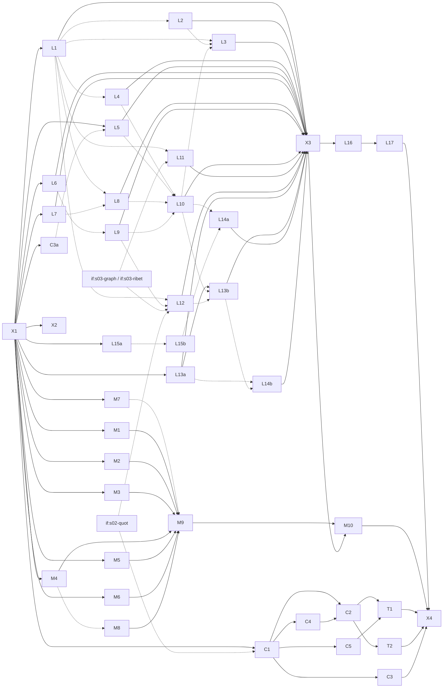

# Stage 04 implementation plan: ordinary and Λ-adic passage (revised after stage 1)

Status: P3 implementation plan, **revised** after stage 1 (re-plan brief `briefs/replan-s02-06.md`, which overrides
`briefs/common.md`). Author: stage-04 re-planning drafter (Opus), 2026-11-14. Stage 04 gets a final pass before launch
(re-bind the upstream Lean names, write the int1/int2 spec files out). Sources: `plan/staged/stage-04-lambda-adic.tex`
(*tex*, labels `…:s04-…`), `SPLIT.md` §04, `audits/stage-04-{muse,resolution}.md`, the stage-1 closure
(`outbox/20261114T174651Z_milestone-closure-s01.md`), `runs/s01.md`, `experiments/SUMMARY.md`, the Lean tree
`lean/Langlandscape/` at main 7ce2a3e. Upstream stages 02/03 are cited **only by stage-tex interface labels**
(`if:s02-*`, `if:s03-*`), never by their WP ids, because those plans are being revised in parallel.
Notes on what changed relative to the coarse draft: `audits/stage-04-replan-notes.md`. **Second revision** after the adversarial
audit `audits/stage-04-replan-audit.md` (A1–A19); verdicts and evidence: `audits/stage-04-replan-resolution.md`.

Abbreviations: **CWP(F…)** = `tools/check_wp.sh F…` inside the TITAN integration round (build, sorry/forbidden-token
grep, docstring check) with 0 FAIL lines; **AX(decls)** = the decls are listed in the round's `AXIOMS` scratch file and
report 0 non-standard lines; **TEXCHK(labels)** = `latexmk -pdf` exit 0 (standalone-s04.tex for single WPs,
`main.tex` at merge), no undefined refs/cites, listed labels present; **PYCHK(table)** = `pytest code/python` pass and
the stated numbers in `code/results/s04/*.json` with provenance (`code.md`).

## 0. Scope, fixed decisions, inputs from stage 1, carried-over items

### 0.1 Scope (unchanged in substance)
- **Lean deliverable = the finite-level core for all `s ≥ 1`**: the ordinary projector and its exactness (`def:s04-e`),
  `lem:s04-ekills`(a)–(d), `prop:s04-freeA`, `lem:s04-hida`(a)–(d), hence the finite-level part of
  `thm:s04-control`(a) (`e ℤ_p[X_{s+1}] ⊗_{ℤ_p[Δ_{s+1}]} ℤ_p[Δ_s] ≅ e ℤ_p[X_s]`, rank constant), the ordinary Ribet
  sequence at each level (`thm:s04-lambdaribet`(a),(c) at level s) compatible with `π_*`, and the limits `Mord`, `Xord`
  with exactness of `lim` (`thm:s04-lambdaribet`(a)).
- **Not formalized** (maths/cited only): `prop:s04-ekillsVk`, `rem:s04-nearly`, `rem:s04-hida86`, `def:s04-BN`,
  `def:s04-Pk` (dictionary in M4 and numerics in C4). `thm:s04-control`(b) and `hyp:s04-CR` enter Lean
  only as registered hypotheses (§0.4, S04-L14a); `thm:s04-Gor` enters Lean only as `Hyp.HsiehGor`, **registered by stage 06**
  (S06-L8a, §0.4); `thm:s04-etaB` stays cited mathematics (no Lean statement, `Hyp.HsiehEta` is dropped). Status wording:
  the ℤ_p tower results are *formalized modulo `Hyp.PadicOrdDecomp`* until L3 is green (D-e, F-e).

### 0.2 Fixed decisions (new or changed in this revision)
- **D-e (design of `e`, fixed now, no longer a conceptual WP).** For `T : Module.End R M`:
  `ordPart T := ⨅ n, LinearMap.range (T ^ n)`, `nilPart T := {m | ∀ k, ∃ n, (T ^ n) m ∈ (p ^ k : R) • ⊤}`,
  `HasOrdDecomp T : Prop := IsCompl (ordPart T) (nilPart T)`, `ordProj T h := Submodule.linearProjOfIsCompl …`.
  Functoriality and exactness are proved for any `T`-equivariant maps between modules **with** `HasOrdDecomp`; the
  decomposition itself is a theorem in two instances: finite length (Mathlib Fitting,
  `LinearMap.eventually_isCompl_ker_pow_range_pow`) and f.g. `ℤ_[p]`-modules (L3). Downstream abstract lemmas take
  `(h : HasOrdDecomp T)` as an ordinary argument. **Tower instances (fallback F-e, made honest):** `Hyp.PadicOrdDecomp : Prop :=
  ∀ (M : Type) [AddCommGroup M] [Module ℤ_[p] M] [Module.Finite ℤ_[p] M] (T : Module.End ℤ_[p] M), HasOrdDecomp T` is a
  registered, *true and provable* hypothesis (`Hyp/PadicOrdDecomp.lean`; the `def` is written by L1, the theorem
  `padicOrdDecomp_holds` by L3). Every ℤ_[p] tower theorem (L10, L12, L13b) takes `(hdec : Hyp.PadicOrdDecomp)` as an explicit
  argument, so its signature is **the same whether or not L3 succeeds** (no rework at the F-e decision). The `ZMod (p ^ m)`
  instances (all `m`, via L2) are proved unconditionally. Docstrings of the ℤ_[p] theorems say "formalized modulo
  `Hyp.PadicOrdDecomp`"; once L3 is green a tiny file `Ordinary/TowerUncond.lean` (L3 owner, int4/int5) specialises them with
  `padicOrdDecomp_holds`. The F-e decision (is L3 green?) is taken at the int2 result (≈ t 60) and confirmed at int3; if L3 is
  not green then, the HYPOTHESES row stays `open`, the closure, `runs/s04.md` and the seam note to stage 05 (§4) say so, and M10
  does not mark `thm:s04-control`(a) `\stformal` without "modulo `Hyp.PadicOrdDecomp`".
- **D-lim (no Weil vendoring).** The coarse plan vendored Weil's `LAdicRankOfInverseSystem` + an ML extract for L8. It is
  **dropped**: exactness of `lim` is an elementary sequential lifting argument on ℕ-indexed systems with surjective
  transitions. Surjectivity on the three Ribet systems `0 → A_s → B_s → C_s → 0` (`A = e H1`, `B = e ℤ_p[X(U0q q UU_s)]`,
  `C = e ℤ_p[X_s]²`) is **not** "split exactness + five lemma" but: control (L10, delivered for **both** `UU_s` and
  `U0q q UU_s`) gives surjective `B_{s+1} → B_s`, `C_{s+1} → C_s` with kernels `I·B_{s+1}`, `I·C_{s+1}` (`I` = augmentation
  ideal of `ker(Δ_{s+1} → Δ_s)`); `α` is Δ-equivariant (L12 `alpha_comm_diamond`) and surjective, so `ker B → ker C` is
  onto, and the snake lemma gives `coker(A_{s+1} → A_s) = 0`. The abstract ℕ-indexed layer (compatible-family submodules,
  lifting along surjective transitions, `lim_exact`, `Lam`) is **L13a** (Mathlib-only, no deps, int1); L13b instantiates it
  on the Ribet systems. `Mord`, `Xord` are concrete submodules of compatible families in `Π s, M s` (no `CategoryTheory`
  limits). Fallback: register `Hyp.InvLimExact` (§0.4). No `lakefile.toml` change, no new vendor lib, no new licence.
- **D-eta (η-principle and `HsiehGor` Lean moved out; ownership made unambiguous).** `congruenceIdeal`/`IsGorenstein` are owned
  by stage 06 (`CommAlg/Gorenstein.lean`, S06-L1); stage 04 must not stub another stage's definitions on its integration
  branch. Therefore: (i) the Lean registration of `Hyp.HsiehGor` (`thm:s04-Gor`) is **owned by stage 06** (S06-L8a, which
  already writes the other `Hyp/*.lean` files of the defect layer), with the stage-06 §0 signature (generic base ring `A`, `TB`,
  module `M`, via `CommAlg.IsGorenstein`; quoted in §0.4); stage 04 supplies only the maths (M4) and the label. (ii) `Hyp.HsiehEta` is **dropped** from
  Lean (`thm:s04-etaB` is cited mathematics; stage 06 does not use it in Lean). (iii) The η-principle Lean WP is **S06-L17**
  (`CommAlg/EtaPrinciple.lean`, `EtaPrinciple.congruenceIdeal_eq_span_pairing`, early lane, stacked on S06-L2); S04-M6 keeps the
  maths only. Stage 04 has no Lean file importing `Langlandscape.CommAlg.*`. Resolution of these cross-stage points: `audits/stage-04-replan-resolution.md`. Open
  question Q2 (§7).
- **D-Λ.** Mathlib v4.35 has no completed group rings; `Λ = 𝒪[[1+pℤ_p]]` is not defined as such. Instead, in the same
  pattern as `Mord` (D-lim), L13a defines `Ordinary.Lam` as the subring of compatible families in
  `Π s, MonoidAlgebra ℤ_[p] (Δ s)` (tex: `Λ = lim 𝒪[Δ_s]`; docstring cites `Lam ≅ 𝒪[[1+pℤ_p]]`), and L13b gives `Mord U` its
  `Lam`-module structure from the levelwise diamonds. `Hyp.MordLambdaFree U : Prop := ∃ r, Nonempty (Mord U ≃ₗ[Lam] (Fin r → Lam))
  ∧ (the control isomorphisms at all levels)` is registered by L14b (it needs `Mord`, so it belongs to int4, not int3); the
  docstring gives the non-vacuity reason (toy `Δ_s = 1`). The finite-level compatible-basis theorem
  (`∃ r, ∀ s, e ℤ_p[X_s] ≅ ℤ_p[Δ_s]^r` compatibly with `π_*`, Nakayama over the local rings `ℤ_p[Δ_s]`) is L13b's *stretch*
  target and, being provable, is not itself a hypothesis.
- **Coefficient ring.** `ℤ_[p]` (Mathlib `PadicInt`), `p ≥ 5`, `p ∤ D·M`; levels `UU_s = Utower M p s`. This is the
  specialisation **𝒪_E = ℤ_p, E = ℚ_p** of the tex (which works over `𝒪_E`); L10/L12/L13 docstrings and the M10 status upgrades
  say "for `E = ℚ_p`" (general `𝒪_E` = stretch, not planned).
- **Connectivity.** L12/L13b take only the explicit argument `∀ s ≥ 1, Tree.BGConnected d q hq (UU_s) (Tree.isQLevel_Utower hqN)`
  (stage-02 Lean: `BGConnected d q hq U hU` takes `hU : IsQLevel`; `isQLevel_Utower (hqN : ¬ q ∣ M * p ^ s)`, S02-L4a). The SA
  route is a *corollary* via stage 02's export `Tree.BGConnected_of_SA_HS (hSA : Hyp.SA d q hq) (hHS : Hyp.HS d) (hBT : Hyp.BTtree q)
  (hU : IsQAdmissible …)` (`IsQAdmissible` = `IsQLevel ∧ NrdSurj`, `nrdSurj_Utower` from S02-L10), so it lists `Hyp.SA`, `Hyp.HS`,
  `Hyp.BTtree` explicitly (tex F7/D5).
- **Lean layout.** `lean/Langlandscape/Langlandscape/Ordinary/*.lean` (namespace `Langlandscape.Ordinary`), carry-over
  operators in `…/Brandt/` (namespace `Langlandscape.Brandt`), local groups in `…/Local/`, hypotheses in `…/Hyp/`, tests
  in `LanglandscapeTests/S04/`. Every public `def`/`theorem` has a docstring citing its `mathematics/` label
  (= tex label, `s04-…`; stage 1 kept all tex labels).

### 0.3 What stage 1 delivered that stage 04 uses (exact names, main 7ce2a3e)
| use | declarations (file) |
|---|---|
| `U_p` (`N_{U_p}`), cohomological and homological, at `Utower M p s` | `Langlandscape.Brandt.Up`, `UpHom`, `Up_apply`, `UpHom_single` (`Brandt/Up.lean`) |
| tower maps, `lem:s01-Up`(b) | `towerMap`, `towerPush` (`π_*`), `towerPull` (`π^*`), `Up_comm_push`, `Up_comm_pull`, `Utower_succ_le` (`Brandt/Up.lean`) |
| generic double-coset operators, adjoint | `heckeT`, `heckeTHom`, `dcSet`, `conjSub` (`Brandt/DoubleCoset.lean`); `brandtPairing_heckeTHom` (`⟨T_g a,b⟩ = ⟨a,T_{g⁻¹} b⟩`), `pushforward`, `trace`, `levelMap`, `normMap_pushforward` (`Brandt/Adjoint.lean`) |
| Brandt module, pairings | `ZX`, `ZXdual`, `brandtPairing`, `evalPairing_perfect`, `normMap`, `normMap_bijective`, `brandtModule`, `brandtModuleTrivEquiv` (`Brandt/Module.lean`) |
| local cosets at p | `Langlandscape.Local.K0`, `K1`, `Iw` (`Local/GL2Levels.lean`); `varpi`, `varpiDiag`, `diagOneP`, `varpiPrime`, `K1_mul_varpi_mul_K1`, `exists_varpi_inv_mul`, `reps_indep`, `diag1p_reps`, `relIndex_K1_succ` (`Local/UpCosets.lean`) |
| levels, finiteness, mass | `Langlandscape.Quat.DefiniteData.Utower`, `U0q`, `U1`, `Utower_antitone` (`Quat/Levels.lean`); `finite_XB_Utower` (`Quat/LevelFinite.lean`); `card_XB_Utower` (under `GL2TF.Hyp.EichlerMass`, `Quat/MassTower.lean`) |
| free diamond action, trivial `Γ_x` | `deltaElt`, `diamondAct`, `diamondAct_mul`, `diamondAct_free`, `Gam_eq_bot_of_le_U1`, `rightMulXB` (`Quat/Stab.lean`) |
| Hecke commutation | `diamond`, `diamond_apply_eq_diamondAct` (`Brandt/Hecke.lean`); `Up_comm_diamond`, `Up_comm_diamond_self`, `Up_comm_Tl`, `Up_comm_rightTranslate` (finiteness hypotheses kept) (`Brandt/Corollaries.lean`) |
| reused hypotheses | `GL2TF.Hyp.EichlerMass`; from stage 02: `Langlandscape.Hyp.SA`, `Hyp.HS` (`if:s02-SA`) |

Upstream exports needed from stages 02/03 (names re-bound at the final pass; default: stage 03 merged to `main` first):
`if:s02-quot` (`Tree.s0 d q hq U`, `Tree.s1 d q hq U`, `Tree.BG d q hq U hU`, `Tree.BGConnected d q hq U hU`, Hecke equivariance (c):
`heckeT_comm_s{0,1}Pull`, `heckeTHom_comm_s{0,1}Push`, `varpi_comm_s1Pull` for `p ≠ q`, `stage-02.md` §4.1),
`if:s02-indef` (`Graph.H1 (Tree.BG …) ℤ` = `Tree.Xindef`, `finrank_Xindef_of_connected`), `if:s03-graph` (`Graph.WGraph`, `Graph.WGraph.X`
(alias `Graph.X`), `Graph.PhiComb`, `Ribet.DRgraph`), `if:s03-ribet` (`Ribet.ribet_exact (R)`: exact `0 → H1 → R[X(U0q U)]⁰ → (R[X U]⁰)² → 0`,
`α = (−s0_*, s1_*)`, **over any `CommRing R`**, deg-0 parts, trivial coefficients (S03-L9); L12 instantiates it at `R = ℤ_[p]`, so
`ribet_exact_baseChange` is only a fallback; the `V`-coefficient map is `Ribet.alphaV` on `brandtModule U R V ρ` with `Ribet.CoeffData`
(S03-L14), without Hecke operators). L12 proves the `UpAt`-equivariance `UpAt_comm_s0/s1` (stage-02 commutation at `g = ϖ`;
`UpAt` is the stage-04 object of L9).
If any is not merged at launch, X1 writes `sorry`-stubs of exactly those signatures on `impl/s04-int1` only
(`SORRIES.md` rows, never merged to `main`) and the stage master re-bases before the next round (lesson D4).

### 0.4 Registered hypotheses (never axioms; OVERVIEW §3.6)
| Lean name | statement (tex) | source | discharge plan |
|---|---|---|---|
| `Langlandscape.Hyp.PadicOrdDecomp` (**true, provable**; L1 `def`, L3 theorem `padicOrdDecomp_holds`) | `def:s04-e`, f.g. `ℤ_p`-form | D-e | L3 (discharged when green) |
| `Langlandscape.Hyp.MordLambdaFree U` (L14b, int4): `∃ r, Nonempty (Mord U ≃ₗ[Lam] (Fin r → Lam)) ∧` control isos | `thm:s04-control`(a), Λ-adic half (`Lam = lim ℤ_p[Δ_s]`, D-Λ) | Hsieh Thm 4.2; LV11 Prop 3.6 | L13b compatible bases (stretch) + Iwasawa algebra (post-stage) |
| `Langlandscape.Hyp.HidaControl` | `thm:s04-control`(b), weight k, **definite** side, `P^ad_k`, finite-level form mod `p^s` (distinct from stage 06's GL₂-side control) | Hsieh Thm 4.2(2); LV11 Thm 3.7; Hida 1988 Thm 9.4 | needs L15a/b (L14a, int3); else schematic (Q3), decided by the stage master at int3 |
| `Langlandscape.Hyp.HsiehCR` (L14a) | `hyp:s04-CR` on abstract residual data | Hsieh §1.4 | a condition; toy instance only |
| `Langlandscape.Hyp.HsiehGor` (**registered by stage 06, S06-L8a**, file `Hyp/HsiehGor.lean`; signature `def Langlandscape.Hyp.HsiehGor (A TB M : Type*) [CommRing A] [CommRing TB] [Algebra A TB] [AddCommGroup M] [Module TB M] : Prop := CommAlg.IsGorenstein A TB ∧ Nonempty (M ≃ₗ[TB] TB)`; the eigenline clause of `thm:s04-Gor` follows by Lemma S; text fixed in `stage-06.md` §0) | `thm:s04-Gor` | Hsieh Thm 4.5 + proof | cited |
| ~~`Hyp.HsiehEta`~~ **dropped from Lean** | `thm:s04-etaB` stays cited maths (M4, M6) | Hsieh Def 4.12, Rem 7.8 | — |
| `Langlandscape.Hyp.InvLimExact` (**conditional**, L14b only if L13b falls back) | exactness of `lim` on the ordinary Ribet system | tex proof (compactness) | L13 route of D-lim |

### 0.5 Carried over from stage 1 (closure "open issues", `runs/s01.md` coverage updates)
| item | stage-1 status | stage-04 handling |
|---|---|---|
| `U'_p`, `U_p^* = ⟨p⟩_M U'_p` (`lem:s01-Up`(d)); trace half of `lem:s01-Up`(c) | not defined in Lean | **S04-L5** (core: consumer `lem:s04-ekills`(d), `e*`; stage 05/06 pairings) |
| product diamond `⟨d⟩ = ∏_{ℓ∣M}` not assembled | one-prime factors only | **S04-L5** assembles `diamondM` (needed for `⟨p⟩_M`) |
| Hecke operators **with coefficients** (`brandtModule U R V ρ`, `V_k`) | module only, operators trivial-coefficient | **S04-L15a/L15b** (ext; consumer `Hyp.HidaControl` statement); fallback schematic (Q3) |
| `U_p` at levels other than `Utower` (here `K'_s`, `U0q q (Utower …)`) | `Up` only at `Utower` | **S04-L9** (`UpAt`) |
| tex `def:s01-NUp` side claim "e ≠ 0 in every weight" false in weight 2 | fixed in s01 chapter | M1/M4 must not reuse it (acceptance grep in M1) |
| `U_ℓ` at `ℓ ∣ N`; `Up_comm_Sl`/`Up_comm_rightTranslate` finiteness hyps; 80 linter warnings, R8b/R8c hygiene | open | not needed by stage 04; new s04 files must add **0** warnings (build log grep in each round) |
| `check_wp.sh` docstring check looks for `s01-` only, and only on `theorem`/`lemma` | tool | S02-X1 widened the pattern to `s[0-9][0-9]-` (later stages never edit tools; X1 only greps `tools/check_wp.sh` for it and reports to the global master if absent; lesson D3); public `def`/`structure` docstrings are **not** machine-checked, so they are an L16 checklist item (§4); test theorems also need `s04-` docstrings (writers told in every WP brief) |
| mass level-change: factor-2 wording corrected in s01 (`runs/s01.md` maths corrections) | fixed in s01 chapter | M2's factor-2 paragraph and the `card_XB_Utower` use in L11 follow the corrected s01 wording (M2 acceptance: no "factor 2" claim contradicting `prop:s01-adjoint`(c) / `normMap_pushforward_two`) |
| `prop:s01-relations`(c): direction of `R_g` corrected | fixed in s01 chapter | M1 cites the corrected direction (acceptance: grep of the `R_g` direction against the s01 chapter) |
| `Up_comm_Tl'` (no free `hfin`, `Brandt/HeckeFinite.lean`) | formalized | L12 cites `Up_comm_Tl'`, not `Up_comm_Tl` |

## 1. Work packages

Columns: OVERVIEW §1 schema plus `model (+fix)`, `remote-eligible` (R = yes), `TITAN round`. Times: agent-active /
wall (min), calibrated (`runs/s01.md`; brief §F). All Lean WPs: no local Lean, checks only via TITAN integration rounds.

### Track X (stage master + mechanical)
| id | goal | inputs | outputs | acceptance | diff. | model (+fix) | R | TITAN | act/wall | deps |
|---|---|---|---|---|---|---|---|---|---|---|
| S04-X1 | **(skip the s04 drivers and `bib/s04.bib`: written by remote `abhijit/s04-math`; merge it instead; (global master 2026-11-14, Abhijit batch 2))** kickoff: worktrees + `impl/s04-*` branches off `wip-implementation`; `impl/s04-int1`; `mathematics/chapters/s04.tex` (`\InputIfFileExists` per section), `standalone-s04.tex`, `bib/s04.bib` header; `code/results/s04/`; HYPOTHESES rows (§0.4, `open`); SORRIES rows for upstream stubs if any; check (no edit) that `tools/check_wp.sh` has `s[0-9][0-9]-`; plain `git worktree add` (no `tools/new_wp.sh`); `.titan/spec-int1.txt` on the int branch only | OVERVIEW §2, §3.6; §0.3 | dirs, stubs, registry rows, spec file | `latexmk -pdf standalone-s04.tex` exit 0 (empty chapter); `git log` shows sync merge; spec lines match §3 | mechanical | sonnet (+1 opus fix ≤ 2) | — | — | 5 / 10 | stage 03 merged (or §0.3 stubs) |
| S04-X2 | axiom scratch files: from the declared outputs of §1 generate (with S02-X2's `tools/gen_axioms.py`) **one file per WP** `.titan/s04_<wp>_axioms.lean` (fully qualified `Langlandscape.…` names, every needed import, one `#print axioms` per headline decl) and the `Audit/PrintAxioms.lean` rows; returns the text in its report, the stage master writes the files; regenerated per round | §1 output columns | report (file text; files on the int branch only, written by the stage master), rows in report | names resolve (round log has no `unknown constant`); non-standard count computed after wrapped-line join (as `titan_batch.sh`) | mechanical | haiku (ladder → sonnet) | — | int1–int4 | 3 / 5 per round | X1 |
| S04-X3 | **early full gate** `s04-gate1-1` once the core L1–L14b (incl. `Limit.lean`, `Hyp/MordLambdaFree.lean`) is green after int4b/c; L15a/b join only if green (else carried over): OVERVIEW §4.3 gate variant (a)–(f) (full `lbuild Langlandscape LanglandscapeTests`, VendorStacks, `Audit/PrintAxioms.lean` with `expected = <#print lines>`, forbidden-token grep, sorry count, `check_frozen.sh`) | int4 green | outbox job + result | (a)–(f) clean, printed = expected; result in outbox | mechanical | stage master | — | gate-1 | 3 / 8 | int4 (core L1–L14b green) |
| S04-X4 | **final gate from scratch** `s04-final-1` + milestone closure (outbox) + `runs/s04.md` | X3, L17, M10, C/T done | closure file, run log | from-scratch build rc 0, axioms standard, 0 sorry, frozen clean, 0 new warnings | mechanical | stage master | — | final | 5 / 12 | L17, M10, C5, T2 |

### Track M (`mathematics/chapters/s04/*.tex`; each WP creates only its own new section file)
| id | goal | inputs | outputs | acceptance | diff. | model (+fix) | R | TITAN | act/wall | deps |
|---|---|---|---|---|---|---|---|---|---|---|
| S04-M1 | §1: `def:s04-e` (finite-monoid and f.g. `ℤ_p` forms, the D-e definition, exactness), `lem:s04-ekills`(a)–(d) full proofs incl. `e` vs `e*` and `U_p^* = ⟨p⟩_M U'_p` | tex; `if:s01-{brandt,hecke,mass}`, `if:s03-graph` | `s04/ordinary.tex` | TEXCHK(`def:s04-e`, `lem:s04-ekills`); `grep -c 'every weight'` = 0 (stage-1 correction); foreign interfaces cited as `\texttt{if:s0N-…}` text, not `\ref` (§6) | routine | sonnet (+1 budgeted opus fix ~2 min) | R | — | 10 / 15 | X1 |
| S04-M2 | §2: `prop:s04-freeA` (`ℤ_p[Δ_s]` local), `lem:s04-hida` in full (matrix identity with the `ϖ_j` of `def:s01-NUp`, torsor, base change), `thm:s04-control`(a) (Nakayama, compatible bases), factor-2 paragraph (corrected s01 wording, §0.5) | tex | `s04/control.tex` | TEXCHK(`prop:s04-freeA`, `lem:s04-hida`, `thm:s04-control`) | hard | opus (+1 planned opus fix) | R | — | 15 / 25 | X1 |
| S04-M3 | §3: `thm:s04-lambdaribet` full proof by the D-lim route (surjective transitions via control at both levels + snake lemma) and by compactness, rank check (c), expected-rank remark; connectivity hypothesis in the statement | tex; `if:s03-ribet`, `if:s02-{quot,indef}` | `s04/lambdaribet.tex` | TEXCHK; "connected for every s" in the theorem statement (grep); foreign interfaces as `\texttt{if:…}` text (§6) | routine | sonnet (+1 budgeted opus fix) | R | — | 10 / 15 | X1 |
| S04-M4 | §4: dictionary to Hsieh / LV11 / Hida 1988: `def:s04-Pk` proof, `thm:s04-control`(b) in our conventions, `def:s04-BN` (i)–(iv), `hyp:s04-CR`, `thm:s04-Gor`, `thm:s04-etaB`; Hsieh's `#Γ` = `w_x` | tex; literature | `s04/hsieh.tex` | TEXCHK; every `\lit` has Thm/§/p. | conceptual | opus | R | — | 20 / 30 | X1 |
| S04-M5 | literature verification for M2/M4: pdftotext page checks of every `\lit` in the tex §2–§4 (Hsieh, LV11, Hida 1988/86/93), and Helm 2007 / MW86 status | tex; `literature/`; MISSING_LITERATURE | `mathematics/litnotes/{hsieh2017,lv2011,hida1988}.md` (no copied text) | each cited statement: file, Thm/§, page, ≤ 15-line paraphrase; list of mismatches | routine | sonnet (+1 budgeted opus fix ~2 min) | R | — | 10 / 15 | X1 |
| S04-M6 | §5: comm-alg lemma (free rank one over Gorenstein + perfect equivariant pairing ⇒ congruence ideal = self-pairing; Hsieh Rem 7.3, d = 1); **maths only here**: the Lean WP is owned by stage 06 (`CommAlg/EtaPrinciple.lean`, D-eta), and its docstring is the reference statement | tex `thm:s04-etaB` paragraph (no stage-06 file is an input, so M6 stays remote-eligible) | `s04/etaprinciple.tex` | TEXCHK; the statement text equals the docstring of `Langlandscape.CommAlg.EtaPrinciple.congruenceIdeal_eq_span_pairing` (S06-L17), checked by the stage master at merge (not an input of the WP); if S06-L17 is not yet drafted, the M6 text is the reference and S06-L17's docstring copies it | hard | opus (+1 planned opus fix) | R | — | 15 / 25 | X1 |
| S04-M7 | *optional*: `prop:s04-ekillsVk` (transfer of `U_p` to `H_*(Γ_U, V_k)`), `rem:s04-nearly` | tex; `if:s02-SA` | `s04/vk.tex` | TEXCHK | conceptual | opus | R | — | 15 / 25 | X1 |
| S04-M8 | independent second reading of M4 (normalisations R1: `P_k` vs `P^ad_k`, adelic vs classical diamonds, `N_{U_p}` vs Hsieh's `U_p`, `e` vs `e*`, factor 2) | M4 draft, tex, literature | `mathematics/litnotes/s04-m4-second-reader.md` (allowed new file, OVERVIEW §6.1) | verdict line + numbered items with page refs | conceptual | opus | R | — | 10 / 15 | M4 (draft) |
| S04-M9 | chapter audit (`agents/roles/mathematics_chapter_audit.md`), runs **in parallel** with L16 | M1–M6 (+M7), M8 | `mathematics/audits/s04.md` | `verdict:` line (PASS / PASS WITH REMARKS / numbered fix list) | conceptual | fable | — | — | 8 / 12 | M1–M6, M8 |
| S04-M10 | apply M9 + M8 fixes; status upgrades `\leanplanned → \stformal` for L-formalized results; milestone PDF | M9; L-track names | edited chapter, `main.pdf` | TEXCHK at `main.tex`; every numbered M9 item closed in the audit file | routine | sonnet (+1 budgeted opus fix) | — (edits existing files) | — | 8 / 12 | M9, X3 |

### Track L (Lean; files under `lean/Langlandscape/`)
| id | goal | inputs | outputs | acceptance | diff. | model (+fix) | R | TITAN | act/wall | deps |
|---|---|---|---|---|---|---|---|---|---|---|
| S04-L1 | ordinary projector (D-e): `ordPart`, `nilPart`, `HasOrdDecomp`, `ordProj`, `ordProj_idem`, `ordProj_comm` (commutes with `S` commuting with `T`), `ordPart_map`/`nilPart_map` (equivariant maps), `ordPart_exact` (SES of `T`-modules), `ordPart_eq_bot_of_topNilpotent`, `ordPart_eq_top_of_isUnit` | `def:s04-e`; Mathlib | `Ordinary/Projector.lean`, `Hyp/PadicOrdDecomp.lean` (the `def … : Prop` only, D-e), `LanglandscapeTests/S04/Projector.lean` | CWP; tests (with `s04-` docstrings): `T = p` on `ℤ_[p]` ⇒ `ordPart = ⊥`, `T = 1` ⇒ `⊤`; AX(`ordPart_exact`) | hard | opus (+1 planned opus fix) | — | int1 | 20 / 55 | X1 |
| S04-L2 | finite-length instance: `hasOrdDecomp_of_finiteLength` (Artinian + Noetherian, via `LinearMap.eventually_isCompl_ker_pow_range_pow`), `ordProj_eq_pow` (`e = T^N`), instance for `ZMod (p^m)`-modules | `def:s04-e` (finite case); L1 | `Ordinary/Fitting.lean` | CWP; test on a 2×2 example over `ZMod 25` | routine | sonnet (+1 budgeted opus fix) | — | int1 | 10 / 40 | L1 (draft) |
| S04-L3 | f.g. `ℤ_[p]` instance: `hasOrdDecomp_padic` (`Module.Finite ℤ_[p] M`), `padicOrdDecomp_holds : Hyp.PadicOrdDecomp`, route: Fitting mod `p^k` (L2), compatibility, p-adic completeness of f.g. `ℤ_[p]`-modules; alternative route Hensel factorisation of the char. polynomial; later (int4/int5, after L10 is green) `Ordinary/TowerUncond.lean` specialising the ℤ_[p] tower theorems with `padicOrdDecomp_holds` | `def:s04-e`; L1, L2; L10 (only for `TowerUncond`) | `Ordinary/PadicDecomp.lean`, `Ordinary/TowerUncond.lean` | CWP; AX; F-e (D-e) decided at the int2 result and confirmed at int3 (recorded in `runs/s04.md`); L3 is off the critical path (L10 does not depend on it) | hard | opus (+1 planned opus fix) | — | int2 | 25 / 70 | L1, L2 (drafts) |
| S04-L4 | `lem:s04-ekills`(a),(d) abstract: finite `X`, `Ordinary.deg X R : (X →₀ R) →ₗ[R] R` (sum of coefficients; the name and type stage 05 bridges to), `Up : (X →₀ R) →ₗ[R] (X →₀ R)` with `deg ∘ Up = p • deg`; `ordPart_deg_eq_bot` on `R` (U = p), `ordPart_ker_deg` (`e (ker deg) = e ⊤`); (d): `perfect_ordPart_pairing` between `ordPart Up` and `ordPart Upᵀ` for `⟨[x],[y]⟩ = δ` (`LinearMap.IsPerfPair` on the restriction) and an `e ≠ e*` example | `lem:s04-ekills`(a),(d); L1 | `Ordinary/EKills.lean`, tests | CWP; AX | routine | sonnet (+1 budgeted opus fix) | — | int1 | 12 / 45 | L1 (draft) |
| S04-L5 | **carry-over** `U'_p`/`U_p^*`: `UpStar := heckeTHom … (localEmbedGL d p hp (varpiDiag p))⁻¹` at `Utower` (the same embedding as `Up`) with its own `relIndex ≠ 0` lemma (`hfin'` of `brandtPairing_heckeTHom`), `brandtPairing_UpHom_UpStar` (adjoint, `w_x = 1` at `s ≥ 1` from `Gam_eq_bot_of_le_U1`), `UpPrime` (`diagOneP`, reps `diag1p_reps`), `diamondM` (product over `ℓ ∣ M`, assembled from `diamond`), `UpStar_eq_diamondM_UpPrime` (`lem:s01-Up`(d); `U_p^* = ⟨p⟩_M U'_p` involves the idele `p^{(p)}`, so the **exponent sign of `⟨p⟩_M` is fixed numerically by C3a before this lemma is drafted**; the other L5 lemmas start at t ≈ 10), `UpPrime_comm_trace` (trace half of `lem:s01-Up`(c)) | `lem:s01-Up`(c),(d), `def:s01-hecke`; §0.3; C3a (sign, soft) | `Brandt/UpAdjoint.lean`, tests | CWP; AX(`UpStar_eq_diamondM_UpPrime`, `UpPrime_comm_trace`) | hard | opus (+1 planned opus fix) | — | int1 | 20 / 60 | X1 |
| S04-L6 | `lem:s04-hida`(a),(b) locally: `Kpp p s := K1 p s ⊓ K0 p (s+1)`, `Kpp_mul_varpi_mul_Kpp` (same `ϖ_j`), `exists_varpi_conj` (`∀ u ∈ K1 p s, ∀ j, ∃ i, ∃ uj ∈ Kpp p s, u * varpi j = varpi i * uj`), `relIndex_Kpp = p`, `Kpp ⧸ K1 (s+1) ≃ ker (Δ_{s+1} → Δ_s)` | `lem:s04-hida`(a),(b); `Local/UpCosets.lean` | `Local/HidaLocal.lean`, tests | CWP; AX | hard | opus (+1 planned opus fix); **conditional strand** §5 | — | int1 | 15 / 50 | X1 |
| S04-L7 | `prop:s04-freeA` abstract: `IsLocalRing (MonoidAlgebra ℤ_[p] G)` for `G` cyclic of order `p^n` (general finite p-group = stretch), same over `ZMod (p^m)`; f.g. projective ⇒ free (`Module.free_of_flat_of_isLocalRing`); direct summand of free stays free | `prop:s04-freeA`; Mathlib | `Ordinary/GroupRing.lean`, tests | CWP; acceptance met with the cyclic case | hard | opus (+1 planned opus fix) | **R** (`abhijit/s04-l7` off `origin/main` 864d104; remote (global master 2026-11-14, Abhijit batch 4)) | int1 | 20 / 55 | X1 |
| S04-L8 | abstract control: for a free `G`-set `Y` and `H ≤ G`, `ℤ_p[Y] ⊗_{ℤ_p[G]} ℤ_p[G⧸H] ≃ ℤ_p[Y⧸H]`; `ordProj` commutes with this base change; Hida (c),(d) from "`π'_*` surjective, `Up (ker π'_*) = 0`"; `ordRank` constant | `lem:s04-hida`(c),(d); L1, L7 | `Ordinary/ControlAbstract.lean`, tests | CWP; AX | hard | opus (+1 planned opus fix) | — | int2 | 20 / 55 | L1, L7 (drafts) |
| S04-L9 | global `K'_s` level and `U_p` at general levels: `UtowerP M p s` (`U1(M)` away, `Kpp` at p), `UpAt U` for any level with p-component `K1 p s` or `Kpp p s` (covers `U0q q (Utower …)`), `π' : X'_s → X_s`, `π'' : X_{s+1} → X'_s`, `Up_comm` with both pushforwards, `Up_ker_push_eq_zero` (global Hida (b)), `π''` is a `ker(Δ_{s+1}→Δ_s)`-torsor (from `diamondAct_free`) | `lem:s04-hida`(a)–(c); L6; `Brandt/Up.lean`, `Quat/Stab.lean` | `Ordinary/KppTower.lean`, tests | CWP; AX | hard | opus (+1 planned opus fix) | — | int2 | 20 / 60 | L6 (draft) |
| S04-L10 | instantiation on Brandt towers: `Xs`, `Xs'`; ekills (a),(d) instances (with L5 `UpStar`); `ordFree_finite` (`prop:s04-freeA`), `ord_control_finite`, `ordRank_const` (`thm:s04-control`(a) finite part) over `ℤ_[p]` (taking `hdec : Hyp.PadicOrdDecomp`, `E = ℚ_p`) and over `ZMod (p^m)` (unconditional, L2); control delivered for **both** `UU_s` and `U0q q UU_s` (needed by D-lim); the **exported instance** `ekillsA_tower : e ℤ_[p][S_s]⁰ = e ℤ_[p][S_s]` (`if:s04-ekills`(a) at Brandt level, stage-05 input) lives here | `thm:s04-control`(a); L2, L4, L5, L8, L9 | `Ordinary/Tower.lean`, tests | CWP; AX(`ord_control_finite`, `ordRank_const`, `ekillsA_tower`): standard + `Hyp.PadicOrdDecomp` + listed Hyps only | hard | opus (+1 planned opus fix) | — | int3 | 25 / 60 | L4, L5, L8, L9 (drafts) (L3 not needed: F-e is an argument, D-e) |
| S04-L11 | `lem:s04-ekills`(b),(c) on weighted graphs: `U_p`-equivariant `∂` with `U_p = p` on vertices; `e` kills the vertex term; `PhiComb ⊗ ℤ_p ≅ ℤ_p/|E|` (w = 1) with `U_p^*` acting by `p`, `e = 0`; `v_p |X_s| ≥ 2s − 2` from `card_XB_Utower` (under `GL2TF.Hyp.EichlerMass`) | `lem:s04-ekills`(b),(c); `if:s03-graph`; L1, L4 | `Ordinary/EKillsGraph.lean`, tests | CWP; AX | routine | sonnet (+1 budgeted opus fix) | — | int2 | 12 / 45 | L1, L4 (drafts); `if:s03-graph` |
| S04-L12 | ordinary Ribet at level s: stage 03's `Ribet.ribet_exact (R := ℤ_[p])` (any `CommRing R`; `ribet_exact_baseChange` (flat `ℤ → ℤ_[p]`) only if the instance does not elaborate), `UpAt_comm_s0/s1` (`UpAt` commutes with `s0_*`, `s1_*`: stage-02 commutation at `g = ϖ`, cite `Up_comm_Tl'` where a prime-to-p operator is used), `alpha_comm_diamond` (α is Δ-equivariant), then under `∀ s ≥ 1, Tree.BGConnected … (Tree.isQLevel_Utower hqN)` (explicit argument) `0 → e H1 → e ℤ_p[X(U0q q UU_s)] → e ℤ_p[X_s]² → 0` exact (with `hdec : Hyp.PadicOrdDecomp`; `E = ℚ_p`); compatibility with `π_*`; rank formula (c) | `thm:s04-lambdaribet`(a),(c) at level s; `if:s03-ribet`, `if:s02-{quot,indef}`; L1, L4, L9 | `Ordinary/RibetFinite.lean`, tests | CWP; AX | hard | opus (+1 planned opus fix; the base-change and `UpAt` steps cost +1 round, risk 4) | — | int3 | 25 / 65 | L1, L4, L9 (drafts); `if:s03-ribet` |
| S04-L13a | **abstract inverse-system layer (D-lim, D-Λ)**: for ℕ-indexed systems of `R`-modules `M s` with transitions `f s : M (s+1) → M s`: `Compat M` (submodule of compatible families in `Π s, M s`), `Compat.lift` (lifting along surjective transitions), `compat_proj_surjective`, `lim_exact` (short exact sequences of systems with surjective transitions ⇒ `0 → lim A → lim B → lim C → 0`), `Lam G` (compatible families in `Π s, MonoidAlgebra R (G s)` for surjective group homs, a subring) and `Compat M` as a `Lam`-module for equivariant systems; Mathlib-only, no stage-04 or upstream input | `def:s04-Mord`, `thm:s04-lambdaribet`(a) (abstract part); Mathlib | `Ordinary/InvLimit.lean`, tests | CWP; AX(`lim_exact`) | hard | opus (+1 planned opus fix) | **R** (`abhijit/s04-l13a` off `origin/main` 864d104; remote (global master 2026-11-14, Abhijit batch 4)) | int1 | 20 / 55 | X1 |
| S04-L13b | instantiation (D-lim): `Mord U`, `Xord U q` on the three Ribet systems; surjective transitions from L10 control at both levels + `alpha_comm_diamond` + snake lemma (D-lim); `lim_exact` for the Ribet systems (`thm:s04-lambdaribet`(a)); `Lam`-module structure on `Mord U` from the levelwise diamonds (for `E = ℚ_p`, `hdec : Hyp.PadicOrdDecomp`); *stretch*: `ord_compatible_basis` (D-Λ) | `def:s04-Mord`, `thm:s04-lambdaribet`(a); L13a, L10, L12 | `Ordinary/Limit.lean`, tests | CWP; AX(`lim_exact_ribet`); fallback: `Hyp.InvLimExact` (decision in `runs/s04.md`, L14b then adds its file); **execution:** fallback taken — `lim_exact_ribet` takes `hA : Hyp.InvLimExact`; the concrete snake-route theorem `transA_surjective_of_snake` is *optional* and was dropped (deviation 7) | hard | opus (+1 planned opus fix) | — | int4 | 20 / 50 | L13a (green, int1), L10, L12 (drafts) |
| S04-L14a | register `Hyp.{HidaControl, HsiehCR}` (`HsiehGor` is registered by stage 06, `HsiehEta` is dropped, §0.4): `def … : Prop` with docstrings (tex label, source, discharge plan, owner); non-vacuity (`HsiehCR` toy instance); `HidaControl` non-schematic only if L15b is green at int3 (else schematic, Q3, decided by the stage master) | §0.4; L10 signatures; L15b (soft) | `Hyp/{HidaControl,HsiehCR}.lean`, `LanglandscapeTests/S04/Hyp.lean`; HYPOTHESES lines in report | CWP; Fable faithfulness item in L16 | routine (mechanical-with-meaning) | sonnet (+1 budgeted opus fix) | — | int3 | 10 / 35 | L10 (signatures); L15b (soft) |
| S04-L14b | register `Hyp.MordLambdaFree` (statement in D-Λ, over `Lam`) and, if L13b falls back, `Hyp.InvLimExact`; docstrings, non-vacuity sentence; HYPOTHESES lines | §0.4; L13a/L13b signatures | `Hyp/{MordLambdaFree,InvLimExact}.lean`, `LanglandscapeTests/S04/HypLam.lean` | CWP; Fable faithfulness item in L16 | routine (mechanical-with-meaning, stacked) | sonnet (+1 budgeted opus fix) | — | int4 | 8 / 30 | L13a, L13b (signatures) |
| S04-L15a | **carry-over** Hecke with coefficients: for a submonoid `Σ` of `(B̂)ˣ` containing `U` and `g`, and `ρ : Σ →* Module.End R V` extending the `U`-action, `heckeTV` on `brandtModule U R V ρ`; well-definedness; `heckeTV_triv` (= `heckeT` under `brandtModuleTrivEquiv`) | `def:s01-hecke` with coefficients; `Brandt/Module.lean`, `Brandt/DoubleCoset.lean`; `Ribet.CoeffData`/`Ribet.alphaV` (S03-L14: `heckeTV` acts on the same `brandtModule U R V ρ`) | `Brandt/HeckeCoeff.lean`, tests; *optional*: clause (b) of `thm:s03-iharaH0` (`T_g ↦ deg(UgU)[ℓ^{v_ℓ(Nrd g)}]` on `coker alphaV`) as a registered statement next to `Hyp.HidaControl` | CWP; AX(`heckeTV_triv`) | hard | opus (+1 planned opus fix) | — | int1 | 20 / 55 | X1 |
| S04-L15b | `Vk` (homogeneous degree `k−2` polynomials over `R`, action `P ↦ P((X,Y)g)` of `M₂(ℤ_p) ∩ GL₂(ℚ_p)`) as a `Σ_p`-module; `UpV` at level `U·K1 p 1`; `ev : Vk → R` intertwines `UpV` and `Up` (`def:s04-Pk` justification, first half) | `eq:s01-Vk`, `def:s04-Pk`; L15a | `Quat/Vk.lean`, `Brandt/UpCoeff.lean`, tests | CWP; AX | routine (mechanical-with-meaning) | sonnet (+1 budgeted opus fix) | — | int2 | 15 / 45 | L15a (draft) |
| S04-MOD | **module-system conversion** (agents/rules/lean.md, global master 2026-11-14): convert the Mathlib-only subgraph bottom-up to `module` + `public import` (cross-file declarations `public`; every file keeps its import set, only `import` → `public import`; file layout as Mathlib: header, `module`, the `public import`s, the module docstring, `@[expose] public section`, then `namespace`; afterwards a separate step S04-MOD-b, by hand and verified by its own TITAN build, turns proof-only dependencies into plain `import` — `lake exe shake` is forbidden): `CommAlg/{Gorenstein,LemmaS,NewOld}` and those `Ordinary/*` (+ their tests) whose imports are all modules; files importing the frozen `AlgJL`/`GL2TF` and their dependants stay non-module; unblocks Abhijit's S05 files (need `CommAlg.NewOld` as a module) | lean.md module policy; current tree | the converted files (header, `module`, `public import`, `public` markers) | one dedicated TITAN round (never mixed into a proof WP): full `lbuild Langlandscape LanglandscapeTests` rc 0, axioms unchanged, 0 new warnings | routine (mechanical-with-meaning) | sonnet (+1 opus fix) | — | own round, off the critical path (after the L-core is green; else right after X4, before closure) | 10 / 25 | L-core merged |
| S04-IMP | **minimise the imports of all NEW stage-4 Lean files** (merge gate, agents/rules/lean.md): per file `#min_imports` in a scratch copy (`import Mathlib.Tactic.MinImports`) run through `tools/lfile.sh` on TITAN/CONCEPTD, hand check by dropping imports one at a time, keep the module layout and the public/private split | all s04 files (Ordinary/*, Local/HidaLocal, Brandt/{UpAdjoint,HeckeCoeff,UpCoeff}, Quat/Vk, Hyp/{PadicOrdDecomp,HidaControl,HsiehCR,MordLambdaFree,InvLimExact}, tests) | minimal import lines | own TITAN round(s) after the L-core is merged: every file + all dependants build, axioms unchanged; must pass before X4 | routine (mechanical-with-meaning) | sonnet (+1 opus fix) | — | own round | 15 / 30 | L-core merged, S04-MOD |
| S04-IMP-old | **moved to the stage boundary (global master, 2026-11-15); not part of the S04 closure gates** — the same for the 82 GL2TF/AlgJL-dependent existing files of stages 1–3 | stage 1–3 files | minimal imports | own rounds | routine | sonnet (+1 opus fix) | — | off the critical path, after S04-IMP; moves to the stage boundary (global master) if it would delay the S04 closure by > ~30 min | 30 / 60 | S04-IMP |
| S04-L16 | Lean audit (`agents/roles/lean_audit.md`) on the gate-1 tree (which contains `Ordinary/Limit.lean`, `Hyp/MordLambdaFree.lean`, `Hyp/InvLimExact.lean`), **in parallel** with M9: `Hyp.*` faithfulness (`MordLambdaFree` over `Lam`, `PadicOrdDecomp`, `HidaControl`, `HsiehCR`; the stage-06 `HsiehGor` signature against the stage-04 maths), `e` vs `e*`, `N_{U_p}` vs `U'_p`, `Kpp` level, sign of `α`, F-e/D-lim decisions; **checklist item: docstrings of every public `def`/`structure`** (`ordPart`, `HasOrdDecomp`, `ordProj`, every `Hyp.*`, `Kpp`, `UtowerP`, `Lam`, …), which `check_wp.sh` does not test | X3 tree | `lean/Langlandscape/audits/2026-…_s04.md` | verdict line; required items numbered | conceptual | fable | — | — | 8 / 12 | X3 |
| S04-L17 | audit fixes (L16 required items; split into L17a/b/… by file if > 1 file) | L16 | edits in the affected files | CWP in the fix round `int5`; items closed in the audit file | routine | opus for maths-bearing items, sonnet for hygiene (+1 budgeted opus fix) | — | int5 | 8 / 20 | L16 |

### Track C (`code/python/langlandscape/ordinary/`) and H
| id | goal | inputs | outputs | acceptance | diff. | model (+fix) | R | TITAN | act/wall | deps |
|---|---|---|---|---|---|---|---|---|---|---|
| S04-C1 | ordinary toolkit on top of `langlandscape.up` (stage 1): `U_p` mod `p^m` on `S_s` and on `X'_s` (level `K'_s`), `π_*`, `π'_*`, `e` by image stabilisation (Fitting over `ℤ/p^m`), `Δ_s`-orbits, freeness test and rank over `ℤ/p^m[Δ_s]` | `def:s04-e`, `lem:s04-hida`; `code/python/langlandscape/up.py`; stage-02 quotient builder (`if:s02-quot` code) | `ordinary/{proj,tower}.py`, tests | PYCHK: `e² = e`, `U_p e = e U_p`, `deg U_p = p deg`; discriminator `π_* U_p = U_p π_*` for `N_{U_p}`, failure for `U'_p` | hard | opus (+1 planned opus fix) | — | — | 15 / 25 | X1 |
| S04-C2 | **T3** (B₃, q = 2, p = 5, s ≤ 3, mod 5³): ekills (a),(d) (pairing det on `e × e*` a unit), Hida (d) rank constant, Λ-adic Ribet ranks (b),(c) | tex HACS T3; C1 | `results/s04/T3.json` | PYCHK: `|S_s| = 2, 50, 1250`; `rk H_1 = |S_s| + 1`; `rk_{Δ_s} e` equal for s = 1, 2, 3 **and** = the C4 count at s = 1; `rk e H_1 = rk e ℤ[X'] − 2 rk e ℤ[X]` | routine | sonnet (+1 budgeted opus fix) | — | — | 10 / 15 | C1 |
| S04-C3a | **sign pin for L5 (quick, runs first)**: `U_p^* = ⟨p⟩_M U'_p` on `S_1` mod `5³` from the stage-1 `up.py` alone (no C1): fixes the exponent sign of `⟨p⟩_M` (idele `p^{(p)}`) and writes it into `results/s04/H6_sign.json` | `lem:s01-Up`(d); `code/python/langlandscape/up.py` | `results/s04/H6_sign.json` | PYCHK: adjoint identity exact mod `5³` for one sign, failing for the other | routine | sonnet (+1 budgeted opus fix) | — | — | 6 / 10 | X1 |
| S04-C3 | **H6** + carry-over numerics: literal `U'_p` breaks Hida (d) with `π_*` (s = 1 → 2); `U_p^* = ⟨p⟩_M U'_p` and `e ≠ e*` on `S_1`, `S_2` (cross-check of L5; sign from C3a) | tex H6; `lem:s01-Up`(d); C1, C3a | `results/s04/H6.json` | PYCHK: failure witnessed; adjoint identity holds exactly mod 5³ | routine | sonnet (+1 budgeted opus fix) | — | — | 10 / 15 | C1 |
| S04-C4 | **seed C2**: `rk e ℤ_p[X_1]` vs # ordinary 3-new weight-2 forms on `Γ_1(5) ∩ Γ_0(3)` (PARI `mf`), Eisenstein line killed; diamond eigenvalues `⟨d⟩ = d^{2−k}` for k ≤ 6 (`P^ad_k`, not `P_k`) | tex C2, `def:s04-Pk`; stage-1 `pari.py`, `up_mf.py` | `results/s04/C2.json` | PYCHK: ranks equal; eigenvalues match `P^ad_k` | hard | opus (+1 planned opus fix) | — | — | 15 / 25 | C1 |
| S04-C5 | **H7**: `Φcomb ⊗ ℤ_5 = ℤ/5^{v_5|S_s|}`, `e = 0` on it, for `B_q` (q ∈ {11, 23}), p = 5, s ≤ 2 | `lem:s04-ekills`(c); stage-03 Smith-form code (`if:s03-graph` numerics) | `results/s04/H7.json` | PYCHK: `v_5|S_s| ≥ 2s − 2`; `U_p^* = 5` on `Φ ⊗ ℤ_5` | routine | sonnet (+1 budgeted opus fix) | — | — | 10 / 15 | C1 |
| S04-H1 | *optional, gated on a filled `code/hacs/` (OVERVIEW F8)*: port C1/C2 to the HACS definite module | C1, C2 | HACS module, `CHANGES.md` | equals C2 table | routine | sonnet (+1 budgeted opus fix) | — | — | 20 / 30 | C2, HACS snapshot |

### Track T (`talk/slides/`)
| id | goal | inputs | outputs | acceptance | diff. | model (+fix) | R | TITAN | act/wall | deps |
|---|---|---|---|---|---|---|---|---|---|---|
| S04-T1 | slide "integral subtleties are non-ordinary" (`U_p = p` on Mazur's group / Eisenstein cokernels, `e` kills them, free Λ-module survives) | `lem:s04-ekills`, `thm:s04-lambdaribet`; C2, C5 | `talk/slides/s04-nonord.tex` | `latexmk` exit 0, no undefined refs; every number from `results/s04/*.json`, every claim with a label (grep) | routine | sonnet (+1 budgeted opus fix) | — | — | 6 / 10 | C2, C5 |
| S04-T2 | TikZ tower `S_{s+1} → X'_s → S_s` (1250 → 250 → 50 at s = 2), factor p absorbed by `e` | `lem:s04-hida`; C2 | `talk/slides/s04-tower.tex` | as T1; sizes from `T3.json` | routine | sonnet (+1 budgeted opus fix) | — | — | 6 / 10 | C2 |

**Count: 43 WPs** (+ S04-MOD, S04-IMP, S04-IMP-old, S04-E1M/E1L errata lane, S04-L10b added at execution; abhijit/min-imports merged after S04-MOD with their minimal sets in our module form) — X 4, M 10, L 20 (L1–L12, L13a, L13b, L14a, L14b, L15a, L15b, L16, L17), C 6 (C1–C5, C3a), H 1, T 2. Optional/ext:
M7, H1, L15a/b (ext: may continue into stage 05/06; not a precondition of X3), L13b stretch part (`ord_compatible_basis`).
Dropped vs. coarse: Weil vendoring (old X2), the η-principle Lean WP (old L10, to stage 06), `Hyp.HsiehGor` registration (to
S06-L8a) and `Hyp.HsiehEta` (dropped), the separate integration WP (old L11, now X3/X4 gates).

## 2. DAG

Hard edges (`A -> B`: B needs A's merged output; `(d)` = B may start on A's **draft** signatures, stacked):
```
X1->all  X1->X2
L1->L2(d) L1->L3(d) L2->L3(d) L1->L4(d) L1->L8(d) L7->L8(d) L6->L9(d)
L4->L10(d) L5->L10(d) L8->L10(d) L9->L10(d)            (L3 is not an input of L10: F-e is the argument hdec, D-e)
L10->L3(TowerUncond only, after L10 green)
L1->L11(d) L4->L11(d) L1->L12(d) L4->L12(d) L9->L12(d)
L13a->L13b(green, int1) L10->L13b(d) L12->L13b(d) L10->L14a(d) L15b->L14a(soft) L13a->L14b(d) L13b->L14b(d) L15a->L15b(d)
C3a->L5 (sign: before UpStar_eq_diamondM_UpPrime is drafted, soft)
{L1..L12, L13a, L13b, L14a, L14b green} -> X3   (L15a, L15b are NOT preconditions: they join gate-1 if green, else carried over)
X3->L16  X3->M10  L16->L17  L17->X4
M4->M8(d)  {M1..M6,M8}->M9  M9->M10  M10->X4
C1->C2 C1->C3 C1->C4 C1->C5 X1->C3a C3a->C3 C4->C2(s=1 cross-check) C2->T1 C5->T1 C2->T2 C2->H1  {C*,T*}->X4
upstream: if:s03-graph->L11  if:s03-ribet->L12  if:s02-quot->L12  if:s02-quot->C1
cross-stage: stage-06 S06-L8a registers Hyp.HsiehGor (stage 04 does not); stage-06 owns the eta-principle Lean WP (S06-L17)
```

**Waves** (wall from stage t = 0; stacking means a wave starts on drafts, not on green):
- W0 (t = 0-10): X1.
- W1 (t ~ 10): L1, L5, L6, L7, L13a, L15a; M1-M6 (all parallel, local or remote); C1, C3a. Strand §5 (if approved) on L6.
- W2 (t ~ 30, on W1 drafts): L2, L3, L4, L8, L9, L11, L15b; M8 (on the M4 draft); C2-C5.
- W3 (t ~ 50, on W2 drafts): L10, L12, L14a; T1, T2.
- W4 (t ~ 75): L13b (on L10/L12 drafts), L14b (on the L13b signatures); M9 once M1-M8 are in.
- W5 (t ~ 120-125): X3 (gate-1, after int4b/c) -> L16 || M9 (Fable, parallel) -> L17, M10 -> X4.

**Critical path** (Lean, summed wall with stacking, costed with TITAN rounds): X1 10 -> L1 draft 20 -> L8 draft 20 -> L10 draft 25
(t = 75) -> L13b draft 20 (t = 95; L13a is off the path, green in int1) -> int4 + int4b/c round trips ~ 3 x 7 = 21 (L10 is green only at
int3b, t ~ 95-100, so L13b cannot be green before ~ t 120) -> X3 gate-1 8 -> L16 Fable 12 -> L17 fixes + int5 20 -> X4 final gate +
closure 12 = **~ 175 min ~ 2.9 h** (L3 and L12 are off it: L3 no longer gates L10, L12 stacks on L9 and ends before L10 is green).
Gate-1 is **one** version: after int4b/c, on the tree that already contains `Limit.lean`, `MordLambdaFree` and `InvLimExact`
(so the Fable audit L16 sees the riskiest new files); the earlier "core-only gate at t ~ 100" is deleted. If L13b falls back
(`Hyp.InvLimExact`) it shortens by ~ 15 min. Near-critical: L9 (global `K'_s`, `Up_comm`), L12 (base change and `UpAt`, +1 round).
M track ~ X1 + M4 30 + M8 15 + M9 12 + M10 12 ~ 80 min; C/T ~ C1 25 + C4 25 + C2 15 + T1 10 ~ 75 min: both off the critical path.
**Stage wall estimate: 3.0 h, range 2.6-3.8 h.** Low end: L13b draft cannot end before ~ t 95 and the fixed tail after L13b is green is
>= 52 min (X3 8, L16 12, L17 + int5 20, X4 12), so >= ~ 2.6 h; high end: two extra TITAN rounds for L10/L13b, F-e confirmed at int3
(no signature rework, D-e), L12 base-change round. Throughput: ~ 17 Lean WPs x ~ 18 min agent-active ~ 5 agent-h + M ~ 2 h + C/T ~ 1.4 h; with
<= 8 subagents per delegating agent (Fabian 16:32) and sub-coordinators for M and C/T (OVERVIEW F3) it is round-bound, not worker-bound.

## 3. TITAN plan

All Lean checks on TITAN (≤ 3 concurrent builds) via the file outbox: the stage master writes and commits
`plan/implementation/outbox/<UTC>_titan-s04-<job>-<n>.md` (job id, priority, branch + full sha, command
`bash tools/titan_batch.sh .titan/spec-<job>.txt`, report: summary.txt in full, `error:` lines ≤ 200 per failing WP, FAIL
lines of check_wp, non-standard axiom lines, new-warning count for s04 files; result branch `titan/<job-id>`). The global
master pushes and relays. `.titan/` files live only on `impl/s04-int<k>` (finding A0.1). One integration build per round;
letters for re-runs (`int2a`, `int2b`, …). Before each round the stage master rebases every open WP branch whose upstream got a
fix onto the fixed upstream WP head(s) or `impl/s04-int<k>~1`, never onto the `.titan/` top commit (lesson D4, OVERVIEW §9.4).

| round | trigger (≈ t) | WPs in the spec (lines `<WP-id> <files>`) | AXIOMS file |
|---|---|---|---|
| int1 | W1 drafts in (~ 30) | `S04-L1 Langlandscape/Ordinary/Projector.lean Langlandscape/Hyp/PadicOrdDecomp.lean LanglandscapeTests/S04/Projector.lean`; `S04-L5 Langlandscape/Brandt/UpAdjoint.lean LanglandscapeTests/S04/UpAdjoint.lean`; `S04-L6 Langlandscape/Local/HidaLocal.lean LanglandscapeTests/S04/HidaLocal.lean`; `S04-L7 Langlandscape/Ordinary/GroupRing.lean LanglandscapeTests/S04/GroupRing.lean`; `S04-L13a Langlandscape/Ordinary/InvLimit.lean LanglandscapeTests/S04/InvLimit.lean`; `S04-L15a Langlandscape/Brandt/HeckeCoeff.lean LanglandscapeTests/S04/HeckeCoeff.lean`; (+ `S04-L2`, `S04-L4` if drafted) | one `AXIOMS .titan/s04_<wp>_axioms.lean` line after each WP line (X2) |
| int2 | W2 drafts + int1 fixes (~ 55) | int1 files + `S04-L2 …/Ordinary/Fitting.lean`, `S04-L3 …/Ordinary/PadicDecomp.lean`, `S04-L4 …/Ordinary/EKills.lean`, `S04-L8 …/Ordinary/ControlAbstract.lean`, `S04-L9 …/Ordinary/KppTower.lean`, `S04-L11 …/Ordinary/EKillsGraph.lean`, `S04-L15b …/Quat/Vk.lean …/Brandt/UpCoeff.lean` (each with its test file). **F-e decision (is L3 green?) at this round's result.** | per WP, as int1 |
| int3 | W3 + fixes (~ 80) | all of int2 + `S04-L10 …/Ordinary/Tower.lean`, `S04-L12 …/Ordinary/RibetFinite.lean`, `S04-L14a Langlandscape/Hyp/{HidaControl,HsiehCR}.lean LanglandscapeTests/S04/Hyp.lean`; `HidaControl` schematic-or-not decided here by the stage master | per WP, as int1 |
| int4 | L13b draft (~ 100) | all + `S04-L13b …/Ordinary/Limit.lean`, `S04-L14b Langlandscape/Hyp/{MordLambdaFree,InvLimExact}.lean LanglandscapeTests/S04/HypLam.lean` (+ `S04-L3` `Ordinary/TowerUncond.lean` if L3 is green); re-runs `int4b`, `int4c` | per WP, as int1 |
| gate-1 | core L1-L14b green after int4b/c (~ 120) | **early full gate** (X3): full library + tests, `Audit/PrintAxioms.lean` with the s04 rows, forbidden grep, `check_frozen.sh` | `Audit/PrintAxioms.lean` |
| int5 | L17 fixes (~ 150) | the files touched by L17 + all s04 files | per WP, as int1 |
| final | after int5, M10, C/T | **from scratch** (X4): `lbuild Langlandscape LanglandscapeTests`, PrintAxioms, grep, frozen | `Audit/PrintAxioms.lean` |

Expect 5-7 rounds (+ letters). The strand (§5, if approved) gets its two slots per round as a pair in one outbox file
(`s04-l6-a-<n>`, `s04-l6-b-<n>`, neutral refs `titan-in/<job>`, deleted after fetch); no gate or integration job is dispatched
meanwhile (OVERVIEW §5.2), so the concurrency cap of 3 builds is respected.

## 4. Gates and audits
- **Per WP**: CWP of its files in the integration round (build, no sorry/forbidden token, every public declaration has a
  docstring with its `s04-`/`s01-` label — the docstring check must pass **in the round**, not be patched afterwards by the
  stage master, lesson D3), its tests file builds, AX for the headline declarations (X2 file: fully qualified names,
  all imports, wrapped-line join, lesson D2), 0 new linter warnings in its files. M: TEXCHK; C: PYCHK; T: latexmk.
- **Early full gate** X3 (`s04-gate1-1`) as soon as the core L1-L14b is green (after int4b/c, one placement only; lesson D1); L16 audits this tree,
  including `Limit.lean`, `MordLambdaFree`, `InvLimExact`. L15a/L15b are not preconditions (they join if green).
- **Audits in parallel**: L16 (Fable Lean audit) || M9 (Fable chapter audit), both after X3 / after M1-M8; WP-level
  second reading M8 (opus). Fix WPs: L17 (Lean), M10 (maths); each item closed in the audit file. L16 checklist adds: docstrings of public
  `def`/`structure` (not covered by `check_wp.sh`, §0.5).
- **Final from-scratch gate** X4 (`s04-final-1`), then the milestone closure in the outbox (lesson D5: every job spec,
  status and closure as a committed outbox file; SendMessage only as notification) and `runs/s04.md` with agent-active
  minutes separate from TITAN wait.
- **Stage 04 done**: M = chapter builds in `main.tex`, M9 verdict PASS/PASS WITH REMARKS with required items closed;
  L = all s04 targets in the final gate, SORRIES empty, HYPOTHESES has the §0.4 rows, L16 PASS; C = pytest pass, T3/H6/C2/H7
  recorded with provenance; T = slides compile, claims traceable. Partial exports first (they unblock stages 05/06):
  `if:s04-ekills`(d) (L4/L10) and **`if:s04-ekills`(a) at Brandt level** (`Ordinary.ekillsA_tower`, `Ordinary/Tower.lean`, L10, int3;
  the abstract lemma is in `Ordinary/EKills.lean`, L4), `Mord`/`Xord`/`Lam` signatures (L13a/L13b). `Hyp.HsiehGor` is **not** an
  S04 export (stage 06 registers it, S06-L8a).
- **Seam note to stage 05** (written by the stage master at int3, in the closure): (i) S05-L7 imports `Ordinary/Tower.lean` for
  ekills (a); the ℤ_[p] statements carry `hdec : Hyp.PadicOrdDecomp`, so S05-L7's `ordPart (G.X s ⊗ ℤ_p)` is "formalized modulo
  `Hyp.PadicOrdDecomp`" until L3 is green (the `ZMod (p^m)` forms are unconditional); (ii) Weil vendoring is dropped (D-lim), so
  S05-L3's "unless stage 04 vendored Weil" resolves to the toy; (iii) the limit version against `Mord` needs int4 (`Limit.lean`).

## 5. Experiment strand (conditional only)
None planned (brief §B). **Conditional strand E1′ (Lean hard: opus vs sonnet) on S04-L6**, *only if* the stage-02 E1 result
leaves the Lean-hard cell undecided or confounded; stage 04 has 12 Lean-hard WPs (L1, L3, L5-L10, L12, L13a, L13b, L15a), so §9 (i) of
EXPERIMENT_PROTOCOL holds; the global master approves per §9 and records it in LOG.md. **Not triggered if the stage-02 E1 already
decides the cell, and the stage-06 E1′ (on **S06-L5b**) is not triggered if this one decides it** (one E1′ per project suffices).
L6 is chosen because it is the same matrix-coset flavour as the stage-1 E1 WP (S01-L9). Slack: L6 -> L9 -> L12 has only ~ 10 min
(65 vs 75), so L6 is **not** clearly off the critical path; therefore the L6 brief fixes the exported signatures (`Kpp`, `exists_varpi_conj`,
`relIndex_Kpp`) in the spec, L9 stacks on these declared signatures (not on either strand's draft), and neither strand's latency
delays L9. Design: strands `s04-l6-a` and `s04-l6-b` (neutral ids and refs, no model names anywhere TITAN or an auditor sees;
`exp/s04-l6-<model>` stays local); byte-identical brief; both run under the **same** regime (priority-2 slot in the same pair
outbox file, started together, no gate meanwhile; neither runs as an "int" WP with normal relays); agent-active minutes
recorded separately from TITAN wait; relays verbatim (errors only), **no fix hints** from stage master or global master (lesson D6);
both strands run **locally** (not remote-eligible); the WP-level audit is **fable** (OVERVIEW §5.2: opus is in the pair); at most one
strand is merged.

## 6. Remote-eligible WPs (possible node "Abhijit")
**The stage is launchable without Abhijit**: the default executor of every WP is local; the global master decides per WP
at stage launch. Conditions (brief §E): self-contained; inputs only the stage tex + merged `mathematics/` + `literature/`;
new files only; remote M WPs form **one package branch `abhijit/s04-math`** (OVERVIEW §6.1 O13; single-WP literature/review
assignments `abhijit/<wp-id-lowercase>`) off `origin/wip-implementation` (after X1, so `chapters/s04.tex`,
`standalone-s04.tex`, `bib/s04.bib` exist); aggregator lines (`main.tex`, `references.bib`, `bib/s04.bib` entries,
`chapters/s04/NOTES.md` lines) returned in the WP report and applied by the stage master; acceptance
`latexmk -pdf standalone-s04.tex` exit 0, no undefined refs/cites. The standalone driver inputs `chapters/s01` only (stage-1 labels);
citations of stage 02/03/06 interfaces (`if:s02-*`, `if:s03-*`, `if:s06-*`) are written as `\texttt{if:…}` text, **not** `\ref`, so
M WPs can run any number of stages ahead without those chapters being merged at the base sha. A remote WP not delivered when its
first consumer is ready is re-run locally with the fallback model in the table.
*Batch-2 note (global master 2026-11-14, Abhijit batch 1):* `abhijit/s04-math` writes `bib/s04.bib`, `chapters/s04.tex` and `standalone-s04.tex` itself; S04-X1 skips them.
*Batch-2 assignment (global master 2026-11-14, Abhijit batch 2):* S04-M1, M2, M3, M4, M6 (+M7) are **remote** in one package `abhijit/s04-math` off `origin/main` (does not wait for X1; X1 skips `chapters/s04.tex`, `standalone-s04.tex` and `bib/s04.bib` and merges the package instead; its `latexmk standalone-s04.tex` acceptance then runs on the merged driver). **S04-M5** (literature) is remote as `abhijit/s04-m5`. **S04-M8 stays local** (independent second reading).

| WP | branch | new files | local fallback model | note |
|---|---|---|---|---|
| S04-M1 | `abhijit/s04-math` | `mathematics/chapters/s04/ordinary.tex` | sonnet (+opus fix) | foreign interfaces as `\texttt{if:…}` text |
| S04-M2 | `abhijit/s04-math` | `mathematics/chapters/s04/control.tex` | opus | planned opus fix round stays with the same executor |
| S04-M3 | `abhijit/s04-math` | `mathematics/chapters/s04/lambdaribet.tex` | sonnet (+opus fix) | foreign interfaces as `\texttt{if:…}` text |
| S04-M4 | `abhijit/s04-math` | `mathematics/chapters/s04/hsieh.tex` | opus | needs `literature/` copy (Hsieh, LV11, Hida 1988) |
| S04-M5 | `abhijit/s04-m5` | `mathematics/litnotes/{hsieh2017,lv2011,hida1988}.md` | sonnet (+opus fix) | literature WP; library access helps (Helm 2007, MW86) |
| S04-M6 | `abhijit/s04-math` | `mathematics/chapters/s04/etaprinciple.tex` | opus | maths only; no stage-06 input (the stage-06 docstring is checked at merge) |
| S04-M7 | `abhijit/s04-math` | `mathematics/chapters/s04/vk.tex` | opus | optional |
| S04-M8 | `abhijit/s04-m8` | `mathematics/litnotes/s04-m4-second-reader.md` | opus | review WP; most valuable if M4 ran locally (independent account) |
*Batch-4 assignment (global master 2026-11-14, Abhijit batch 4):* **S04-L7** (`Ordinary/GroupRing.lean` + test) and **S04-L13a** (`Ordinary/InvLimit.lean` + test) are **remote**, one branch each (`abhijit/s04-l7`, `abhijit/s04-l13a`) off `origin/main` 864d104. Both rows are Mathlib-only with deps X1 only (*verified*: inputs "Mathlib", no `Hyp`/GL2TF/upstream-stage file; import gate `grep -nP '^import (?!Mathlib\.|Langlandscape\.Ordinary\.)'` empty); local direct-`lean` draft check (`lean.md` exception R-A), acceptance in our TITAN round `s04-int1`. S04-X1 creates **no worktrees** for L7/L13a; it merges the fetched `origin/abhijit/s04-l7`/`-l13a` heads into `impl/s04-int1` (spec lines of §3 unchanged). Local fallback: opus (+1 planned fix) if not delivered at int1.

| WP | branch | new files | local fallback model | note |
|---|---|---|---|---|
| S04-L7 | `abhijit/s04-l7` | `lean/Langlandscape/Langlandscape/Ordinary/GroupRing.lean`, `lean/Langlandscape/LanglandscapeTests/S04/GroupRing.lean` | opus (+pf) | (global master 2026-11-14, Abhijit batch 4); statement `info` first (consumers L8, L10) |
| S04-L13a | `abhijit/s04-l13a` | `lean/Langlandscape/Langlandscape/Ordinary/InvLimit.lean`, `lean/Langlandscape/LanglandscapeTests/S04/InvLimit.lean` | opus (+pf) | (global master 2026-11-14, Abhijit batch 4); statement `info` first (consumers L13b, L14b) |
Not eligible: M9 (Fable chapter audit), M10 (edits existing files), all other L WPs (GL2TF/Brandt/`Hyp` inputs or stacked on local drafts), C/T/X WPs, the strand.

## 7. Risks and open questions for Fabian

**Risks.**
1. **Normalisations** (tex R1, highest): `P_k` vs `P^ad_k`, adelic vs classical diamonds, `N_{U_p}` vs `U'_p`, `e` vs `e*`;
   invisible to builds. Mitigation: C1 discriminator, C3 (H6 + adjoint identity), C4 diamonds, M4 + M8 second reader, L16 items.
2. **p-adic decomposition (L3)**: completeness/Hensel route may exceed two rounds. Mitigation: F-e as defined in D-e (ℤ_[p] tower
   theorems take `hdec : Hyp.PadicOrdDecomp`, `ZMod (p^m)` instances unconditional); signatures never change, so the decision (int2 result,
   confirmed at int3) causes no L10/L12/L13b rework; labels say "formalized modulo `Hyp.PadicOrdDecomp`" (closure, M10, seam note).
3. **Group-ring locality (L7)**: Mathlib gap; cyclic `Δ_s` suffices (p ≥ 5).
4. **Upstream drift** (`if:s02-quot`, `if:s03-ribet` Lean shapes): stage 03 exports `ribet_exact` over any `CommRing R` (so the base
   change is a fallback only), but `UpAt` is new, so L12 carries `UpAt_comm_s0/s1` (+1 round, costed in L12 and in the wall range); re-bind at the final pass; stubs only
   if stage 03 is not merged.
5. **Abstract-data hypotheses** (`HsiehCR`, and `HsiehGor` registered by stage 06): faithfulness rests on L16 and on the single `HsiehGor`
   signature shared with S06-L8a.
6. **Hecke with coefficients (L15a)**: the monoid-extension interface may not match the stage-1 `brandtModule` (`ρ` on `U`
   only); ext status, off the critical path.

**Open questions for Fabian** (defaults in brackets; the stage launches on the defaults).
- Q1. Accept `Hyp.MordLambdaFree` (no Iwasawa algebra in Lean) for the hackathon, with L13's compatible-basis theorem as the
  strongest proved form? [yes]
- Q2. Stage 06 owns `congruenceIdeal`/`IsGorenstein`, the η-principle Lean WP **and** the registration of `Hyp.HsiehGor`; `Hyp.HsiehEta`
  is dropped from Lean (stage 04 keeps the maths M4/M6)? [yes]
- Q3. Hecke operators with coefficients in stage 04 (L15a/b, so that `Hyp.HidaControl` is stated non-schematically) or
  keep `Hyp.HidaControl` schematic and defer coefficients? [do L15a/b as ext; schematic fallback]
- Q4. Acceptable that, if L3 fails, the ℤ_[p] tower theorems are "formalized modulo `Hyp.PadicOrdDecomp`" (true, provable) while the
  `ZMod (p^m)` versions are unconditional (F-e)? [yes]
- Q5. Drop the Weil vendoring (D-lim) — no new third-party code in stage 04? [yes]
- Q6. `prop:s04-ekillsVk` (M7) optional or drop? [optional, remote if Abhijit is idle]
