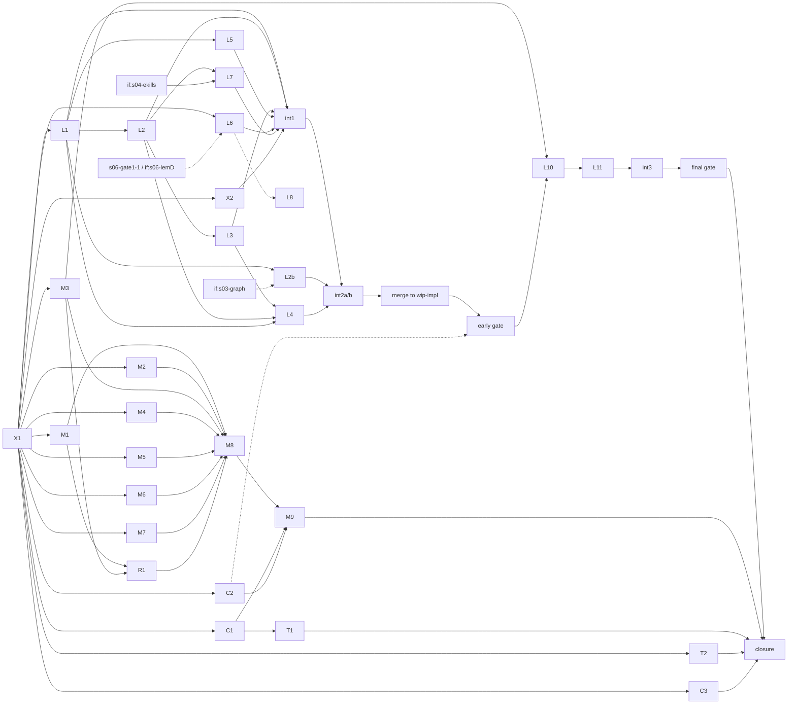

# Stage 05 implementation plan: the comparison hypothesis and the simplicial shape (revised after stage 1)

Status: P3 implementation plan, **revised** after stage 1 (re-planning brief `briefs/replan-s02-06.md`, which overrides
`briefs/common.md`). Author: stage-05 re-planning drafter (Opus), 2026-11-14; **revised by the reviser (Sonnet) after the Opus audit
`audits/stage-05-replan-audit.md` (A1–A25), see `audits/stage-05-replan-resolution.md`.** The conventions of the brief
(sections A–F) are binding and will be in the new OVERVIEW §4.3/§4.4/§5/§5.2/§6.1/§9. The stage gets a final pass before launch.
Sources: `plan/staged/stage-05-comparison-hypothesis.tex` (*tex*, labels `…:s05-…`), `SPLIT.md` §05,
`audits/stage-05-{muse,resolution}.md`, the global seam audit and its resolution (D1 = F1, D3 = F6), `experiments/SUMMARY.md`,
`runs/s01.md`, the stage-1 closure, the stage-1 Lean tree `lean/Langlandscape/` at main 7ce2a3e.
**Cross-stage references use stage-tex labels only** (`if:s0N-…`). The other stages are being re-planned in parallel, so
their WP ids are not used here. Declaration names of other stages are quoted from their current plans and are
**reconfirmed at launch** (X1 step 4).

## 0. Scope, fixed decisions, inputs from stage 1, carried-over items

**Scope (tex: "nothing in this stage is deep except what is assumed").** The deliverables are:
(i) exact statements of `hyp:s05-X` (X1)–(X4), `def:s05-Xiso` and `def:s05-theta`, with every normalisation fixed:
ε = +1, exponent +1, `⟨d⟩ ↦ ⟨d⟩⁻¹`, `U_p ↦ N_{U_p}`, the μ_N-model with Picard functoriality, the positive monodromy pairing,
the Rosati-twisted top piece in (X4), and the factor 2 (F2) at s = 0, M ≤ 2;
(ii) the convention bookkeeping (`prop:s05-sign`, `lem:s05-consistency`, `rem:s05-{Xstatus,factor2,illusie,hsieh}`);
(iii) a few formal proofs (`lem:s05-consistency`(b)–(d), `prop:s05-subquot`, `prop:s05-Xlambda`(a) at finite level);
(iv) two validation computations, T05-1 (ε) and T05-2 (exponent and diamonds).
Out of scope: any proof of Hyp.X, and the defect formula (stage 06).

> **Update 2026-11-15:** FD1 (mu_N-model with Picard functoriality) and FD2 ("+Pi_q" accepted; Hsieh's JL(U_q) = -U_q is an erratum) were
> DECIDED by Fabian (agents/status/STATE.md, "Decisions by Fabian"; recorded as decided in the s05 maths, Lean docstrings and talk per
> `plan/implementation/outbox/20261115T015741Z_milestone-closure-s06.md`). The `\provisional` / "provisional" wording below is the
> planning-time state, kept as the historical record.

**Open Fabian decisions, as they stand in the tex** (both are marked `\provisional` there; the plan implements the
recommendation and names the WPs that would change):
- **FD1, the Hyp.X model** (seam D1/F1): Setting, `hyp:s05-X`(X4), `rem:s05-Xstatus` (four-row table), `prop:s05-sign`(a) and
  `if:s05-hypX` fix the **μ_N-model with Picard functoriality** (Ribet–Stein §2.3.1.1). Hence `Frob_q = q·U_q` on the bottom
  piece, `σ_q = U_q⁻¹`, and the Frobenius permutation is `Π_q⁻¹`. With the naive model, (X4) would read `q⟨q⟩⁻¹U_q`.
  In Lean this is **one clause** of `Hyp.X.gal` (S05-L3) plus docstrings. Changing it costs about 10 min plus one TITAN round,
  and it touches L3, L4, M3 and M1 (table). It must be decided before L3 merges, ideally before launch.
- **FD2, Hsieh's sign** (seam D3/F6): `rem:s05-hsieh` gives the verdict "`+Π_q`, Hsieh's `JL(U_q) = −U_q` is an erratum, not
  imported". Writing to the author is still undecided. T05-1 (S05-C1) stays a **validation**, and S05-M5 confirms the verdict
  against Hsieh §3 (his GL₂-side `U_q`). If Fabian rejects the verdict, only M5, C1 (framing) and T1 (one line) change. No Lean
  statement depends on it (L7 and the audit grep for `U_q` with `q ∣ N⁻` in imported statements).

**Registered hypotheses (never axioms; OVERVIEW §3.6)**, `lean/Langlandscape/Langlandscape/Hyp/`, namespace
`Langlandscape.Hyp.X` (the tex path `AlgJL/Hyp/HypX.lean` is the frozen import's namespace and is not used):

| Lean name | file | statement (tex) | source | instances | discharge plan |
|---|---|---|---|---|---|
| `Langlandscape.Hyp.X.char` | `Hyp/HypX.lean` | `hyp:s05-X` (X1)∧(X2)∧(X3), ∀ s, on `CharGroupData`; **one family φ** (`∃ φ : ∀ s, …`), a deliberate deviation from the tex Lean-track text `∀ s, ∃ φ`, because (X3) links φ_s and φ_{s'} (recorded in the L2 docstring, in M3 and here, so that L10 does not flag it) | Ribet 1990 Prop 3.1/3.7/3.8; DR V.1.16/1.18; Raynaud Thm 5, Γ₀-level only (`thm:s05-G`) | `canonicalCharData` (S05-L4; vacuity documented, tex R6) | none (geometric; `rem:s05-Xstatus`) |
| `Langlandscape.Hyp.X.gal` | `Hyp/HypXGal.lean` | `hyp:s05-X` (X4) on `TateModuleData`; **takes the family `φ` as an argument** (it presupposes the `φ_s`), FD1 clause marked "provisional (FD1)" in the docstring | SGA7 IX (not in literature/), Illusie Thm 2.7, Ribet–Stein Lemma 3.17 | toy instance **for all s** (S05-L4; direct-sum model) | none |
| `Langlandscape.Hyp.X.iso` | `Hyp/HypX.lean` | `def:s05-Xiso` on abstract Hecke-module data | Hsieh Thm 4.5; Helm Cor 8.11 | toy instance (S05-L4) | algebraic half = `prop:s05-Xiso` (optional S05-L8); freeness stays with stage 04's Hsieh hypotheses (`if:s04-Mord`) |

The registry row for `Hyp.X.char` states the claim that stays outside Lean: "the `CharGroupData` *is* the character group of
`J_s`". Hypotheses of other stages are reused and not redefined (stage 04's Hsieh/Mord hypotheses, `GL2TF.Hyp.EichlerMass`).

**Not formalized** (maths, cited or computed only): `thm:s05-G`; `prop:s05-sign` (it is a statement about the geometric side;
M1 + C1/C2); `prop:s05-AL`; `prop:s05-Xlambda`(b)–(d); `prop:s05-nochain` (tex L3); `def:s05-stages`; `conj:s05-O2`; all
remarks; the "what is lost" table.

**Stage-1 Lean API used** (main 7ce2a3e, namespace `Langlandscape.Brandt` unless stated otherwise; `d : Langlandscape.Quat.DefiniteData`,
with `d.D = q` for `B_q`):
- Levels (`Langlandscape.Quat.DefiniteData`): `d.Utower M p s hN` (`U_s`), `Utower_antitone`, `U0`, `U1`, `finite_XB_Utower`.
- Modules: `ZX U R` (homological `R[X_B(U)]`, `XB U →₀ R`), `ZXdual`, `brandtPairing U R`, `normMap`; in `Langlandscape.Quat` (not `Brandt`): `wx` (`Quat/Basic.lean`), `negOne` (`Quat/Weights.lean`).
  **There is no `deg` in stage 1**: S05-L1 defines `Comparison.deg` (or reuses stage 04's `deg`, S04-L4 `Ordinary/EKills.lean`, if merged, with a bridge lemma).
- Homological Hecke: `heckeTHom U g R hfin : ZX U R →ₗ ZX U R`; `UpHom d M p s hN hp hM hpM hs R` (`N_{U_p}`, s ≥ 1);
  `PiEllHom R d ℓ hℓ P U` (right translation by `P ∈ (QuatAlg ℚ_[ℓ])ˣ`, ℓ ∣ D); diamonds as `heckeTHom` of `diamondElt d ℓ hℓ t`
  (one prime at a time; **the product ⟨d⟩ over ℓ ∣ Mp^s is not assembled**, a carried-over item); `Tl` via `elemT`,
  `relIndex_elemT_ne_zero_Utower`.
- Adjoints/pushforward: `Tl_adjoint`, `Tl_adjoint'`, `diamond_adjoint`, `PiEll_adjoint`, `brandtPairing_translateHom`;
  `pushforward U' U R`, `trace`, `normMap_pushforward`, `normMap_pushforward_two` (the factor 2 of `rem:s05-factor2`),
  `towerPush`, `towerPush_eq_pushforward`, `Up_comm_push`, `Up_comm_PiEll`, `Up_comm_Tl'`.
- Carried over from the stage-1 closure: (a) **`U_ℓ` for ℓ ∣ M is not in Lean** (K0/K1 local level). S05-L1 adds it or
  restricts `HeckeSym` (decision rule in L1). (b) `Up_comm_rightTranslate` and `Up_comm_Sl` keep finiteness hypotheses; L5
  passes them through. (c) The product diamond is assembled in L1 as a finite composition over `(Mp^s).primeFactors`, or
  `dia d` is indexed by local units, as L1 decides. (d) There are 80 linter warnings: new stage-05 files must add none
  (check_wp). (e) The tex correction to `prop:s01-relations`(c) (direction of `R_g`) is used by M1.

**Interface `if:s06-lemD` (imported from stage 06; Lemma D(a)–(c) of `lem:s06-D`) — explicit seam.** Quoted from `stage-06.md` §0
(*FIXED* there; a signature change needs the stage-05 master's written OK):
- **Files and namespace.** Quoted from `stage-06.md` §0 rev. 2 (block "Interface `if:s06-lemD` — FIXED signature (rev. 2)"; that
  block is authoritative and is copied verbatim into the L6 brief). The duality isos are **`A`-linear** (Mathlib v4.35 has no
  `Module S (Module.Dual A M)`); `S`-equivariance is `bEquivDualQuot_smul`, the map is `bEquivDualQuot_apply`.
  `Langlandscape/CommAlg/Gorenstein.lean` (**sole owner S06-L1**): `IsGorensteinWith A S ℓ`, `IsGorenstein`, `ann`, `congruenceIdeal`,
  `structure NewOldData A S` (fields `𝔞 𝔟 : Ideal S`, `free`, `finite`, `tf_a`, `tf_b`, `inf_eq_bot : 𝔞 ⊓ 𝔟 = ⊥`, `split : ∃ c : A,
  c ≠ 0 ∧ algebraMap A S c ∈ 𝔞 ⊔ 𝔟`), and `theorem NewOldData.split_iff [IsDomain A] (𝔞 𝔟 : Ideal S) : (∃ c : A, c ≠ 0 ∧ algebraMap
  A S c ∈ 𝔞 ⊔ 𝔟) ↔ (𝔞 ⊔ 𝔟).map (Algebra.TensorProduct.includeRight : S →ₐ[A] FractionRing A ⊗[A] S) = ⊤` (no `tf_*` hypotheses).
  `Langlandscape/CommAlg/NewOld.lean` (S06-L3; variables `[IsDomain A] [IsNoetherianRing A] [IsLocalRing A] (D : NewOldData A S)
  {ℓ : Module.Dual A S} (hℓ : IsGorensteinWith A S ℓ) (hb : Module.Free A (S ⧸ D.𝔟))`): `NewOldData.ann_a : ann D.𝔞 = D.𝔟`,
  `NewOldData.ann_b : ann D.𝔟 = D.𝔞`, `NewOldData.bEquivDualQuot (hℓ) : D.𝔟 ≃ₗ[A] Module.Dual A (S ⧸ D.𝔞)` with
  `bEquivDualQuot_apply`, `bEquivDualQuot_smul` (+ `aEquivDualQuot` and its `_apply`, `_smul`), and (c) `isComplemented_b`,
  `free_b`, `quotAEquivDualB` (+ `_mk`), `free_quot_a`. Namespace `Langlandscape.CommAlg`. `S` is finite **free** over `A` (fields
  `free`, `finite`); **no locality of `S`**.
- Used by stage 05: (a) and `split_iff` in S05-L6 (`prop:s05-subquot`); (b) in S05-L8 (optional); the statement only, in S05-M4.
- **States, in order of expectation** (X1 step 4 decides which one holds, and writes it into `lean/Langlandscape/audits/s05-seams.md`):
  1. **Early lane merged (expected).** Stage 06 runs a Mathlib-only early lane (jobs `s06-int1`…`s06-int4`, priority 3: S06-L1
     `Gorenstein.lean`, S06-L3 `NewOld.lean`, …), started by stage 03; it ends with `s06-gate1-1` + the L18 Fable audit, and the
     **global master** merges the clean `impl/s06-early` into `wip-implementation` at a stage boundary **before S05-X1** (the 04→05
     boundary), announced by the outbox file `<UTC>_s06-early-handover.md` ("`if:s06-lemD` green at <sha>"). X1 step 4 looks for that announcement and for
     `ann_a` in the merged tree. L6 then imports it and is accepted by plain TCHK.
  2. **Stage-06 scenario B** (cold start: L3(a) is in the in-stage `s06-int1` of stage 06). L6 waits about 1–2 rounds of stage 06 (the stage-06
     master announces it) and meanwhile follows state 3 or sits out of G1.
  3. **Stub.** The signatures are known but not merged: L6 compiles against a `sorry`-stub of **exactly** the quoted signatures in
     **both** files (`CommAlg/Gorenstein.lean`, `CommAlg/NewOld.lean`; the stub of only `NewOld.lean` would not elaborate), on
     `impl/s05-int<k>` only. The stub is listed in SORRIES.md **on the integration branch only**; **no stage-05 SORRIES row exists on
     `wip-implementation`**. The stub never merges. **Acceptance of L6 while stubbed ("compiles", not green):** BUILD ok for
     `CommAlg/SubQuot.lean`; the CHECK_WP FAIL lines of L6 are exactly the stub's `declaration uses 'sorry'` lines (Lake replays the
     dependency logs); `#print axioms CommAlg.subquot_*` is standard + `sorryAx` only. L6 is **not** in G1's precondition and not
     counted as green until the real Lemma D is merged; it is then rebased (lesson D4) and enters int3/G2 (or Q4).
  4. **L6F fallback.** Stage 06 late beyond the stage-05 final gate: S05-L6F writes the full rev.-2 stage-06 block (incl. `_apply`/`_smul`) in `NewOld.lean`
     (and, only with stage 06's **written agreement, since S06-L1 is the sole owner**, in `Gorenstein.lean`). It needs the global
     master's approval.
- Seam conditions that M4 and L6 respect: subquot is stated with `A` local and `T` localised at `𝔪`. The splitting `T_K = (T/𝔞)_K ×
  (T/𝔟)_K` is turned into the field-free `c` by **`NewOldData.split_iff`** (stage 06), not re-proved and not restated as a hypothesis.
- **GL2TF-free rule.** `CommAlg/SubQuot.lean` falls under stage 06's gate `grep -nP '^import (GL2TF|Langlandscape\.(?!CommAlg))'`: it
  imports Mathlib and `CommAlg.*` only. (S05-L6 could also run in stage 06's early lane, being Mathlib-only; not planned, see Q4.)

**Other imported interfaces** (statements must exist; the Lean declarations are reconfirmed at launch):
- `if:s01-{classset,brandt,hecke,targets}`: merged, names above.
- `if:s03-graph`: `Graph.WGraph` and `Graph.WGraph.X` (stage 03 S03-L1, `Graph/Weighted.lean`), the DR graph; used only by the bridge S05-L2b, soft.
- `if:s04-ekills`(a): `e ℤ_p[S_s]⁰ = e ℤ_p[S_s]`. Names (`stage-04.md` §4 seam note): `ordPart`, `ordProj` (`Ordinary/Projector.lean`);
  the abstract lemma `Ordinary.ordPart_ker_deg` (`e (ker deg) = e ⊤`, for `Ordinary.deg X R : (X →₀ R) →ₗ[R] R` on a finite `X` with
  `deg ∘ Up = p • deg`) in `Ordinary/EKills.lean` (S04-L4); the Brandt-level instance **`Ordinary.ekillsA_tower`** in `Ordinary/Tower.lean`
  (S04-L10, int3). The ℤ_[p] forms take `hdec : Hyp.PadicOrdDecomp` (L7 is "formalized modulo `Hyp.PadicOrdDecomp`" until S04-L3 is
  green; the `ZMod (p^m)` forms are unconditional). Used by L7; L7 needs a bridge from `Comparison.deg` to `Ordinary.deg`.
- `if:s04-Mord`: `Mord` and the Hsieh/Mord hypotheses (`Ordinary/Limit.lean`, needs S04-int4). Used by L7 (soft, limit version) and L8.
- `if:s02-{quot,coh,indef}`, `if:s03-{ribet,amalgam}`: maths only.

**Lean layout and conventions.** Files `Langlandscape/Comparison/*.lean` (namespace `Langlandscape.Comparison`) and
`Langlandscape/CommAlg/SubQuot.lean` (namespace `Langlandscape.CommAlg`). Every public declaration has a docstring.
The main theorems cite their `mathematics/` label (`s05-…`, from the M WPs; stage-tex label until then); check_wp checks this
in the integration round (lesson D3).

**Abbreviations.**
- **TCHK(WP)**: in the integration round's `summary.txt`, `CHECK_WP <WP> rc=0 0 FAIL lines` (build, sorry and forbidden
  tokens, docstrings) and the WP's **own** `AXIOMS .titan/s05_<wp>_axioms.lean rc=0 nonstandard=0` line (OVERVIEW §4.3; a combined
  file would let one failing draft block every WP). The docstring check requires the generalised `s[0-9][0-9]-` regex (S02-X1; X1 step 4 verifies it) and
  covers `theorem`/`lemma` only, so public `def`/`structure` docstrings (`Hyp.X.*`, `CharGroupData`, `theta`, …) are checked by
  the WP audit and by L10.
- **TEXCHK(labels)**: `latexmk -pdf standalone-s05.tex` (and `main.tex` at merge) in `mathematics/`, exit 0, no undefined
  refs or cites **other than the allowed ones below**, listed labels present. `standalone-s05.tex` `\input`s the merged chapters
  s01–s04 (guarded `\IfFileExists`) so that `prop:s01-relations`, `if:s04-ekills`/`Mord`, `if:s02-*`, `if:s03-amalgam` resolve. References
  to **stage-06 labels** (`if:s06-lemD`, `lem:s06-D`) are written as text with the interface name and the quoted statement until
  stage 06 is merged; M9 converts them to `\ref`s then. Allowed deviation for M4: its inputs include `plan/staged/stage-06-integral-defect.tex`
  (§ Lemma D only), which the request copies for a remote node.
- **PYCHK(file)**: `pytest code/python` passes; the stated values are in `code/results/s05/<file>.json` with provenance
  (script, commit, params, date, runtime; `code.md`).

## 1. Work packages

Columns per common.md plus `model (+fix)`, `remote` (remote-eligible, §6) and `TITAN` (integration round, §3).
`wall` = calibrated wall minutes (agent-active in brackets for Lean). Lean WPs never build locally: they draft, are merged into
`impl/s05-int<k>` by the stage master and are checked by that round's TITAN build.

### Track X (stage master + mechanical WPs)
| id | goal | inputs | outputs | acceptance | diff. | model (+fix) | remote | TITAN | wall | deps |
|---|---|---|---|---|---|---|---|---|---|---|
| S05-X1 | kickoff: (1) re-sync `wip-implementation`, create `impl/s05-*` branches and worktrees; (2) `mathematics/chapters/s05.tex` with `\InputIfFileExists{chapters/s05/<f>}{}{}` per section file (sign, higherweight, hypX, subquot, geometric, status, simplicial) and `mathematics/standalone-s05.tex` (`\input`s the merged chapters s01–s04; per-WP bib guards `\IfFileExists{bib/s05-<wp>.bib}{\addbibresource{bib/s05-<wp>.bib}}{}`, biblatex as in `preamble.tex`), so that M WPs create **new files only**; **push the drivers to `origin/wip-implementation`** (remote WPs start from that sha); (3) `code/results/s05/`; (4) **seam check**: grep the merged tree for the `if:s06-lemD` (§0 states 1–4; the stage-06 outbox announcement), `if:s04-ekills` and `if:s03-graph` declarations; **grep `tools/check_wp.sh` for the generalised docstring regex `s[0-9][0-9]-`** (delivered by S02-X1; later stages never edit tools: if absent, stop and report to the global master); write the note `lean/Langlandscape/audits/s05-seams.md` (found / stub needed, exact signatures); (5) HYPOTHESES rows (3, `open`) and, only if state 3 holds, the SORRIES row for the Lemma-D stub **on `impl/s05-int<k>` only** (none on `wip-implementation`); (6) **no signature stubs by the kickoff**: the owners of L1, L2, L3 commit their **signature skeletons** (§1 "Signatures") first, ≈ 5 min each, and the other writers stack on those skeletons; (7) `.titan/spec-int1.txt` and the per-WP axiom files (X2) on `impl/s05-int1` | OVERVIEW §2, §3.6; this §0 | dirs, pushed drivers, registry rows, seam note, int1 spec | `latexmk -pdf standalone-s05.tex` exit 0 (empty chapter); seam note present; `check_wp.sh` regex verified | mechanical-with-meaning | sonnet (+opus 2–5 min) | no | — | 12 | stage 04 merged (or its partial export), §7. **Remote chapter** (global master 2026-11-14, Abhijit batch 3): M1–M7 and R1 are remote; X1 step (2) does **not** create `chapters/s05.tex`, `standalone-s05.tex` or any `bib/s05-*.bib` (the package `abhijit/s05-math` owns them and starts off `origin/main`, not off an X1 push); X1 merges `origin/abhijit/s05-math`, `-s05-lit` (then `-s05-r1`) `--no-ff` instead and runs its latexmk acceptance on the merged driver |
| S05-X2 | axiom scratch files, generated **mechanically** from the declared outputs of §1 (headline list below): **one file per WP** `.titan/s05_<wp>_axioms.lean` (e.g. `s05_l1_axioms.lean`) with fully qualified names `Langlandscape.…`, every import that WP's names need, one `#print axioms` per line; plus **one combined file** `.titan/s05_all_axioms.lean` for G1/G2 only (not in an integration spec); the rows to add to `Audit/PrintAxioms.lean` (report); re-generated per round from the merged names | §1 outputs, `titan_batch.sh` (wrapped-line join) | file texts in the report (the stage master writes the per-WP files + combined file, integration branch only), PrintAxioms rows | in int1, every WP's `AXIOMS … rc=0`; no `unknown constant` (the WP's own drafts may fail the build, but only that WP's line then reads rc ≠ 0) | mechanical | haiku (ladder → sonnet) | no | int1→ | 5 | X1 |

Headline declarations (axiom list; names fixed here): `Comparison.theta`, `Comparison.deg_heckeTHom`,
`Comparison.degZero_stable`, `Hyp.X.char`, `Hyp.X.gal`, `Hyp.X.iso`, `Comparison.theta_adjoint`,
`Comparison.projection_formula`, `Comparison.projection_formula_two`, `Comparison.Up_comm_pushforward_degZero`,
`CommAlg.subquot_kernel`, `CommAlg.subquot_coker`, `Comparison.xlambda_finite`, `Comparison.degZero_equiv_graphX` (L2b), the tests `canonicalCharData_char`, `toyTate_gal` and
`toyXIso_holds` (L4), and (if L8) `Comparison.xiso_of_gorenstein`. Per-WP assignment (X2): L1 `theta`, `deg_heckeTHom`, `degZero_stable`; L2 `Hyp.X.char`,
`Hyp.X.iso`; L3 `Hyp.X.gal`; L5 `theta_adjoint`, `projection_formula(_two)`, `Up_comm_pushforward_degZero`; L6 `subquot_kernel`,
`subquot_coker`; L7 `xlambda_finite`; L2b, L4, L8 their own.

**Signatures (§1 "Signatures"; the design decisions of L1–L3, committed as skeletons by their owners first).** The plan fixes names,
arities and the meaning of every argument; L1/L2/L3 fix the exact Lean types in their skeleton commits (≈ 5 min each, L2 on L1's skeleton,
L3 on L2's), which the others stack on. Fixed here:
- `Comparison.deg (U) (R) : ZX U R →ₗ[R] R`; `degZero U R : Submodule R (ZX U R) := LinearMap.ker (deg U R)`.
- `inductive HeckeSym (M p q s : ℕ)`: `T ℓ` (ℓ prime, ℓ ∤ Mpq), `U ℓ` (ℓ ∣ M; L1 decision rule), `Up` (s ≥ 1) / `Tp` (s = 0), `dia u`
  (`u : (ZMod (M * p ^ s))ˣ`), `Uq`.
- `theta d M p q s hN (Pq : (QuatAlg ℚ_[q] d.a d.b)ˣ) (hPq : IsUniformiserElt q Pq) : HeckeSym M p q s →
  Module.End ℤ (degZero (d.Utower M p s hN) ℤ)`; `IsUniformiserElt` (valuation of `Nrd Pq` is 1, `q ∣ d.D`) is defined by L1.
- `structure CharGroupData (M q p : ℕ)`: `X : ℕ → Type` (free f.g. `ℤ`-modules), `act s : HeckeSym M p q s → Module.End ℤ (X s)`,
  `u s : LinearMap.BilinForm ℤ (X s)` (symmetric, positive-definite), `β : s ≤ s' → X s' →ₗ[ℤ] X s`. **No relations field.**
- `structure TateModuleData (M q p : ℕ)`: per `s`, a free f.g. `ℤ_[p]`-module `T s`, `frob s : T s ≃ₗ[ℤ_[p]] T s`, tame `τ s`
  with `frob τ frob⁻¹ = τ^q`, a commuting `HeckeSym`-action, the filtration `Tt s ≤ TI s ≤ ⊤`, and `N s`.
- `Hyp.X.char (G : CharGroupData M q p) : Prop := ∃ φ : ∀ s, G.X s ≃ₗ[ℤ] degZero (S s) ℤ, (X1) ∧ (X2) ∧ (X3)`.
- `Hyp.X.gal (G : CharGroupData M q p) (φ : ∀ s, G.X s ≃ₗ[ℤ] degZero (S s) ℤ) (T : TateModuleData M q p) : Prop`, graded pieces
  typed: top `degZero ⊗ ℤ_[p]` with `h ↦ (theta h)*` (Brandt adjoint); middle `T_pJ_1(Mp^s)^{⊕2}` opaque; bottom `Hom(degZero, ℤ_p(1))`
  with the **transpose** action, **Frobenius on the bottom piece = `q • (theta Uq).dualMap`** (the transpose of the endomorphism of
  `degZero`; stated on the Hom-piece, never on the top piece), `N` from top to bottom `x ↦ ⟨x,·⟩_w`. Docstring: "FD1 clause: provisional".

### Track M (`mathematics/chapters/s05/*.tex`, one new section file per WP; M1–M7 and R1 run in parallel)
| id | goal | inputs | outputs | acceptance | diff. | model (+fix) | remote | TITAN | wall | deps |
|---|---|---|---|---|---|---|---|---|---|---|
| S05-M1 | `prop:s05-sign`(a)–(d) in full (Ribet chain 3.1/3.7/3.8/Rem 3.5(b), Γ₀ vs Γ₁ Frobenius in the μ_N-model, **FD1** marked `\provisional`), `lem:s05-consistency`(a)–(d) with the Rosati duals on `J_1(N)`, `def:s05-theta`, the four-row table of `rem:s05-Xstatus`, `rem:s05-factor2` | tex; `if:s01-hecke`, stage-01 `prop:s01-relations` (with the `R_g` correction); Ribet 1990; Ribet–Stein §2.3.1.1, L. 3.15, 3.17 | `sign.tex`, `bib/s05-m1.bib` | TEXCHK(`prop:s05-sign`, `lem:s05-consistency`, `def:s05-theta`); every `\lit` page listed in the report; WP-level audit (§4 item 3) before merge | hard (normalisations) | opus (+planned opus fix) | **yes** (`abhijit/s05-math`) (global master 2026-11-14, Abhijit batch 3) | — | 25 (+8 audit) | X1 |
| S05-M2 | `prop:s05-sign`(e) higher weight with a precise local-JL reference (St⊗χ ↔ χ∘Nrd, positive square root), or an explicit "not found" | tex; `missing/stage-05.md`; JL 1970 / Bushnell–Henniart if present | `higherweight.tex`, `bib/s05-m2.bib`; missing-list update (report) | TEXCHK; reference with page, or "not found" | conceptual | opus | **yes** (`abhijit/s05-lit`) (global master 2026-11-14, Abhijit batch 3) | — | 15 | X1 |
| S05-M3 | `hyp:s05-X` stated with the data list of seed Hyp 8.1 (FD1 `\provisional`), `prop:s05-AL`, `prop:s05-Xlambda`(a),(b) full proofs ((X3) ⇒ iso of inverse systems, via `if:s04-ekills`(a)); (c),(d) as sketches tied to stage 04's twist; "what is lost" table | tex; `if:s04-{ekills,Mord}` | `hypX.tex`, `bib/s05-m3.bib` | TEXCHK(`hyp:s05-X`, `prop:s05-AL`, `prop:s05-Xlambda`); the (X1)–(X4) wording is what L2/L3 docstrings quote (checked in L10); it records the one-family-φ deviation; WP-level audit (§4 item 3) before merge | hard | opus (+planned opus fix) | **yes** (`abhijit/s05-math`) (global master 2026-11-14, Abhijit batch 3); E8′ not triggered: stage-03 E8 decided (opus wins, master log 21:49) | — | 25 (+8 audit) | X1 |
| S05-M4 | `def:s05-Xiso`, `prop:s05-Xiso` (hyps (i)–(iii)), `prop:s05-subquot` (proof via `if:s06-lemD`(a), stated so that the field-free `c` is visibly available, `A` local), `prop:s05-nochain`(a)–(c), `rem:s05-nochain` | tex; `if:s06-lemD` (statement quoted from stage-06 §0 and `plan/staged/stage-06-integral-defect.tex` § Lemma D) | `subquot.tex`, `bib/s05-m4.bib` | TEXCHK(`prop:s05-subquot`, `if:s05-subquot`); the subquot statement is what the L6 docstring quotes | routine | sonnet (+opus ~2 min) | **yes** (`abhijit/s05-math`) (global master 2026-11-14, Abhijit batch 3) | — | 15 | X1 |
| S05-M5 | `thm:s05-G`(G1)–(G5) with **verified** citations (DR, Ribet, Mazur App., Raynaud/Illusie in Astérisque 196–197, Kohel, PW); `rem:s05-illusie`; `rem:s05-hsieh` confirmation against Hsieh §3 GL₂-side `U_q` (**FD2**) | tex; literature | `geometric.tex`, `bib/s05-m5.bib`; verification table (cite, page, ≤ 1-line paraphrase) in the report | TEXCHK; every `\lit` page found or flagged | routine (literature) | sonnet (+opus ~2 min) | **yes** (`abhijit/s05-lit`) (global master 2026-11-14, Abhijit batch 3) | — | 20 | X1 |
| S05-M6 | literature search for Γ₁-level DR/Deuring/character-group statements (Conrad appendix, Helm, Ribet–Takahashi, Jordan–Livné, Carayol, Edixhoven); status paragraph of `rem:s05-Xstatus` | `rem:s05-Xstatus`; `missing/stage-05.md` | `status.tex`, `mathematics/litnotes/s05-gamma1.md`; missing-list update (report) | TEXCHK; every source gets a hit with page, or "no statement found" | routine (literature) | sonnet (+opus ~2 min) | **yes** (`abhijit/s05-lit`) (global master 2026-11-14, Abhijit batch 3) | — | 20 | X1 |
| S05-M7 | simplicial shape: `def:s05-stages`, the two-part zig-zag, `conj:s05-O2`, `rem:s05-{degree,O7,O46,context,BN,D1}` | tex; `if:s02-{quot,coh}`, `if:s03-amalgam` | `simplicial.tex`, `bib/s05-m7.bib` | TEXCHK(`def:s05-stages`, `conj:s05-O2`) | routine | sonnet (+opus ~2 min) | **yes** (`abhijit/s05-math`) (global master 2026-11-14, Abhijit batch 3) | — | 15 | X1 |
| S05-R1 | independent second reader of the normalisation chain: ε, e, δ, Frobenius table (FD1), (X4) Rosati twist, factor 2; reads tex + merged M1/M3 + literature, gives a verdict per item | tex; merged `sign.tex`, `hypX.tex`; Ribet 1990, Ribet–Stein, Conrad app. | `mathematics/chapters/s05/NOTES.md` (verdict CONFIRMED / GAP + exact step per item) | each of the 7 items has a verdict with a page reference | conceptual (review) | opus | **yes** (`abhijit/s05-r1`) (global master 2026-11-14, Abhijit batch 3) | — | 15 | M1, M3 merged |
| S05-M8 | **Fable chapter audit** (`mathematics_chapter_audit.md`), **in parallel with S05-L10**; focus on ε/e/δ, the Rosati twist, the factor 2, FD1/FD2 marked provisional, statuses | M1–M7, R1 | `mathematics/audits/s05.md` | verdict PASS / PASS WITH REMARKS / fix list | conceptual | fable | no | — | 15 | M1–M7, R1 |
| S05-M9 | apply M8 fixes; insert the **C2 verdict** on (δ, e) into `sign.tex` (status upgrade to *computed*) and the C1 count; final build (converts the textual stage-06 references to `\ref` if stage 06 is merged); milestone PDF | M8, C1, C2 | chapter, `bib/s05.bib` (merged from the per-WP files, **keys de-duplicated across the files**, and the `references.bib` lines), PDF | TEXCHK on `main.tex`; every M8 item closed | routine | sonnet (+opus ~2 min) | no (edits existing files) | — | 12 | M8, C1, C2 |

### Track L (Lean; `lean/Langlandscape/Langlandscape/{Comparison,Hyp,CommAlg}/`; TITAN only)
| id | goal | inputs | outputs | acceptance | diff. | model (+fix) | remote | TITAN | wall (active) | deps |
|---|---|---|---|---|---|---|---|---|---|---|
| S05-L1 | dictionary: defines `Comparison.deg` (none in stage 1; reuse stage 04's `deg` if merged, else define and give L7 a bridge lemma) and `degZero U R := ker deg` on `ZX U R`; **commits its signature skeleton first (≈ 5 min)**; `deg_heckeTHom` (`deg (heckeTHom g x) = relIndex · deg x`) and `degZero_stable`; `HeckeSym M p q s` (inductive: `T ℓ` (ℓ ∤ Mpq), `U ℓ` (ℓ ∣ M), `Up` (s ≥ 1) / `Tp` (s = 0), `dia` (unit of `(ℤ/Mp^s)ˣ`), `Uq`); `theta d M p q s hN (Pq) hPq : HeckeSym → Module.End ℤ (degZero (d.Utower M p s hN) ℤ)`, with `Uq ↦ +PiEllHom … Pq`, `dia d ↦` homological diamond of `d⁻¹` (product over primes), `Up ↦ UpHom`, `T ℓ ↦ heckeTHom (elemT …)`. **Decision rule for `U ℓ`, ℓ ∣ M:** if the K1-coset relIndex lemma for ℓ ∣ M (pattern `Up_relIndex_ne_zero`) is ≤ 40 lines, prove it here; otherwise drop `U ℓ` from `HeckeSym` and record the restriction in the docstring and in HYPOTHESES (carried-over item (a)). One docstring line per normalisation, with its tex label | `def:s05-theta`; stage-1 API §0 | `Comparison/Dictionary.lean` | TCHK(S05-L1); WP-level audit (§4 item 3) | hard | opus (fixes by the author in rounds; escalation to the stage master after 2 failed rounds) | no | int1 | 45 (15) | X1 |
| S05-L2 | **skeleton first** (on L1's skeleton), then: `structure CharGroupData M q p` (§1 "Signatures": free f.g. `X s`, `act s`, symmetric positive-definite `u s`, `β`; **no relations field**: `lem:s05-consistency`(a) is about the image of `ℋ_s` in `End X_q(J_s) ⊗ ℚ`, a consequence of (X1) for any `G`, not data; it would also need `T_{ℓ²}` and a global–local idele proof of `Π_q² = ⟨q⟩`, outside L4's budget; it stays a docstring remark / possible later theorem); `def Hyp.X.char (G) : Prop := ∃ φ : ∀ s, G.X s ≃ₗ[ℤ] degZero (S s) ℤ, (∀ s h, X1) ∧ (∀ s x y, X2 with `brandtPairing`) ∧ (∀ s ≤ s', X3 with `pushforward`)` (**one family** φ, a deliberate deviation from the tex Lean-track `∀ s, ∃ φ`, stated in the docstring; the factor 2 only at s = 0, M ≤ 2, via `normMap_pushforward_two`); `Hyp.X.iso` on abstract Hecke-module data (pattern of stage 04's Hsieh hypotheses) | `hyp:s05-X`, `def:s05-Xiso`, `if:s05-hypX`; L1 skeleton | `Hyp/HypX.lean` | TCHK(S05-L2); the docstring quotes (X1)–(X3) and states "G = character group stays outside Lean"; WP-level audit L2+L3 (§4 item 3) | conceptual | opus (fixes by the author in rounds; escalation after 2 failed rounds) | no | int1 | 45 (15) | L1 (skeleton) |
| S05-L2b | DR bridge: `Comparison.degZero_equiv_graphX : degZero (S s) ℤ ≃ₗ[ℤ] (G s).X` with `X = Graph.WGraph.X` of the two-vertex DR graph of `if:s03-graph` (a bridge lemma, not a new object). Stage 03's `Ribet.DRgraph d` exists only at `d.Ohat`, so `G s` is the two-vertex `Graph.WGraph` on `E = XB (S s)`, `w = wx`, built here by the same pattern (or L2b is restricted to `U = d.Ohat` and says so) | `if:s03-graph` (stage-03 names, reconfirmed by X1); L1 | `Comparison/DRBridge.lean` | TCHK(S05-L2b) | mechanical-with-meaning | sonnet (+opus 2–5 min) | no | int2a | 35 (10) | L1, `if:s03-graph` merged |
| S05-L3 | **skeleton first** (on L2's skeleton), then `TateModuleData` (§1 "Signatures": free f.g. `ℤ_[p]`-modules, `Frob`, tame `τ` with `Frob τ Frob⁻¹ = τ^q`, commuting `HeckeSym`-action, filtration `Tt ≤ TI ≤ ⊤`, `N`) and `Hyp.X.gal (G) (φ : ∀ s, G.X s ≃ₗ[ℤ] degZero (S s) ℤ) (T : TateModuleData M q p)` (X4; it **takes φ**, since it presupposes the `φ_s`): graded pieces typed as in §1 ("Signatures"): top `degZero ⊗ ℤ_p` with `h ↦ (theta h)*`, middle opaque `T_pJ_1(Mp^s)^{⊕2}`, bottom `Hom(degZero, ℤ_p(1))` with the transpose action, **FD1 clause: `Frob = q • (theta Uq).dualMap` on the Hom-piece (the transpose, not on the top piece), docstring "provisional (FD1)"**, `N = ⟨x,·⟩_w`. **Toy model, decided** (stage 04 dropped Weil vendoring, `stage-04.md` "Dropped vs. coarse: Weil vendoring"): no `ContinuousZlModule` | `hyp:s05-X`(X4), `rem:s05-Xstatus` row 1; L2 skeleton | `Hyp/HypXGal.lean` | TCHK(S05-L3); WP-level audit L2+L3 (§4 item 3) | conceptual | opus (fixes by the author in rounds; escalation after 2 failed rounds) | no | int1 | 45 (15) | L2 (skeleton) |
| S05-L4 | non-vacuity (tex R6): `canonicalCharData` (`X s := degZero (S s)`, `act := theta`, `u := brandtPairing`, `β := pushforward`), `canonicalCharData_char : Hyp.X.char canonicalCharData`; `toyTate_gal : Hyp.X.gal canonicalCharData φ_id toyT` **for all s** (the direct-sum model `toyT s := top ⊕ middle ⊕ bottom` with the pieces of §1 and middle := `0`, so the exported ∀ s Prop is witnessed; if the construction exceeds the budget, a docstring sentence says why and the instance stays at one level, as the exception); `toyXIso_holds`, a toy `Hyp.X.iso` instance | L2, L3 drafts; L1 | `LanglandscapeTests/Hyp/S05.lean` | TCHK(S05-L4); HYPOTHESES "instances" column filled (report) | mechanical-with-meaning (stacked) | sonnet (+opus 2–5 min) | no | int2a | 40 (10) | L1, L2, L3 (drafts) |
| S05-L5 | `lem:s05-consistency`(b)–(d): `theta_adjoint` (Brandt adjoint of `theta h` = `theta (h^Ros)` for `T ℓ`, `dia`, `Uq`, from `Tl_adjoint'`, `diamond_adjoint`, `PiEll_adjoint`); `projection_formula` (s ≥ 1) and `projection_formula_two` (factor 2, `−1 ∈ U_0`, from `normMap_pushforward(_two)`, `trace`); `Up_comm_pushforward_degZero` (from `Up_comm_push`, `towerPush_eq_pushforward`); the failure for `U_p^*` is a docstring remark citing stage 01 | `lem:s05-consistency`; stage-1 API | `Comparison/Consistency.lean` | TCHK(S05-L5) | routine (plumbing of existing lemmas) | sonnet (+opus 2–5 min) | no | int1 | 40 (12) | L1 (skeleton) |
| S05-L6 | `prop:s05-subquot`: `H` free of rank r over `T` ⇒ `subquot_kernel : H[𝔞] = 𝔟 • H ≃ 𝔟^r`, `H/𝔞H ≃ (T/𝔞)^r`, the map `H[𝔞] → H/𝔞H` injective, `subquot_coker : coker ≃ (T/(𝔞+𝔟))^r` (reduce to r = 1 via `Finsupp`/`Pi`); builds a `NewOldData` using **stage 06's `NewOldData.split_iff`** (no own `splitting_to_c`) and applies `NewOldData.ann_a` (`if:s06-lemD`(a)); imports Mathlib + `CommAlg.*` only (GL2TF-free gate, §0) | `prop:s05-subquot`, `if:s05-subquot`; **`if:s06-lemD`** (§0 seam) | `CommAlg/SubQuot.lean` | against merged Lemma D (§0 states 1–2): TCHK(S05-L6). Against the stub (state 3): the "compiles" acceptance of §0 only (BUILD ok; FAIL lines = the stub's sorry; axioms standard + `sorryAx`); L6 is then **not green and not in G1's precondition** | mechanical-with-meaning (stacked on stage-06 signatures) | sonnet (+opus 2–5 min) | **yes** (`abhijit/s05-l6`, off `origin/main` 0e24ba5 + `abhijit/s06-l3` 212d944 (Lemma D, §0 state 1)) (global master 2026-11-14, Abhijit batch 5) | int1 (merged Lemma D, or stub) | 40 (10) | X1 (seam note); real Lemma D merged for green / merge |
| S05-L6F | **fallback only**: Lemma D(a),(b) with the stage-06 signatures in `CommAlg/NewOld.lean`, and the `NewOldData` definitions in `CommAlg/Gorenstein.lean` only with stage 06's **written agreement** (S06-L1 is its sole owner); run only under §0 state 4; normally 0 min | `lem:s06-D` via `if:s06-lemD` | `CommAlg/NewOld.lean` (+ `CommAlg/Gorenstein.lean`) | TCHK(S05-L6F); WP-level audit if run | hard | opus (+planned opus fix) | no | if run | (45) | approval of the global master and stage 06 |
| S05-L7 | `prop:s05-Xlambda`(a) at finite level: `xlambda_finite`: under `Hyp.X.char G`, `ordPart (G.X s ⊗ ℤ_p) ≃ ordPart (ℤ_p[S_s])` (via `if:s04-ekills`(a), `ordPart_ker_deg`, through a bridge lemma from `Comparison.deg` to stage 04's `deg`), Hecke-equivariant away from q, compatible with `β`/`pushforward`; the limit version against `Mord` **iff** stage 04's limit (`if:s04-Mord`) is merged in Lean; otherwise it is a docstring remark | `prop:s05-Xlambda`(a); L2; `if:s04-{ekills,Mord}` | `Comparison/XLambda.lean` | TCHK(S05-L7); axioms standard + listed `Hyp.*` arguments only; WP-level audit (§4 item 3) | hard | opus (+planned opus fix) | no | int1 | 50 (18) | L2 (skeleton), stage-04 ekills merged |
| S05-L8 | *optional (ext)*: `prop:s05-Xiso` algebraic half: `xiso_of_gorenstein` (`H` free of rank one over `T`, `T'` Gorenstein, `bEquivDualQuot` (A-linear) + `bEquivDualQuot_smul` (T-equivariance) ⇒ `H[𝔞] ≃ T'` non-canonically); `Hyp.X.iso` from Hsieh-shaped data | `prop:s05-Xiso`; L6; `if:s06-lemD`(b), `IsGorensteinWith` | `Comparison/XIso.lean` | TCHK(S05-L8) | hard | opus (+planned opus fix) | **partly**: algebraic half `xiso_of_gorenstein` remote (`abhijit/s05-l8`, stacked on `abhijit/s05-l6`); the `Hyp.X.iso` line stays **local** (appended to `Comparison/XIso.lean` after L2) (global master 2026-11-14, Abhijit batch 5) | int2b / int3 | 40 (15) | L6 (real Lemma D merged), `if:s06-lemD` merged |
| S05-L10 | **Fable Lean audit** (`lean_audit.md`), **in parallel with S05-M8**, on the early-gate commit: faithfulness of `Hyp.X.*` to `hyp:s05-X` (ε, exponent, δ, Rosati twist, direction of β, positivity, one family φ, FD1 clause), vacuity documented, `theta` against `def:s05-theta`, `if:s06-lemD` use, docstring labels (**including `def`/`structure` docstrings with labels**, which check_wp does not cover; the FD1 clause on the Hom-piece as a transpose; the one-family-φ deviation recorded) | early-gate sha; M3 (merged or tex) | `lean/Langlandscape/audits/<date>_s05.md` | verdict PASS / PASS WITH REMARKS (required items listed) | conceptual | fable | no | — | 10 | G1 |
| S05-L11 | Lean audit-fix WP(s): one per required L10 item cluster, each `≤ 15 min` | L10 report | fixes on `impl/s05-l11<x>` | TCHK in int3 | routine | sonnet; opus for statement changes (+opus 2–5 min) | no | int3 | 15 (8) | L10 |

### Track C (`code/python/langlandscape/comparison/`, new subpackage) and H
| id | goal | inputs | outputs | acceptance | diff. | model (+fix) | remote | TITAN | wall | deps |
|---|---|---|---|---|---|---|---|---|---|---|
| S05-C1 | **T05-1** (validation, FD2): `q ∈ {11,23,37,43}`, M = 1, `k ∈ {2,4,6,8}`; `Π_q`-eigenvalue on each Brandt eigenline (matched by `T_2,T_3,T_5`) vs `a_q` of the q-new form (PARI `mf`). Extends stage-1 `pi_ell.py` (`D ∈ {11,13,17,19}`, `k ≤ 4`, `pi_sign.json` all_plus) by import, not by editing | `tc:s05-sign`, `rem:s05-hsieh`; `pi_ell.py`, `brandt.py`, `symn.py` | `comparison/sign.py`, `tests/test_s05_sign.py`, `results/s05/T05-1.json` | PYCHK: `a_q = +λ(Π_q)` for every eigenline (count recorded) | routine | sonnet (+opus ~2 min) | no | — | 15 | X1 |
| S05-C2 | **T05-2** (validation of `prop:s05-sign`(d), tex R2): `B_q`, `U_1(N)`, weight 2. Brandt `T_ℓ`, adelic `⟨d⟩`, `Π_q` on `ℤ[X_B(U_1(N))]⁰`, built on stage-1 `levels.py` (`level_points(N1, N0)` gives `U_1(N)` class sets; the Hecke and `Π_q` action at `U_1(N)` is new). Match eigensystems with PARI `mf` on `Γ_1(N) ∩ Γ_0(q)` q-new with characters χ; confirm `U_q ↦ +Π_q`, `⟨d⟩ ↦ ⟨d⟩⁻¹`, and a witnessed failure of `Π_q⁻¹` where `χ(q) ≠ ±1`. **Informative pairs only** (`ord(q mod N) ∉ {1,2}`): (q, N) = (13, 5), (11, 7); add (23, 5) if fast. **Stop rule:** C2 ends at t ≈ 47 while L3 is already in int1 (t ≈ 35), so "L3 merges" means the merge of L3 into `wip-implementation` (and G1), not the int-branch merge: a contradiction with the tex stops M1/M9, that merge and G1, and goes to the global master (FD1) | `tc:s05-exp`, `prop:s05-sign`(c),(d); `levels.py`, `brandt.py`, `pari.py` | `comparison/gamma1.py`, `tests/test_s05_gamma1.py`, `results/s05/T05-2.json` | PYCHK: all eigensystems matched under θ; mismatch witnessed for `Π_q⁻¹` | hard (normalisation-decisive) | opus (+planned opus fix) | no | — | 35 | X1 |
| S05-C3 | **T05-3** = (X2) at Γ₀-level: a pointer to stage 03's T1 results (Smith form vs `num((q−1)/12)`, `if:s03-graph`) with a recomputed summary; no new computation | `rem:s05-O46`; `code/results/s03/` | `results/s05/T05-3.json` | PYCHK: values equal stage 03's | mechanical | haiku (ladder → sonnet) | no | — | 5 | X1, stage-03 T1 merged |
| S05-C4 | *ext*: **T05-5** sub/quot cokernel at the seed T5 triples (Hecke algebra mod `p^m` localised at 𝔪, `𝔞`, `𝔟`, `coker(H[𝔞] → H/𝔞H)` vs `T/(𝔞+𝔟)`) on stage 06's congruence toolkit | `prop:s05-subquot`; stage-06 T5 code | `comparison/subquot.py`, `results/s05/T05-5.json` | PYCHK: orders equal at every triple computed | routine | sonnet (+opus ~2 min) | no | — | 25 | stage-06 T5 code merged |
| S05-H1 | *not scheduled* (OVERVIEW F8, `code/hacs/` empty): **T05-4** = seed T7 (Brandt Gram on `e ℤ_p[S_s]⁰_𝔪` vs Ohta-twisted GL₂ pairing at Eisenstein/non-Gorenstein 𝔪); needs HACS `U_p` at level `qp^s` | tex T05-4 | `results/s05/T7.json` | PYCHK | hard | opus | no | — | — | HACS with `U_p` |

### Track T (`talk/slides/`)
| id | goal | inputs | outputs | acceptance | diff. | model (+fix) | remote | TITAN | wall | deps |
|---|---|---|---|---|---|---|---|---|---|---|
| S05-T1 | slide "why the geometric route is expensive" (DR, Néron, SGA7, Čerednik–Drinfeld vs trees + SA), plus one line `U_q ↦ +Π_q` with the T05-1 count; Hyp.X is never called "known" (R1); FD2 phrased as "we find `+`" | `thm:s05-G`, `prop:s05-sign`; C1 | `talk/slides/s05-cost.tex` | `latexmk` exit 0; claims cite labels / `results/s05/T05-1.json` | routine | sonnet (+opus ~2 min) | no | — | 10 | C1 |
| S05-T2 | TikZ two-part zig-zag (left: q ∤ D, explicit simplicial maps; right: `B_q`, DR graph ⟷ dual graph, one hypothesis arrow `Hyp.X`; the primes labelled as in the tex) | `def:s05-stages` | `talk/slides/s05-zigzag.tex` | `latexmk` exit 0 | routine | sonnet (+opus ~2 min) | no | — | 12 | X1 |

**Count: 31 WPs.** X 2, M 10 (M1–M9, R1), L 12 (L1–L8 incl. L2b and L6F, L10, L11), C 4 + H1, T 2.
- **27 scheduled:** X1–X2, M1–M9, R1, L1–L7 (incl. L2b, without L6F), L10, L11, C1–C3, T1, T2.
- **Ext/optional (3):** L8, C4 and H1. H1 is not scheduled.
- **Fallback (1):** L6F.
- **Gate steps** G1/G2 (§4) are stage-master steps, not WPs.

## 2. DAG

```
precondition: stage 04 merged (or its partial export) -> X1
X1->{M1..M7, L1, L6, C1, C2, C3, T2, X2}   X2 -> int1
L1(skeleton)->L2(skeleton)->L3(skeleton)  L1->L5  L1->L2b  L1->L4 (input)  L2->L7  L2->L4  L3->L4   (writers stack on skeletons: edges = signature deps)
s06-gate1-1 + hand-over merge (early lane merged) or S06-L3(a) merged -> L6 (green / merge)   if:s06-lemD(b)->L8  L6->L8  if:s04-ekills->L7  if:s03-graph->L2b  stage03-T1->C3
{L1,L2,L3,L5,L6(stub: not counted),L7} -> int1 -> int2a.. -> merge to wip-implementation -> G1 (early full gate)
L2b, L4 -> int2a
G1->L10  M3->L10 (input)  {M1,M3}->WP audit->merge->R1  {M1..M7,R1}->M8   L10 ∥ M8   L10->L11->int3->G2 (final gate)   M8->M9  C1->M9  C2->M9  C1->T1
C2 -> L3 (merge to wip-implementation) and C2 -> G1 (stop rule)
L1, L2, L3, L7, C2, {M1,M3} -> WP-level audit (§4 item 3)
G2, M9, C1–C3, T1, T2 -> closure
```


**Waves** (t in minutes from X1 start; calibrated per brief F):
- **W0 (t = 0–12).** X1.
- **W1 (t ≈ 12).** All writers start in parallel.
  - L1 (skeleton in the first ≈ 5 min), then L2, L3 (skeletons in turn), L5, L6 and L7 stacked on the skeletons.
  - M1–M7 (local or remote), C1, C2, C3 and T2.
  - X2.
  - Concurrency is 6 Lean, 7 M and 4 C/T writers: about 17 agents, split over the stage master (≤ 8) and two
    sub-coordinators (M; C/T).
- **W2 (t ≈ 40).** int1. L2b and L4 are drafted while int1 runs. R1 starts once M1 and M3 have merged.
- **W3 (t ≈ 45–75).** int2a and int2b, with fixes between rounds. M8 runs once M1–M7 and R1 have merged. T1 runs after C1.
- **W4 (t ≈ 80).** Merge of the green WPs into `wip-implementation` (≈ 3 min), then G1, the early full gate. Then L10 and M8 run as parallel Fable audits.
- **W5 (t ≈ 95–126).** L11 → int3 → G2 (final, from scratch); M9; closure.

**Critical path (Lean, summed wall).**

| step | min |
|---|---|
| X1 | 12 |
| L1 draft | 20 |
| L2/L3 drafts ready on the skeletons (L2 skeleton ≈ t+5 of L1, L3 skeleton after it), int1 sent | 8 |
| int1 round | 7 |
| fix | 8 |
| int2a | 7 |
| fix | 8 |
| int2b (contingency round, the stage-1 rate was 3–6 rounds) | 7 |
| merge of green WPs into `wip-implementation` (G1 runs there) | 3 |
| G1 early full gate | 6 |
| L10 Fable Lean audit | 10 |
| L11 fixes | 10 |
| int3 | 7 |
| G2 final gate from scratch | 8 |
| closure | 5 |
| **total** | **≈ 126 min** |

- Off the path:
  - M track: X1 12 + M1/M3 25 + WP audit 8 + R1 15 + M8 15 + M9 12 ≈ 87 min. Slack ≈ 39 min, since M8 must end before closure.
  - C2: 35 min (slack ≈ 70); its stop rule guards the L3 merge and G1 (t ≈ 80).
  - L7 joins int1 only if `if:s04-ekills` is merged. Otherwise L7 waits for it and becomes critical: stage 04 then gates
    stage 05, not the other way round.
- **Stage wall estimate: ≈ 2.1 h, range 1.5–3.2 h.**
  - Upside: 2 rounds instead of 3.
  - Downside: 5–6 rounds (+25 min), a C2 contradiction (stop, Fabian), or Lemma D not merged at G2 (L6 holds the
    closure).
  - **Stage-06 dependency.** Default (early lane merged before X1, §0 state 1): no effect. If stage 06 runs in scenario B (L3(a) in
    `s06-int1`), L6 waits about 1–2 stage-06 rounds (+10–15 min on L6 only; critical only if it outlasts G2).
  - For scale: stage 1 took 2.2 h against an 8.8 h plan, and stage 05 is smaller in Lean (about 9 files, 100–300 lines each).

## 3. TITAN plan (remote-only Lean; OVERVIEW §4.3)

- **Mechanics.** The stage master merges drafts into `impl/s05-int<k>`, writes and commits
  `plan/implementation/outbox/<UTC>_titan-s05-<job>-<n>.md`, and the global master pushes and relays. Each job spec gives:
  - the job id, the priority, the branch and full sha;
  - the command: `cd lean/Langlandscape && bash tools/titan_batch.sh .titan/spec-<job>.txt`;
  - the report: `summary.txt` in full, `error:` lines (≤ 200 per failing WP), the FAIL lines of check_wp, and the
    non-standard axiom lines;
  - the result branch `titan/<job-id>`.
- `.titan/` files exist **only on the integration branch** (lesson A0.1); WP branches never contain them. At most one
  integration build per round, plus at most one strand job (if E8′ runs it is LaTeX, so it needs no TITAN slot). The ≤ 3
  concurrent builds are shared with stage 06 (05 ∥ 06) **by the global master's ordering** (§7 risk 5).
- **int1** (all core drafts, t ≈ 40), `.titan/spec-int1.txt` (one AXIOMS line per WP, following its WP line, so that one failing
  draft cannot block the others):
  ```
  S05-L1 Langlandscape/Comparison/Dictionary.lean
  AXIOMS .titan/s05_l1_axioms.lean
  S05-L2 Langlandscape/Hyp/HypX.lean
  AXIOMS .titan/s05_l2_axioms.lean
  S05-L3 Langlandscape/Hyp/HypXGal.lean
  AXIOMS .titan/s05_l3_axioms.lean
  S05-L5 Langlandscape/Comparison/Consistency.lean
  AXIOMS .titan/s05_l5_axioms.lean
  S05-L6 Langlandscape/CommAlg/SubQuot.lean
  AXIOMS .titan/s05_l6_axioms.lean
  S05-L7 Langlandscape/Comparison/XLambda.lean
  AXIOMS .titan/s05_l7_axioms.lean
  ```
  Under §0 state 3 the stub (`CommAlg/Gorenstein.lean`, `CommAlg/NewOld.lean`) is on the integration branch (not a spec line, SORRIES
  row on that branch only) and L6's line is judged by the "compiles" acceptance. L7 is dropped from int1 if `if:s04-ekills` is not in the tree.
- **int2a**: the failing WPs of int1, plus `S05-L2b Langlandscape/Comparison/DRBridge.lean` and
  `S05-L4 LanglandscapeTests/Hyp/S05.lean`. **int2b, int2c, …** are re-runs after fixes; the letter counts re-runs of round 2.
  Before every round, open WP branches are rebased onto the fixed integration tree (lesson D4).
- **G1, the early full gate** (job `s05-gate1-1`, lesson D1), run on `wip-implementation` (OVERVIEW §4.3 gate variant, no `.titan/`
  content, no stub) **after the green WPs are merged there** (≈ 3 min, on the critical path), as soon as L1–L5, L7, L2b and L4 are
  green (**L6 only if the real Lemma D is merged**), t ≈ 80: (a) `tools/lbuild.sh Langlandscape LanglandscapeTests`; (b) `tools/lbuild.sh
  LanglandscapeVendorStacks`; (c) `tools/lfile.sh Audit/PrintAxioms.lean` with the stage-05 rows added by X2 (wrapped-line join, count
  and non-standard = 0; the combined `.titan/s05_all_axioms.lean`-derived rows); (d) the forbidden-token grep `\bsorry\b|\badmit\b|^axiom|native_decide|implemented_by`
  over `Langlandscape LanglandscapeTests` → empty; (e) the `declaration uses 'sorry'` count in the log of (a) (only the import's replayed
  line allowed); (f) `tools/check_frozen.sh`; plus check_wp for all stage-05 files (docstring gate, lesson D3) and the GL2TF-free grep on `CommAlg/`.
  L10 runs on this sha.
- **int3**: the L11 fixes (+ L8 if done), and L6 rebound from the stub to stage 06's merged `Gorenstein.lean` and `NewOld.lean` (L6 then
  enters TCHK and the merge).
- **G2, the final gate** (job `s05-final-1`): **from scratch** (fresh unseeded checkout, `.lake/build` of `Langlandscape` removed, as
  `s01-final-1`) at the merge commit of `wip-implementation`, with the same checks (a)–(f) as G1. In addition SORRIES.md has no stage-05 rows (no Lemma-D
  stub), and HYPOTHESES has the three rows with instances.
- **Axiom scratch files** (S05-X2, haiku): one per WP, generated from the headline list in §1 (names fully qualified, only that WP's
  imports), plus the combined file for G1/G2; re-generated if a name changes in a fix round. File name: `.titan/s05_<wp>_axioms.lean`.
- **Parallel stage 06.** Stage 06's early lane (priority 3) and its integration rounds share the three slots with ours (§7 risk 5).

## 4. Gates and audits

1. **Per WP.** The acceptance column. Lean WPs are accepted on TCHK in an integration round (no local build). M WPs are
   accepted on TEXCHK on their branch (remote or local) and again by the stage master after merge. C WPs are accepted on
   PYCHK.
2. **Early full gate G1** (§3) at mid-stage, as soon as the core Lean WPs are green (merged into `wip-implementation` first).
3. **WP-level audits** (OVERVIEW §5.3, before merge, one blind opus audit each, 5–8 min): **L2+L3 jointly** (statement against the tex, the
   FD1 transpose clause, φ as an argument); **L1** (`theta` against `def:s05-theta`, the `U ℓ` decision); **L7**; **C2** (normalisation
   verdict); **M1+M3** jointly (normalisation chain, one-family-φ deviation; fable instead of opus if E8′ runs); L6F and L8 if they run.
   They are off the critical path except L1–L3, which run in parallel with int1/int2 (their findings are folded into the int2 fix
   rounds). M2 (literature lookup) is covered by M8; R1 is the independent re-read after M1/M3 have merged.
4. **Parallel Fable audits.** S05-L10 (Lean audit on the G1 sha) ∥ S05-M8 (chapter audit on the merged M1–M7 + R1).
   Both are Fable, run concurrently (Fabian 18:22), and each writes its own report. The cross-check "M3 statement = L2/L3
   docstrings" is item 1 of L10.
5. **Fix WPs.** L11 (Lean, budget 10–15 min, one TITAN round int3) and M9 (maths, ~12 min). Required items only; hygiene
   remarks go to `runs/s05.md` as carried-over items.
6. **Final from-scratch gate G2** (§3).
7. **Milestone closure.** `plan/implementation/outbox/<UTC>_milestone-closure-s05.md` (delivered, verification, open
   issues, request) and `runs/s05.md` (per-WP wall, rounds, models, experiment data). Status and job specs always go to the
   outbox; SendMessage is only a notification (lesson D5).
- **Stage done** (per track):
  - **M**: `main.tex` compiles with chapter s05, M8 PASS (or remarks closed by M9), `if:s05-{hypX,subquot}` labels present,
    FD1/FD2 still marked provisional unless Fabian decided.
  - **L**: G2 PASS, L10 PASS, SORRIES clean (no stage-05 row on `wip-implementation`).
  - **C**: C1–C3 recorded. C2's verdict is in `sign.tex`.
  - **T**: T1 and T2 compile.
  - **May continue in stage 06:** L8, C4, H1, and L6 if stage 06's Lemma D is late. The last is stated in the closure;
    then `if:s05-subquot` has no Lean counterpart at the stage-05 merge.

## 5. Experiment strands

None planned (brief B). **One conditional strand, E8′ (LaTeX-hard), on S05-M3**:
- **Condition.** It runs only if stage 03's E8 result leaves the cell "LaTeX hard: opus + planned opus fix vs fable
  single-shot" undecided or confounded (stage 01: E8 undecided, all-fail proposed). The global master approves per
  EXPERIMENT_PROTOCOL §9.
- **Strands.** `exp/s05-m3-opus` (opus + one planned opus fix round) and `exp/s05-m3-fable` (fable, single shot). Both run
  locally (M3 is then **not** remote-eligible) from the same brief: the verbatim M3 row, the tex, and the acceptance
  command.
- **Audit.** The **same protocol as stage 03's E8**: both strands are audited by **one blind opus auditor** (OVERVIEW §5.2;
  `stage-03.md`), the self-preference confound is noted in `experiments/LOG.md`, and optionally a second blind fable audit of both is
  recorded but not used for the verdict. Otherwise the data cannot be pooled with S03.
- **Recorded.** Active vs wall minutes, W0 (crit/maj/min), Q0/Qf, and the rounds.
- **Merge.** The stage master merges at most one strand. The reference (opus) is mergeable at mechanical acceptance (EXPERIMENT_PROTOCOL §4.4
  rule), so the strand never delays M8.
- **Relays.** TITAN is not involved. Audit results are relayed verbatim with no fix hints (lesson D6).
- **Why M3.** It is the stage's only full-proof LaTeX WP with a mechanical check, its statement is fixed by the tex, and
  its errors (direction of β, the `P_k` ↔ `P^ad_k` dictionary) are auditable.
- **Not chosen.** Lean-hard L7 (it depends on stage-04 API drift, so the cell would be confounded); L1 (critical path).

## 6. Remote-eligible WPs (node "Abhijit"; OVERVIEW §6.1)

**The stage is launchable without Abhijit.** The default executor is local. The global master decides per WP at stage launch.
- **Start condition.** *Batch 3 (global master 2026-11-14, Abhijit batch 3): superseded for this chapter: the package `abhijit/s05-math` writes the drivers and per-WP bibs itself off `origin/main` (as `abhijit/s04-math` did, stage-04 §6); `abhijit/s05-lit` stacks on its driver commit, `abhijit/s05-r1` on its head once M1 and M3 are pushed.* Originally: Remote WPs start only after X1's drivers are merged **and pushed** to `origin/wip-implementation` (the base sha is in the
  request), so they cannot run "stages ahead" (OVERVIEW §7). The standalone is created by X1, not by the first remote WP.
- **Conditions.** Inputs are the stage tex, the merged `mathematics/` and `literature/` (the node needs its own copy); M4 also needs
  the Lemma D statement from stage 06's tex (the request copies it; allowed deviation, §0 TEXCHK). The WP writes **new files only**,
  on the **package branch `abhijit/s05-math`** (M1–M7; OVERVIEW §6.1 O13) resp. `abhijit/s05-r1` (R1 alone, sole writer of
  `chapters/s05/NOTES.md`) off `origin/wip-implementation` (after X1). Aggregator lines are returned in the WP report and
  applied by the stage master.
- **Acceptance.** `latexmk -pdf standalone-s05.tex` exit 0, no undefined refs or cites other than the allowed stage-06 textual ones.
  Per-WP bib files `bib/s05-<wp>.bib` (kept: the only way to keep 8 concurrent remote WPs new-files-only; stage 03 does the same) are
  loaded by the guard `\IfFileExists{bib/s05-<wp>.bib}{\addbibresource{bib/s05-<wp>.bib}}{}` (biblatex); M9 de-duplicates keys.

| WP | branch | files (new) | why eligible | caveat | local fallback model |
|---|---|---|---|---|---|
| S05-M1 | `abhijit/s05-math` | `chapters/s05/sign.tex`, `bib/s05-m1.bib` | maths, self-contained | the C2 verdict is inserted later by M9 (local) | opus; **remote, batch 3** (`abhijit/s05-math`) (global master 2026-11-14, Abhijit batch 3) |
| S05-M2 | `abhijit/s05-math` | `chapters/s05/higherweight.tex`, `bib/s05-m2.bib` | maths + literature | library access helps (missing local-JL reference) | opus; **remote, batch 3** (`abhijit/s05-lit`) (global master 2026-11-14, Abhijit batch 3) |
| S05-M3 | `abhijit/s05-math` | `chapters/s05/hypX.tex`, `bib/s05-m3.bib` | maths | **not** if the conditional strand E8′ runs | opus; **remote, batch 3** (`abhijit/s05-math`) (global master 2026-11-14, Abhijit batch 3) |
| S05-M4 | `abhijit/s05-math` | `chapters/s05/subquot.tex`, `bib/s05-m4.bib` | maths | must keep the `if:s06-lemD` statement shape (§0); needs the stage-06 Lemma D statement | sonnet; **remote, batch 3** (`abhijit/s05-math`) (global master 2026-11-14, Abhijit batch 3) |
| S05-M5 | `abhijit/s05-math` | `chapters/s05/geometric.tex`, `bib/s05-m5.bib` | literature verification | Astérisque 196–197, DR; FD2 confirmation | sonnet; **remote, batch 3** (`abhijit/s05-lit`) (global master 2026-11-14, Abhijit batch 3) |
| S05-M6 | `abhijit/s05-math` | `chapters/s05/status.tex`, `litnotes/s05-gamma1.md` | literature search | library access (Helm 2007, Ribet 1987–88) | sonnet; **remote, batch 3** (`abhijit/s05-lit`) (global master 2026-11-14, Abhijit batch 3) |
| S05-M7 | `abhijit/s05-math` | `chapters/s05/simplicial.tex`, `bib/s05-m7.bib` | maths | — | sonnet; **remote, batch 3** (`abhijit/s05-math`) (global master 2026-11-14, Abhijit batch 3) |
| S05-R1 | `abhijit/s05-r1` | `chapters/s05/NOTES.md` | second reader | needs M1 and M3 merged first; a different account gives a truly independent reading | opus (a different local agent); **remote, batch 3** (`abhijit/s05-r1`) (global master 2026-11-14, Abhijit batch 3) |

*Batch-5 assignment (global master 2026-11-14, Abhijit batch 5):* **S05-L6** (`CommAlg/SubQuot.lean`) and the algebraic half of **S05-L8** (`xiso_of_gorenstein` in `Comparison/XIso.lean`) are remote. Both import `Mathlib.*` and `Langlandscape.CommAlg.*` only (§0 GL2TF-free gate, *verified* against the rows; Lemma D is merged on `wip-implementation`, §0 state 1). Local direct-`lean` draft check (`lean.md` exception R-A); acceptance in our TITAN round. S05-X1 creates **no worktrees** for L6/L8; it merges the fetched heads into `impl/s05-int1` (L6) resp. `impl/s05-int2b` (L8). The `Hyp.X.iso` part of L8 needs L2 (`Hyp/HypX.lean`) and stays local: a small local WP appends it to the merged `XIso.lean`. Also remote (maths, on the unmerged package branches): the closure attempt of the open items of `abhijit/s05-math` 2a96294 (prop sign (d) Picard `U_p = N_{U_p}`, FD1 rows 2–3, AL inputs (R1)/(R2) at Γ_s, `prop:s05-Xlambda`(c),(d), Rosati equivariance of `u_s`) and an R1 re-read of the changes (`abhijit/s05-r1`).

| WP | branch | new files | local fallback model | note |
|---|---|---|---|---|
| S05-L6 | `abhijit/s05-l6` | `lean/Langlandscape/Langlandscape/CommAlg/SubQuot.lean` | sonnet (+opus fix) | (global master 2026-11-14, Abhijit batch 5); statement `info` first |
| S05-L8 (alg. half) | `abhijit/s05-l8` (on `abhijit/s05-l6`) | `lean/Langlandscape/Langlandscape/Comparison/XIso.lean` | opus (+pf) | (global master 2026-11-14, Abhijit batch 5); optional (ext); `Hyp.X.iso` local |
Not eligible: X1, X2, all other L (TITAN via our outbox; stage-1/Brandt/`Hyp` inputs), C/H/T (brief E), M8 and L10 (Fable audits), M9 (edits existing files),
and any strand.

## 7. Risks and open questions for Fabian

**Risks.**
1. **Normalisations** (tex R2, R4; highest). δ, the exponent of `Π_q`, the (X4) Rosati twist and the Frobenius formula
   (FD1). A wrong choice still builds.
   - Mitigation: C2 decides δ and e numerically (informative pairs only), R1 reads the chain independently, and L10 checks the
     Lean statements line by line against M3.
2. **Vacuity** (tex R6). `Hyp.X.char` on abstract `CharGroupData` is satisfiable by fiat; L4 proves this.
   - Theorems using it (L7) are honest only as "for every G with these properties". This is stated in the registry and in
     T1 (R1: never "known").
3. **Stage-1 API gaps.**
   - `U_ℓ` (ℓ ∣ M) and the product diamond are missing (§0 carried-over items). L1's decision rule bounds the cost; the
     worst case is a restricted `HeckeSym`, documented.
   - `Tl`/`heckeTHom` need explicit `relIndex` proofs; the `_Utower` lemmas exist.
4. **Seam drift with stages 04/06** (re-planned in parallel). Names of `if:s06-lemD`, `if:s04-ekills` and `if:s03-graph` are
   reconfirmed by X1 step 4. The stub (the exception, §0 state 3) uses the exact signatures in both files, rebinding takes ≤ 10 min plus
   one round, and L6F is the fallback. The expected case is stage 06's early lane (`s06-gate1-1`, hand-over merge by the global master) merged before X1.
5. **TITAN contention and shared files** (05 ∥ 06). There is one integration build per stage per round. Worst case in flight: the 05
   integration round + the 06 integration round + 2 slots of stage 06's conditional E1′ + the early lane, more than 3 builds, so
   "≤ 3 shared" holds only with **the global master's ordering**: integration rounds and gates (priority 1) before strands and
   the early lane (priority 3), ties by critical path. Both stages edit `Audit/PrintAxioms.lean`, `HYPOTHESES.md`, `SORRIES.md`,
   `Langlandscape.lean`/`LanglandscapeTests.lean`, `mathematics/main.tex` and `references.bib`: **merge order = order of green gates;
   the later stage rebases onto the other's merge before its next round (lesson D4)**; shared-file lines are aggregator lines applied
   by the stage master at merge time, never edited on WP branches. Each round trip is 3–8 min; 6 rounds would add ~25 min.
6. **No Γ₁-level reference** (tex R1). M6 may find nothing. This has low impact by design.
7. **Computation scope.** C2 needs new `U_1(N)` Hecke and `Π_q` code and PARI `mf` with character orbits. It is the
   costliest C WP, but off the critical path. C4 depends on stage 06's toolkit (ext).

8. **Provisional decisions inside the Lean statements** (FD1, the one-family φ, the dropped relations field). A wrong choice still
   builds; L10 and the WP audit of L2+L3 are the checks (§4).

**Open questions for Fabian.**
- **Q1 (FD1).** Confirm the μ_N-model with Picard functoriality for Hyp.X (`Frob_q = qU_q`, Frobenius permutation `Π_q⁻¹`),
  as in the tex `\provisional` F1/D1. Needed before L3 merges.
- **Q2 (FD2).** Confirm "Hsieh's `JL(U_q) = −U_q` is an erratum, not imported" (tex `\provisional` F6/D3), and decide whether
  to write to the author.
- **Q3.** Is it acceptable to restrict `HeckeSym` (and so `Hyp.X.char`) to omit `U_ℓ` for ℓ ∣ M if L1's decision rule
  triggers? Alternatively, restrict the Lean statement to M = 1.
- **Q4.** May stage 05 close with L6 (`if:s05-subquot` in Lean) carried into stage 06 if Lemma D is late, instead of running
  the fallback L6F? (Related, stage 06's Q1, fixed by the re-planning master: the global master merges stage 06's early lane into
  `wip-implementation` at the 04→05 boundary; the hand-over outbox file announces `s06-gate1-1` to the stage-05 master.)
