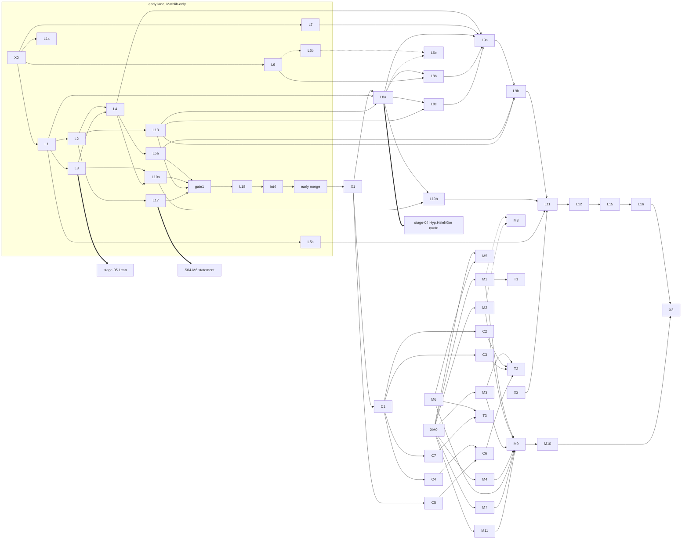

# Stage 06 implementation plan: the integral Jacquet–Langlands defect (revised after stage 1)

Status: P3 implementation plan, **revision 2 (post stage 1, audit resolved)**. WPs are concrete; TITAN rounds are sketched and
get a final pass before launch. Authors: stage-06 re-planning drafter (Opus), reviser (Opus), 2026-11-14. Resolution of the
23 audit findings: `audits/stage-06-replan-resolution.md`. Binding: `briefs/replan-s02-06.md` (§A–F, cited as *brief A*…),
then `OVERVIEW.md` (sections named there: §2 branches, §4.3 TITAN, §4.4 wall calibration, §5 models, §5.2 strands, §5.3
audits, §6.1 remote, §9 lessons). Sources: `plan/staged/stage-06-integral-defect.tex` (*tex*; labels `…:s06-…`), `SPLIT.md`
§06, `audits/stage-06-{muse,resolution,replan-audit}.md`, `experiments/SUMMARY.md`, `runs/s01.md`, the stage-1 closure,
`lean/Langlandscape/` at main 7ce2a3e. Other stages are revised in parallel: **cross-stage inputs are named by stage-tex
label, Lean declaration or file, never by a foreign WP id.** Own WP ids S06-L1, S06-L3, S06-L8a and S06-L17 are named by
stages 04/05 and are kept stable.

## 0. Scope, fixed decisions, inputs from stage 1, carried-over items

**Scope.** (i) Lean: the commutative-algebra core fully proved (tex L1–L5: `lem:s06-S`, `lem:s06-G`, `lem:s06-D`,
`thm:s06-E`, core of `prop:s06-galois`, the squeeze of `thm:s06-defect` step (5)), the η-principle of `thm:s04-etaB`
(paragraph after it, `\sttoprove`, "Lean-friendly"; **NEW in rev. 2: owned here, S06-L17**), then `thm:s06-defect`,
`cor:s06-fixed`, `cor:s06-allweights` as Lean theorems over abstract Λ-adic data modulo registered `Hyp.*` (tex L6).
(ii) Chapter `s06` (tex M1–M6). (iii) Computations T4, T5, H3 and the C4(i) regression (tex H1–H4). (iv) Talk K1–K3.

**Fixed decisions.**
- *Mathlib v4.35 has no Gorenstein algebras / congruence ideals* (*verified*: the only "Gorenstein" in the frozen Mathlib is a
  bibliography entry in `GroupTheory/Focal.lean`). Used API (*verified* in `/home/janosch/data/mathlib4_v4350`):
  `Submodule.colon (N) (S : Set M)` and `bot_colon` (`RingTheory/Ideal/Colon.lean`), `Module.Dual` (an `abbrev` for
  `M →ₗ[R] R`, `LinearAlgebra/Dual/Defs.lean:61`) incl. `LinearAlgebra/Dual/BaseChange.lean`, `Module.IsTorsionFree`
  (`Algebra/Module/Torsion/Free.lean:45`), `Module.free_of_finite_type_torsion_free'`, `Submodule.eq_bot_of_le_smul_of_le_jacobson_bot`,
  `OrzechProperty.bijective_of_surjective_of_injective`, `IsDiscreteValuationRing`, `IsLocalRing`, `IsLocalHom`,
  `RingTheory/SimpleModule/WedderburnArtin.lean`, `Ideal.quotientKerAlgEquivOfSurjective`, `AlgHom.liftEquiv`
  (`RingTheory/TensorProduct/Basic.lean:716`: `(A →ₐ[R] B) ≃ (S ⊗[R] A →ₐ[S] B)`), `Algebra.TensorProduct.includeRight`,
  `Algebra.TensorProduct.tensorQuotientEquiv` (`RingTheory/TensorProduct/Quotient.lean:96`: `A ⊗[R] (T ⧸ I) ≃ₐ[S] (A ⊗[R] T) ⧸
  I.map includeRight`).
- **No `S`-module structure on `Module.Dual A M` exists in Mathlib v4.35** (*verified*, audit A1): the codomain instance
  `LinearMap.module` (`Algebra/Module/LinearMap/Defs.lean:948`) needs `Module S A`, and precomposition gives only
  `Module Sᵈᵐᵃ (M →ₛₗ[σ] M')` (`Algebra/Module/LinearMap/Basic.lean:109`). Therefore **every duality iso of this stage is
  `A`-linear, and its `S`-equivariance is an exported `_apply`/`_smul` lemma** (the explicit formula of the tex). No new global
  or scoped instance on `Module.Dual` is introduced (a `Module S (Module.Dual A M)` instance would give a non-defeq diamond
  with `LinearMap.module` at `S := A`).
- **Interface `if:s06-lemD` — FIXED signature (rev. 2; stage 05 copies this block verbatim; a change needs the stage-05
  master's written OK in the outbox).** Namespace `Langlandscape.CommAlg`. `λ` is a Lean keyword: maps are named `μ`, `lam`.
  ```lean
  -- CommAlg/Gorenstein.lean (sole owner S06-L1); variables {A S : Type*} [CommRing A] [CommRing S] [Algebra A S]
  def IsGorensteinWith (A S) (ℓ : Module.Dual A S) : Prop :=
    Module.Free A S ∧ Module.Finite A S ∧ Function.Bijective (fun s : S => ℓ ∘ₗ LinearMap.mulLeft A s)
  def IsGorenstein (A S) : Prop := ∃ ℓ : Module.Dual A S, IsGorensteinWith A S ℓ
  def ann (I : Ideal S) : Ideal S := (⊥ : Ideal S).colon (I : Set S)
  def congruenceIdeal (μ : S →ₐ[A] A) : Ideal A := (ann (RingHom.ker μ)).map μ
  structure NewOldData (A S) where                       -- only [CommRing A] [CommRing S] [Algebra A S]
    𝔞 : Ideal S
    𝔟 : Ideal S
    free : Module.Free A S
    finite : Module.Finite A S
    tf_a : Module.IsTorsionFree A (S ⧸ 𝔞)
    tf_b : Module.IsTorsionFree A (S ⧸ 𝔟)
    inf_eq_bot : 𝔞 ⊓ 𝔟 = ⊥
    split : ∃ c : A, c ≠ 0 ∧ algebraMap A S c ∈ 𝔞 ⊔ 𝔟  -- field-free form of S_K = (S/𝔞)_K × (S/𝔟)_K
  theorem NewOldData.split_iff [IsDomain A] (𝔞 𝔟 : Ideal S) :
    (∃ c : A, c ≠ 0 ∧ algebraMap A S c ∈ 𝔞 ⊔ 𝔟) ↔
      (𝔞 ⊔ 𝔟).map (Algebra.TensorProduct.includeRight : S →ₐ[A] FractionRing A ⊗[A] S) = ⊤
  -- CommAlg/NewOld.lean (S06-L3); variables [IsDomain A] [IsNoetherianRing A] [IsLocalRing A] (D : NewOldData A S)
  --   {ℓ : Module.Dual A S} (hℓ : IsGorensteinWith A S ℓ) (hb : Module.Free A (S ⧸ D.𝔟))
  -- (a) no Gorenstein hypothesis
  theorem NewOldData.ann_a : ann D.𝔞 = D.𝔟
  theorem NewOldData.ann_b : ann D.𝔟 = D.𝔞
  -- (b) β ↦ ℓ(β ·): A-linear isos, S-equivariant by _apply/_smul
  noncomputable def NewOldData.bEquivDualQuot : D.𝔟 ≃ₗ[A] Module.Dual A (S ⧸ D.𝔞)
  theorem NewOldData.bEquivDualQuot_apply (b : D.𝔟) (s : S) :
    D.bEquivDualQuot hℓ b (Ideal.Quotient.mk D.𝔞 s) = ℓ ((b : S) * s)
  theorem NewOldData.bEquivDualQuot_smul (s : S) (b : D.𝔟) :
    D.bEquivDualQuot hℓ (s • b) = D.bEquivDualQuot hℓ b ∘ₗ LinearMap.mulLeft A (Ideal.Quotient.mk D.𝔞 s)
  noncomputable def NewOldData.aEquivDualQuot : D.𝔞 ≃ₗ[A] Module.Dual A (S ⧸ D.𝔟)   -- + _apply, _smul (same shape)
  -- (c) under Module.Free A (S ⧸ D.𝔟)
  theorem NewOldData.isComplemented_b : IsComplemented (D.𝔟.restrictScalars A)        -- (hb only)
  theorem NewOldData.free_b : Module.Free A D.𝔟                                       -- (hb only)
  noncomputable def NewOldData.quotAEquivDualB : (S ⧸ D.𝔞) ≃ₗ[A] Module.Dual A D.𝔟  -- (hℓ hb)
  theorem NewOldData.quotAEquivDualB_mk (s : S) (b : D.𝔟) :
    D.quotAEquivDualB hℓ hb (Ideal.Quotient.mk D.𝔞 s) b = ℓ (s * (b : S))
  theorem NewOldData.free_quot_a : Module.Free A (S ⧸ D.𝔞)                            -- (hℓ hb)
  ```
  The `.lean` docstring of each is the docstring-cited form of `lem:s06-D`(a)–(c) (`s06-D`); the docstring of
  `bEquivDualQuot` states "the tex's `S`-isomorphism = this `A`-linear iso + `bEquivDualQuot_smul`". `S` is finite free over `A`;
  **no locality of `S`** (stage 05's "local `S`" is harmless, not a field). The instances `Module A D.𝔟` (`Submodule.module'`) and
  `Algebra A (S ⧸ D.𝔞)` (`Ideal.Quotient.algebra`) are Mathlib's; if they do not unify in `LinearMap.mulLeft`, L3 uses
  `Algebra.lmul A (S ⧸ D.𝔞)` and records it in the outbox **before** stage 05 copies the block (the only permitted change).
- **Sole owner of `CommAlg/Gorenstein.lean` is S06-L1.** Stage 05 (`CommAlg/SubQuot.lean`) and stage 04 (maths only) import
  or quote it, never define it. **Stage 06 owns all Lean statements that need `IsGorenstein`/`congruenceIdeal`:** `Hyp.HsiehGor`
  (S06-L8a, signature below, the same text in stage 04) and the η-principle (S06-L17, `CommAlg/EtaPrinciple.lean`). `Hyp.HsiehEta`
  does not exist in Lean (`η^B_F := η(R′, lam′)` by definition; the comparison with `B_N(F^D,F^D)` is computation C5/C6).
- **GL2TF-free CommAlg layer.** The files of the early WPs (`CommAlg/{Gorenstein,LemmaS,NewOld,ThmE,DVR,LemmaG,TraceForm,Burnside,
  Squeeze,BaseChange,EtaPrinciple,TwoByTwo}.lean`, `LanglandscapeTests/S06/{Gorenstein,Toy}.lean`) import **Mathlib and
  `Langlandscape.CommAlg.*` only**. Gate (run by X0, every early round, L11): `grep -nP '^import (GL2TF|Langlandscape\.(?!CommAlg))'`
  on exactly that file list is empty (other stages' `CommAlg/*.lean`, e.g. stage 05's `SubQuot.lean`, are not in the list).
- **Gorenstein base change is required** (L13). (Gor_R′) comes from `Hyp.HsiehGor` over Λ via `Hyp.LambdaJL` and is base-changed
  to `I` (tex: "both are then base-changed to `I_F` by Lemma S"); `cor:s06-fixed` and `cor:s06-allweights` base-change (Gor_R)
  along `P`, `P′`.
- **`Defect` layer** (`Langlandscape/Defect/*.lean`, namespace `Langlandscape.Defect`, imports `CommAlg.*`, `Hyp.*`). Fixed
  shape (rev. 2, audit A2/A3; S06-L8a writes it, X1 stubs it so that L9a stacks):
  ```lean
  structure Setting (Λ I T 𝒪 G : Type*) [CommRing Λ] [CommRing I] [IsDomain I] [IsNoetherianRing I] [IsLocalRing I]
      [Algebra Λ I] [CommRing T] [Algebra Λ T] [CommRing 𝒪] [IsDomain 𝒪] [IsLocalRing 𝒪] [Group G] where
    𝔞Λ : Ideal T             -- ker (T → T′)            (def:s06-rings)
    𝔟Λ : Ideal T             -- ker (T → T″)
    lamΛ : T →ₐ[Λ] I         -- λ_F
    Iq : Subgroup G          -- inertia at q
    ρ : G →* GL (Fin 2) I    -- ρ_F
    P : I →+* 𝒪              -- arithmetic specialisation, 𝒪 = 𝒪_P
    P_surj : Function.Surjective P   -- structural: 𝒪_P = I_F/P (gives IsLocalHom P, lemma Setting.isLocalHom_P)
    t : ℕ
  abbrev Setting.R := I ⊗[Λ] T                                                     -- R := T ⊗_Λ I_F
  def Setting.𝔞 : Ideal D.R := D.𝔞Λ.map Algebra.TensorProduct.includeRight          -- "keep the names 𝔞 R"
  def Setting.𝔟 : Ideal D.R := D.𝔟Λ.map Algebra.TensorProduct.includeRight
  noncomputable def Setting.lam : D.R →ₐ[I] I := AlgHom.liftEquiv Λ I T I D.lamΛ
  noncomputable def Setting.quotient_baseChange : D.R ⧸ D.𝔞 ≃ₐ[I] I ⊗[Λ] (T ⧸ D.𝔞Λ) :=
    (Algebra.TensorProduct.tensorQuotientEquiv ..).symm
  ```
  `Setting` holds **data only** (plus the structural `P_surj`); every mathematical input is a `Hyp.*` argument visible in the
  signature (L12 item 3). No Brandt, Hida or GL₂ Hecke API, so no coupling to the stage-02/03 Lean.
- **`Hyp.HsiehGor` — FIXED signature (rev. 2; registered by S06-L8a in `Hyp/HsiehGor.lean`; stage 04 quotes it):**
  ```lean
  /-- `thm:s04-Gor` (`s04-Gor`): Hsieh Thm 4.5 + proof. Cited, not discharged. Instantiated by S06-L8c with
  `A := Λ`, `TB :=` the definite ordinary Hecke algebra `T ⧸ 𝔞Λ` (via `Hyp.LambdaJL`), `M := M^ord_𝔪`. -/
  def Langlandscape.Hyp.HsiehGor (A TB M : Type*) [CommRing A] [CommRing TB] [Algebra A TB]
      [AddCommGroup M] [Module TB M] : Prop :=
    CommAlg.IsGorenstein A TB ∧ Nonempty (M ≃ₗ[TB] TB)
  ```
  (The eigenline statement of `thm:s04-Gor` follows from the free-rank-one clause by Lemma S and is not a separate field.)
- **Registered hypotheses (never axioms; OVERVIEW §3.6):** new files `Langlandscape/Hyp/{HsiehGor,OldDecomp,HsiehGorFull,
  FreeRankTwo,ResidualBurnside,TamSpec,HidaControlGL2,KimOta,KimOtaRT}.lean` (9; all S06-L8a), each `def … : Prop` over
  `Defect.Setting` (except `HsiehGor`, above); reused: `Langlandscape.Hyp.LambdaJL` (exists, `Hyp/LambdaJL.lean`: `∃ φ : TGL →ₐ[Λ]
  TB` surjective, matching generators, `ker = newIdeal`; instantiated with `TGL := T`, `newIdeal := 𝔞Λ`).
  | `Hyp.*` | statement (tex) | source | discharge |
  |---|---|---|---|
  | `HsiehGor` | (Gor_R′) on the definite side, `thm:s04-Gor` | Hs Thm 4.5 | cited |
  | `OldDecomp` | `lem:s06-decomp` corrected: a `NewOldData I D.R` with `𝔞 = D.𝔞`, `𝔟 = D.𝔟`, and `Module.Free I (D.R ⧸ D.𝔟)` | Hi86b Thm 3.1, Cor 3.2; Hensel | maths (M2), not formalized |
  | `HsiehGorFull` | (Gor_R): `IsGorenstein I D.R` | Hs §3.3, Wi95, MW86, Hel Cor 8.11 | cited |
  | `FreeRankTwo` | `prop:s06-galois` inputs (1), (2) + Chebotarev trace step | Hs, tex | cited |
  | `ResidualBurnside` | `I[G] ↠ M₂(I)` | tex proof of `prop:s06-galois` | stretch L6b + L6c |
  | `TamSpec` | `lem:s06-tam`(a), (b) | KO Def 2.12, PW Def 3.3 | maths only |
  | `HidaControlGL2` | step (3): control for `T′`, `𝔟` at `P` incl. p-stabilisation and (P2); identifies `𝒪 ⊗[I] D.R` with `T_k(N)_𝔪` | Hi86b, tex | cited (name avoids stage 04's `Hyp.HidaControl`) |
  | `KimOta` | `thm:s06-KO` at one point, on `𝒪 ⊗[I] D.R` | KO Thm 1.1 | cited |
  | `KimOtaRT` | (Lev_M) output, `prop:s06-levM` step (4): **inclusion only** | KO Thm 3.14 | cited; M6 second reader |
  The fixed-weight Gorenstein property used by `cor:s06-fixed` (tex: [KO, Prop. 5.1(1)]) is **derived**, not registered:
  `IsGorenstein.baseChange` (L13) along `P` applied to `Hyp.HsiehGorFull`; the identification of `𝒪 ⊗[I] D.R` with
  `T_k(N)_𝔪` is the content of `Hyp.HidaControlGL2` (audit A4; L12 item 9).
- Not formalized: proofs of `lem:s06-decomp`, `lem:s06-tam`, `prop:s06-levM` steps (1)–(4), `prop:s06-betti`(b),(c),
  `rem:s06-{CR,minus1,open}`, `conj:s06-several`. Optional: `prop:s06-betti`(a) linear algebra (L14).

**What stage 1 delivered that this stage uses.** Lean project `lean/Langlandscape/` (P, regime (a)), tools `titan_batch.sh`,
`check_wp.sh`, `check_frozen.sh`, `new_wp.sh`; `Langlandscape.Hyp.LambdaJL` (schematic, F6); `Audit/PrintAxioms.lean` (161
lines, standard). `lean_lib Langlandscape` has **no globs** (`lakefile.toml`): a module is built only if reachable from
`Langlandscape.lean` / `LanglandscapeTests.lean`. Code: `code/python/langlandscape/{brandt,symn,pari,padic,up,up_mf,results}.py`
for C1/C5. Maths: `mathematics/main.tex`, `preamble.tex`, chapter pattern `chapters/s01.tex` + `chapters/s01/*.tex`, status
macros. Talk: `talk/main.tex`, `talk/slides/*.tex` pattern.

**Carried-over items (closure "open issues", runs/s01.md, master log).**
1. `check_wp.sh` docstring check hard-coded `s01-`: **widened by S02-X1** to `re.search(r's[0-9][0-9]-', doc)` (stage-02 plan
   §3.1 step 2). Stage 06 does **not** edit tools; X0 only checks `grep -c "s\[0-9\]\[0-9\]-" tools/check_wp.sh` ≥ 1 on the base.
2. Axiom scratch file missed an import (int3 incident); the L14 gate failed on 12 unqualified names: X2 generates the scratch
   files mechanically from the first round on (fully qualified, all imports, joined-line count) — lesson D2.
3. `.titan/` files only on integration branches (finding A0.1); writers never commit them; merge sources are checked by
   `git ls-tree -r --name-only <src> | grep -c '\.titan/'` = 0.
4. 80 linter warnings in stage-1 code: stage-06 files add **0** new warnings (build log; gate L11 counts them for `CommAlg/`,
   `Defect/`, `Hyp/` new files).
5. Outbox, not SendMessage-only (17:49 incident) — lesson D5.
6. HACS: `code/hacs/` is still empty on `main` (OVERVIEW F8): H1 stays gated.

Abbreviations: **TCHK(files)** = the files appear in an integration round whose `summary.txt` has `BUILD rc=0` for their
modules and `CHECK_WP <wp> rc=0 0 FAIL lines` (build, sorry, forbidden tokens, docstrings with an `s06-` label); **TEXCHK** =
`latexmk -pdf standalone-s06.tex` (and `main.tex` after merge) exit 0, no undefined refs/cites, listed labels present;
**PYCHK** = `pytest code/python/tests/test_defect_*.py` pass and result JSON with provenance (script, commit, params, runtime);
**WPA** = WP-level audit before merge (OVERVIEW §5.3; opus, fable for strands), rows `S06-AW-<wp>`.

## 1. Work packages

Columns: schema of common.md/OVERVIEW §1 + `model (+fix)` + `remote` (remote-eligible, §6) + `early` (GL2TF-free, may start
before the stage) + `TITAN round`. Times: **wall / agent-active** (min), calibrated per brief F / OVERVIEW §4.4 (upper half for
hard/conceptual). Fix budgets: *bf* = one budgeted opus fix round (Lean ~2–5 min, LaTeX/code ~2 min); *pf* = one planned opus fix
round; *—* = conceptual or stage-master work, no fix round. Rounds: early lane `int1`–`int4`, `gate1`; in-stage (scenario A)
`int5`–`int7`, `gate2`, `final`; scenario B renumbers in-stage from `int1` (§3).

### Track X (stage master unless stated)
| id | goal | inputs | outputs | acceptance | diff. | model (+fix) | remote | early | wall/act | TITAN round | deps |
|---|---|---|---|---|---|---|---|---|---|---|---|
| S06-X0 | early-lane kickoff: clean branch `impl/s06-early` off `wip-implementation` (after S02-X1 is merged); worktrees for L1, L2, L3, L4, L5a, L5b, L6, L7, L10a, L13, L14, L17 (writers stack on the §0 signatures and L1's draft); `.titan/spec-int1.txt` on `impl/s06-int1` | §0, §3.1 | branches, stubs, spec | spec lines = §3.1; `awk '$1 !~ /^#/ && /#/' .titan/spec-*.txt` empty (no trailing comments); `check_wp.sh` widened (carry-over 1); GL2TF-free grep empty | mechanical | sonnet (+bf) | no | yes | 10/6 | — | S02-X1 merged; global master's OK for the early lane (re-planning master: start **by stage 03**) Remote WPs (L1–L3, L4, L13, L17, M1–M4, M7 (+M8), M6, M11; batch 3: L5a, L6, L7, L10a, L14 (+L6b) (global master 2026-11-14, Abhijit batch 3)): no worktrees; merge the fetched `abhijit/*` heads into `impl/s06-int1` (global master 2026-11-14, Abhijit batch 1). |
| S06-XM0 | maths kickoff (local M WPs only; a remote package `abhijit/s06-math` has its own single writer, OVERVIEW §6.1): `mathematics/standalone-s06.tex` (guarded `\addbibresource{bib/s06-<wp>.bib}` per M WP), `chapters/s06.tex` driver with `\InputIfFileExists{chapters/s06/s06-<wp>.tex}{}{}` per M WP, `chapters/s06/NOTES.md` | §6 | the three files | `latexmk -pdf standalone-s06.tex` exit 0 (empty chapter) | mechanical | sonnet (+bf) | no | yes | 8/5 | — | — |
| S06-X1 | stage kickoff: re-sync `wip-implementation` (stage 04 merged; early lane merged in A); rebase open early-lane branches (lesson D4); `code/results/s06/`, `talk/slides/s06-*.tex` stubs; name-only placeholder HYPOTHESES rows (9 new `Hyp.*`, `open`; final text from L8a's report); `sorry` stubs of the §0 `Defect.Setting` block and of the 9 `Hyp` names with their declared argument lists (bodies `sorry`, on `impl/s06-int<k>` only, SORRIES rows there; never merged); `.titan/spec-int5.txt` (A) / `spec-int1.txt` (B) | §0, §3.2 | dirs, stubs, registry rows, spec | stubs elaborate in the first in-stage round; spec = §3.2; no trailing comments | mechanical-with-meaning | sonnet (+bf) | no | no | 12/8 | — | stage 04 merged |
| S06-X2 | axiom scratch files: from the declared outputs of §1 generate one `.titan/s06_<wp>_axioms.lean` per Lean WP (`import` every module, one `#print axioms Langlandscape.…` per headline decl, fully qualified) + the `Audit/PrintAxioms.lean` rows; returns the text in its report, the stage master writes the files | §1 outputs | report (file text), rows | every name resolves (`AXIOMS … rc=0`); nonstandard = 0 after line join | mechanical | haiku (ladder → sonnet) | no | partly (CommAlg part in early lane) | 5/3 | **from int1** (early) and from the first in-stage round | L-drafts declared |
| S06-X3 | milestone closure + `runs/s06.md` + outbox closure file | all | `plan/implementation/runs/s06.md`, `outbox/<UTC>_milestone-closure-s06.md` | closure lists delivered/verification/open issues | mechanical | stage master (—) | no | no | 5/5 | — | L16, M10, C/T done |

### Track M (`mathematics/chapters/s06/s06-<wp>.tex`, `bib/s06-<wp>.bib`; all remote-eligible except M9, M10)
| id | goal | inputs | outputs | acceptance | diff. | model (+fix) | remote | early | wall/act | TITAN | deps |
|---|---|---|---|---|---|---|---|---|---|---|---|
| S06-M1 | §1 comm. algebra: Gorenstein/trace, Lemmas S (incl. base change), G, **D (a)–(c)** stated so that the `if:s06-lemD` block of §0 is its literal Lean form (the `S`-isomorphism of (b) = `A`-iso + formula), Thm E (i)–(iv), "where each Gorenstein hypothesis is used", toy `S = {(x,y) ∈ A² : x ≡ y mod ϖ^t}` (in `ss:s06-ca`) | `ss:s06-ca`, `lem:s06-S`, `lem:s06-G`, `lem:s06-D`, `thm:s06-E`, `if:s06-lemD` | `s06-m1.tex` | TEXCHK(`lem:s06-D`, `thm:s06-E`, `if:s06-lemD`); hypotheses of `lem:s06-D` = `NewOldData` fields | hard (full proofs) | opus (+pf) | yes | yes | 22/15 | — | XM0 |
| S06-M2 | §2 setting: `hyp:s06-H`, `def:s06-rings`, `def:s06-ctam`, `def:s06-tam`, **Lemma decomp** (a)–(c) full proof (Hensel factorisation, Hi86b old ideal ⊆ 𝔟), Lemma tam (a)–(c), Rem CR | `hyp:s06-H`, `lem:s06-decomp`, `lem:s06-tam`, `rem:s06-CR`; imported `if:s01-targets`, `if:s01-hecke`, `if:s04-Mord` | `s06-m2.tex` | TEXCHK; Hi86b page refs re-checked (OCR caveat) | hard | opus (+pf) | yes | yes | 22/15 | — | XM0 |
| S06-M3 | §3 defect: control step (3) as equality (p-stabilisation, (P2)), Thm defect steps (1)–(5) (squeeze with `P` local, A2), Cor allweights, Thm KO + Cor fixed (Gorenstein input derived by base change, A4) | `thm:s06-defect`, `cor:s06-allweights`, `thm:s06-KO`, `cor:s06-fixed`; `if:s04-etaB` | `s06-m3.tex` | TEXCHK; every `\lit` page listed in report | hard | opus (+pf) | yes | yes | 22/15 | — | XM0 |
| S06-M4 | §4 Galois half: Prop galois in full (Chebotarev + continuity, Burnside mod `m_A` + Nakayama, perfect trace form) | `prop:s06-galois` | `s06-m4.tex` | TEXCHK; statement = L8b docstring | hard (full proofs) | opus (+pf) | yes | yes | 20/14 | — | XM0 |
| S06-M5 | §5 `q ≡ −1`: Prop levM (5 steps), Rem minus1, which `M > 1` satisfy (Lev_M) | `prop:s06-levM`, `rem:s06-minus1` | `s06-m5.tex` | TEXCHK; second-reader points of tex l. 291–294 answered | conceptual | opus (+pf) | no (**local**, since M6 is remote; (global master 2026-11-14, Abhijit batch 1)) | yes | 25/15 | — | M6 (verdict first; XM0 not run) |
| S06-M6 | **second reader (q ≡ −1)**: M5 step (4) against KO §3, Thm 3.14; a different agent/node than M5 | `prop:s06-levM` (M5 text); KO PDF | local: `mathematics/audits/s06-levM.md`; remote: `mathematics/litnotes/s06-m6-levM.md` | verdict CONFIRMED / GAP with the 4-item checklist, each with KO page/thm: (1) level `N⁺_{ρ,Σ⁺}N⁻` = `M`; (2) `P_ρ̄ ⊆ Σ`; (3) `U_ℓ`, `ℓ ∣ M`, vs anemic algebra; (4) Hensel distinctness mod `ϖ`; gates T3 and the `q ≡ −1` clause of `if:s06-defect` | conceptual | opus (remote, independent account) / fable (local) (—) | **yes (preferred)** | yes | 20/15 | — | — (input: stage-tex `prop:s06-levM`; dep M5 removed, (global master 2026-11-14, Abhijit batch 1)) |
| S06-M7 | §6 Betti: Prop betti (a), (c) proofs; (b) via Ihara + Dia89 (Ri84 missing); `k ≥ p` marked `\stexp` | `prop:s06-betti`, `if:s03-amalgam` (use only `det(Ψ*Ψ)` and `coker(Ψ*Ψ)_𝔪`; entry assignment per `stage-03.md` §0.2.8 / `chapters/s03/NOTES.md`) | `s06-m7.tex` | TEXCHK | hard | opus (+pf) | yes | yes | 20/14 | — | XM0 |
| S06-M8 | *optional*: Rem open (O5), Conj several for r = 3 | `rem:s06-open`, `conj:s06-several` | `s06-m8.tex` | TEXCHK; `\stconj`/`\stopen` kept | conceptual | opus (—) | yes | yes | 15/10 | — | M1, M2 |
| S06-M11 | literature WP: verify every `\lit` of tex 06 (Hs §3.3/§7.2/Thm 4.5/Rem 7.8, KO Thm 1.1/3.14/Prop 5.1, Wi95 p. 482, Hi86b Thm 3.1/Cor 3.2, Dia89, PW Thm 6.8); notes on the missing Ri84, MW86, Böc07, Hi86a | tex `\lit` list; `literature/`; `missing/stage-06.md` | `mathematics/litnotes/<bibkey>.md`, `bib/s06-m11.bib` | every use has Thm/§/page; no copied text; biber-clean `.bib` | routine | sonnet (+bf) | yes | yes | 15/10 | — | XM0 |
| S06-M9 | chapter audit (`mathematics_chapter_audit.md`), **parallel with L12** | M1–M7, M11 (+M8) | `mathematics/audits/s06.md` | verdict PASS / fix list; plus "M5 step (4) agrees with the M6 verdict" (global master 2026-11-14, Abhijit batch 1) | conceptual | fable (—) | no | no | 10/8 | — | M1–M7, M11 |
| S06-M10 | apply M9 fixes, aggregator lines (`main.tex` `\input{chapters/s06}`, `references.bib` from the per-WP bib files), final build, milestone PDF | M9 | chapter, `main.pdf` | TEXCHK on `main.tex`; every M9 item closed | routine | sonnet (+bf) | no (edits merged files) | no | 12/8 | — | M9 |

### Track L — CommAlg layer (Mathlib-only, GL2TF-free, early-startable)
All files under `lean/Langlandscape/Langlandscape/CommAlg/`, namespace `Langlandscape.CommAlg`; docstrings cite the tex label;
tests under `LanglandscapeTests/S06/`.
| id | goal | inputs | outputs (decls) | acceptance | diff. | model (+fix) | remote | early | wall/act | TITAN round (A: early / B: cold) | deps |
|---|---|---|---|---|---|---|---|---|---|---|---|
| S06-L1 | defs of §0 exactly: `IsGorensteinWith`, `IsGorenstein`, `ann`, `congruenceIdeal`, `NewOldData`, `NewOldData.split_iff`, `IsGorenstein.of_algEquiv`; **`isGorenstein_iff_cyclic`** (`IsGorenstein A S ↔ Free ∧ Finite ∧ ∃ ℓ, ∀ φ : Module.Dual A S, ∃ s, φ = ℓ ∘ₗ mulLeft A s`, i.e. `S^∨` cyclic ⇔ free of rank one, via `OrzechProperty`; A15); tests `isGorenstein_self`, `congruenceIdeal_id : congruenceIdeal (AlgHom.id A A) = ⊤` in `LanglandscapeTests/S06/Gorenstein.lean` | `ss:s06-ca`, `def:s06-rings`, `lem:s06-D` | `CommAlg/Gorenstein.lean` (**sole owner**), `LanglandscapeTests/S06/Gorenstein.lean` | TCHK; names/signatures = §0 exactly; WPA | conceptual (+ `split_iff`, iff proof) | opus (+pf) | **yes** (`abhijit/s06-l1`; fallback opus (+pf); (global master 2026-11-14, Abhijit batch 1)) | **yes** | 45/15 | int1 / int1 | X0 (A) or X1 (B) |
| S06-L2 | Lemma S (no base change): `LemmaS.ann_ker_eq_span` (`ann (ker μ) = span {θ}`, free rank one), `LemmaS.trace_theta_mul : ℓ (θ * x) = μ x`, `LemmaS.congruenceIdeal_eq_span : congruenceIdeal μ = span {μ θ}` | `lem:s06-S` | `CommAlg/LemmaS.lean` | TCHK; WPA | hard (root of both spines) | opus (+pf) | **yes** (`abhijit/s06-l2`; fallback opus (+pf); (global master 2026-11-14, Abhijit batch 1)) | **yes** | 45/15 | int1 / int1 | L1 (draft) |
| S06-L3 | **Lemma D = `if:s06-lemD`** (decls §0, incl. `_apply`/`_smul`/`_mk`): (a) `ann_a`, `ann_b` (int1), then (b) `bEquivDualQuot` (+`_apply`, `_smul`), `aEquivDualQuot` (+), (c) `isComplemented_b`, `free_b`, `quotAEquivDualB` (+`_mk`), `free_quot_a` (int2); fallback for (c): `A` a PID first | `lem:s06-D`, `if:s06-lemD` | `CommAlg/NewOld.lean` | TCHK; signatures = §0 = stage-05 import (diff in L18 and L12); `#print axioms` std for all decls; WPA | hard | opus (+pf) | **yes** (`abhijit/s06-l3`; fallback opus (+pf); (global master 2026-11-14, Abhijit batch 1)) | **yes** | 60/20 | int1 (a), int2 (b,c) / int1, int2 | L1 (draft) |
| S06-L4 | Thm E (i), (ii), (iv), Gorenstein half of (iii): `ThmE.theta_mem_b`, `ThmE.eta_eq_span_lambda'`, `ThmE.c_eq_orderIdeal`, `ThmE.eta_eq_c_mul_of_unimodular`, `ThmE.unimodular_of_isGorenstein`, `ThmE.c_principal_iff_isGorenstein` (with `Module.Free A S'` explicit) | `thm:s06-E`(i)–(iv) | `CommAlg/ThmE.lean` | TCHK; axioms std; WPA | hard | opus (+pf) | **yes** (`abhijit/s06-l4`) (global master 2026-11-14, Abhijit batch 2) | **yes** | 60/20 | int2 / int2 | L2, L3 (drafts) |
| S06-L5a | Thm E(iii) DVR case: `ThmE.eta_eq_c_mul_of_dvr` (saturated `S'[λ']` is a summand over a PID; no hypothesis on `S'`; `(Gor_S)` is an explicit argument) | `thm:s06-E`(iii) | `CommAlg/DVR.lean` | TCHK; WPA | hard | opus (+pf) | **yes** (`abhijit/s06-l5a`, off `abhijit/s06-l4` 4ac6651) (global master 2026-11-14, Abhijit batch 3) | **yes** | 50/18 | int3 / int2–3 | L4 (draft) |
| S06-L5b | Lemma G: `isGorenstein_of_isGorenstein_quotient` (Nakayama for `S^∨`, `𝔪_A S ≤ jacobson ⊥` for finite `S` over local `A`, sub-lemma `jacobson_le_of_finite_local`) — **conditional strand WP, §5**; held in the early lane until the S04 strand status is known (it is a leaf, so holding costs no path) | `lem:s06-G` | `CommAlg/LemmaG.lean` | TCHK; WPA (fable if strand) | hard | opus (+pf) | no | **yes** | 45/15 | int3 (or in-stage) / int2 | L1 (draft); §5 rule |
| S06-L6 | trace-form core: `eq_one_of_trace_mul_eq` (`A` local, `A[G] → M₂(A)` surjective, `tr ρ(gσ) = tr ρ(g) ∀ g` ⇒ `ρ σ = 1`, matrix units) | `prop:s06-galois` (proof) | `CommAlg/TraceForm.lean` | TCHK | routine | sonnet (+bf) | **yes** (`abhijit/s06-l6`, off `abhijit/s06-l1` 8c0916b) (global master 2026-11-14, Abhijit batch 3) | **yes** | 35/8 | int1 / int1 | — |
| S06-L6b | *stretch*: `surjective_groupAlgebra_of_absIrred` (abs. irreducible ⇒ `k[G] ↠ M₂(k)` by Wedderburn–Artin; lift by Nakayama); **no `Hyp` import** (A13) | `prop:s06-galois` (proof) | `CommAlg/Burnside.lean` | TCHK; WPA | hard | opus (+pf) | **yes** (`abhijit/s06-l6b`, stacked on `abhijit/s06-l6`) (global master 2026-11-14, Abhijit batch 3) | **yes** | 60/25 | int3 / int3 | L6 |
| S06-L6c | *stretch*: one-line discharge `Hyp.residualBurnside_of_absIrred` from L6b | L6b, L8a | `Defect/Galois.lean` (append) or `LanglandscapeTests/S06/Hyp.lean` | TCHK; HYPOTHESES row → proved | mechanical-with-meaning | sonnet (+bf) | no | no | 10/4 | in-stage | L6b (green), L8a |
| S06-L7 | squeeze: `squeeze` (`I` local domain, `𝒪` **local** domain, `P : I →+* 𝒪` with **`[IsLocalHom P]`**, `𝔱 ≤ span {h}`, `P h ≠ 0`, `span (P '' 𝔱) ≥ span {P h}` ⇒ `𝔱 = span {h}`; without locality false: `ℤ_(p) → ℚ`, `𝔱 = (p)`, `h = 1`; A2) | `thm:s06-defect` step (5) | `CommAlg/Squeeze.lean` | TCHK | routine | sonnet (+bf) | **yes** (`abhijit/s06-l7`, off `abhijit/s06-l1` 8c0916b) (global master 2026-11-14, Abhijit batch 3) | **yes** | 30/6 | int1 / int1 | — |
| S06-L13 | **required**: base change: `IsGorenstein.baseChange` (finite free, `A → A'`), `LemmaS.congruenceIdeal_baseChange (hℓ : IsGorensteinWith A S ℓ) [IsLocalHom (algebraMap A A')] : congruenceIdeal (AlgHom.liftEquiv A A' S A' ((Algebra.ofId A A').comp μ)) = (congruenceIdeal μ).map (algebraMap A A')` (Gorenstein hypothesis required: `Ann` does not commute with non-flat base change; A14) | `lem:s06-S` (base-change part) | `CommAlg/BaseChange.lean` | TCHK; WPA | hard | opus (+pf) | **yes** (`abhijit/s06-l13`) (global master 2026-11-14, Abhijit batch 2) | **yes** | 55/20 | int2 / int2 | L2 (draft) |
| S06-L17 | **η-principle (NEW, from stage 04)**: `EtaPrinciple.isGorensteinWith_of_pairing` and `EtaPrinciple.congruenceIdeal_eq_span_pairing` (`S` finite free over `A`, `e : M ≃ₗ[S] S`, `B : M →ₗ[A] M →ₗ[A] A` bijective, `B (s • m) n = B m (s • n)`, `μ : S →ₐ[A] A`, `m₀` generating the eigenline `{m | ∀ s, s • m = μ s • m}` ⇒ `congruenceIdeal μ = span {B m₀ m₀}`) | paragraph after `thm:s04-etaB` (cite `thm:s04-etaB`), Hs Rem 7.3 | `CommAlg/EtaPrinciple.lean` | TCHK; docstring = reference statement for S04-M6 | routine (stacked on Lemma S) | sonnet (+bf) | **yes** (`abhijit/s06-l17`) (global master 2026-11-14, Abhijit batch 2) | **yes** | 35/8 | int2 / int2 | L2 (draft) |
| S06-L10a | non-vacuity (CommAlg): toy `S = {(x,y) : x ≡ y mod p^t}` ⊆ `ℤ_[p] × ℤ_[p]`: `IsGorenstein`, `NewOldData` with coordinate kernels, `congruenceIdeal = span {p^t}`, Lemma D and Thm E instantiated | `ss:s06-ca` (toy, M1) | `LanglandscapeTests/S06/Toy.lean` | TCHK | routine | sonnet (+bf) | **yes** (`abhijit/s06-l10a`, off `abhijit/s06-l4` 4ac6651) (global master 2026-11-14, Abhijit batch 3) | **yes** | 40/10 | int3 / int3 | L3, L4 (drafts) |
| S06-L14 | *optional*: Prop betti(a): `coker [[u,*],[*,u]] ≃ T ⧸ (det)` for `u` a unit | `prop:s06-betti`(a) | `CommAlg/TwoByTwo.lean` | TCHK | routine | sonnet (+bf) | **yes** (`abhijit/s06-l14`, off `abhijit/s06-l1` 8c0916b) (global master 2026-11-14, Abhijit batch 3) | **yes** | 30/6 | any | — |
| S06-L18 | **early-lane Fable Lean audit** (`lean_audit.md`) on the `s06-gate1-1` sha: L12 items (1), (2), (7), (8), (10) + `def`/`structure` docstrings of the CommAlg layer; precondition of the hand-over merge (A6) | gate1 | `lean/Langlandscape/audits/<date>_s06-early.md` | verdict PASS / PASS WITH REMARKS; required items closed in `int4` | conceptual | fable (—) | no | yes | 8/6 | — | gate1 |

### Track L — Defect layer (in-stage)
| id | goal | inputs | outputs (decls) | acceptance | diff. | model (+fix) | remote | early | wall/act | TITAN round | deps |
|---|---|---|---|---|---|---|---|---|---|---|---|
| S06-L8a | `Defect.Setting` exactly as §0 (+ `Setting.isLocalHom_P`, `quotient_baseChange`, `cq := D.𝔟.map D.lam`, `tq`) + the 9 new `Hyp.*` statements (docstrings: label, source, discharge, owner), `Hyp.HsiehGor` with the §0 signature; HYPOTHESES final text (report; replaces X1's placeholders) | §0; `def:s06-rings`, `if:s04-Mord`, `if:s01-targets`; `Langlandscape.Hyp.LambdaJL` | `Defect/Setting.lean`, `Hyp/{HsiehGor,OldDecomp,HsiehGorFull,FreeRankTwo,ResidualBurnside,TamSpec,HidaControlGL2,KimOta,KimOtaRT}.lean` | TCHK; every `Hyp` file has `namespace Langlandscape.Hyp`, `def … : Prop`, no `axiom`; WPA (faithfulness vs tex) | conceptual (design) | opus (—) | no | no | 35/15 | int5 | L1, L13 (drafts), X1 |
| S06-L8c | `Defect.Setting.gor_new : IsGorenstein I (D.R ⧸ D.𝔞)` from `Hyp.HsiehGor Λ TB M`, `Hyp.LambdaJL … Λ T TB … D.𝔞Λ` (`Ideal.quotientKerAlgEquivOfSurjective`), `IsGorenstein.baseChange`, `quotient_baseChange`, `IsGorenstein.of_algEquiv` | `thm:s06-defect` step (1) | `Defect/Gorenstein.lean` | TCHK; axioms std; WPA | hard | opus (+pf) | no | no | 45/15 | int5, int6 | L8a, L13 (drafts) |
| S06-L8b | abstract Prop galois: `Defect.galois : D.tq ≤ D.cq` from `Hyp.FreeRankTwo`, `Hyp.ResidualBurnside`, `eq_one_of_trace_mul_eq` | `prop:s06-galois` | `Defect/Galois.lean` | TCHK | routine | sonnet (+bf) | no | no | 35/10 | int5 | L6, L8a (drafts) |
| S06-L9a | **Thm defect**: `Defect.defect_formula : ∃ h, η_F = span {h} * η^B_F ∧ span {h} = D.cq ∧ D.cq = D.tq` from `Hyp.{OldDecomp,HsiehGorFull,HsiehGor,LambdaJL,FreeRankTwo,ResidualBurnside,TamSpec,HidaControlGL2}` and (`Hyp.KimOta` **or** `Hyp.KimOtaRT`), all explicit arguments; uses `gor_new`, `squeeze` with `Setting.isLocalHom_P` | `thm:s06-defect`, `if:s06-defect` | `Defect/Main.lean` | TCHK; axioms std; hypotheses visible in signature; WPA | hard | opus (+pf) | no | no | 50/20 | int5, int6 | L4, L7, L8a, L8b, L8c (drafts) |
| S06-L9b | `Defect.cor_fixed` (`Hyp.KimOta` + `[IsDiscreteValuationRing 𝒪]` + `ThmE.eta_eq_c_mul_of_dvr` on `𝒪 ⊗[I] D.R`, whose (Gor) is `IsGorenstein.baseChange` of `Hyp.HsiehGorFull` along `P` — no extra `Hyp`, A4 ⇒ `cq(f) = (ϖ^t)`), `Defect.cor_allweights` (specialise at `P′` via `congruenceIdeal_baseChange`, control via `Hyp.HidaControlGL2`) | `cor:s06-fixed`, `cor:s06-allweights` | `Defect/Corollaries.lean` | TCHK; axioms std; WPA | hard | opus (+pf) | no | no | 45/18 | int5 (draft), int6 | L5a, L9a, L13 (drafts) |
| S06-L10b | `Hyp` non-vacuity: toy `Defect.Setting` (from L10a) with instances of `OldDecomp`, `HsiehGorFull`, `HsiehGor`, `TamSpec`, `ResidualBurnside` where feasible, else a docstring sentence why not | OVERVIEW §3.6 | `LanglandscapeTests/S06/Hyp.lean` | TCHK | routine | sonnet (+bf) | no | no | 35/10 | int6 | L8a, L10a |

### Track L — integration, gates, audit
| id | goal | inputs | outputs | acceptance | diff. | model (+fix) | remote | early | wall/act | TITAN round | deps |
|---|---|---|---|---|---|---|---|---|---|---|---|
| S06-L11 | integration + **early full gate** `s06-gate2-1` (A; `s06-gate1-1` in B) **when all non-optional L WPs are green** (L1–L5b, L6, L7, L8a, L8b, L8c, L9a, L9b, L10a, L10b, L13, L17): root imports, `Audit/PrintAxioms.lean` rows (from X2), full `lbuild Langlandscape LanglandscapeTests`, PrintAxioms (joined lines), forbidden-token grep, `check_frozen.sh`, GL2TF-free grep, new-warning count | all L | aggregator edits | all rc 0; 0 non-standard axiom lines; 0 sorry; 0 new warnings | routine | stage master (sonnet +bf for edits) | no | no | 8/4 | gate2 | all non-optional L green |
| S06-L12 | Lean audit (`lean_audit.md`) **parallel with M9** on the gate2 sha. Checklist: (1) `split` + `tf_*` ⇔ splitting (Muse F26 counterexample `ℤ_p × ℤ/p` excluded; `split_iff`); (2) `IsGorensteinWith` = "`S^∨` free of rank one over `S`" (`isGorenstein_iff_cyclic`); (3) (Gor_R) and (Gor_R′) separate arguments in `defect_formula`; (4) `KimOtaRT` is only the inclusion; (5) no hidden (H0⁻); (6) every `Hyp.*` has a non-vacuity test or reason; (7) PrintAxioms re-run; (8) docstrings of every public `def`/`structure` (not covered by `check_wp.sh`); (9) A2 locality (`IsLocalHom P` from `P_surj`) and A4 (fixed-weight Gorenstein derived, not hidden); (10) diff of the exported `if:s06-lemD` and `Hyp.HsiehGor` signatures against the stage-05 and stage-04 quotes | L11 | `lean/Langlandscape/audits/<date>_s06.md` | verdict PASS / PASS WITH REMARKS + required list | conceptual | fable (—) | no | no | 8/6 | — | L11 |
| S06-L15 | audit fix WPs (one per cluster of required items; sub-ids L15a, L15b, …) | L12 required items | fixes on WP files | items closed in `int7` | routine/hard | opus (+pf) (hard) / sonnet (+bf) (hygiene) | no | no | 13/8 | int7 | L12 |
| S06-L16 | **final gate `s06-final-1` from scratch** (fresh unseeded checkout; as stage-1 final-1 (a)–(f)) | L15 | outbox result | as L11, from scratch | mechanical | stage master (—) | no | no | 6/2 | final | L15 |
| S06-AW-<wp> | **WP-level audits** (OVERVIEW §5.3), one per hard/conceptual WP before its merge: early L1, L2, L3, L4, L5a, L5b, L6b, L13; in-stage L8a, L8c, L9a, L9b; code C1, C4, C5, C7. Maths M1–M5, M7 are covered by M9 (Fable chapter audit) plus the M6 second reader | WP report + its TCHK sha | `lean/Langlandscape/audits/wp/<wp>.md` (Lean), `code/results/s06/audits/<wp>.md` (code) | verdict + required items; required items fixed in the next round letter | conceptual | opus (—); fable for strand WPs | no | early ones yes | 6/5 each, in parallel | — | the WP green |

### Track C (`code/python/langlandscape/defect/`, tests `code/python/tests/test_defect_*.py`) and H
| id | goal | inputs | outputs | acceptance | diff. | model (+fix) | remote | wall/act | deps |
|---|---|---|---|---|---|---|---|---|---|
| S06-C1 | congruence toolkit over `ℤ/p^m`: `ℤ_p`-Hecke algebra from integer matrices, localisation at `m`, `𝔞`, `𝔟`, `η(S,μ)`, `𝔠 = λ(𝔟)`, Gorenstein test (`Hom(S,ℤ_p)` cyclic); Smith form via PARI `matsnf` (reuse a stage-03 helper if merged) | `def:s06-rings`, `def:s06-ctam`, `lem:s06-S`; `pari.py`, `padic.py` | `defect/{hecke_alg,congruence}.py`, tests | PYCHK: toy of L10a gives `η = 𝔠 = p^t`; a non-Gorenstein toy is detected; WPA | hard (design) | opus (+pf) | no | 20/15 | X1 |
| S06-C2 | seed C4(i) regression: `q ∈ {2,3,5}`, `qM ≤ 70`, `k ≤ 16`, `v(h) = v(𝔠_q)`; Eisenstein `(h) ⊇ 𝔠_q` | seed C4(i) | `results/s06/C4i.json` | PYCHK: all listed cases equal, count recorded | routine | sonnet (+bf) | no | 12/10 | C1 |
| S06-C3 | T4 Hecke side: `T(1)_m`, `p = 17`, `k ∈ {12,28,44,60,124}`, `δ = (q+1)² − q^{2−k}T_q²` at `q = 3`, `length T(1)_m/(δ)`; `t_{G_k}(3)` independently | `prop:s06-betti`(a),(c), `cor:s06-allweights` | `results/s06/T4_hecke.json` | PYCHK (gating: exit 0, provenance, finite ranks, `k = 12` row `ord₁₇ = 1`); prediction `1,1,1,1,2` recorded, not gating (`\stexp`) | routine | sonnet (+bf) | no | 15/12 | C1 |
| S06-C4 | T5 GL₂ side: 7 triples and `k+(p−1)`: `η_f(q)`, `η_f(1,q)`, `𝔠_q(f)`, `rk T′_m ≥ 2` | tex H2 | `results/s06/T5_gl2.json` | PYCHK: `η = 𝔠·η^new` (proved, failure = bug); WPA | hard | opus (+pf) | no | 20/15 | C1 |
| S06-C5 | T5 definite side: Brandt module of `B_q` with `Sym^{k−2}` at `m` (stage-1 `brandt.py`, `symn.py`), Gram matrix with `w_x` and with `|Γ_x|`, `η^B` from the determinant | `if:s04-etaB`, tex (S1), (S3) | `defect/gram.py`, `results/s06/T5_def.json` | PYCHK: dim = q-new dim; `v_p` of the ratio of the two Gram determinants = 0; WPA | hard | opus (+pf) | no | 20/15 | X1 |
| S06-C6 | T5 comparison: `η^B` (C5) vs `η_f(1,q)` (C4), `η_f(q) = 𝔠_q(f)·η^B` at `k` and `k+(p−1)` | C4, C5 | `results/s06/T5.json` | PYCHK table per triple | routine | sonnet (+bf) | no | 12/10 | C4, C5 |
| S06-C7 | H3 validation `q ≡ −1` (`M = 1`): `(13,7,4)`, `(13,7,6)`, `(19,5,4)`, `(29,5,4)`: `ord 𝔠_q(f) − t_f(q)` with `U_q` in the algebra; `t_f(q)` independent of `𝔠_q` | `prop:s06-levM`, `rem:s06-minus1` | `results/s06/H3.json` | PYCHK: difference recorded; prediction 0; WPA | conceptual | opus (—) | no | 20/15 | C1 |
| S06-H1 | *gated on HACS in `code/hacs/`*: T4 Betti side `coker(Ψ*Ψ)_m` | `prop:s06-betti`, `if:s03-amalgam` | `results/s06/T4_betti.json` | `≅ (T(1)_m/δ)²` at `k = 12` | hard | opus (+pf) | no | 30/20 | C3, HACS |

### Track T (`talk/slides/`)
| id | goal | inputs | outputs | acceptance | diff. | model (+fix) | remote | wall/act | deps |
|---|---|---|---|---|---|---|---|---|---|
| S06-T1 | K1 "the defect is an old/new congruence ideal": Thm E three-line proof; the two Gorenstein hypotheses | `thm:s06-E` (M1); L4 (formalized if merged) | `s06-thmE.tex` | `latexmk` exit 0; claims cite labels/decls | routine | sonnet (+bf) | no | 8/6 | M1 |
| S06-T2 | K2 "… equals a Tamagawa ideal": squeeze, numbers 17, 29, 131, T4/T5 tables | `thm:s06-defect` (M3); C2, C3, C6 | `s06-defect.tex` | as T1; numbers from `results/s06/*.json` | routine | sonnet (+bf) | no | 10/8 | M3, C2, C3, C6 |
| S06-T3 | K3 caveats: `q ≡ −1` (only if M6 CONFIRMED), trivial primes (BKM) | `rem:s06-minus1`, `rem:s06-open`; M6, C7 | `s06-caveats.tex` | as T1; `q ≡ −1` claim present iff M6 CONFIRMED | routine | sonnet (+bf) | no | 8/6 | M6, C7 |

**Count: 53 WP rows** (X 5, M 11, L 25 incl. the L15 placeholder and L18, AW 1 row = 16 audits, C 7, H 1, T 3); optional/stretch/gated:
M8, L6b, L6c, L14, H1 → **48 planned**. **Early-startable (GL2TF-free):** X0, XM0, L1, L2, L3, L4, L5a, L5b, L6, L6b, L7, L10a, L13,
L14, L17, L18 and their AW audits (Lean); M1–M8, M11 (maths, remote-eligible, stage tex only).

## 2. DAG

Edges (`→` = needs the draft's signatures unless marked `(green)`; `B:` = scenario-B variant):
```
X0->L1 X0->L2 X0->L3 X0->L5b X0->L6 X0->L7 X0->L13 X0->L14 X0->L17 X0->L10a X0->L4 X0->L5a
B:X1->L1 B:X1->L6 B:X1->L7 B:X1->L14
L1->L2 L1->L3 L1->L5b L2->L4 L3->L4 L2->L13 L2->L17 L4->L5a L6->L6b L3->L10a L4->L10a
{L1,L2,L3,L4,L5a,L6,L7,L10a,L13,L17}(green)->gate1  gate1->L18  L18->int4  int4->early-merge
XM0->M1 XM0->M2 XM0->M3 XM0->M4 XM0->M7 XM0->M11  M6->M5  M1->M8 M2->M8   # (global master 2026-11-14, Abhijit batch 1): XM0 not run, M5 local after M6
M1->M9 M2->M9 M3->M9 M4->M9 M5->M9 M6->M9 M7->M9 M11->M9  M9->M10
early-merge->X1  X1->L8a L1->L8a L13->L8a  L8a->L8c L13->L8c  L6->L8b L8a->L8b
L4->L9a L7->L9a L8a->L9a L8b->L9a L8c->L9a  L5a->L9b L9a->L9b L13->L9b  L8a->L10b L10a->L10b
L6b(green)->L6c L8a->L6c
{L1,L2,L3,L4,L5a,L5b,L6,L7,L8a,L8b,L8c,L9a,L9b,L10a,L10b,L13,L17}(green)->L11  X2->L11
L11->L12  L12->L15  L15->L16
{L1,L2,L3,L4,L5a,L5b,L6,L7,L8a,L8b,L8c,L9a,L9b,L10a,L10b,L13,L17}(green)->L16
X1->C1 X1->C5 C1->C2 C1->C3 C1->C4 C1->C7 C4->C6 C5->C6 C3->H1
M1->T1 M3->T2 C2->T2 C3->T2 C6->T2 M6->T3 C7->T3
L16->X3 M10->X3 C2->X3 C3->X3 C4->X3 C5->X3 C6->X3 C7->X3 T1->X3 T2->X3 T3->X3
<hard/conceptual WP>(green)->AW-<wp>->merge of <wp>
export: L3(green, merged at a stage boundary) => stage-05 Lean (if:s06-lemD); L8a => stage-04 quote of Hyp.HsiehGor;
        L17 docstring => S04-M6 reference statement
```

**Waves (ready sets; ≤ 8 concurrent subagents per stage master, F12; Fable may run in parallel, 18:22 directive).**
- E0 (early lane, after the global master's OK; recommended to start no later than stage 03, so that it merges at the
  04→05 boundary and stage 05 sees the real Lemma D): X0, XM0 → L1, L2, L3, L6, L7, L14 drafts (stacked on the §0 signatures)
  → E1: L4, L13, L17 → E2: L5a, L10a, L6b → gate1 → L18 → int4 → early merge. L5b: per §5. M1–M8, M11 at any time after XM0.
- W1 (stage start): X1 → L8a, L8b, L8c, L9a, L9b, L10b drafts (stacked), remaining M WPs, C1, C5, T1 (after M1).
- W2: int rounds; C2, C3, C4, C7, M6, T3 when inputs exist; AW audits in parallel; L11 early gate.
- W3: L12 ∥ M9 → L15, M10, C6 → T2 → L16 → X3.

**Critical path** (OVERVIEW §4.4 method: X1 + first draft wave + R × 4–8 min, R = TITAN runs incl. letters; upper half for
hard/conceptual; tail = gate ~5, Fable audit ∥ chapter audit 6–10, fix WPs + their round 10–20, final ~5, closure ~5).
- *Scenario A (default: early lane merged before stage start).* X1 12 → L8a statement freeze (opus) 12 → L9a draft (stacked
  on the frozen L8a statements and the §0 Setting stub) 20 → R = 6 runs (int5, int5a, int5b, int6, int6a, int6b) × 7 = 42 →
  gate2 5 → L12 8 (∥ M9) → L15 + int7 15 → L16 5 → X3 5, + 6 for an AW-L9a required item landing on the path
  = **130 min ≈ 2.2 h (range 1.6–2.9 h)**. Parallel M path (already done early in A, else): XM0 8 → M5 25 → M6 20 → M9 10 → M10 12
  → X3 = 75 (+ wait for L16) — slack ≈ 50 min. C/T path: X1 12 → C1 20 → C4 20 → C6 12 → T2 10 = 74 — slack ≈ 55 min.
- *Mixed scenario (early lane started but not fully green at stage start).* The remaining early spec lines join `int5`;
  L18 runs on gate2 together with L12 (one Fable audit with both checklists); +1–2 runs ≈ **+10–15 min → 2.4 h**.
- *Scenario B (cold start: no early lane).* X1 12 → wave 1 drafts (8 WPs: L1, L2, L3, L6, L7, L8a, L13, L17) 20 → wave 2 (L4,
  L5a, L5b, L8b, L8c, L9a, L9b, L10a, L10b; in parallel with int1) +15 → R = 9 runs × 7 = 63 → gate1 5 → L12 8 → L15 + int4 15 →
  L16 5 → X3 5, + 6 (AW) = **154 min ≈ 2.6 h (range 1.8–3.4 h)**. L3 → L4 → L9a → L9b is the dependency spine (stacked).
- *Early lane itself:* X0 10 → L1 15 → drafts 20 → R = 7 runs × 7 = 49 (priority 3: waits for free slots, upper end) → gate1
  5 → L18 8 → int4 + fixes 13 ≈ **120 min ≈ 2.0 h**, off every stage's critical path; it needs ≥ 1 stage of lead time.
- **Stage wall estimate: 2.2 h (A), range 1.6–2.9 h; 2.6 h (B), range 1.8–3.4 h.** Cross-check: revision-1 estimate 9 h ×
  0.25–0.35 = 2.3–3.2 h; A is 4 % below the lower end (explained by the early lane, which removes ~25 min of CommAlg rounds and
  the CommAlg audit from the stage). OVERVIEW §7 (provisional) gives 3.5 ± 1.0 and "S06 1.7 / 2.3 h": the global master
  updates it to **2.2 / 2.6 h** (cross-stage item in the resolution file).

## 3. TITAN plan (OVERVIEW §4.3; ≤ 3 concurrent builds; outbox only; grammar O16 unchanged)

General: writers never build; each round the stage master (early lane: the early coordinator) merges the current drafts into
`impl/s06-int<k>` (letter = re-run), adds the `.titan/`-only top commit with `.titan/spec-int<k>.txt` + the per-WP
`.titan/s06_<wp>_axioms.lean` files (X2), commits the outbox file `plan/implementation/outbox/<UTC>_titan-s06-<job>-<n>.md` (job
id, priority, branch + full sha, command `bash tools/titan_batch.sh .titan/spec-int<k>.txt`, report = `summary.txt` in full,
`error:` lines ≤ 200 per failing WP, FAIL lines of check_wp, non-standard axiom lines, result branch `titan/s06-<job>-<n>`).
SendMessage only as notification. After a round, every open WP branch is rebased onto the fixed upstream heads or
`impl/s06-int<k>~1` (lesson D4). **Spec files carry no trailing comments** (`titan_batch.sh` skips only lines whose first token
starts with `#` and word-splits the rest, l. 11–12); comments go on their own lines. **Job ids use the O16 grammar only**: the
early lane takes round numbers `int1`–`int4` and `gate1`; the in-stage rounds continue with `int5`… and `gate2` (scenario A), or
start at `int1`/`gate1` (scenario B); `final` in both.

### 3.1 Early lane (scenario A): branches `impl/s06-int1`…`int4` off `impl/s06-early`, priority 3
```
# .titan/spec-int1.txt  (job s06-int1-1)
# S06-L3: part (a) only in int1
S06-L1  Langlandscape/CommAlg/Gorenstein.lean LanglandscapeTests/S06/Gorenstein.lean
S06-L2  Langlandscape/CommAlg/LemmaS.lean
S06-L3  Langlandscape/CommAlg/NewOld.lean
S06-L6  Langlandscape/CommAlg/TraceForm.lean
S06-L7  Langlandscape/CommAlg/Squeeze.lean
AXIOMS .titan/s06_l1_axioms.lean
AXIOMS .titan/s06_l2_axioms.lean
AXIOMS .titan/s06_l3_axioms.lean
AXIOMS .titan/s06_l6_axioms.lean
AXIOMS .titan/s06_l7_axioms.lean
```
- `int2*`: L3 (b),(c), L4, L13, L17 + fixes. `int3*`: L5a, L10a (`LanglandscapeTests/S06/Toy.lean`) (+ L6b, L14 if run; L5b per §5) +
  fixes. The early lane's root lines (`Langlandscape.lean`, `LanglandscapeTests.lean`, `Audit/PrintAxioms.lean`) live on the
  integration branches only until the hand-over merge.
- **CommAlg gate `s06-gate1-1`**: all early CommAlg files + `LanglandscapeTests/S06/{Gorenstein,Toy}.lean`, PrintAxioms rows (X2,
  CommAlg part), forbidden grep, GL2TF-free grep on the §0 file list, `check_frozen.sh`. Then **L18** (Fable) on the gate1 sha;
  required items → fix letter `int4` (+ AW items).
- **Hand-over merge (proposed answer to Q1, audit A12).** Source: the clean branch `impl/s06-early`, carrying the WP merge
  commits only (`git ls-tree -r --name-only impl/s06-early | grep -c '\.titan/'` = 0), at the sha that passed `int4`.
  **The global master merges it into `wip-implementation` at a stage boundary** — after stage k is merged into `main` and before
  stage k+1's X1, **at the latest before S05-X1** (re-planning master decision; recommended: the 04→05 boundary) — with one `--no-ff` merge commit that also adds the three aggregator files'
  lines (`import Langlandscape.CommAlg.*` in `Langlandscape.lean`, `import LanglandscapeTests.S06.*` in `LanglandscapeTests.lean`,
  the CommAlg rows of `Audit/PrintAxioms.lean`). The merge gate is stage k+1's `int1`, whose spec includes the CommAlg spec lines
  once. No stage master merges foreign code mid-stage (OVERVIEW §2). The early coordinator writes an outbox file
  `<UTC>_s06-early-handover.md` ("`if:s06-lemD` green at <sha>", the root lines, the L18 verdict) addressed to the stage-04/05 masters.

### 3.2 In-stage rounds, branch `impl/s06-int<k>`, jobs `s06-int<k>-<n>`, priority 1
```
# .titan/spec-int5.txt  (scenario A, job s06-int5-1; in B this is spec-int1.txt and the int1 lines of §3.1 are prepended)
S06-L8a  Langlandscape/Defect/Setting.lean Langlandscape/Hyp/HsiehGor.lean Langlandscape/Hyp/OldDecomp.lean Langlandscape/Hyp/HsiehGorFull.lean Langlandscape/Hyp/FreeRankTwo.lean Langlandscape/Hyp/ResidualBurnside.lean Langlandscape/Hyp/TamSpec.lean Langlandscape/Hyp/HidaControlGL2.lean Langlandscape/Hyp/KimOta.lean Langlandscape/Hyp/KimOtaRT.lean
S06-L8c  Langlandscape/Defect/Gorenstein.lean
S06-L8b  Langlandscape/Defect/Galois.lean
S06-L9a  Langlandscape/Defect/Main.lean
S06-L9b  Langlandscape/Defect/Corollaries.lean
AXIOMS .titan/s06_l8a_axioms.lean
AXIOMS .titan/s06_l8c_axioms.lean
AXIOMS .titan/s06_l8b_axioms.lean
AXIOMS .titan/s06_l9a_axioms.lean
AXIOMS .titan/s06_l9b_axioms.lean
```
- `int5a/b/…`: fixes. `int6*`: L10b (`LanglandscapeTests/S06/Hyp.lean`), L6c if run + fixes. In B: `int2` = early int2 lines +
  Defect fixes, `int3` = early int3 lines + L10b.
- **Early full gate `s06-gate2-1`** (L11; lesson D1) once **all non-optional L WPs** are green: `tools/lbuild.sh Langlandscape
  LanglandscapeTests`, `tools/lfile.sh Audit/PrintAxioms.lean` (joined-line count), forbidden-token grep, `declaration uses
  'sorry'` count, `check_frozen.sh`, GL2TF-free grep, new-warning count. L12 and M9 start on its sha. WPs that are optional
  (L6b, L6c, L14) and merge after gate2 get a delta check by L12's auditor (≤ 5 min) before L16.
- `int7*` (B: `int4*`): L15 audit fixes. **Final gate `s06-final-1`** (L16): fresh **unseeded** checkout, same (a)–(f) as
  s01-final-1, from scratch.
- Axiom scratch files = **X2** (haiku, report only; the stage master writes them), from the **first** round of each lane.
- TITAN budget: A ≈ 6–8 in-stage runs + 2 gates; B ≈ 9–11 runs + 2 gates; early lane ≈ 7 runs + 1 gate; the strand (§5) adds
  one pair (2 slots) per round it runs in.

## 4. Gates and audits
- **Per WP:** Lean = TCHK in an integration round (docstring check passes *in the round*, not patched afterwards by the stage
  master: lesson D3; main theorems cite `lem:s06-D`, `thm:s06-E`, `thm:s06-defect`, … which are kept as `mathematics/` labels by
  M1–M3; no new labels are needed: the toy cites `ss:s06-ca`, the Burnside step cites `prop:s06-galois`; M1/M4 may add the
  extra labels `ex:s06-toy`, `lem:s06-burnside`, and docstrings switch to them only after the M WP is merged); M = TEXCHK on
  `standalone-s06.tex`; C = PYCHK; T = `latexmk` exit 0 + traceable claims.
- **WP-level audits** (OVERVIEW §5.3): `S06-AW-<wp>` for every hard/conceptual L and C WP before its merge (list in §1), opus,
  ~6 min each, in parallel with the next round; strand WPs: fable.
- **Merge gate:** acceptance re-run on the merged result (the next integration round counts).
- **Early-lane gate** `s06-gate1-1` + **L18 Fable Lean audit** before the hand-over merge; **early full gate** `s06-gate2-1`
  (L11) in-stage.
- **Audits in parallel:** L12 Fable Lean audit ∥ M9 Fable chapter audit, both on the gate2 sha / the M-track head; checklist
  items (1)–(10) in the L12 row.
- **Fix WPs:** L15a… (Lean), M10 (maths); each closes its items in `int7`/TEXCHK.
- **Final from-scratch gate** L16, then **milestone closure** X3 (outbox), `runs/s06.md`, PDFs (global master mirrors).
- Done: L = all targets build from scratch, SORRIES empty, HYPOTHESES has the 9 new rows (+ `ResidualBurnside` proved if L6b/L6c),
  L18 and L12 PASS; M = chapter compiles, M6 verdict recorded, M9 PASS, M10 applied; C = PYCHK for C1–C7, mismatches with
  predictions (T4 `k ≥ 28`, H3) recorded as results; T = compile, `q ≡ −1` claim only with M6 CONFIRMED. The stage may merge
  with M8, L6b, L6c, L14, H1 open.

## 5. Experiment strands (brief B)
**None planned.** **One conditional strand: E1′ "Lean hard, Mathlib-only commutative algebra" (opus vs sonnet) on S06-L5b**
(`CommAlg/LemmaG.lean`, `isGorenstein_of_isGorenstein_quotient`). Why L5b: hard, Mathlib-only, exact statement fixed, and it
has **no consumer in the DAG** (only the gates), so it is a leaf in both scenarios and the strand never sits on a path (L5a feeds
L9b and would; audit A10). Second choice: L6b.
- **Trigger rule (one E1′ per project; audit A10 and stage-04 audit A12).** Stage 04 names the same cell (E1′ on S04-L6) and runs
  first. The S06 E1′ runs **only if** (i) the stage-02 E1 result leaves the Lean-hard cell undecided or confounded, **and** (ii)
  stage 04's E1′ was not triggered or left the cell undecided, **and** (iii) L5b has not run yet; the global master approves per
  EXPERIMENT_PROTOCOL §9. Otherwise L5b runs as a plain opus (+pf) WP and the strand is recorded "not triggered".
- **Scheduling.** L5b is held (not drafted) until the S04 E1′ status is known; it then runs in the early lane (`int3` or a later
  letter) or, if the lane has merged, in-stage (`int5`/`int6`).
- **Protocol.** Branches `exp/s06-l5b-opus`, `exp/s06-l5b-sonnet` (local only, never pushed), both **local** (not
  remote-eligible); jobs `s06-l5b-a-<n>`, `s06-l5b-b-<n>` in **one outbox file** per round, neutral refs `titan-in/<job-id>`
  (deleted after fetch), no model names; priority 2; while the pair waits no gate is dispatched (OVERVIEW §4.3 O7); agent-active
  minutes recorded separately from TITAN wait (`experiments/events.tsv`); relays verbatim (errors only), **no fix hints**
  (lesson D6); **WP audit by fable** for both (OVERVIEW §5.2: E1 → fable); at most one strand merged.

## 6. Remote-eligible WPs (brief E; OVERVIEW §6.1; possible node "Abhijit")
**The stage is launchable without Abhijit.** Default executor is local; the global master decides per WP at stage launch, and
only after OVERVIEW §6.1's preconditions (Q5 transport, Q2 literature) hold. Conditions for every row: self-contained; inputs
only `plan/staged/stage-06-integral-defect.tex` + merged `mathematics/` + `literature/`; new files only; remote M WPs form **one
package branch `abhijit/s06-math`** with one writer for the per-stage files (`standalone-s06.tex`, `chapters/s06.tex`,
`chapters/s06/NOTES.md`; then XM0 is not run locally); single-WP assignment `abhijit/<wp-id-lowercase>`; aggregator lines
(`main.tex` `\input`, `references.bib`) returned in the report; acceptance `latexmk -pdf standalone-s06.tex` exit 0, no undefined
refs/cites (sibling-WP rule of §6.1). A remote WP not delivered when its first consumer is ready is re-run locally with the
fallback model.

| WP | branch | files | local fallback model | note |
|---|---|---|---|---|
| S06-M1 | `abhijit/s06-math` | `mathematics/chapters/s06/s06-m1.tex`, `bib/s06-m1.bib` | opus (+pf) | keep the `if:s06-lemD` block (§0) verbatim |
| S06-M2 | `abhijit/s06-math` | `…/s06/s06-m2.tex`, `bib/s06-m2.bib` | opus (+pf) | Hi86b OCR: page refs re-checked |
| S06-M3 | `abhijit/s06-math` | `…/s06/s06-m3.tex`, `bib/s06-m3.bib` | opus (+pf) | — |
| S06-M4 | `abhijit/s06-math` | `…/s06/s06-m4.tex`, `bib/s06-m4.bib` | opus (+pf) | — |
| S06-M5 | — (local) | `…/s06/s06-m5.tex`, `bib/s06-m5.bib` | opus (+pf) | **local** (opus +pf; M6 is remote) (global master 2026-11-14, Abhijit batch 1) |
| **S06-M6** | `abhijit/s06-m6` | `mathematics/litnotes/s06-m6-levM.md` | fable | **preferred remote** (independent account = independent second reader); if M5 is remote too, M6 is local; if undelivered when M9 is ready, re-run locally by Fable (+≈ 20 min on the M path, inside its ≈ 50 min slack) |
| S06-L1 | `abhijit/s06-l1` | `lean/Langlandscape/CommAlg/*` (as the WP row) | opus (+pf) | (global master 2026-11-14, Abhijit batch 1); Mathlib-only draft, local direct-`lean` check allowed (`lean.md` exception), acceptance in our TITAN round |
| S06-L2 | `abhijit/s06-l2` (stacked on `abhijit/s06-l1`) | as the WP row | opus (+pf) | (global master 2026-11-14, Abhijit batch 1) |
| S06-L3 | `abhijit/s06-l3` (stacked on `abhijit/s06-l1`) | as the WP row | opus (+pf) | (global master 2026-11-14, Abhijit batch 1) |
| S06-M7 | `abhijit/s06-math` | `…/s06/s06-m7.tex`, `bib/s06-m7.bib` | opus (+pf) | — |
| S06-M8 (opt.) | `abhijit/s06-math` | `…/s06/s06-m8.tex`, `bib/s06-m8.bib` | opus | — |
| S06-M11 | `abhijit/s06-m11` | `mathematics/litnotes/<bibkey>.md`, `bib/s06-m11.bib` | sonnet (+bf) | library access helps for Ri84, MW86, Böc07, Hi86a; **remote, batch 2** (global master 2026-11-14, Abhijit batch 2) |
| S06-L13 | `abhijit/s06-l13` (stacked on `abhijit/s06-l2` 53621a1) | `lean/Langlandscape/Langlandscape/CommAlg/BaseChange.lean` | opus (+pf) | (global master 2026-11-14, Abhijit batch 2); Mathlib-only (GL2TF-free, *verified* against the §1 row and the §0 import gate); local direct-`lean` check (`lean.md` exception), acceptance in our TITAN round `int2` |
| S06-L17 | `abhijit/s06-l17` (stacked on `abhijit/s06-l2` 53621a1) | `lean/Langlandscape/Langlandscape/CommAlg/EtaPrinciple.lean` | opus (+pf) | (global master 2026-11-14, Abhijit batch 2); Mathlib-only (GL2TF-free, *verified* against the §1 row and the §0 import gate); local direct-`lean` check (`lean.md` exception), acceptance in our TITAN round `int2` |
| S06-L4 | `abhijit/s06-l4` (off `abhijit/s06-l3` 212d944, then `git merge abhijit/s06-l2`) | `lean/Langlandscape/Langlandscape/CommAlg/ThmE.lean` | opus (+pf) | (global master 2026-11-14, Abhijit batch 2); Mathlib-only (GL2TF-free, *verified* against the §1 row and the §0 import gate); local direct-`lean` check (`lean.md` exception), acceptance in our TITAN round `int2` |
| S06-L5a | `abhijit/s06-l5a` (off `abhijit/s06-l4` 4ac6651) | `lean/Langlandscape/Langlandscape/CommAlg/DVR.lean` | opus (+pf) | (global master 2026-11-14, Abhijit batch 3); Mathlib-only (GL2TF-free per the §0 import gate; row text has no `Hyp`/`Defect` import); local direct-`lean` check (`lean.md` exception), acceptance in our TITAN round (`int3*` or in-stage); L5a: signature skeleton pushed first (consumer L9b, local) |
| S06-L10a | `abhijit/s06-l10a` (off `abhijit/s06-l4` 4ac6651) | `lean/Langlandscape/LanglandscapeTests/S06/Toy.lean` | sonnet (+bf) | (global master 2026-11-14, Abhijit batch 3); Mathlib-only (GL2TF-free per the §0 import gate; row text has no `Hyp`/`Defect` import); local direct-`lean` check (`lean.md` exception), acceptance in our TITAN round (`int3*` or in-stage); L5a: signature skeleton pushed first (consumer L9b, local) |
| S06-L6 | `abhijit/s06-l6` (off `abhijit/s06-l1` 8c0916b) | `…/CommAlg/TraceForm.lean` | sonnet (+bf) | (global master 2026-11-14, Abhijit batch 3); Mathlib-only (GL2TF-free per the §0 import gate; row text has no `Hyp`/`Defect` import); local direct-`lean` check (`lean.md` exception), acceptance in our TITAN round (`int3*` or in-stage); L5a: signature skeleton pushed first (consumer L9b, local) |
| S06-L7 | `abhijit/s06-l7` (off `abhijit/s06-l1` 8c0916b) | `…/CommAlg/Squeeze.lean` | sonnet (+bf) | (global master 2026-11-14, Abhijit batch 3); Mathlib-only (GL2TF-free per the §0 import gate; row text has no `Hyp`/`Defect` import); local direct-`lean` check (`lean.md` exception), acceptance in our TITAN round (`int3*` or in-stage); L5a: signature skeleton pushed first (consumer L9b, local) |
| S06-L14 | `abhijit/s06-l14` (off `abhijit/s06-l1` 8c0916b) | `…/CommAlg/TwoByTwo.lean` (optional) | sonnet (+bf) | (global master 2026-11-14, Abhijit batch 3); Mathlib-only (GL2TF-free per the §0 import gate; row text has no `Hyp`/`Defect` import); local direct-`lean` check (`lean.md` exception), acceptance in our TITAN round (`int3*` or in-stage); L5a: signature skeleton pushed first (consumer L9b, local) |
| S06-L6b | `abhijit/s06-l6b` (stacked on `abhijit/s06-l6`) | `…/CommAlg/Burnside.lean` (stretch, only after L6) | opus (+pf) | (global master 2026-11-14, Abhijit batch 3); Mathlib-only (GL2TF-free per the §0 import gate; row text has no `Hyp`/`Defect` import); local direct-`lean` check (`lean.md` exception), acceptance in our TITAN round (`int3*` or in-stage); L5a: signature skeleton pushed first (consumer L9b, local) |
Not eligible: M9 (Fable chapter audit), M10 (edits merged files), the strand WPs, all other L WPs (L5b: conditional strand §5, local; Defect layer L8*–L10b, L6c: Hyp/Defect imports), C/H/T/X WPs and AW audits.

## 7. Risks and open questions
**Risks.** (1) *Encoding faithfulness* (field-free split, trace definition, abstract `Setting`/`Hyp.*` could make Thm defect
vacuous): `split_iff`, `isGorenstein_iff_cyclic` in L1, toy L10a/L10b, L18 + L12 checklists. (2) *05/06 seam drift*: block frozen
in §0 (rev. 2, `A`-linear duals), change only with the stage-05 master's written OK; L3 (a) in the first round; L12 item (10)
diffs both quotes. (3) *Mathlib module-theory gaps* (`Module.Dual` of quotients, complements over a local ring, PID saturation,
base change of duals, `mulLeft` on `S ⧸ 𝔞`): each may cost 1–2 extra runs; L3 fallback "A a PID first". (4) *`Hyp.HsiehGor`
shape*: now fixed here (§0) and only quoted by stage 04, so no bridging lemma is needed. (5) *Early-lane TITAN contention* with
stages 02–05 (≤ 3 builds; during S02 the E1 pair plus the round fill all 3 slots): priority 3, it never pre-empts the active stage;
hence the lead time of ≥ 1 stage and the mixed scenario. (6) *M6 GAP* in Prop levM step (4): Lean unaffected (`KimOtaRT` is a
separate disjunct); T3 and `if:s06-defect` drop `q ≡ −1`. (7) *Computations*: congruence ideals need the full algebra incl. `U_q`
(H3); anemic algebra gives wrong `𝔠_q`. (8) *Literature gaps* (Ri84, MW86, Böc07, Hi86a; Hi86b OCR): M11. (9) *Tensor-quotient
API* (`tensorQuotientEquiv`, `liftEquiv`) may need `Algebra`/`IsScalarTower` instance glue in L8a/L8c: +1 run.

**Open questions for Fabian.**
- Q1 *Early lane*: may a stage-06 early coordinator run the CommAlg WPs during stages 02–05? [yes, start by stage 03; the global
  master merges the clean `impl/s06-early` at a stage boundary before S05-X1, after L18 PASS (re-planning master decision; OVERVIEW §4.3);
  if S05-L6F ever runs, stage 06 gives written agreement for `CommAlg/Gorenstein.lean`]
- Q2 *M6 executor*: Abhijit's node (independent account, preferred) or local Fable? If both are available, should both read?
- Q3 *L13 required* (Gorenstein base change) — accept, or state (Gor_R′) directly over `I` as a further `Hyp`? (The §0 `HsiehGor`
  signature is generic in the base ring, so either instantiation works without a signature change.)
- Q4 *Code WPs remote*: the Abhijit scout proposed C1–C4 as a remote package; brief E excludes code. Keep excluded?
- Q5 *Conditional strand* E1′ on L5b: approve the trigger rule of §5 (one E1′ per project, S04 first)?
